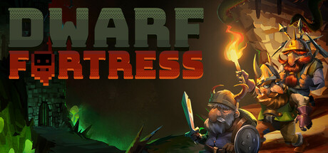
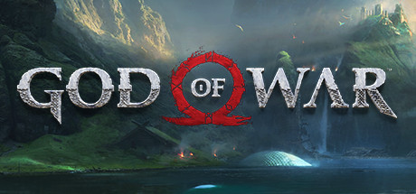

# 2022 in Video Games

[← Back to index](../README.md)

12 titles · [source](https://en.wikipedia.org/wiki/2022_in_video_games)

### Chained Echoes

**Platforms:** Windows, Nintendo Switch &nbsp;|&nbsp; **Developer:** Matthias Linda &nbsp;|&nbsp; **Publisher:** Deck13 &nbsp;|&nbsp; **Genre:** Indie, RPG &nbsp;|&nbsp; **Released:** December 8, 2022

> Take up your sword, channel your magic or board your Mech. Chained Echoes is a 16-bit style RPG set in a fantasy world where dragons are as common as piloted mechanical suits.
>
> _Synopsis source: Steam_

[Wikipedia](https://en.wikipedia.org/wiki/Chained_Echoes) · [Steam](https://store.steampowered.com/app/1229240)

---

### Cuphead in the Delicious Last Course

**Platforms:** Xbox One &nbsp;|&nbsp; **Developer:** Studio MDHR &nbsp;|&nbsp; **Publisher:** Studio MDHR &nbsp;|&nbsp; **Released:** June 30, 2022

[Wikipedia](https://en.wikipedia.org/wiki/Cuphead_in_the_Delicious_Last_Course)

---

### Dwarf Fortress

**Platforms:** Windows &nbsp;|&nbsp; **Developer:** Bay 12 Games &nbsp;|&nbsp; **Publisher:** Kitfox Games &nbsp;|&nbsp; **Genre:** Indie, Simulation, Strategy &nbsp;|&nbsp; **Released:** December 6, 2022

> Build a fortress and try to help your dwarves survive against a deeply generated world. Keep your dwarves happy, grow their community and beware of digging too deeply. The deepest, most intricate simulation of a world that's ever been created.
>
> _Synopsis source: Steam_

[Wikipedia](https://en.wikipedia.org/wiki/Dwarf_Fortress) · [Steam](https://store.steampowered.com/app/975370)

---

### Elden Ring

**Platforms:** PlayStation 5, Xbox Series X/S, Windows &nbsp;|&nbsp; **Developer:** FromSoftware &nbsp;|&nbsp; **Publisher:** Bandai Namco Entertainment &nbsp;|&nbsp; **Genre:** Action, RPG &nbsp;|&nbsp; **Released:** February 25, 2022

> THE CRITICALLY ACCLAIMED FANTASY ACTION RPG. Rise, Tarnished, and be guided by grace to brandish the power of the Elden Ring and become an Elden Lord in the Lands Between.
>
> _Synopsis source: Steam_

[Wikipedia](https://en.wikipedia.org/wiki/Elden_Ring) · [Steam](https://store.steampowered.com/app/1245620)

---

### God of War

**Platforms:** Windows &nbsp;|&nbsp; **Developer:** Jetpack Interactive &nbsp;|&nbsp; **Publisher:** Sony Interactive Entertainment &nbsp;|&nbsp; **Genre:** Action, Adventure, RPG &nbsp;|&nbsp; **Released:** January 14, 2022

> His vengeance against the Gods of Olympus years behind him, Kratos now lives as a man in the realm of Norse Gods and monsters. It is in this harsh, unforgiving world that he must fight to survive… and teach his son to do the same.
>
> _Synopsis source: Steam_

[Wikipedia](https://en.wikipedia.org/wiki/God_of_War_(2018_video_game)) · [Steam](https://store.steampowered.com/app/1593500)

---

### God of War Ragnarök

**Platforms:** PlayStation 5 &nbsp;|&nbsp; **Developer:** Santa Monica Studio &nbsp;|&nbsp; **Publisher:** Sony Interactive Entertainment &nbsp;|&nbsp; **Released:** November 9, 2022

[Wikipedia](https://en.wikipedia.org/wiki/God_of_War_Ragnar%C3%B6k)

---

### Persona 5 Royal

**Platforms:** Windows, Nintendo Switch, Xbox Series X/S, PlayStation 5 &nbsp;|&nbsp; **Developer:** Atlus &nbsp;|&nbsp; **Publisher:** Sega &nbsp;|&nbsp; **Genre:** RPG &nbsp;|&nbsp; **Released:** October 21, 2022

> Lead the Phantom Thieves of Hearts in this award winning, stylish turn-based RPG filled with dungeon crawling, party customization, strategic combat, and Persona fusion. Explore Tokyo, build relationships, battle Shadows, and infiltrate the minds of the corrupt to make them change their ways!
>
> _Synopsis source: Steam_

[Wikipedia](https://en.wikipedia.org/wiki/Persona_5_Royal) · [Steam](https://store.steampowered.com/app/1687950)

---

### Portal Companion Collection

**Platforms:** Nintendo Switch &nbsp;|&nbsp; **Developer:** Valve , Nvidia Lightspeed Studios &nbsp;|&nbsp; **Publisher:** Valve &nbsp;|&nbsp; **Released:** June 28, 2022

[Wikipedia](https://en.wikipedia.org/wiki/Portal_Companion_Collection)

---

### Rogue Legacy 2

**Platforms:** Xbox Series X/S &nbsp;|&nbsp; **Developer:** Cellar Door Games &nbsp;|&nbsp; **Publisher:** Cellar Door Games &nbsp;|&nbsp; **Released:** April 28, 2022

[Wikipedia](https://en.wikipedia.org/wiki/Rogue_Legacy_2)

---

### The Legend of Heroes: Trails from Zero

**Platforms:** Windows &nbsp;|&nbsp; **Developer:** Nihon Falcom &nbsp;|&nbsp; **Publisher:** NIS America &nbsp;|&nbsp; **Genre:** RPG &nbsp;|&nbsp; **Released:** September 27, 2022

> When Lloyd Bannings is assigned to Crossbell's Special Support Section, he and his new teammates must prove themselves as they fight to overcome the injustice of a city gripped by corruption.
>
> _Synopsis source: Steam_

[Steam](https://store.steampowered.com/app/1668510)

---

### The Stanley Parable: Ultra Deluxe

**Platforms:** Xbox Series X/S, Windows &nbsp;|&nbsp; **Developer:** Crows Crows Crows &nbsp;|&nbsp; **Publisher:** Crows Crows Crows &nbsp;|&nbsp; **Genre:** Adventure, Casual, Indie &nbsp;|&nbsp; **Released:** April 27, 2022

> The Stanley Parable: Ultra Deluxe is an expanded re-imagining of 2013's The Stanley Parable. You will play as Stanley, and you will not play as Stanley. You will make a choice, and you will become powerless. You are not here to win. The Stanley Parable is a game that plays you.
>
> _Synopsis source: Steam_

[Steam](https://store.steampowered.com/app/1703340)

---

### The Witcher 3: Wild Hunt - Complete Edition

**Platforms:** PlayStation 5 &nbsp;|&nbsp; **Developer:** CD Projekt Red &nbsp;|&nbsp; **Publisher:** CD Projekt &nbsp;|&nbsp; **Released:** December 14, 2022

---
