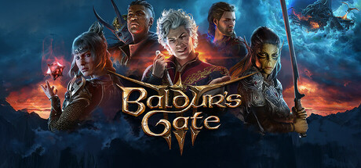

# 2023 in Video Games — July–September

[← All of 2023](../2023.md) · [Back to index](../../README.md)

305 titles.

### 30XX

**Platforms:** Windows, Nintendo Switch &nbsp;|&nbsp; **Developer:** Batterystaple Games &nbsp;|&nbsp; **Publisher:** Batterystaple Games &nbsp;|&nbsp; **Genre:** Roguelike, Action, Platformer &nbsp;|&nbsp; **Released:** August 9

[Wikipedia](https://en.wikipedia.org/wiki/30XX)

---

### A Guidebook of Babel

**Platforms:** Windows, Nintendo Switch &nbsp;|&nbsp; **Developer:** StarryStarry &nbsp;|&nbsp; **Publisher:** StarryStarry &nbsp;|&nbsp; **Genre:** Adventure &nbsp;|&nbsp; **Released:** August 3

---

### Abomi Nation

**Platforms:** Nintendo Switch, Xbox One, Xbox Series X/S &nbsp;|&nbsp; **Developer:** Orange Pylon Games &nbsp;|&nbsp; **Publisher:** DANGEN Entertainment &nbsp;|&nbsp; **Genre:** Monster tamer &nbsp;|&nbsp; **Released:** September 28

---

### Ad Infinitum

**Platforms:** Windows, PlayStation 5, Xbox Series X/S &nbsp;|&nbsp; **Developer:** Hekate &nbsp;|&nbsp; **Publisher:** Nacon &nbsp;|&nbsp; **Genre:** Survival horror &nbsp;|&nbsp; **Released:** September 14

[Wikipedia](https://en.wikipedia.org/wiki/Ad_Infinitum_(video_game))

---

### Adore

**Platforms:** Windows, Nintendo Switch, PlayStation 4, PlayStation 5, Xbox One, Xbox Series X/S &nbsp;|&nbsp; **Developer:** Cadabra Games &nbsp;|&nbsp; **Publisher:** QuByte &nbsp;|&nbsp; **Genre:** Action &nbsp;|&nbsp; **Released:** August 3

---

### Affogato

**Platforms:** Windows &nbsp;|&nbsp; **Developer:** Befun Studio &nbsp;|&nbsp; **Publisher:** Spiral Up Games &nbsp;|&nbsp; **Genre:** Tower defense, RPG &nbsp;|&nbsp; **Released:** August 17

---

### Age of Empires IV

**Platforms:** Xbox One, Xbox Series X/S &nbsp;|&nbsp; **Developer:** Relic Entertainment , World's Edge &nbsp;|&nbsp; **Publisher:** Xbox Game Studios &nbsp;|&nbsp; **Genre:** RTS &nbsp;|&nbsp; **Released:** August 22

[Wikipedia](https://en.wikipedia.org/wiki/Age_of_Empires_IV)

---

### AK-xolotl

**Platforms:** Windows, Nintendo Switch, PlayStation 4, PlayStation 5, Xbox One, Xbox Series X/S &nbsp;|&nbsp; **Developer:** 2Awesome Studio &nbsp;|&nbsp; **Publisher:** Playstack &nbsp;|&nbsp; **Genre:** Roguelike, Bullet hell &nbsp;|&nbsp; **Released:** September 14

---

### Akiba's Trip: Undead & Undressed – Director's Cut

**Platforms:** Windows, Nintendo Switch, PlayStation 4 &nbsp;|&nbsp; **Developer:** Acquire &nbsp;|&nbsp; **Publisher:** Acquire &nbsp;|&nbsp; **Genre:** Action-adventure, Brawler &nbsp;|&nbsp; **Released:** August 1

---

### Amatsu Sora ni Saku

**Platforms:** Windows &nbsp;|&nbsp; **Developer:** studio aila &nbsp;|&nbsp; **Publisher:** studio aila &nbsp;|&nbsp; **Genre:** Visual novel &nbsp;|&nbsp; **Released:** September 9 (JP)

---

### Anno: Mutationem

**Platforms:** Xbox One, Xbox Series X/S &nbsp;|&nbsp; **Developer:** ThinkingStars &nbsp;|&nbsp; **Publisher:** Lightning Games &nbsp;|&nbsp; **Genre:** Action-adventure &nbsp;|&nbsp; **Released:** September 22

---

### Anonymous;Code

**Platforms:** Windows, Nintendo Switch, PlayStation 4 &nbsp;|&nbsp; **Developer:** Mages &nbsp;|&nbsp; **Publisher:** Spike Chunsoft &nbsp;|&nbsp; **Genre:** Visual novel &nbsp;|&nbsp; **Released:** September 8

[Wikipedia](https://en.wikipedia.org/wiki/Anonymous;Code)

---

### Another Crusade

**Platforms:** Windows, Nintendo Switch, PlayStation 4, PlayStation 5, Xbox One, Xbox Series X/S &nbsp;|&nbsp; **Developer:** Dragon Vein Studios &nbsp;|&nbsp; **Publisher:** Limited Run Games &nbsp;|&nbsp; **Genre:** RPG &nbsp;|&nbsp; **Released:** September 15

---

### Arcadian Atlas

**Platforms:** Windows &nbsp;|&nbsp; **Developer:** Twin Otter Studios &nbsp;|&nbsp; **Publisher:** Serenity Forge &nbsp;|&nbsp; **Genre:** Tactical RPG &nbsp;|&nbsp; **Released:** July 27

[Wikipedia](https://en.wikipedia.org/wiki/Arcadian_Atlas)

---

### Armored Core VI: Fires of Rubicon

**Platforms:** Windows, PlayStation 4, PlayStation 5, Xbox One, Xbox Series X/S &nbsp;|&nbsp; **Developer:** FromSoftware &nbsp;|&nbsp; **Publisher:** Bandai Namco Entertainment &nbsp;|&nbsp; **Genre:** Action-adventure, Simulation &nbsp;|&nbsp; **Released:** August 25

> By combining FromSoftware’s longstanding expertise in mech games and their signature robust gameplay, Armored Core VI: Fires of Rubicon will be a new action experience.
>
> _Synopsis source: IGDB_

[IGDB](https://www.igdb.com/games/armored-core-vi-fires-of-rubicon)

---

### Astrea: Six-Sided Oracles

**Platforms:** Windows &nbsp;|&nbsp; **Developer:** Little Leo Games &nbsp;|&nbsp; **Publisher:** Akupara Games &nbsp;|&nbsp; **Genre:** Deck building (roguelike) &nbsp;|&nbsp; **Released:** September 21

---

### Atelier Marie: The Alchemist of Salburg – Remake

**Platforms:** Windows, Nintendo Switch, PlayStation 4, PlayStation 5 &nbsp;|&nbsp; **Developer:** Gust &nbsp;|&nbsp; **Publisher:** Koei Tecmo &nbsp;|&nbsp; **Genre:** RPG &nbsp;|&nbsp; **Released:** July 13

---

### Atelier Resleriana: Forgotten Alchemy and the Polar Night Liberator

**Platforms:** iOS, Android &nbsp;|&nbsp; **Developer:** Gust &nbsp;|&nbsp; **Publisher:** Koei Tecmo , Akatsuki Games &nbsp;|&nbsp; **Genre:** RPG &nbsp;|&nbsp; **Released:** September 23 (JP)

---

### Atlas Fallen

**Platforms:** Windows, PlayStation 5, Xbox Series X/S &nbsp;|&nbsp; **Developer:** Deck13 Interactive &nbsp;|&nbsp; **Publisher:** Focus Entertainment &nbsp;|&nbsp; **Genre:** Action RPG &nbsp;|&nbsp; **Released:** August 10

> Rise from the dust and glide the sands of a timeless land, filled with ancient dangers, mysteries and fragments of the past. Hunt legendary monsters with powerful sand-infused weapons and abilities in spectacular, super-powered combat.
>
> _Synopsis source: IGDB_

[Wikipedia](https://en.wikipedia.org/wiki/Atlas_Fallen) · [IGDB](https://www.igdb.com/games/atlas-fallen)

---

### Avatar: The Last Airbender – Quest for Balance

**Platforms:** Windows, Nintendo Switch, PlayStation 4, PlayStation 5, Xbox One, Xbox Series X/S &nbsp;|&nbsp; **Developer:** Bamtang Games &nbsp;|&nbsp; **Publisher:** GameMill Entertainment &nbsp;|&nbsp; **Genre:** Action-adventure &nbsp;|&nbsp; **Released:** September 22

---

### Axiom Verge 2

**Platforms:** Xbox One &nbsp;|&nbsp; **Developer:** Thomas Happ Games &nbsp;|&nbsp; **Publisher:** Thomas Happ Games &nbsp;|&nbsp; **Genre:** Metroidvania &nbsp;|&nbsp; **Released:** July 11

[Wikipedia](https://en.wikipedia.org/wiki/Axiom_Verge_2)

---

### Baldur's Gate 3

**Platforms:** macOS, PlayStation 5, Windows, Xbox Series X/S &nbsp;|&nbsp; **Developer:** Larian Studios &nbsp;|&nbsp; **Publisher:** Larian Studios &nbsp;|&nbsp; **Genre:** RPG &nbsp;|&nbsp; **Released:** August 3, 2023

> Baldur’s Gate 3 is a story-rich, party-based RPG set in the universe of Dungeons &amp; Dragons, where your choices shape a tale of fellowship and betrayal, survival and sacrifice, and the lure of absolute power.
>
> _Synopsis source: Steam_

[Wikipedia](https://en.wikipedia.org/wiki/Baldur%27s_Gate_3) · [Steam](https://store.steampowered.com/app/1086940)

---

### Baldur's Gate III

**Platforms:** macOS, PlayStation 5, Xbox Series X/S, Windows &nbsp;|&nbsp; **Developer:** Larian Studios &nbsp;|&nbsp; **Publisher:** Larian Studios &nbsp;|&nbsp; **Genre:** Role-playing (RPG), Strategy, Turn-based strategy (TBS), Adventure &nbsp;|&nbsp; **Released:** August 3, 2023

> An ancient evil has returned to Baldur's Gate, intent on devouring it from the inside out. The fate of Faerun lies in your hands. Alone, you may resist. But together, you can overcome.
>
> _Synopsis source: IGDB_

[IGDB](https://www.igdb.com/games/baldurs-gate-iii)

---

### Banchou Tactics

**Platforms:** Windows &nbsp;|&nbsp; **Developer:** Secret Character, Itsaraamata &nbsp;|&nbsp; **Publisher:** Flyhigh Works &nbsp;|&nbsp; **Genre:** Tactical RPG &nbsp;|&nbsp; **Released:** August 10

---

### Baten Kaitos I & II HD Remaster

**Platforms:** Nintendo Switch &nbsp;|&nbsp; **Developer:** Monolith Soft &nbsp;|&nbsp; **Publisher:** Bandai Namco Entertainment &nbsp;|&nbsp; **Genre:** RPG &nbsp;|&nbsp; **Released:** September 14

[Wikipedia](https://en.wikipedia.org/wiki/Baten_Kaitos_I_%26_II_HD_Remaster)

---

### Bit.Trip Rerunner

**Platforms:** Windows &nbsp;|&nbsp; **Developer:** Choice Provisions &nbsp;|&nbsp; **Publisher:** Choice Provisions &nbsp;|&nbsp; **Genre:** Rhythm, Platformer &nbsp;|&nbsp; **Released:** September 19

[Wikipedia](https://en.wikipedia.org/wiki/Bit.Trip_Rerunner)

---

### Black Skylands

**Platforms:** Windows, Nintendo Switch, PlayStation 4, PlayStation 5, Xbox One, Xbox Series X/S &nbsp;|&nbsp; **Developer:** Hungry Couch &nbsp;|&nbsp; **Publisher:** tinyBuild &nbsp;|&nbsp; **Genre:** Action-adventure &nbsp;|&nbsp; **Released:** August 15

[Wikipedia](https://en.wikipedia.org/wiki/Black_Skylands)

---

### Blasphemous 2

**Platforms:** Windows, Nintendo Switch, PlayStation 5, Xbox Series X/S, PlayStation 4, Xbox One &nbsp;|&nbsp; **Developer:** The Game Kitchen &nbsp;|&nbsp; **Publisher:** Team17 &nbsp;|&nbsp; **Genre:** Metroidvania &nbsp;|&nbsp; **Released:** August 24

[Wikipedia](https://en.wikipedia.org/wiki/Blasphemous_2)

---

### Blasphemous II

**Platforms:** Nintendo Switch, Xbox One, Windows, PlayStation 5, Xbox Series X/S, PlayStation 4 &nbsp;|&nbsp; **Developer:** The Game Kitchen &nbsp;|&nbsp; **Publisher:** Team17 &nbsp;|&nbsp; **Genre:** Platform, Role-playing (RPG), Hack and slash/Beat 'em up, Adventure, Indie &nbsp;|&nbsp; **Released:** August 24, 2023

> The Penitent One awakens as Blasphemous 2 joins him once again in an endless struggle against The Miracle. Dive into a perilous new world filled with mysteries and secrets to discover, and tear your way through monstrous foes that stand between you and your quest to end the cycle one and for all.
>
> _Synopsis source: IGDB_

[IGDB](https://www.igdb.com/games/blasphemous-ii)

---

### Blood Strike

**Platforms:** Android, iOS, Windows &nbsp;|&nbsp; **Developer:** NetEase Games &nbsp;|&nbsp; **Publisher:** NetEase Games &nbsp;|&nbsp; **Genre:** Shooter, Strategy, Adventure &nbsp;|&nbsp; **Released:** September 15, 2023

> Charge into fast paced combat in modes such as Battle Royale, Squad Fight or Hot Zone alone or with friends. Blood Strike offers a wide range of playable Strikers, each with a unique active and passive ability letting you deploy drones, shield walls and everything in between. Customize your weapons to your liking and get ready to prove that you have what it takes to come out on top!
>
> _Synopsis source: IGDB_

[IGDB](https://www.igdb.com/games/blood-strike--2)

---

### Bokura

**Platforms:** Windows, Nintendo Switch, iOS, Android &nbsp;|&nbsp; **Developer:** Tokoronyori &nbsp;|&nbsp; **Publisher:** Kodansha &nbsp;|&nbsp; **Genre:** Puzzle, Adventure &nbsp;|&nbsp; **Released:** August 10

---

### Bomb Rush Cyberfunk

**Platforms:** Windows, Nintendo Switch, PlayStation 4, PlayStation 5, Xbox One, Xbox Series X/S &nbsp;|&nbsp; **Developer:** Team Reptile &nbsp;|&nbsp; **Publisher:** Team Reptile &nbsp;|&nbsp; **Genre:** Action, Platformer &nbsp;|&nbsp; **Released:** August 18

> Bomb Rush Cyberfunk, an indie action-adventure platformer, features 1 second per second of highly advanced funkstyle. In a world where self-styled crews are equipped with personal boostpacks, new heights of graffiti are reached. Start your own cypher and dance, paint, trick, face off with the cops and stake your claim to the extrusions and cavities of a sprawling metropolis in an alternate future.
>
> _Synopsis source: IGDB_

[Wikipedia](https://en.wikipedia.org/wiki/Bomb_Rush_Cyberfunk) · [IGDB](https://www.igdb.com/games/bomb-rush-cyberfunk)

---

### Book of Hours

**Platforms:** Linux, macOS, Windows &nbsp;|&nbsp; **Developer:** Weather Factory &nbsp;|&nbsp; **Publisher:** Weather Factory &nbsp;|&nbsp; **Genre:** Indie, RPG, Simulation &nbsp;|&nbsp; **Released:** August 17, 2023

> Book of Hours is an elegant, melancholy, combat-free RPG set in an occult library, from the makers of BAFTA-nominated Cultist Simulator and the creator of Fallen London and Sunless Sea.
>
> _Synopsis source: IGDB_

[Wikipedia](https://en.wikipedia.org/wiki/Book_of_Hours_(video_game)) · [IGDB](https://www.igdb.com/games/book-of-hours)

---

### Borderlands Collection: Pandora's Box

**Platforms:** Windows, PlayStation 4, PlayStation 5, Xbox One, Xbox Series X/S &nbsp;|&nbsp; **Developer:** Gearbox Software &nbsp;|&nbsp; **Publisher:** 2K &nbsp;|&nbsp; **Genre:** — N/a &nbsp;|&nbsp; **Released:** September 1

[Wikipedia](https://en.wikipedia.org/wiki/Borderlands_(series))

---

### Bugsnax

**Platforms:** iOS &nbsp;|&nbsp; **Developer:** Young Horses &nbsp;|&nbsp; **Publisher:** Young Horses &nbsp;|&nbsp; **Genre:** Adventure &nbsp;|&nbsp; **Released:** July 12

[Wikipedia](https://en.wikipedia.org/wiki/Bugsnax)

---

### Call of the Wild: The Angler

**Platforms:** PlayStation 4, PlayStation 5, Xbox One, Xbox Series X/S &nbsp;|&nbsp; **Developer:** Expansive Worlds &nbsp;|&nbsp; **Publisher:** Expansive Worlds &nbsp;|&nbsp; **Genre:** Simulation &nbsp;|&nbsp; **Released:** August 30

---

### Chants of Sennaar

**Platforms:** Windows, Nintendo Switch, PlayStation 4, PlayStation 5 &nbsp;|&nbsp; **Developer:** Rundisc &nbsp;|&nbsp; **Publisher:** Focus Entertainment &nbsp;|&nbsp; **Genre:** Puzzle, Adventure &nbsp;|&nbsp; **Released:** September 5

> In this game of adventure and enigmas where ancient languages are both the lock and the key, travel the endless steps of a prodigious labyrinth, multiply unexpected encounters and unveil the mysteries of a fantastic world inspired by the myth of Babel.
>
> _Synopsis source: IGDB_

[Wikipedia](https://en.wikipedia.org/wiki/Chants_of_Sennaar) · [IGDB](https://www.igdb.com/games/chants-of-sennaar)

---

### Cocoon

**Platforms:** Windows, Nintendo Switch, PlayStation 4, PlayStation 5, Xbox One, Xbox Series X/S &nbsp;|&nbsp; **Developer:** Geometric Interactive &nbsp;|&nbsp; **Publisher:** Annapurna Interactive &nbsp;|&nbsp; **Genre:** Puzzle, Adventure &nbsp;|&nbsp; **Released:** September 29

> Cocoon is a puzzle adventure game developed by Geometric Interactive and published by Annapurna Interactive. Players control a small insect-like creature navigating interconnected worlds contained within orbs, solving environmental puzzles by carrying and using these orbs to manipulate space and progression.
>
> _Synopsis source: IGDB_

[Wikipedia](https://en.wikipedia.org/wiki/Cocoon_(video_game)) · [IGDB](https://www.igdb.com/games/cocoon)

---

### Counter-Strike 2

**Platforms:** Windows &nbsp;|&nbsp; **Developer:** Valve &nbsp;|&nbsp; **Publisher:** Valve &nbsp;|&nbsp; **Genre:** FPS &nbsp;|&nbsp; **Released:** September 27

> Counter-Strike 2 is a free-to-play multiplayer tactical first-person shooter developed and published by Valve. Released in September 2023, it is the fifth main entry in the Counter-Strike series and serves as a direct replacement for Counter-Strike: Global Offensive on Steam. Two teams, Terrorists and Counter-Terrorists, compete in objective-based rounds across modes such as bomb defusal and hostage rescue. Built on the Source 2 engine, the game introduced volumetric smoke physics, revised weapon handling, and a new sub-tick server architecture. It inherited all cosmetic items from its predecessor and features both a map-specific Competitive mode and a numerically ranked Premier mode.
>
> _Synopsis source: IGDB_

[Wikipedia](https://en.wikipedia.org/wiki/Counter-Strike_2) · [IGDB](https://www.igdb.com/games/counter-strike-2)

---

### Cross Tails

**Platforms:** Windows, Nintendo Switch, PlayStation 4, PlayStation 5, Xbox One, Xbox Series X/S &nbsp;|&nbsp; **Developer:** RideonJapan &nbsp;|&nbsp; **Publisher:** Kemco &nbsp;|&nbsp; **Genre:** Strategy, RPG &nbsp;|&nbsp; **Released:** July 20

---

### Crossfire: Sierra Squad

**Platforms:** Windows, PlayStation 5 &nbsp;|&nbsp; **Developer:** Smilegate &nbsp;|&nbsp; **Publisher:** Smilegate &nbsp;|&nbsp; **Genre:** FPS &nbsp;|&nbsp; **Released:** August 29

[Wikipedia](https://en.wikipedia.org/wiki/CrossfireX)

---

### Crymachina

**Platforms:** Nintendo Switch, PlayStation 4, PlayStation 5, Windows &nbsp;|&nbsp; **Developer:** Aquria &nbsp;|&nbsp; **Publisher:** FuRyu &nbsp;|&nbsp; **Genre:** Action RPG &nbsp;|&nbsp; **Released:** July 27 (JP/NA/EU)

---

### Cut the Rope Daily

**Platforms:** iOS, Android &nbsp;|&nbsp; **Developer:** ZeptoLab &nbsp;|&nbsp; **Publisher:** Netflix Games &nbsp;|&nbsp; **Genre:** Simulation &nbsp;|&nbsp; **Released:** August 1

[Wikipedia](https://en.wikipedia.org/wiki/Cut_the_Rope)

---

### Cyber Citizen Shockman 2: A New Menace

**Platforms:** Windows, Nintendo Switch, PlayStation 4, PlayStation 5, Xbox One, Xbox Series X/S &nbsp;|&nbsp; **Developer:** Masaya Games, Shinyuden &nbsp;|&nbsp; **Publisher:** Ratalaika Games &nbsp;|&nbsp; **Genre:** Action, Platformer &nbsp;|&nbsp; **Released:** September 22

---

### Cyberpunk 2077: Phantom Liberty

**Platforms:** PlayStation 5, Windows, Xbox Series X/S &nbsp;|&nbsp; **Developer:** CD Projekt Red &nbsp;|&nbsp; **Publisher:** CD Projekt &nbsp;|&nbsp; **Genre:** Action role-playing &nbsp;|&nbsp; **Released:** September 26, 2023

[Wikipedia](https://en.wikipedia.org/wiki/Cyberpunk_2077:_Phantom_Liberty)

---

### D.C. III P.S. ~Da Capo III~ Plus Story

**Platforms:** Nintendo Switch, PlayStation 4 &nbsp;|&nbsp; **Developer:** Circus &nbsp;|&nbsp; **Publisher:** Entergram &nbsp;|&nbsp; **Genre:** Visual novel &nbsp;|&nbsp; **Released:** August 24

[Wikipedia](https://en.wikipedia.org/wiki/Da_Capo_III)

---

### Dark and Darker

**Platforms:** Windows &nbsp;|&nbsp; **Developer:** IRONMACE &nbsp;|&nbsp; **Publisher:** IRONMACE &nbsp;|&nbsp; **Genre:** Shooter, Role-playing (RPG), Tactical, Adventure &nbsp;|&nbsp; **Released:** August 7, 2023

> An unforgiving hardcore fantasy FPS dungeon PvPvE adventure. Band together with your friends and use your courage, wits, and cunning to uncover mythical treasures, defeat gruesome monsters, while staying one step ahead of the other devious treasure-hunters.
>
> _Synopsis source: IGDB_

[IGDB](https://www.igdb.com/games/dark-and-darker)

---

### Daymare: 1994 Sandcastle

**Platforms:** Windows, PlayStation 4, PlayStation 5, Xbox One, Xbox Series X/S &nbsp;|&nbsp; **Developer:** Invader Studios &nbsp;|&nbsp; **Publisher:** Leonardo Interactive &nbsp;|&nbsp; **Genre:** Survival horror &nbsp;|&nbsp; **Released:** August 30

---

### Dead Cells

**Platforms:** PlayStation 5 &nbsp;|&nbsp; **Developer:** Motion Twin , Evil Empire &nbsp;|&nbsp; **Publisher:** Motion Twin &nbsp;|&nbsp; **Genre:** Metroidvania &nbsp;|&nbsp; **Released:** August 11

[Wikipedia](https://en.wikipedia.org/wiki/Dead_Cells)

---

### Deathbulge: Battle of the Bands

**Platforms:** Windows, macOS, Linux &nbsp;|&nbsp; **Developer:** Deathbulge, Five Houses LLC &nbsp;|&nbsp; **Publisher:** Deathbulge, Five Houses LLC &nbsp;|&nbsp; **Genre:** RPG &nbsp;|&nbsp; **Released:** August 8

---

### Deceit 2

**Platforms:** Windows, PlayStation 5, Xbox Series X/S &nbsp;|&nbsp; **Developer:** World Makers &nbsp;|&nbsp; **Publisher:** World Makers &nbsp;|&nbsp; **Genre:** Social deduction, Horror, Survival &nbsp;|&nbsp; **Released:** September 14, 2023

> Deceit 2 is an online social deduction horror game. Inspire fear as the Terror, play detective as the Innocent, or create mayhem as the Cursed. Trapped with friends and strangers: who can you trust to help you escape?
>
> _Synopsis source: IGDB_

[Wikipedia](https://en.wikipedia.org/wiki/Deceit_2) · [IGDB](https://www.igdb.com/games/deceit-2)

---

### Disney Illusion Island

**Platforms:** Nintendo Switch &nbsp;|&nbsp; **Developer:** Dlala Studios &nbsp;|&nbsp; **Publisher:** Disney Interactive &nbsp;|&nbsp; **Genre:** Platformer &nbsp;|&nbsp; **Released:** July 28

[Wikipedia](https://en.wikipedia.org/wiki/Disney_Illusion_Island)

---

### Disney Speedstorm

**Platforms:** Windows, Nintendo Switch, PlayStation 4, PlayStation 5, Xbox One, Xbox Series X/S &nbsp;|&nbsp; **Developer:** Gameloft Barcelona &nbsp;|&nbsp; **Publisher:** Gameloft &nbsp;|&nbsp; **Genre:** Racing &nbsp;|&nbsp; **Released:** September 28

> Drift into the ultimate hero-based combat racing game, set on high-speed circuits inspired by Disney and Pixar worlds. Master each character’s unique skills on the racetrack and claim victory in this thrilling arcade racing experience.
>
> _Synopsis source: IGDB_

[Wikipedia](https://en.wikipedia.org/wiki/Disney_Speedstorm) · [IGDB](https://www.igdb.com/games/disney-speedstorm)

---

### Dolphin Spirit: Ocean Mission

**Platforms:** Windows, Nintendo Switch, PlayStation 4, PlayStation 5, Xbox One, Xbox Series X/S &nbsp;|&nbsp; **Developer:** Magic Pockets &nbsp;|&nbsp; **Publisher:** Microids &nbsp;|&nbsp; **Genre:** Adventure &nbsp;|&nbsp; **Released:** September 28

---

### Double Dragon Gaiden: Rise of the Dragons

**Platforms:** Windows, Nintendo Switch, PlayStation 4, PlayStation 5, Xbox One, Xbox Series X/S &nbsp;|&nbsp; **Developer:** Secret Base &nbsp;|&nbsp; **Publisher:** Modus Games &nbsp;|&nbsp; **Genre:** Brawler &nbsp;|&nbsp; **Released:** July 27

[Wikipedia](https://en.wikipedia.org/wiki/Double_Dragon#Game_series)

---

### Downtown Nekketsu March: Super-Awesome Field Day!

**Platforms:** Nintendo Switch &nbsp;|&nbsp; **Genre:** Action, Sports &nbsp;|&nbsp; **Released:** September 6

[Wikipedia](https://en.wikipedia.org/wiki/River_City_(video_game_series))

---

### Dragon Quest Treasures

**Platforms:** Windows &nbsp;|&nbsp; **Developer:** Tose &nbsp;|&nbsp; **Publisher:** Square Enix &nbsp;|&nbsp; **Genre:** Action RPG &nbsp;|&nbsp; **Released:** July 14

[Wikipedia](https://en.wikipedia.org/wiki/Dragon_Quest_Treasures)

---

### Dragonheir: Silent Gods

**Platforms:** macOS, Windows, Android, iOS &nbsp;|&nbsp; **Developer:** SGRA Studio &nbsp;|&nbsp; **Publisher:** Proxima Beta, Nuverse Games &nbsp;|&nbsp; **Genre:** Role-playing (RPG), Strategy, Adventure &nbsp;|&nbsp; **Released:** September 19, 2023

> Authentic Dungeon Adventurous RPG Strategy Game  Dragonheir: Silent Gods is an open-world RPG that puts you in control of over 200 heroes. In this game, you'll experience strategic combat like never before, where every move counts and every decision could be the difference between victory and defeat. The multiverse concept allows you to travel through different worlds, exploring endless wonders and surprises.
>
> _Synopsis source: IGDB_

[IGDB](https://www.igdb.com/games/dragonheir-silent-gods)

---

### Dune: Spice Wars

**Platforms:** Windows &nbsp;|&nbsp; **Developer:** Shiro Games &nbsp;|&nbsp; **Publisher:** Funcom &nbsp;|&nbsp; **Genre:** RTS &nbsp;|&nbsp; **Released:** September 14

> Dune: Spice Wars is a real-time strategy game with 4X elements, from the developers of the critically acclaimed Northgard. Set in Frank Herbert’s groundbreaking Dune universe, you must lead your faction and battle for control and dominance over the harsh desert planet of Arrakis. Best your opponents through political intrigue, crush them in combat, and undermine them with your network of illusive spies.
>
> _Synopsis source: IGDB_

[IGDB](https://www.igdb.com/games/dune-spice-wars)

---

### Dyschronia: Chronos Alternate Episode III

**Platforms:** PlayStation 5, Meta Quest &nbsp;|&nbsp; **Developer:** IzanagiGames, MyDearest &nbsp;|&nbsp; **Publisher:** IzanagiGames, MyDearest &nbsp;|&nbsp; **Genre:** Adventure &nbsp;|&nbsp; **Released:** July 13

---

### EA Sports FC 24

**Platforms:** Windows, Nintendo Switch, PlayStation 4, PlayStation 5, Xbox One, Xbox Series X/S &nbsp;|&nbsp; **Developer:** EA Vancouver , EA Romania &nbsp;|&nbsp; **Publisher:** EA Sports &nbsp;|&nbsp; **Genre:** Sports &nbsp;|&nbsp; **Released:** September 29

> EA Sports FC 24 is a football simulation game and the first entry in the series following the rebranding from the FIFA name. It features licensed leagues and competitions including the Premier League, UEFA Champions League, La Liga, Bundesliga, Serie A, and several women's football leagues. Game modes include Ultimate Team, Career Mode, and online multiplayer. The game uses the Frostbite engine with updated motion capture and ball physics for realistic on-pitch action.
>
> _Synopsis source: IGDB_

[Wikipedia](https://en.wikipedia.org/wiki/EA_Sports_FC_24) · [IGDB](https://www.igdb.com/games/ea-sports-fc-24)

---

### Ed-0: Zombie Uprising

**Platforms:** Windows, PlayStation 5, Xbox Series X/S &nbsp;|&nbsp; **Developer:** Lancarse &nbsp;|&nbsp; **Publisher:** D3 Publisher &nbsp;|&nbsp; **Genre:** Roguelike &nbsp;|&nbsp; **Released:** July 13

---

### eFootball 2024

**Platforms:** PlayStation 5, Android, PlayStation 4, Xbox One, Xbox Series X/S, Windows, iOS &nbsp;|&nbsp; **Developer:** Konami Digital Entertainment &nbsp;|&nbsp; **Publisher:** Konami &nbsp;|&nbsp; **Genre:** Simulator, Sport &nbsp;|&nbsp; **Released:** September 7, 2023

> eFootball 2024 is a football simulation game developed and published by Konami as part of their ongoing eFootball series. Released in September 2023, it is an update to eFootball 2023 rather than a completely new title, continuing the free-to-play model introduced with the previous instalments.  The game features updated team rosters, enhanced graphics, and refined gameplay mechanics.
>
> _Synopsis source: IGDB_

[IGDB](https://www.igdb.com/games/efootball-2024)

---

### El Paso, Elsewhere

**Platforms:** Windows, Xbox One, Xbox Series X/S &nbsp;|&nbsp; **Developer:** Strange Scaffold &nbsp;|&nbsp; **Publisher:** Strange Scaffold &nbsp;|&nbsp; **Genre:** TPS &nbsp;|&nbsp; **Released:** September 26

[Wikipedia](https://en.wikipedia.org/wiki/El_Paso,_Elsewhere)

---

### Ember Knights

**Platforms:** Nintendo Switch &nbsp;|&nbsp; **Developer:** Doom Turtle &nbsp;|&nbsp; **Publisher:** Twin Sails Interactive &nbsp;|&nbsp; **Genre:** Roguelike &nbsp;|&nbsp; **Released:** July 18

---

### En Garde

**Platforms:** Windows &nbsp;|&nbsp; **Developer:** Fireplace Games &nbsp;|&nbsp; **Publisher:** Fireplace Games &nbsp;|&nbsp; **Genre:** Action &nbsp;|&nbsp; **Released:** August 16

> En Garde! is a swashbuckler action game! Battle graceless guards and nefarious noblemen in fast-paced fights full of spectacle. Use the environment, your wit and your blade to teach them all a lesson!
>
> _Synopsis source: IGDB_

[Wikipedia](https://en.wikipedia.org/wiki/En_Garde_(video_game)) · [IGDB](https://www.igdb.com/games/en-garde)

---

### Enchanted Portals

**Platforms:** Windows &nbsp;|&nbsp; **Developer:** Xixo Games Studio &nbsp;|&nbsp; **Publisher:** Xixo Games Studio &nbsp;|&nbsp; **Genre:** Platformer &nbsp;|&nbsp; **Released:** September 5

[Wikipedia](https://en.wikipedia.org/wiki/Enchanted_Portals)

---

### Eternal Return

**Platforms:** Windows &nbsp;|&nbsp; **Developer:** Nimble Neuron &nbsp;|&nbsp; **Publisher:** SapStaR Games, Nimble Neuron &nbsp;|&nbsp; **Genre:** Battle royale &nbsp;|&nbsp; **Released:** July 20, 2023

> Fend for yourself and defeat other survivors in unique and exciting top-down Survival Battle Royale gameplay. Become your favorite character and outlast your opponents by combining your wits and strategy with searching and item crafting to become the ultimate survivor.
>
> _Synopsis source: IGDB_

[Wikipedia](https://en.wikipedia.org/wiki/Eternal_Return_(video_game)) · [IGDB](https://www.igdb.com/games/eternal-return--1)

---

### Eternights

**Platforms:** Windows, PlayStation 5, PlayStation 4 &nbsp;|&nbsp; **Developer:** Studio Sai &nbsp;|&nbsp; **Publisher:** Studio Sai &nbsp;|&nbsp; **Genre:** Hack and slash, Dating sim &nbsp;|&nbsp; **Released:** September 12

[Wikipedia](https://en.wikipedia.org/wiki/Eternights)

---

### Everhood: Eternity Edition

**Platforms:** PlayStation 4, PlayStation 5, Xbox One, Xbox Series X/S &nbsp;|&nbsp; **Developer:** Foreign Gnomes &nbsp;|&nbsp; **Publisher:** Blitworks Games &nbsp;|&nbsp; **Genre:** Adventure, RPG, Rhythm &nbsp;|&nbsp; **Released:** September 28

---

### Excitebike 64

**Platforms:** Nintendo Switch &nbsp;|&nbsp; **Genre:** Racing &nbsp;|&nbsp; **Released:** August 30

[Wikipedia](https://en.wikipedia.org/wiki/Excitebike_64)

---

### Exoprimal

**Platforms:** Windows, PlayStation 4, PlayStation 5, Xbox One, Xbox Series X/S &nbsp;|&nbsp; **Developer:** Capcom &nbsp;|&nbsp; **Publisher:** Capcom &nbsp;|&nbsp; **Genre:** TPS &nbsp;|&nbsp; **Released:** July 14

[Wikipedia](https://en.wikipedia.org/wiki/Exoprimal)

---

### F-Zero 99

**Platforms:** Nintendo Switch &nbsp;|&nbsp; **Developer:** Nintendo Software Technology &nbsp;|&nbsp; **Publisher:** Nintendo &nbsp;|&nbsp; **Genre:** Racing &nbsp;|&nbsp; **Released:** September 14

> A battle royale game featuring tracks from the original F-Zero for Super Nintendo Entertainment System.  Line up with 98 other F-Zero machines and race to the finish in this thrilling take on the original Super NES game. Keep an eye on your power meter as you boost and bash, because speed is just as important as survival. Defend yourself with a Spin Attack and collect Super Sparks to breeze past the competition on the elevated Skyway.  Outpace and outlive your opponents in rotating modes  The core F-Zero 99 mode is just one way to race at breakneck speeds. Mini Prix and Grand Prix modes appear on a set schedule and challenge you to compete and qualify in a series of races. Team Battle and the extra-tough Pro Tracks mode rotate throughout the day. Prepare yourself in Practice Mode and race against your ghost.
>
> _Synopsis source: IGDB_

[Wikipedia](https://en.wikipedia.org/wiki/F-Zero_99) · [IGDB](https://www.igdb.com/games/f-zero-99)

---

### F1 Manager 2023

**Platforms:** Windows, PlayStation 4, PlayStation 5, Xbox One, Xbox Series X/S &nbsp;|&nbsp; **Developer:** Frontier Developments &nbsp;|&nbsp; **Publisher:** Frontier Developments &nbsp;|&nbsp; **Genre:** Business sim &nbsp;|&nbsp; **Released:** July 31

[Wikipedia](https://en.wikipedia.org/wiki/F1_Manager_2023)

---

### Fading Afternoon

**Platforms:** Windows, Nintendo Switch &nbsp;|&nbsp; **Developer:** Yeo &nbsp;|&nbsp; **Publisher:** Yeo, Indie Ark &nbsp;|&nbsp; **Genre:** Beat 'em up &nbsp;|&nbsp; **Released:** September 15, 2023

> Seiji Maruyama is a middle-aged yakuza recently released from prison. Known as "Gozuki" (one of the demon generals from Buddhist mythology) he is the power that his oyabun counts on. But there is one thing his aniki is not taking into account: Maruyama is getting old.
>
> _Synopsis source: IGDB_

[Wikipedia](https://en.wikipedia.org/wiki/Fading_Afternoon) · [IGDB](https://www.igdb.com/games/fading-afternoon)

---

### Fae Farm

**Platforms:** Windows, Nintendo Switch &nbsp;|&nbsp; **Developer:** Phoenix Labs &nbsp;|&nbsp; **Publisher:** Phoenix Labs &nbsp;|&nbsp; **Genre:** Action RPG &nbsp;|&nbsp; **Released:** September 8

> Escape to the fairytale life of your dreams in Fae Farm, a cozy farm-sim RPG for 1-4 players. Craft, cultivate, and decorate to grow your shared homestead—and use spellbinding magic to explore the enchanted island of Azoria.
>
> _Synopsis source: IGDB_

[Wikipedia](https://en.wikipedia.org/wiki/Fae_Farm) · [IGDB](https://www.igdb.com/games/fae-farm)

---

### Fate/Samurai Remnant

**Platforms:** Windows, Nintendo Switch, PlayStation 4, PlayStation 5 &nbsp;|&nbsp; **Developer:** Omega Force , Kou Shibusawa &nbsp;|&nbsp; **Publisher:** Koei Tecmo &nbsp;|&nbsp; **Genre:** Action RPG &nbsp;|&nbsp; **Released:** September 28 (JP)

[Wikipedia](https://en.wikipedia.org/wiki/Fate/Samurai_Remnant)

---

### Final Fantasy VII: Ever Crisis

**Platforms:** iOS, Android, Windows &nbsp;|&nbsp; **Developer:** Applibot &nbsp;|&nbsp; **Publisher:** Square Enix &nbsp;|&nbsp; **Genre:** Action RPG &nbsp;|&nbsp; **Released:** September 7

> Final Fantasy VII: Ever Crisis is a mobile game covering the whole FFVII timeline by splitting each story into short chapters focused on important moments using animated cutscenes, some with conversation options, followed by a battle.  Relive the most memorable moments from FFVII and experience the journey of a young hero Sephiroth.  Experience both classic and new stories within the FFVII universe presented in a retro-style look combined with modern, beautifully rendered graphics, that’s easily accessible on the go. Team up your favorite characters and customize each one with iconic gear and weapons to defeat powerful opponents in Solo or Co-op battle mode.
>
> _Synopsis source: IGDB_

[IGDB](https://www.igdb.com/games/final-fantasy-vii-ever-crisis)

---

### Firewall Ultra

**Platforms:** PlayStation 5 &nbsp;|&nbsp; **Developer:** First Contact Entertainment &nbsp;|&nbsp; **Publisher:** Sony Interactive Entertainment &nbsp;|&nbsp; **Genre:** FPS &nbsp;|&nbsp; **Released:** August 24

[Wikipedia](https://en.wikipedia.org/wiki/Firewall_Ultra)

---

### Flutter Away

**Platforms:** Windows, Nintendo Switch &nbsp;|&nbsp; **Developer:** Runaway Play &nbsp;|&nbsp; **Publisher:** Runaway Play &nbsp;|&nbsp; **Genre:** Adventure &nbsp;|&nbsp; **Released:** August 3

---

### Fort Solis

**Platforms:** Windows, macOS, PlayStation 5 &nbsp;|&nbsp; **Developer:** Fallen Leaf, Black Drakkar Games &nbsp;|&nbsp; **Publisher:** Dear Villagers &nbsp;|&nbsp; **Genre:** Horror, Adventure &nbsp;|&nbsp; **Released:** August 22

> Fort Solis is a single player third person thriller set on the far side of Mars. Engineer Jack Leary responds to a routine alarm. Upon arriving at a dormant Fort Solis he becomes unnerved by the lack of any staff at the base. As the night grows longer events begin to unravel and spiral out of control. The mystery of what Fort Solis was created for starts to appear along with its crew. Can Jack escape with what he has discovered and more importantly, his life?
>
> _Synopsis source: IGDB_

[Wikipedia](https://en.wikipedia.org/wiki/Fort_Solis) · [IGDB](https://www.igdb.com/games/fort-solis)

---

### Fragment's Note 2+

**Platforms:** Nintendo Switch &nbsp;|&nbsp; **Developer:** Ullucus Heaven &nbsp;|&nbsp; **Publisher:** Ullucus Heaven &nbsp;|&nbsp; **Genre:** Visual novel &nbsp;|&nbsp; **Released:** September 21

---

### G-Mode Archives+: Megami Ibunroku Persona: Ikū no Tō-hen

**Platforms:** Nintendo Switch, Windows &nbsp;|&nbsp; **Developer:** Atlus &nbsp;|&nbsp; **Publisher:** G-Mode &nbsp;|&nbsp; **Genre:** Dungeon crawl &nbsp;|&nbsp; **Released:** September 14 (JP)

---

### Gimmick! Special Edition

**Platforms:** Windows, Nintendo Switch, PlayStation 4, Xbox One &nbsp;|&nbsp; **Developer:** Bitwave Games, Sunsoft &nbsp;|&nbsp; **Publisher:** Bitwave Games &nbsp;|&nbsp; **Genre:** Platformer &nbsp;|&nbsp; **Released:** July 6

[Wikipedia](https://en.wikipedia.org/wiki/Gimmick!_Special_Edition)

---

### Gloomhaven

**Platforms:** Nintendo Switch, PlayStation 4, PlayStation 5, Xbox One, Xbox Series X/S &nbsp;|&nbsp; **Developer:** Flaming Fowl Studios, Saber Interactive &nbsp;|&nbsp; **Publisher:** Twin Sails Interactive &nbsp;|&nbsp; **Genre:** Tactical RPG &nbsp;|&nbsp; **Released:** September 18

[Wikipedia](https://en.wikipedia.org/wiki/Gloomhaven_(video_game))

---

### Golf It!

**Platforms:** macOS, Windows &nbsp;|&nbsp; **Developer:** Perfuse Entertainment &nbsp;|&nbsp; **Publisher:** Perfuse Entertainment &nbsp;|&nbsp; **Genre:** Simulator, Sport, Indie &nbsp;|&nbsp; **Released:** July 18, 2023

> Golf It! is a multiplayer Minigolf game with focus on a dynamic, fun and creative multiplayer experience. One of the most exciting features is a Multiplayer Editor, where you can build and play custom maps together with your friends.
>
> _Synopsis source: IGDB_

[IGDB](https://www.igdb.com/games/golf-it)

---

### Goodbye Volcano High

**Platforms:** Windows, PlayStation 4, PlayStation 5 &nbsp;|&nbsp; **Developer:** KO OP &nbsp;|&nbsp; **Publisher:** KO OP &nbsp;|&nbsp; **Genre:** Narrative adventure &nbsp;|&nbsp; **Released:** August 29

[Wikipedia](https://en.wikipedia.org/wiki/Goodbye_Volcano_High)

---

### Gord

**Platforms:** Windows, PlayStation 5, Xbox Series X/S &nbsp;|&nbsp; **Developer:** Covenant.dev &nbsp;|&nbsp; **Publisher:** Team17 &nbsp;|&nbsp; **Genre:** Strategy &nbsp;|&nbsp; **Released:** August 17

[Wikipedia](https://en.wikipedia.org/wiki/Gord_(video_game))

---

### GoreBox

**Platforms:** Android, Linux, Windows &nbsp;|&nbsp; **Developer:** F2Games &nbsp;|&nbsp; **Publisher:** F2Games &nbsp;|&nbsp; **Genre:** Game creation system &nbsp;|&nbsp; **Released:** July 22, 2023

> GoreBox is a chaotic physics-driven sandbox where creativity meets destruction. Use the Reality Crusher to spawn, manipulate, and obliterate anything. Customize, battle with friends, roleplay, or face devious creatures. In this world, your imagination rules—and chaos is your playground!
>
> _Synopsis source: IGDB_

[Wikipedia](https://en.wikipedia.org/wiki/GoreBox) · [IGDB](https://www.igdb.com/games/gorebox)

---

### Gothic Classic

**Platforms:** Nintendo Switch &nbsp;|&nbsp; **Developer:** Piranha Bytes &nbsp;|&nbsp; **Publisher:** THQ Nordic &nbsp;|&nbsp; **Genre:** Action RPG &nbsp;|&nbsp; **Released:** September 28

[Wikipedia](https://en.wikipedia.org/wiki/Gothic_(video_game))

---

### Gourmet Warriors

**Platforms:** Nintendo Switch, PlayStation 4, Xbox One &nbsp;|&nbsp; **Developer:** QUByte Interactive &nbsp;|&nbsp; **Publisher:** QUByte Interactive &nbsp;|&nbsp; **Genre:** Brawler &nbsp;|&nbsp; **Released:** August 31

[Wikipedia](https://en.wikipedia.org/wiki/Gourmet_Warriors)

---

### Gravity Circuit

**Platforms:** Windows, Nintendo Switch, PlayStation 4, PlayStation 5 &nbsp;|&nbsp; **Developer:** Domesticated Ant Games &nbsp;|&nbsp; **Publisher:** PID Games &nbsp;|&nbsp; **Genre:** Action, Platformer &nbsp;|&nbsp; **Released:** July 13

---

### Great Ambition of the SLIMES

**Platforms:** Windows, Nintendo Switch &nbsp;|&nbsp; **Developer:** Altair Works &nbsp;|&nbsp; **Publisher:** Flyhigh Works &nbsp;|&nbsp; **Genre:** Tactical RPG &nbsp;|&nbsp; **Released:** July 26

---

### Gunbrella

**Platforms:** Windows, Nintendo Switch &nbsp;|&nbsp; **Developer:** Doinksoft &nbsp;|&nbsp; **Publisher:** Devolver Digital &nbsp;|&nbsp; **Genre:** Action-adventure, Platformer &nbsp;|&nbsp; **Released:** September 13

[Wikipedia](https://en.wikipedia.org/wiki/Gunbrella)

---

### Gylt

**Platforms:** Windows, PlayStation 4, PlayStation 5, Xbox One, Xbox Series X/S &nbsp;|&nbsp; **Developer:** Tequila Works &nbsp;|&nbsp; **Publisher:** Tequila Works &nbsp;|&nbsp; **Genre:** Survival horror &nbsp;|&nbsp; **Released:** July 6

[Wikipedia](https://en.wikipedia.org/wiki/Gylt)

---

### Hammerwatch 2

**Platforms:** Windows, Nintendo Switch, PlayStation 5 &nbsp;|&nbsp; **Developer:** Crackshell &nbsp;|&nbsp; **Publisher:** Modus Games &nbsp;|&nbsp; **Genre:** Hack and slash, Action RPG &nbsp;|&nbsp; **Released:** August 15

[Wikipedia](https://en.wikipedia.org/wiki/Hammerwatch_2)

---

### Harvest Moon: The Winds of Anthos

**Platforms:** Windows, Nintendo Switch, PlayStation 4, PlayStation 5, Xbox One, Xbox Series X/S &nbsp;|&nbsp; **Developer:** Appci Corporation &nbsp;|&nbsp; **Publisher:** Natsume Inc. &nbsp;|&nbsp; **Genre:** Farming &nbsp;|&nbsp; **Released:** September 26

[Wikipedia](https://en.wikipedia.org/wiki/Harvest_Moon_(2007_video_game_series)#List_of_games)

---

### Hello Engineer

**Platforms:** Windows, Nintendo Switch, PlayStation 4, PlayStation 5, Xbox One, Xbox Series X/S &nbsp;|&nbsp; **Developer:** tinyBuild Riga &nbsp;|&nbsp; **Publisher:** tinyBuild &nbsp;|&nbsp; **Genre:** Sandbox &nbsp;|&nbsp; **Released:** August 17

[Wikipedia](https://en.wikipedia.org/wiki/Hello_Engineer)

---

### Hello Kitty Island Adventure

**Platforms:** iOS, Android &nbsp;|&nbsp; **Developer:** Sunblink &nbsp;|&nbsp; **Publisher:** Sunblink &nbsp;|&nbsp; **Genre:** Life sim &nbsp;|&nbsp; **Released:** July 28

> A cozy life sim/adventure hybrid featuring Hello Kitty and Friends. Create a unique, Sanrio-style original avatar and befriend iconic Sanrio characters like Kuromi, Badtz-Maru, Cinnamoroll, Chococat, and Aggretsuko. Share gifts, complete quests, and take part in island activities to deepen your bonds. Spruce up cabins to attract new visitors from among Hello Kitty’s many friends. Create a stylish wardrobe all your own, solve mysterious puzzles, cook delectable recipes, collect friendly critters, and fish, and explore the island solo or with a friend to unearth the many secrets of a massive in-game world.
>
> _Synopsis source: IGDB_

[Wikipedia](https://en.wikipedia.org/wiki/Hello_Kitty_Island_Adventure) · [IGDB](https://www.igdb.com/games/hello-kitty-island-adventure)

---

### High on Life

**Platforms:** PlayStation 4, PlayStation 5 &nbsp;|&nbsp; **Developer:** Squanch Games &nbsp;|&nbsp; **Publisher:** Squanch Games &nbsp;|&nbsp; **Genre:** FPS &nbsp;|&nbsp; **Released:** July 22

[Wikipedia](https://en.wikipedia.org/wiki/High_on_Life_(video_game))

---

### Horizon Chase 2

**Platforms:** Windows, Nintendo Switch &nbsp;|&nbsp; **Developer:** Aquiris &nbsp;|&nbsp; **Publisher:** Epic Games &nbsp;|&nbsp; **Genre:** Racing &nbsp;|&nbsp; **Released:** September 14

[Wikipedia](https://en.wikipedia.org/wiki/Horizon_Chase_2)

---

### Humankind

**Platforms:** PlayStation 4, PlayStation 5, Xbox One, Xbox Series X/S &nbsp;|&nbsp; **Developer:** Amplitude Studios &nbsp;|&nbsp; **Publisher:** Sega &nbsp;|&nbsp; **Genre:** 4X &nbsp;|&nbsp; **Released:** August 22

[Wikipedia](https://en.wikipedia.org/wiki/Humankind_(video_game))

---

### I Expect You To Die 3: Cog in the Machine

**Platforms:** Meta Quest, Windows &nbsp;|&nbsp; **Developer:** Schell Games &nbsp;|&nbsp; **Publisher:** Schell Games &nbsp;|&nbsp; **Genre:** Action, puzzle &nbsp;|&nbsp; **Released:** August 17, 2023

[Wikipedia](https://en.wikipedia.org/wiki/I_Expect_You_To_Die_3:_Cog_in_the_Machine)

---

### Immortals of Aveum

**Platforms:** Windows, PlayStation 5, Xbox Series X/S &nbsp;|&nbsp; **Developer:** Ascendant Studios &nbsp;|&nbsp; **Publisher:** Electronic Arts &nbsp;|&nbsp; **Genre:** FPS &nbsp;|&nbsp; **Released:** August 22

> From the creative director of Dead Space and multiple Call of Duty campaigns comes Immortals of Aveum, a single-player first-person magic shooter set in an original fantasy universe engulfed in magic, rife with conflict, and on the verge of oblivion.
>
> _Synopsis source: IGDB_

[Wikipedia](https://en.wikipedia.org/wiki/Immortals_of_Aveum) · [IGDB](https://www.igdb.com/games/immortals-of-aveum)

---

### Infinity Strash: Dragon Quest The Adventure of Dai

**Platforms:** Windows, Nintendo Switch, PlayStation 4, PlayStation 5, Xbox Series X/S &nbsp;|&nbsp; **Developer:** Game Studio, Kai Graphics &nbsp;|&nbsp; **Publisher:** Square Enix &nbsp;|&nbsp; **Genre:** Action RPG &nbsp;|&nbsp; **Released:** September 28

---

### Inspector Gadget: Mad Time Party

**Platforms:** Windows, Nintendo Switch, PlayStation 4, PlayStation 5, Xbox One, Xbox Series X/S &nbsp;|&nbsp; **Developer:** Smart Tale Games &nbsp;|&nbsp; **Publisher:** Microids &nbsp;|&nbsp; **Genre:** Adventure &nbsp;|&nbsp; **Released:** September 14

[Wikipedia](https://en.wikipedia.org/wiki/Inspector_Gadget#Video_games)

---

### Invector: Rhythm Galaxy

**Platforms:** Windows &nbsp;|&nbsp; **Developer:** Hello There Games &nbsp;|&nbsp; **Publisher:** Warner Music Group &nbsp;|&nbsp; **Genre:** Rhythm &nbsp;|&nbsp; **Released:** July 14

---

### Iron Danger

**Platforms:** PlayStation 5, Xbox Series X/S &nbsp;|&nbsp; **Developer:** Action Squad Studios &nbsp;|&nbsp; **Publisher:** Daedalic Entertainment &nbsp;|&nbsp; **Genre:** Action RPG &nbsp;|&nbsp; **Released:** August 16

[Wikipedia](https://en.wikipedia.org/wiki/Iron_Danger)

---

### Jagged Alliance 3

**Platforms:** Windows, PlayStation 4, PlayStation 5, Xbox One, Xbox Series X/S &nbsp;|&nbsp; **Developer:** Haemimont Games &nbsp;|&nbsp; **Publisher:** THQ Nordic &nbsp;|&nbsp; **Genre:** Tactical RPG, TBT &nbsp;|&nbsp; **Released:** July 14

> The country of Grand Chien is thrown into chaos when the elected president goes missing and the paramilitary force known as "the Legion" seizes control. Hire mercenaries, meet interesting characters, and fight in tactically deep turn-based combat in this true successor to a beloved franchise.
>
> _Synopsis source: IGDB_

[Wikipedia](https://en.wikipedia.org/wiki/Jagged_Alliance_3) · [IGDB](https://www.igdb.com/games/jagged-alliance-3)

---

### Jeepney Simulator

**Platforms:** Windows &nbsp;|&nbsp; **Developer:** Alvin Vann V. Arapoc, Joshua Renzie A. Bicoy &nbsp;|&nbsp; **Publisher:** Spacezero Interactive &nbsp;|&nbsp; **Genre:** Simulator, Driving game, Indie game &nbsp;|&nbsp; **Released:** July 17, 2023

> Embrace your inner jeepney driver! Pick up passengers, calculate change, and weave through traffic in this Filipino-made driving game. Feed your family, customize your jeepneys, and unlock more rides! Don't forget to bring your towel!
>
> _Synopsis source: IGDB_

[Wikipedia](https://en.wikipedia.org/wiki/Jeepney_Simulator) · [IGDB](https://www.igdb.com/games/jeepney-simulator)

---

### Joy Mech Fight

**Platforms:** Nintendo Switch &nbsp;|&nbsp; **Genre:** Fighting &nbsp;|&nbsp; **Released:** September 6

[Wikipedia](https://en.wikipedia.org/wiki/Joy_Mech_Fight)

---

### Kentucky Route Zero: TV Edition

**Platforms:** PlayStation 5, Xbox Series X/S &nbsp;|&nbsp; **Developer:** Cardboard Computer &nbsp;|&nbsp; **Publisher:** Annapurna Interactive &nbsp;|&nbsp; **Genre:** Adventure &nbsp;|&nbsp; **Released:** August 17

---

### Kill The Crows

**Platforms:** Windows, macOS &nbsp;|&nbsp; **Developer:** 5minlab &nbsp;|&nbsp; **Publisher:** 5minlab &nbsp;|&nbsp; **Genre:** Arena shooter &nbsp;|&nbsp; **Released:** August 21

---

### Killsquad

**Platforms:** PlayStation 4, PlayStation 5 &nbsp;|&nbsp; **Developer:** Novarama &nbsp;|&nbsp; **Publisher:** Novarama &nbsp;|&nbsp; **Genre:** Action RPG &nbsp;|&nbsp; **Released:** July 20

[Wikipedia](https://en.wikipedia.org/wiki/Killsquad)

---

### King's Bounty II

**Platforms:** PlayStation 5, Xbox Series X/S &nbsp;|&nbsp; **Developer:** Fulqrum Games &nbsp;|&nbsp; **Publisher:** Prime Matter &nbsp;|&nbsp; **Genre:** RPG &nbsp;|&nbsp; **Released:** September 7

[Wikipedia](https://en.wikipedia.org/wiki/King%27s_Bounty_II)

---

### Kirby & the Amazing Mirror

**Platforms:** Nintendo Switch &nbsp;|&nbsp; **Genre:** Platformer, Metroidvania &nbsp;|&nbsp; **Released:** September 29

[Wikipedia](https://en.wikipedia.org/wiki/Kirby_%26_the_Amazing_Mirror)

---

### Kirby's Star Stacker (SNES)

**Platforms:** Nintendo Switch &nbsp;|&nbsp; **Genre:** Puzzle &nbsp;|&nbsp; **Released:** September 6

[Wikipedia](https://en.wikipedia.org/wiki/Kirby%27s_Star_Stacker#Kirby_no_Kirakira_Kids)

---

### Koa and the Five Pirates of Mara

**Platforms:** Windows, Nintendo Switch, PlayStation 4, PlayStation 5, Xbox One, Xbox Series X/S &nbsp;|&nbsp; **Developer:** Chibig, Talpa Games, Undercoders &nbsp;|&nbsp; **Publisher:** Chibig &nbsp;|&nbsp; **Genre:** Action-adventure, Platformer &nbsp;|&nbsp; **Released:** July 27

---

### Labyrinthine

**Platforms:** SteamVR, Windows &nbsp;|&nbsp; **Developer:** Valko Game Studios &nbsp;|&nbsp; **Publisher:** Klabater, Valko Game Studios &nbsp;|&nbsp; **Genre:** Puzzle, Adventure, Indie &nbsp;|&nbsp; **Released:** August 18, 2023

> LABYRINTHINE, a first-person, multiplayer cooperative horror game, offers an unforgettable journey into the realm of nightmares. With an emphasis on exploration, puzzle-solving, and atmospheric storytelling, it keeps you on the edge of your seat.  Team up with your friends and navigate through the intricate maze, solve cryptic puzzles, and uncover the maze’s dark secrets while staying one step ahead of the lurking terrors. Cooperative play is at the game’s core; you can play alone, but LABYRINTHINE encourages teamwork and voice communication between up to 8 players to face the darkness.
>
> _Synopsis source: IGDB_

[IGDB](https://www.igdb.com/games/labyrinthine)

---

### Lakeburg Legacies

**Platforms:** Windows &nbsp;|&nbsp; **Developer:** Ishtar Games &nbsp;|&nbsp; **Publisher:** Ishtar Games &nbsp;|&nbsp; **Genre:** Simulation &nbsp;|&nbsp; **Released:** July 20, 2023

> Lakeburg Legacies is a social-based village management sim focused on pairing up your townsfolk to make the best, most effective families in order for your kingdom to grow and thrive.
>
> _Synopsis source: IGDB_

[Wikipedia](https://en.wikipedia.org/wiki/Lakeburg_Legacies) · [IGDB](https://www.igdb.com/games/lakeburg-legacies)

---

### Let's School

**Platforms:** Windows &nbsp;|&nbsp; **Developer:** Pathea Games &nbsp;|&nbsp; **Publisher:** PM Studios &nbsp;|&nbsp; **Genre:** CMS &nbsp;|&nbsp; **Released:** July 27

---

### Lies of P

**Platforms:** Windows, PlayStation 4, PlayStation 5, Xbox One, Xbox Series X/S &nbsp;|&nbsp; **Developer:** Round8 Studio &nbsp;|&nbsp; **Publisher:** Neowiz &nbsp;|&nbsp; **Genre:** Action RPG, Soulslike &nbsp;|&nbsp; **Released:** September 19

> Lies of P is an action role-playing game set in a dark, Belle Époque-inspired city overrun by deadly puppets. Players control Pinocchio, reimagined as a mechanical warrior, navigating a decaying world while making choices that affect the unfolding narrative. The game features challenging melee combat, weapon customization, and a mechanical arm with various abilities.
>
> _Synopsis source: IGDB_

[Wikipedia](https://en.wikipedia.org/wiki/Lies_of_P) · [IGDB](https://www.igdb.com/games/lies-of-p)

---

### Lifeless Moon

**Platforms:** Windows &nbsp;|&nbsp; **Developer:** Stage 2 Studios &nbsp;|&nbsp; **Publisher:** Serenity Forge &nbsp;|&nbsp; **Genre:** Adventure, Puzzle &nbsp;|&nbsp; **Released:** August 10

[Wikipedia](https://en.wikipedia.org/wiki/Lifeless_Moon)

---

### Lisa: Definitive Edition

**Platforms:** Windows, Nintendo Switch, PlayStation 4, PlayStation 5, Xbox One, Xbox Series X/S &nbsp;|&nbsp; **Developer:** Dingaling Productions &nbsp;|&nbsp; **Publisher:** Serenity Forge &nbsp;|&nbsp; **Genre:** RPG &nbsp;|&nbsp; **Released:** July 18

---

### Loaded Lions: Mane City

**Platforms:** Browser &nbsp;|&nbsp; **Publisher:** Loaded Lions &nbsp;|&nbsp; **Genre:** Simulator, Strategy, Tactical &nbsp;|&nbsp; **Released:** August 31, 2023

[IGDB](https://www.igdb.com/games/loaded-lions-mane-city)

---

### Lost Eidolons

**Platforms:** PlayStation 5, Xbox Series X/S &nbsp;|&nbsp; **Developer:** Ocean Drive Studio &nbsp;|&nbsp; **Publisher:** Ocean Drive Studio &nbsp;|&nbsp; **Genre:** Tactical RPG &nbsp;|&nbsp; **Released:** August 24

---

### Lost in Play

**Platforms:** iOS, Android &nbsp;|&nbsp; **Developer:** Happy Juice Games &nbsp;|&nbsp; **Publisher:** Snapbreak Games &nbsp;|&nbsp; **Genre:** Adventure, Puzzle &nbsp;|&nbsp; **Released:** July 12

[Wikipedia](https://en.wikipedia.org/wiki/Lost_in_Play)

---

### Madden NFL 24

**Platforms:** Windows, PlayStation 4, PlayStation 5, Xbox One, Xbox Series X/S &nbsp;|&nbsp; **Developer:** EA Tiburon &nbsp;|&nbsp; **Publisher:** EA Sports &nbsp;|&nbsp; **Genre:** Sports &nbsp;|&nbsp; **Released:** August 18

[Wikipedia](https://en.wikipedia.org/wiki/Madden_NFL_24)

---

### Manic Mechanics

**Platforms:** Nintendo Switch &nbsp;|&nbsp; **Developer:** 4J Studios &nbsp;|&nbsp; **Publisher:** 4J Studios &nbsp;|&nbsp; **Genre:** Action, Party &nbsp;|&nbsp; **Released:** July 13

[Wikipedia](https://en.wikipedia.org/wiki/Manic_Mechanics)

---

### Marble It Up! Ultra

**Platforms:** Windows, Nintendo Switch, PlayStation 4, PlayStation 5, Xbox One, Xbox Series X/S &nbsp;|&nbsp; **Developer:** The Marble Collective &nbsp;|&nbsp; **Publisher:** The Marble Collective &nbsp;|&nbsp; **Genre:** Platformer &nbsp;|&nbsp; **Released:** August 17

[Wikipedia](https://en.wikipedia.org/wiki/Marble_It_Up!_Ultra)

---

### Marvel Snap

**Platforms:** Windows &nbsp;|&nbsp; **Developer:** Second Dinner &nbsp;|&nbsp; **Publisher:** Nuverse &nbsp;|&nbsp; **Genre:** DCCG &nbsp;|&nbsp; **Released:** August 22

[Wikipedia](https://en.wikipedia.org/wiki/Marvel_Snap)

---

### Mary Skelter Finale

**Platforms:** Windows &nbsp;|&nbsp; **Developer:** Compile Heart &nbsp;|&nbsp; **Publisher:** Idea Factory &nbsp;|&nbsp; **Genre:** RPG, Dungeon crawl &nbsp;|&nbsp; **Released:** September 12

[Wikipedia](https://en.wikipedia.org/wiki/Mary_Skelter_Finale)

---

### Mediterranea Inferno

**Platforms:** Windows &nbsp;|&nbsp; **Developer:** Eyeguys &nbsp;|&nbsp; **Publisher:** Santa Ragione &nbsp;|&nbsp; **Genre:** Visual novel &nbsp;|&nbsp; **Released:** August 24

[Wikipedia](https://en.wikipedia.org/wiki/Mediterranea_Inferno)

---

### Mega Man X DiVE Offline

**Platforms:** Windows, iOS, Android &nbsp;|&nbsp; **Developer:** Capcom &nbsp;|&nbsp; **Publisher:** Capcom &nbsp;|&nbsp; **Genre:** Action RPG &nbsp;|&nbsp; **Released:** September 1

[Wikipedia](https://en.wikipedia.org/wiki/Mega_Man_X_DiVE_Offline)

---

### Might & Magic: Clash of Heroes - Definitive Edition

**Platforms:** Windows, Nintendo Switch, PlayStation 4 &nbsp;|&nbsp; **Developer:** Dotemu &nbsp;|&nbsp; **Publisher:** Dotemu &nbsp;|&nbsp; **Genre:** Puzzle, Adventure, RPG &nbsp;|&nbsp; **Released:** July 20

---

### Mineko's Night Market

**Platforms:** Windows, Nintendo Switch, PlayStation 4, PlayStation 5, Xbox One &nbsp;|&nbsp; **Developer:** Meowza Games &nbsp;|&nbsp; **Publisher:** Humble Games &nbsp;|&nbsp; **Genre:** Narrative adventure &nbsp;|&nbsp; **Released:** September 26

[Wikipedia](https://en.wikipedia.org/wiki/Mineko%27s_Night_Market)

---

### Mon-Yu

**Platforms:** Windows, Nintendo Switch, PlayStation 5 &nbsp;|&nbsp; **Developer:** Experience &nbsp;|&nbsp; **Publisher:** Aksys Games &nbsp;|&nbsp; **Genre:** RPG, Dungeon crawl &nbsp;|&nbsp; **Released:** September 21

---

### Monochrome Mobius: Rights and Wrongs Forgotten

**Platforms:** PlayStation 4, PlayStation 5 &nbsp;|&nbsp; **Developer:** Aquaplus , Design Act &nbsp;|&nbsp; **Publisher:** NIS America &nbsp;|&nbsp; **Genre:** RPG &nbsp;|&nbsp; **Released:** September 5

---

### Monochrome Mobius: Rights and Wrongs Forgotten (EU/OC)

**Platforms:** PlayStation 4, PlayStation 5 &nbsp;|&nbsp; **Developer:** Aquaplus , Design Act &nbsp;|&nbsp; **Publisher:** NIS America &nbsp;|&nbsp; **Genre:** RPG &nbsp;|&nbsp; **Released:** September 8

---

### Monster Hunter Now

**Platforms:** iOS, Android &nbsp;|&nbsp; **Developer:** Niantic &nbsp;|&nbsp; **Publisher:** Capcom &nbsp;|&nbsp; **Genre:** Action RPG &nbsp;|&nbsp; **Released:** September 14

[Wikipedia](https://en.wikipedia.org/wiki/Monster_Hunter_Now)

---

### Moonring

**Platforms:** Windows, macOS, Linux, Nintendo Switch &nbsp;|&nbsp; **Developer:** Fluttermind &nbsp;|&nbsp; **Genre:** Role-playing &nbsp;|&nbsp; **Released:** September 28, 2023

> A dark fantasy, turn-based, retro-fusion of classic turn-based RPGs and roguelikes, all presented with a unique neon aesthetic.
>
> _Synopsis source: IGDB_

[Wikipedia](https://en.wikipedia.org/wiki/Moonring) · [IGDB](https://www.igdb.com/games/moonring)

---

### Moonstone Island

**Platforms:** Windows, macOS &nbsp;|&nbsp; **Developer:** Studio Supersoft &nbsp;|&nbsp; **Publisher:** Raw Fury &nbsp;|&nbsp; **Genre:** Life sim, Deck building &nbsp;|&nbsp; **Released:** September 20

[Wikipedia](https://en.wikipedia.org/wiki/Moonstone_Island)

---

### Mordhau

**Platforms:** PlayStation 4, PlayStation 5, Xbox One, Xbox Series X/S &nbsp;|&nbsp; **Developer:** Triternion &nbsp;|&nbsp; **Publisher:** Triternion &nbsp;|&nbsp; **Genre:** Fighting, Hack and slash &nbsp;|&nbsp; **Released:** July 12

[Wikipedia](https://en.wikipedia.org/wiki/Mordhau_(video_game))

---

### Mortal Kombat 1

**Platforms:** Windows, Nintendo Switch, PlayStation 5, Xbox Series X/S &nbsp;|&nbsp; **Developer:** NetherRealm Studios &nbsp;|&nbsp; **Publisher:** Warner Bros. Games &nbsp;|&nbsp; **Genre:** Fighting &nbsp;|&nbsp; **Released:** September 19

> A new era has begun. It's In Our Blood. Discover a reborn Mortal Kombat Universe created by Fire God Liu Kang. Mortal Kombat 1 ushers in a new era of the iconic franchise with a new fighting system, game modes, and Fatalities!
>
> _Synopsis source: IGDB_

[Wikipedia](https://en.wikipedia.org/wiki/Mortal_Kombat_1) · [IGDB](https://www.igdb.com/games/mortal-kombat-1--1)

---

### Moving Out 2

**Platforms:** Windows, Nintendo Switch, PlayStation 4, PlayStation 5, Xbox One, Xbox Series X/S &nbsp;|&nbsp; **Developer:** SMG Studio , DevM Games &nbsp;|&nbsp; **Publisher:** Team17 &nbsp;|&nbsp; **Genre:** Puzzle, Action &nbsp;|&nbsp; **Released:** August 15

[Wikipedia](https://en.wikipedia.org/wiki/Moving_Out_2)

---

### Mr. Run and Jump

**Platforms:** Windows, Nintendo Switch, PlayStation 4, PlayStation 5, Xbox One, Xbox Series X/S, Atari VCS &nbsp;|&nbsp; **Developer:** Graphite Lab &nbsp;|&nbsp; **Publisher:** Atari &nbsp;|&nbsp; **Genre:** Platformer, Action &nbsp;|&nbsp; **Released:** July 25

[Wikipedia](https://en.wikipedia.org/wiki/Mr._Run_and_Jump)

---

### Mugen Souls Z

**Platforms:** Nintendo Switch &nbsp;|&nbsp; **Developer:** Compile Heart &nbsp;|&nbsp; **Publisher:** eastasiasoft &nbsp;|&nbsp; **Genre:** RPG &nbsp;|&nbsp; **Released:** September 14

[Wikipedia](https://en.wikipedia.org/wiki/Mugen_Souls#Sequel)

---

### My Friendly Neighborhood

**Platforms:** Windows &nbsp;|&nbsp; **Developer:** Evan Szymanski, John Szymanski &nbsp;|&nbsp; **Publisher:** DreadXP &nbsp;|&nbsp; **Genre:** Survival horror &nbsp;|&nbsp; **Released:** July 18

[Wikipedia](https://en.wikipedia.org/wiki/My_Friendly_Neighborhood)

---

### My Hero Ultra Rumble

**Platforms:** Windows, Nintendo Switch, PlayStation 4, Xbox One &nbsp;|&nbsp; **Developer:** Byking Inc. &nbsp;|&nbsp; **Publisher:** Bandai Namco Entertainment &nbsp;|&nbsp; **Genre:** Battle royale &nbsp;|&nbsp; **Released:** September 28

> Pick your favorite character, team up and fight to be the last ones standing in the new 24-player Battle Royale free to play game "My Hero Ultra Rumble"!
>
> _Synopsis source: IGDB_

[Wikipedia](https://en.wikipedia.org/wiki/My_Hero_Academia#Console_games) · [IGDB](https://www.igdb.com/games/my-hero-ultra-rumble)

---

### MythForce

**Platforms:** Windows, Nintendo Switch, PlayStation 4, PlayStation 5, Xbox One, Xbox Series X/S &nbsp;|&nbsp; **Developer:** Beamdog &nbsp;|&nbsp; **Publisher:** Aspyr &nbsp;|&nbsp; **Genre:** Action RPG &nbsp;|&nbsp; **Released:** September 12

[Wikipedia](https://en.wikipedia.org/wiki/MythForce)

---

### Naraka: Bladepoint

**Platforms:** PlayStation 5 &nbsp;|&nbsp; **Developer:** 24 Entertainment &nbsp;|&nbsp; **Publisher:** NetEase Games &nbsp;|&nbsp; **Genre:** Action-adventure &nbsp;|&nbsp; **Released:** July 13

---

### NASCAR Arcade Rush

**Platforms:** Windows, Nintendo Switch, PlayStation 4, PlayStation 5, Xbox One, Xbox Series X/S &nbsp;|&nbsp; **Developer:** Team6 Game Studios &nbsp;|&nbsp; **Publisher:** GameMill Entertainment &nbsp;|&nbsp; **Genre:** Racing &nbsp;|&nbsp; **Released:** September 15

[Wikipedia](https://en.wikipedia.org/wiki/NASCAR_Arcade_Rush)

---

### Natsu-Mon! 20th Century Summer Vacation

**Platforms:** Nintendo Switch &nbsp;|&nbsp; **Developer:** Millennium Kitchen , Toybox &nbsp;|&nbsp; **Publisher:** Spike Chunsoft &nbsp;|&nbsp; **Genre:** Adventure &nbsp;|&nbsp; **Released:** July 28 (JP)

[Wikipedia](https://en.wikipedia.org/wiki/Natsu-Mon!_20th_Century_Summer_Vacation)

---

### NBA 2K24

**Platforms:** Windows, Nintendo Switch, PlayStation 4, PlayStation 5, Xbox One, Xbox Series X/S &nbsp;|&nbsp; **Developer:** Visual Concepts &nbsp;|&nbsp; **Publisher:** 2K &nbsp;|&nbsp; **Genre:** Sports &nbsp;|&nbsp; **Released:** September 8

> Grab your squad and experience the past, present, and future of hoops culture in NBA 2K24. Enjoy pure, authentic action and limitless personalized MyPLAYER options in MyCAREER. Collect an impressive array of legends and build your perfect lineup in MyTEAM. Relive your favorite eras as a GM or Commissioner in MyNBA. Experience next-level gameplay and lifelike visuals with your favorite NBA and WNBA teams in play now.
>
> _Synopsis source: IGDB_

[Wikipedia](https://en.wikipedia.org/wiki/NBA_2K24) · [IGDB](https://www.igdb.com/games/nba-2k24)

---

### Necrosmith

**Platforms:** Nintendo Switch, PlayStation 5 &nbsp;|&nbsp; **Developer:** Alawar &nbsp;|&nbsp; **Publisher:** Merge Games &nbsp;|&nbsp; **Genre:** Action, Roguelike &nbsp;|&nbsp; **Released:** July 6

---

### Neptunia Game Maker R:Evolution

**Platforms:** Nintendo Switch, PlayStation 4, PlayStation 5 &nbsp;|&nbsp; **Developer:** Compile Heart &nbsp;|&nbsp; **Publisher:** Compile Heart &nbsp;|&nbsp; **Genre:** RPG &nbsp;|&nbsp; **Released:** August 10 (JP)

---

### New Star GP

**Platforms:** Windows, Nintendo Switch, PlayStation 4, Xbox One, Android, iOS &nbsp;|&nbsp; **Developer:** New Star Games &nbsp;|&nbsp; **Publisher:** Five Aces Publishing &nbsp;|&nbsp; **Genre:** Racing &nbsp;|&nbsp; **Released:** August 8, 2023

> New Star GP is a fast and exciting arcade motorsport game with crisp retro visuals. Play career mode and work your way through decades of racing while upgrading your car and your support team... or chase high scores in championship mode on your own or in split-screen with up to three friends!
>
> _Synopsis source: IGDB_

[Wikipedia](https://en.wikipedia.org/wiki/New_Star_GP) · [IGDB](https://www.igdb.com/games/new-star-gp)

---

### Ninja or Die: Shadow of the Sun

**Platforms:** Windows, Nintendo Switch &nbsp;|&nbsp; **Developer:** Nao Games &nbsp;|&nbsp; **Publisher:** Marvelous &nbsp;|&nbsp; **Genre:** Roguelike &nbsp;|&nbsp; **Released:** August 2

---

### Nobunaga's Ambition: Awakening

**Platforms:** Windows, Nintendo Switch, PlayStation 4 &nbsp;|&nbsp; **Developer:** Koei Tecmo &nbsp;|&nbsp; **Publisher:** Koei Tecmo &nbsp;|&nbsp; **Genre:** TBS &nbsp;|&nbsp; **Released:** July 20

[Wikipedia](https://en.wikipedia.org/wiki/Nobunaga%27s_Ambition)

---

### Norn9 : Last Era

**Platforms:** Nintendo Switch &nbsp;|&nbsp; **Developer:** Regista &nbsp;|&nbsp; **Publisher:** Aksys Games &nbsp;|&nbsp; **Genre:** Visual novel &nbsp;|&nbsp; **Released:** August 24

[Wikipedia](https://en.wikipedia.org/wiki/Norn9)

---

### Nour: Play with Your Food

**Platforms:** Windows, PlayStation 4, PlayStation 5 &nbsp;|&nbsp; **Developer:** Terrifying Jellyfish &nbsp;|&nbsp; **Publisher:** Panic &nbsp;|&nbsp; **Genre:** Art &nbsp;|&nbsp; **Released:** September 12

---

### Nova Strike

**Platforms:** Windows, Nintendo Switch, PlayStation 5, Xbox Series X/S &nbsp;|&nbsp; **Developer:** Sanuk Games &nbsp;|&nbsp; **Publisher:** Nacon &nbsp;|&nbsp; **Genre:** Shoot 'em up &nbsp;|&nbsp; **Released:** July 27

---

### Oaken

**Platforms:** Windows, Nintendo Switch, PlayStation 4, PlayStation 5, Xbox One, Xbox Series X/S &nbsp;|&nbsp; **Developer:** Laki Studios &nbsp;|&nbsp; **Publisher:** Goblinz Publishing, Red Art Games &nbsp;|&nbsp; **Genre:** Deck building (roguelike) &nbsp;|&nbsp; **Released:** July 20

---

### Oceanhorn 2: Knights of the Lost Realm

**Platforms:** Windows, PlayStation 5, Xbox Series X/S &nbsp;|&nbsp; **Developer:** Comfox & Bros &nbsp;|&nbsp; **Publisher:** Fireplace Games &nbsp;|&nbsp; **Genre:** Action RPG &nbsp;|&nbsp; **Released:** August 2

---

### Operation Wolf Returns: First Mission VR

**Platforms:** Windows, PlayStation 5, Meta Quest, PICO 4 &nbsp;|&nbsp; **Developer:** Virtuallyz Gaming &nbsp;|&nbsp; **Publisher:** Microids &nbsp;|&nbsp; **Genre:** Shoot 'em up (rail) &nbsp;|&nbsp; **Released:** July 13

[Wikipedia](https://en.wikipedia.org/wiki/Operation_Wolf)

---

### Ou

**Platforms:** Windows, Nintendo Switch &nbsp;|&nbsp; **Developer:** room6, G-Mode &nbsp;|&nbsp; **Publisher:** G-Mode &nbsp;|&nbsp; **Genre:** Adventure &nbsp;|&nbsp; **Released:** August 31

---

### Overpass 2

**Platforms:** Windows, PlayStation 5, Xbox Series X/S &nbsp;|&nbsp; **Developer:** Neopica &nbsp;|&nbsp; **Publisher:** Nacon &nbsp;|&nbsp; **Genre:** Racing &nbsp;|&nbsp; **Released:** September 28

---

### Overwatch

**Platforms:** Nintendo Switch, PlayStation 4, PlayStation 5, Windows, Xbox One, Xbox Series X/S &nbsp;|&nbsp; **Developer:** Blizzard Entertainment &nbsp;|&nbsp; **Publisher:** Blizzard Entertainment &nbsp;|&nbsp; **Genre:** First-person shooter, Hero shooter &nbsp;|&nbsp; **Released:** August 11, 2023

> Overwatch is a free-to-play first-person hero shooter developed by Blizzard Entertainment. Players choose from a large roster of role-based heroes and compete in 5v5 team matches across various objective-based game modes, with both casual and ranked competitive play. Originally released as Overwatch 2 in 2023 as a successor to the 2016 original, the game was rebranded to simply Overwatch in 2026 with a renewed focus on seasonal narrative content and expanded hero rosters.
>
> _Synopsis source: IGDB_

[Wikipedia](https://en.wikipedia.org/wiki/Overwatch_(2023_video_game)) · [IGDB](https://www.igdb.com/games/overwatch--1)

---

### Overwatch 2

**Platforms:** Windows, Nintendo Switch, PlayStation 4, PlayStation 5, Xbox One, Xbox Series X/S &nbsp;|&nbsp; **Developer:** Blizzard Entertainment &nbsp;|&nbsp; **Publisher:** Blizzard Entertainment &nbsp;|&nbsp; **Genre:** FPS &nbsp;|&nbsp; **Released:** August 10

[Wikipedia](https://en.wikipedia.org/wiki/Overwatch_2)

---

### Oxenfree II: Lost Signals

**Platforms:** Windows, Nintendo Switch, PlayStation 4, PlayStation 5 &nbsp;|&nbsp; **Developer:** Night School Studio &nbsp;|&nbsp; **Publisher:** Night School Studio &nbsp;|&nbsp; **Genre:** Graphic adventure &nbsp;|&nbsp; **Released:** July 12

> Five years after the events of Oxenfree, Riley returns to her hometown of Camena to investigate mysterious radio signals. What she finds is more than she bargained for.
>
> _Synopsis source: IGDB_

[IGDB](https://www.igdb.com/games/oxenfree-ii-lost-signals)

---

### Paleo Pines

**Platforms:** Windows, Nintendo Switch, PlayStation 4, PlayStation 5, Xbox One, Xbox Series X/S &nbsp;|&nbsp; **Developer:** Italic Pig &nbsp;|&nbsp; **Publisher:** Modus Games &nbsp;|&nbsp; **Genre:** Simulation &nbsp;|&nbsp; **Released:** September 26

---

### Paper Beast Enhanced Edition

**Platforms:** PlayStation 5 &nbsp;|&nbsp; **Developer:** Pixel Reef &nbsp;|&nbsp; **Publisher:** Pixel Reef &nbsp;|&nbsp; **Genre:** Adventure, Puzzle &nbsp;|&nbsp; **Released:** September 27

[Wikipedia](https://en.wikipedia.org/wiki/Paper_Beast)

---

### Paper Trail

**Platforms:** Windows, Nintendo Switch &nbsp;|&nbsp; **Developer:** Newfangled Games &nbsp;|&nbsp; **Publisher:** Newfangled Games &nbsp;|&nbsp; **Genre:** Puzzle &nbsp;|&nbsp; **Released:** August 5

---

### Paperman: Adventure Delivered

**Platforms:** Windows, Nintendo Switch, PlayStation 4, PlayStation 5, Xbox One, Xbox Series X/S &nbsp;|&nbsp; **Developer:** Secret Item Games &nbsp;|&nbsp; **Publisher:** Mindscape &nbsp;|&nbsp; **Genre:** Platformer &nbsp;|&nbsp; **Released:** September 21

---

### Party Animals

**Platforms:** Windows, Xbox One, Xbox Series X/S &nbsp;|&nbsp; **Developer:** Recreate Games &nbsp;|&nbsp; **Publisher:** Source Technology &nbsp;|&nbsp; **Genre:** Party, Brawler &nbsp;|&nbsp; **Released:** September 20

> Fight your friends as puppies, kittens and other fuzzy creatures in PARTY ANIMALS! Paw it out with your friends remotely, or huddle together for chaotic fun on the same screen. Interact with the world under our realistic physics engine. Did I mention PUPPIES?
>
> _Synopsis source: IGDB_

[Wikipedia](https://en.wikipedia.org/wiki/Party_Animals_(video_game)) · [IGDB](https://www.igdb.com/games/party-animals)

---

### Payday 3

**Platforms:** Windows, PlayStation 5, Xbox Series X/S &nbsp;|&nbsp; **Developer:** Starbreeze Studios &nbsp;|&nbsp; **Publisher:** Prime Matter &nbsp;|&nbsp; **Genre:** FPS &nbsp;|&nbsp; **Released:** September 21

> PAYDAY 3 is a 1-to-4 player co-op FPS and the ultimate heist fantasy, set in the most iconic city in the world. Gone without a trace or through a hail of bullets. Either way, you're getting out with the prize.
>
> _Synopsis source: IGDB_

[Wikipedia](https://en.wikipedia.org/wiki/Payday_3) · [IGDB](https://www.igdb.com/games/payday-3)

---

### Pikmin 4

**Platforms:** Nintendo Switch &nbsp;|&nbsp; **Developer:** Nintendo EPD &nbsp;|&nbsp; **Publisher:** Nintendo &nbsp;|&nbsp; **Genre:** RTS &nbsp;|&nbsp; **Released:** July 21

> Meet Pikmin, small, plantlike creatures you can grow, pluck, command, and overpower your enemies with! These curious helpers come in different types—fire is no sweat for Red Pikmin and the brand-new Ice Pikmin can freeze enemies and the environment. Use your Pikmin’s miniature might (and a bit of strategy) to explore this mysterious planet.  You get a dog, too! Oatchi, resident good boy and dependable partner, can help with things like smashing obstacles and carrying Pikmin throughout your adventure. With the miniscule Pikmin and a capable canine in tow, no challenge is too big!
>
> _Synopsis source: IGDB_

[Wikipedia](https://en.wikipedia.org/wiki/Pikmin_4) · [IGDB](https://www.igdb.com/games/pikmin-4)

---

### Pikmin Finder

**Platforms:** Browser &nbsp;|&nbsp; **Developer:** Nintendo, Niantic &nbsp;|&nbsp; **Publisher:** Nintendo &nbsp;|&nbsp; **Genre:** Augmented reality &nbsp;|&nbsp; **Released:** September 1, 2023

> Pikmin Finder is a mobile browser AR game created to promote Pikmin 4.The gameplay involves looking around to find sprouts, plucking them, and sending those Pikmin to find treasures. The game has 20 treasures to find in total. Once all 20 have been found, a prompt appears to reset all game progress and collect the Pikmin and treasures again.
>
> _Synopsis source: IGDB_

[Wikipedia](https://en.wikipedia.org/wiki/Pikmin_Finder) · [IGDB](https://www.igdb.com/games/pikmin-finder)

---

### PixelJunk Scrappers Deluxe

**Platforms:** Windows, Nintendo Switch, PlayStation 4, PlayStation 5 &nbsp;|&nbsp; **Developer:** Q-Games &nbsp;|&nbsp; **Publisher:** Q-Games &nbsp;|&nbsp; **Genre:** Party, Brawler &nbsp;|&nbsp; **Released:** July 27

[Wikipedia](https://en.wikipedia.org/wiki/PixelJunk)

---

### Pizza Possum

**Platforms:** Windows, Nintendo Switch, PlayStation 5, Xbox Series X/S &nbsp;|&nbsp; **Developer:** Cosy Computer &nbsp;|&nbsp; **Publisher:** Raw Fury &nbsp;|&nbsp; **Genre:** Action &nbsp;|&nbsp; **Released:** September 28

---

### Pocket Bravery

**Platforms:** Windows, Nintendo Switch, PlayStation 4, PlayStation 5, Xbox One, Xbox Series X/S &nbsp;|&nbsp; **Developer:** Statera Studio &nbsp;|&nbsp; **Publisher:** PQube &nbsp;|&nbsp; **Genre:** Fighting &nbsp;|&nbsp; **Released:** August 31

[Wikipedia](https://en.wikipedia.org/wiki/Pocket_Bravery)

---

### Pokémon Sleep

**Platforms:** iOS, Android &nbsp;|&nbsp; **Developer:** Select Button &nbsp;|&nbsp; **Publisher:** The Pokémon Company &nbsp;|&nbsp; **Genre:** Simulation &nbsp;|&nbsp; **Released:** July 18 (EU/NA/JP)

[Wikipedia](https://en.wikipedia.org/wiki/Pok%C3%A9mon_Sleep)

---

### Pokémon Sleep (OC)

**Platforms:** iOS, Android &nbsp;|&nbsp; **Developer:** Select Button &nbsp;|&nbsp; **Publisher:** The Pokémon Company &nbsp;|&nbsp; **Genre:** Simulation &nbsp;|&nbsp; **Released:** July 17

[Wikipedia](https://en.wikipedia.org/wiki/Pok%C3%A9mon_Sleep)

---

### Pokémon Stadium 2

**Platforms:** Nintendo Switch &nbsp;|&nbsp; **Genre:** TBS, Party &nbsp;|&nbsp; **Released:** August 8

[Wikipedia](https://en.wikipedia.org/wiki/Pok%C3%A9mon_Stadium_2)

---

### Pokémon Trading Card Game

**Platforms:** Nintendo Switch &nbsp;|&nbsp; **Genre:** DCCG &nbsp;|&nbsp; **Released:** August 8

[Wikipedia](https://en.wikipedia.org/wiki/Pok%C3%A9mon_Trading_Card_Game_(video_game))

---

### Powerful Pro Baseball Eikan Nine Crossroad

**Platforms:** iOS, Android &nbsp;|&nbsp; **Developer:** Konami &nbsp;|&nbsp; **Publisher:** Konami &nbsp;|&nbsp; **Genre:** Sports &nbsp;|&nbsp; **Released:** September 20 (JP)

[Wikipedia](https://en.wikipedia.org/wiki/Powerful_Pro_Baseball_Eikan_Nine_Crossroad)

---

### Pseudoregalia

**Platforms:** Windows &nbsp;|&nbsp; **Developer:** rittzler &nbsp;|&nbsp; **Publisher:** rittzler &nbsp;|&nbsp; **Genre:** Metroidvania, Platformer &nbsp;|&nbsp; **Released:** July 28

> Sybil finds herself in a distorted castle and must find her own way out. Grow strong and unlock new abilities to build up a deep movement system, fight enemies, find secrets, and uncover the mysteries of Castle Sansa.
>
> _Synopsis source: IGDB_

[Wikipedia](https://en.wikipedia.org/wiki/Pseudoregalia) · [IGDB](https://www.igdb.com/games/pseudoregalia)

---

### Psychic 5 Eternal

**Platforms:** Nintendo Switch &nbsp;|&nbsp; **Developer:** CRT Games &nbsp;|&nbsp; **Publisher:** City Connection &nbsp;|&nbsp; **Genre:** Action &nbsp;|&nbsp; **Released:** July 27

[Wikipedia](https://en.wikipedia.org/wiki/NMK_(company))

---

### Punch Club 2: Fast Forward

**Platforms:** Windows, Nintendo Switch, PlayStation 4, PlayStation 5, Xbox One, Xbox Series X/S &nbsp;|&nbsp; **Developer:** Lazy Bear Games &nbsp;|&nbsp; **Publisher:** tinyBuild &nbsp;|&nbsp; **Genre:** Sports management &nbsp;|&nbsp; **Released:** July 20

---

### Pups & Purrs Pet Shop

**Platforms:** Nintendo Switch &nbsp;|&nbsp; **Developer:** Nippon Columbia &nbsp;|&nbsp; **Publisher:** Aksys Games &nbsp;|&nbsp; **Genre:** Simulation &nbsp;|&nbsp; **Released:** August 10

---

### Puzzles for Clef

**Platforms:** Windows &nbsp;|&nbsp; **Developer:** Weasel Token &nbsp;|&nbsp; **Publisher:** Freedom Games &nbsp;|&nbsp; **Genre:** Puzzle-platformer &nbsp;|&nbsp; **Released:** July 27

---

### Quake II

**Platforms:** Windows, Xbox Series X/S, Xbox One, PlayStation 4, PlayStation 5, Nintendo Switch &nbsp;|&nbsp; **Developer:** Nightdive Studios, Machine Studios, id Software &nbsp;|&nbsp; **Publisher:** Bethesda Softworks &nbsp;|&nbsp; **Genre:** Shooter &nbsp;|&nbsp; **Released:** August 10, 2023

> You are humanity's last hope to stop the Strogg, a hostile alien race waging war against Earth. Play this military sci-fi FPS, now upgraded for modern platforms with improved visuals, new campaign content, online multiplayer/co-op, and more.
>
> _Synopsis source: IGDB_

[IGDB](https://www.igdb.com/games/quake-ii--1)

---

### Quake II - Enhanced Edition

**Platforms:** Windows, Nintendo Switch, PlayStation 4, PlayStation 5, Xbox One, Xbox Series X/S &nbsp;|&nbsp; **Developer:** Nightdive Studios , id Software , MachineGames &nbsp;|&nbsp; **Publisher:** Bethesda Softworks &nbsp;|&nbsp; **Genre:** FPS &nbsp;|&nbsp; **Released:** August 10

[Wikipedia](https://en.wikipedia.org/wiki/Quake_II)

---

### Quest for Camelot

**Platforms:** Nintendo Switch &nbsp;|&nbsp; **Genre:** Action RPG &nbsp;|&nbsp; **Released:** September 6

[Wikipedia](https://en.wikipedia.org/wiki/Quest_for_Camelot_(1998_video_game))

---

### Radiant Tale

**Platforms:** Nintendo Switch &nbsp;|&nbsp; **Developer:** Design Factory &nbsp;|&nbsp; **Publisher:** Aksys Games &nbsp;|&nbsp; **Genre:** Visual novel &nbsp;|&nbsp; **Released:** July 27

---

### Rain World

**Platforms:** PlayStation 5, Xbox One, Xbox Series X/S &nbsp;|&nbsp; **Developer:** Videocult &nbsp;|&nbsp; **Publisher:** Akupara Games &nbsp;|&nbsp; **Genre:** Platformer &nbsp;|&nbsp; **Released:** July 11

[Wikipedia](https://en.wikipedia.org/wiki/Rain_World)

---

### Rainbow Skies

**Platforms:** Nintendo Switch &nbsp;|&nbsp; **Developer:** SideQuest Studios &nbsp;|&nbsp; **Publisher:** eastasiasoft &nbsp;|&nbsp; **Genre:** Strategy, RPG &nbsp;|&nbsp; **Released:** August 11

---

### Raindrop Sprinters

**Platforms:** Nintendo Switch, Windows &nbsp;|&nbsp; **Developer:** room_909 &nbsp;|&nbsp; **Publisher:** Mediascape Co. Ltd. &nbsp;|&nbsp; **Genre:** Action &nbsp;|&nbsp; **Released:** September 6

---

### Ratchet & Clank: Rift Apart

**Platforms:** Windows &nbsp;|&nbsp; **Developer:** Insomniac Games , Nixxes Software &nbsp;|&nbsp; **Publisher:** Sony Interactive Entertainment &nbsp;|&nbsp; **Genre:** TPS, Platformer &nbsp;|&nbsp; **Type:** Port &nbsp;|&nbsp; **Released:** July 26

---

### Red Dead Redemption

**Platforms:** Nintendo Switch, PlayStation 4 &nbsp;|&nbsp; **Developer:** Rockstar San Diego , Double Eleven &nbsp;|&nbsp; **Publisher:** Rockstar Games &nbsp;|&nbsp; **Genre:** Action-adventure &nbsp;|&nbsp; **Type:** Port &nbsp;|&nbsp; **Released:** August 17

[Wikipedia](https://en.wikipedia.org/wiki/Red_Dead_Redemption)

---

### Remnant 2

**Platforms:** Windows, PlayStation 5, Xbox Series X/S &nbsp;|&nbsp; **Developer:** Gunfire Games &nbsp;|&nbsp; **Publisher:** Gearbox Publishing San Francisco &nbsp;|&nbsp; **Genre:** TPS &nbsp;|&nbsp; **Released:** July 25

[Wikipedia](https://en.wikipedia.org/wiki/Remnant_2)

---

### Remnant II

**Platforms:** Xbox Series X/S, PlayStation 5, Windows &nbsp;|&nbsp; **Developer:** Gunfire Games &nbsp;|&nbsp; **Publisher:** Gearbox Publishing &nbsp;|&nbsp; **Genre:** Shooter, Role-playing (RPG), Adventure &nbsp;|&nbsp; **Released:** July 25, 2023

> Remnant II is the sequel to the best-selling game Remnant: From the Ashes that pits survivors of humanity against new deadly creatures and god-like bosses across terrifying worlds. Play solo or co-op with two other friends to explore the depths of the unknown to stop an evil from destroying reality itself. To succeed, players will need to rely on their own skills and those of their team to overcome the toughest challenges and to stave off humanity’s extinction.
>
> _Synopsis source: IGDB_

[IGDB](https://www.igdb.com/games/remnant-ii)

---

### Renfield: Bring Your Own Blood

**Platforms:** Windows &nbsp;|&nbsp; **Developer:** Mega Cat Studios &nbsp;|&nbsp; **Publisher:** Skybound Games &nbsp;|&nbsp; **Genre:** Horror, Roguelike, Shoot 'em up &nbsp;|&nbsp; **Released:** September 20

---

### Retro Revengers

**Platforms:** Windows, Nintendo Switch &nbsp;|&nbsp; **Developer:** Alex &nbsp;|&nbsp; **Publisher:** Shinyuden &nbsp;|&nbsp; **Genre:** Platformer &nbsp;|&nbsp; **Released:** August 24

---

### Return to Monkey Island

**Platforms:** iOS, Android &nbsp;|&nbsp; **Developer:** Terrible Toybox &nbsp;|&nbsp; **Publisher:** Devolver Digital &nbsp;|&nbsp; **Genre:** Graphic adventure &nbsp;|&nbsp; **Released:** July 27

[Wikipedia](https://en.wikipedia.org/wiki/Return_to_Monkey_Island)

---

### Rhapsody: Marl Kingdom Chronicles

**Platforms:** Windows, Nintendo Switch, PlayStation 5 &nbsp;|&nbsp; **Developer:** Nippon Ichi Software &nbsp;|&nbsp; **Publisher:** Nippon Ichi Software &nbsp;|&nbsp; **Genre:** RPG &nbsp;|&nbsp; **Released:** August 29 (NA/EU)

---

### Rhapsody: Marl Kingdom Chronicles (OC)

**Platforms:** Windows, Nintendo Switch, PlayStation 5 &nbsp;|&nbsp; **Developer:** Nippon Ichi Software &nbsp;|&nbsp; **Publisher:** Nippon Ichi Software &nbsp;|&nbsp; **Genre:** RPG &nbsp;|&nbsp; **Released:** September 8

---

### Ride 5

**Platforms:** Windows, PlayStation 5, Xbox Series X/S &nbsp;|&nbsp; **Developer:** Milestone &nbsp;|&nbsp; **Publisher:** Milestone &nbsp;|&nbsp; **Genre:** Racing &nbsp;|&nbsp; **Released:** August 24

[Wikipedia](https://en.wikipedia.org/wiki/Ride_5)

---

### Rise of the Triad: Ludicrous Edition

**Platforms:** Windows &nbsp;|&nbsp; **Developer:** Nightdive Studios &nbsp;|&nbsp; **Publisher:** Apogee Entertainment , New Blood Interactive &nbsp;|&nbsp; **Genre:** FPS &nbsp;|&nbsp; **Released:** July 31

[Wikipedia](https://en.wikipedia.org/wiki/Rise_of_the_Triad)

---

### Roblox

**Platforms:** Meta Quest, PlayStation 4, PlayStation 5 &nbsp;|&nbsp; **Developer:** Roblox Corporation &nbsp;|&nbsp; **Publisher:** Roblox Corporation &nbsp;|&nbsp; **Genre:** Sandbox &nbsp;|&nbsp; **Released:** September 27

[Wikipedia](https://en.wikipedia.org/wiki/Roblox)

---

### Roto Force

**Platforms:** Windows, macOS, Linux, iOS, Android &nbsp;|&nbsp; **Developer:** Accidentally Awesome &nbsp;|&nbsp; **Publisher:** PID Games , East2West Games &nbsp;|&nbsp; **Genre:** Shoot 'em up (twin-stick) &nbsp;|&nbsp; **Released:** July 18

[Wikipedia](https://en.wikipedia.org/wiki/Roto_Force)

---

### Rugby 24

**Platforms:** Windows, PlayStation 4, PlayStation 5, Xbox One, Xbox Series X/S &nbsp;|&nbsp; **Developer:** Big Ant Studios &nbsp;|&nbsp; **Publisher:** Nacon &nbsp;|&nbsp; **Genre:** Sports &nbsp;|&nbsp; **Released:** September 7

---

### Samba de Amigo: Party Central

**Platforms:** Nintendo Switch &nbsp;|&nbsp; **Developer:** Sega &nbsp;|&nbsp; **Publisher:** Sega &nbsp;|&nbsp; **Genre:** Rhythm &nbsp;|&nbsp; **Released:** August 29

---

### Samba de Amigo: Party-To-Go

**Platforms:** iOS &nbsp;|&nbsp; **Developer:** Sega &nbsp;|&nbsp; **Publisher:** Sega &nbsp;|&nbsp; **Genre:** Rhythm &nbsp;|&nbsp; **Released:** August 29

---

### Samurai Shodown

**Platforms:** iOS, Android &nbsp;|&nbsp; **Developer:** SNK &nbsp;|&nbsp; **Publisher:** Netflix Games &nbsp;|&nbsp; **Genre:** Fighting &nbsp;|&nbsp; **Released:** August 29

[Wikipedia](https://en.wikipedia.org/wiki/Samurai_Shodown_(2019_video_game))

---

### Savant: Ascent REMIX

**Platforms:** Windows &nbsp;|&nbsp; **Developer:** D-Pad Studio &nbsp;|&nbsp; **Publisher:** D-Pad Studio &nbsp;|&nbsp; **Genre:** Platformer, Shoot 'em up &nbsp;|&nbsp; **Released:** September 29

---

### Scarf

**Platforms:** PlayStation 4, PlayStation 5, Xbox One, Xbox Series X/S &nbsp;|&nbsp; **Developer:** Uprising Studios &nbsp;|&nbsp; **Publisher:** HandyGames &nbsp;|&nbsp; **Genre:** Platformer &nbsp;|&nbsp; **Released:** July 6

---

### Sea of Stars

**Platforms:** Windows, Nintendo Switch, PlayStation 4, PlayStation 5, Xbox One, Xbox Series X/S &nbsp;|&nbsp; **Developer:** Sabotage Studio &nbsp;|&nbsp; **Publisher:** Sabotage Studio &nbsp;|&nbsp; **Genre:** RPG &nbsp;|&nbsp; **Released:** August 29

> Sea of Stars is a turn-based RPG inspired by the classics. Promising the Sabotage touch in every system, Sea of Stars aims to modernize the classic RPG in terms of turn-based combat, storytelling, exploration and interactions with the environment, while still offering a hearty slice of nostalgia and good old, simple fun.
>
> _Synopsis source: IGDB_

[Wikipedia](https://en.wikipedia.org/wiki/Sea_of_Stars) · [IGDB](https://www.igdb.com/games/sea-of-stars)

---

### Sentimental Death Loop

**Platforms:** Nintendo Switch &nbsp;|&nbsp; **Developer:** Qureate &nbsp;|&nbsp; **Publisher:** Qureate &nbsp;|&nbsp; **Genre:** Adventure &nbsp;|&nbsp; **Released:** July 6

---

### Sephonie

**Platforms:** Nintendo Switch, PlayStation 4, PlayStation 5, Xbox One, Xbox Series X/S &nbsp;|&nbsp; **Developer:** Analgesic Productions &nbsp;|&nbsp; **Publisher:** Ratalaika Games &nbsp;|&nbsp; **Genre:** Platformer &nbsp;|&nbsp; **Released:** July 21

---

### Shadow Gambit: The Cursed Crew

**Platforms:** Windows, PlayStation 5, Xbox Series X/S &nbsp;|&nbsp; **Developer:** Mimimi Games &nbsp;|&nbsp; **Publisher:** Mimimi Games &nbsp;|&nbsp; **Genre:** Stealth, Strategy &nbsp;|&nbsp; **Released:** August 17

> Welcome to the Lost Caribbean! In this stealth strategy game, join a ghost ship with a living soul and assemble a cursed pirate crew. Embrace magical powers to defy the menacing army of the Inquisition, who stands between you and the mysterious treasure of the legendary Captain Mordechai.
>
> _Synopsis source: IGDB_

[IGDB](https://www.igdb.com/games/shadow-gambit-the-cursed-crew)

---

### Silent Hope

**Platforms:** Nintendo Switch, Windows &nbsp;|&nbsp; **Developer:** Marvelous &nbsp;|&nbsp; **Publisher:** Marvelous, Xseed Games &nbsp;|&nbsp; **Genre:** Action RPG &nbsp;|&nbsp; **Released:** September 28 (JP)

---

### Six Ages 2: Lights Going Out

**Platforms:** iOS, macOS, Windows &nbsp;|&nbsp; **Developer:** A Sharp &nbsp;|&nbsp; **Publisher:** Kitfox Games &nbsp;|&nbsp; **Genre:** Role-playing, strategy &nbsp;|&nbsp; **Released:** August 21, 2023

> Life after myths. Death, disaster, despair. A standalone survival-storybook combining interactive fiction and turn-based strategy. The world is ending, and your small clan's survival depends on how you manage its relationship with the remaining gods and their followers.
>
> _Synopsis source: IGDB_

[Wikipedia](https://en.wikipedia.org/wiki/Six_Ages_2:_Lights_Going_Out) · [IGDB](https://www.igdb.com/games/six-ages-2-lights-going-out)

---

### Smurfs Kart

**Platforms:** Windows, PlayStation 4, PlayStation 5, Xbox One, Xbox Series X/S &nbsp;|&nbsp; **Developer:** Eden Games &nbsp;|&nbsp; **Publisher:** Microids &nbsp;|&nbsp; **Genre:** Racing (kart) &nbsp;|&nbsp; **Released:** August 22

[Wikipedia](https://en.wikipedia.org/wiki/Smurfs_Kart)

---

### Snowbreak: Containment Zone

**Platforms:** Windows, Android, iOS &nbsp;|&nbsp; **Developer:** Amazing Seasun Game &nbsp;|&nbsp; **Publisher:** Amazing Seasun Game &nbsp;|&nbsp; **Genre:** Shooter, Role-playing (RPG), Adventure &nbsp;|&nbsp; **Released:** July 20, 2023

> Snowbreak: Containment Zone is a 3D Sci-Fi Waifu shooter, available on both PC and mobile.  As the Adjutant of the Heimdall Force, you'll fight shoulder to shoulder with your Manifestations. Command a three-person squad in the Containment Zone, weaving flawless combos that dazzle and conquer within a time limit. Unravel whispered secrets and hidden truths buried beneath the chaos of battle — every moment brings a new mystery to discover. Only with close and unwavering teamwork can you shatter the impossible and rise victorious. And when the fight subsides, retreat to the Base — a sanctuary where quiet moments blossom into deep bonds with your girls, sharing warmth, laughter, and unspoken promises
>
> _Synopsis source: IGDB_

[IGDB](https://www.igdb.com/games/snowbreak-containment-zone)

---

### Soccer Manager 2024

**Platforms:** iOS, Android &nbsp;|&nbsp; **Developer:** Invincibles Studio &nbsp;|&nbsp; **Publisher:** Invincibles Studio &nbsp;|&nbsp; **Genre:** Sports &nbsp;|&nbsp; **Released:** September 28, 2023

[Wikipedia](https://en.wikipedia.org/wiki/Soccer_Manager_2024)

---

### Solace State

**Platforms:** Windows, Xbox Series X/S &nbsp;|&nbsp; **Developer:** Vivid Foundry &nbsp;|&nbsp; **Publisher:** Vivid Foundry &nbsp;|&nbsp; **Genre:** Visual novel &nbsp;|&nbsp; **Released:** September 14

---

### Solar Ash

**Platforms:** Nintendo Switch, Xbox One, Xbox Series X/S &nbsp;|&nbsp; **Developer:** Heart Machine &nbsp;|&nbsp; **Publisher:** Annapurna Interactive &nbsp;|&nbsp; **Genre:** Action-adventure &nbsp;|&nbsp; **Released:** September 14

[Wikipedia](https://en.wikipedia.org/wiki/Solar_Ash)

---

### Somerville

**Platforms:** PlayStation 4, PlayStation 5 &nbsp;|&nbsp; **Developer:** Jumpship &nbsp;|&nbsp; **Publisher:** Jumpship &nbsp;|&nbsp; **Genre:** Adventure &nbsp;|&nbsp; **Released:** August 31

[Wikipedia](https://en.wikipedia.org/wiki/Somerville_(video_game))

---

### Sonic Prime Dash

**Platforms:** iOS, Android &nbsp;|&nbsp; **Developer:** Hardlight &nbsp;|&nbsp; **Publisher:** Sega &nbsp;|&nbsp; **Genre:** Endless runner &nbsp;|&nbsp; **Released:** July 13

[Wikipedia](https://en.wikipedia.org/wiki/Sonic_Prime_Dash)

---

### Space Invaders: World Defense

**Platforms:** iOS, Android &nbsp;|&nbsp; **Developer:** Google , Taito &nbsp;|&nbsp; **Publisher:** Square Enix , Taito &nbsp;|&nbsp; **Genre:** AR &nbsp;|&nbsp; **Released:** July 18

[Wikipedia](https://en.wikipedia.org/wiki/Space_Invaders)

---

### Sprawl

**Platforms:** Windows &nbsp;|&nbsp; **Developer:** Maeth &nbsp;|&nbsp; **Publisher:** Rogue Games &nbsp;|&nbsp; **Genre:** FPS &nbsp;|&nbsp; **Released:** August 23

---

### Starfield

**Platforms:** Windows, Xbox Series X/S &nbsp;|&nbsp; **Developer:** Bethesda Game Studios &nbsp;|&nbsp; **Publisher:** Bethesda Softworks &nbsp;|&nbsp; **Genre:** Action RPG &nbsp;|&nbsp; **Released:** September 6

> Starfield is a single-player action role-playing game developed by Bethesda Game Studios and set in an open-world space environment. Players create a customizable character and explore a region of the Milky Way galaxy spanning approximately 50 light-years, landing on over 1,000 planets with procedurally generated landscapes. Gameplay includes first-person and third-person combat using firearms, explosives, and melee weapons, as well as spaceship construction, outpost building, resource gathering, and crafting. Players recruit companion characters, join factions, and progress through skill trees spanning Physical, Social, Combat, Science, and Tech categories.
>
> _Synopsis source: IGDB_

[Wikipedia](https://en.wikipedia.org/wiki/Starfield_(video_game)) · [IGDB](https://www.igdb.com/games/starfield)

---

### Stray

**Platforms:** Xbox One, Xbox Series X/S &nbsp;|&nbsp; **Developer:** BlueTwelve Studio &nbsp;|&nbsp; **Publisher:** Annapurna Interactive &nbsp;|&nbsp; **Genre:** Adventure &nbsp;|&nbsp; **Released:** August 10

[Wikipedia](https://en.wikipedia.org/wiki/Stray_(video_game))

---

### Stray Gods: The Roleplaying Musical

**Platforms:** Windows, Nintendo Switch, PlayStation 4, PlayStation 5, Xbox One, Xbox Series X/S &nbsp;|&nbsp; **Developer:** Summerfall Studios &nbsp;|&nbsp; **Publisher:** Humble Games &nbsp;|&nbsp; **Genre:** Narrative adventure, RPG, Music &nbsp;|&nbsp; **Released:** August 10

> Murder. Gods. Romance. Band practice? Unravel the mystery of the Last Muse’s death in an interactive roleplaying musical where Greek gods live hidden among us. Use your newfound powers of musical persuasion to choose how this wry and moving saga will unfold. How will the curtain fall?
>
> _Synopsis source: IGDB_

[IGDB](https://www.igdb.com/games/stray-gods-the-roleplaying-musical)

---

### Summum Aeterna

**Platforms:** Windows, Nintendo Switch, PlayStation 4, PlayStation 5, Xbox One, Xbox Series X/S &nbsp;|&nbsp; **Developer:** Aeternum Game Studios &nbsp;|&nbsp; **Publisher:** Aeternum Game Studios &nbsp;|&nbsp; **Genre:** Roguelike &nbsp;|&nbsp; **Released:** September 14

---

### Super Bomberman R 2

**Platforms:** Windows, Nintendo Switch, PlayStation 4, PlayStation 5, Xbox One, Xbox Series X/S &nbsp;|&nbsp; **Developer:** HexaDrive &nbsp;|&nbsp; **Publisher:** Konami &nbsp;|&nbsp; **Genre:** Action &nbsp;|&nbsp; **Released:** September 13

[Wikipedia](https://en.wikipedia.org/wiki/Super_Bomberman_R)

---

### Super Catboy

**Platforms:** Windows, macOS &nbsp;|&nbsp; **Developer:** Pixelpogo &nbsp;|&nbsp; **Publisher:** Assemble Entertainment &nbsp;|&nbsp; **Genre:** Platformer &nbsp;|&nbsp; **Released:** July 24, 2023

> Super Catboy is an action-packed platformer in a high-bit pixel art style which combines the best elements of the golden 16-bit platformer era of the 90s - enhanced with new ideas! But most importantly: cat content!
>
> _Synopsis source: IGDB_

[Wikipedia](https://en.wikipedia.org/wiki/Super_Catboy) · [IGDB](https://www.igdb.com/games/super-catboy)

---

### Sword and Fairy Inn 2

**Platforms:** Nintendo Switch &nbsp;|&nbsp; **Developer:** Softstar , CubeGame &nbsp;|&nbsp; **Publisher:** Softstar, eastasiasoft &nbsp;|&nbsp; **Genre:** Life sim &nbsp;|&nbsp; **Released:** July 27

[Wikipedia](https://en.wikipedia.org/wiki/The_Legend_of_Sword_and_Fairy)

---

### Synapse

**Platforms:** PlayStation 5 &nbsp;|&nbsp; **Developer:** nDreams &nbsp;|&nbsp; **Publisher:** nDreams &nbsp;|&nbsp; **Genre:** Action, FPS &nbsp;|&nbsp; **Released:** July 4

[Wikipedia](https://en.wikipedia.org/wiki/Synapse_(video_game))

---

### Synced

**Platforms:** Windows &nbsp;|&nbsp; **Developer:** NExT Studios &nbsp;|&nbsp; **Publisher:** Level Infinite &nbsp;|&nbsp; **Genre:** TPS &nbsp;|&nbsp; **Released:** September 8

---

### Taito Milestones 2

**Platforms:** Nintendo Switch &nbsp;|&nbsp; **Developer:** Hamster Corporation &nbsp;|&nbsp; **Publisher:** Taito &nbsp;|&nbsp; **Genre:** — N/a &nbsp;|&nbsp; **Released:** August 31

[Wikipedia](https://en.wikipedia.org/wiki/Taito_Milestones_2)

---

### Tangledeep

**Platforms:** PlayStation 4 &nbsp;|&nbsp; **Developer:** Impact GameWorks &nbsp;|&nbsp; **Publisher:** Impact GameWorks &nbsp;|&nbsp; **Genre:** Dungeon crawl &nbsp;|&nbsp; **Released:** July 24

---

### Tenebris Pictura

**Platforms:** Windows, PlayStation 4, PlayStation 5, Xbox One, Xbox Series X/S &nbsp;|&nbsp; **Developer:** Pentadimensional Games &nbsp;|&nbsp; **Publisher:** Pentadimensional Games &nbsp;|&nbsp; **Genre:** Action-adventure &nbsp;|&nbsp; **Released:** August 31

---

### The Banished Vault

**Platforms:** Windows, macOS &nbsp;|&nbsp; **Developer:** Lunar Division &nbsp;|&nbsp; **Publisher:** Bithell Games &nbsp;|&nbsp; **Genre:** TBS &nbsp;|&nbsp; **Released:** July 25

[Wikipedia](https://en.wikipedia.org/wiki/The_Banished_Vault)

---

### The Big Con

**Platforms:** PlayStation 4, PlayStation 5 &nbsp;|&nbsp; **Developer:** Mighty Yell &nbsp;|&nbsp; **Publisher:** Skybound Games &nbsp;|&nbsp; **Genre:** Adventure &nbsp;|&nbsp; **Released:** August 31

[Wikipedia](https://en.wikipedia.org/wiki/The_Big_Con_(video_game))

---

### The Bridge Curse : Road to Salvation

**Platforms:** Nintendo Switch, PlayStation 4, PlayStation 5, Xbox One, Xbox Series X/S &nbsp;|&nbsp; **Developer:** Softstar &nbsp;|&nbsp; **Publisher:** eastasiasoft &nbsp;|&nbsp; **Genre:** Horror &nbsp;|&nbsp; **Released:** August 30

[Wikipedia](https://en.wikipedia.org/wiki/The_Bridge_Curse)

---

### The Bunny Graveyard

**Platforms:** Windows &nbsp;|&nbsp; **Developer:** Pichón Games &nbsp;|&nbsp; **Publisher:** Pichón Games &nbsp;|&nbsp; **Genre:** PCA, Horror, Puzzle &nbsp;|&nbsp; **Released:** September 22

---

### The Cosmic Wheel Sisterhood

**Platforms:** Windows, Nintendo Switch &nbsp;|&nbsp; **Developer:** Deconstructeam &nbsp;|&nbsp; **Publisher:** Devolver Digital &nbsp;|&nbsp; **Genre:** Adventure &nbsp;|&nbsp; **Released:** August 16

> Immerse yourself in an enchanting narrative experience as Fortuna, a fortune-teller Witch condemned to exile on her asteroid home. Craft your own Tarot deck, regain your freedom, and shape the fate of the cosmic Witch society.
>
> _Synopsis source: IGDB_

[Wikipedia](https://en.wikipedia.org/wiki/The_Cosmic_Wheel_Sisterhood) · [IGDB](https://www.igdb.com/games/the-cosmic-wheel-sisterhood)

---

### The Crew Motorfest

**Platforms:** Windows, PlayStation 4, PlayStation 5, Xbox One, Xbox Series X/S &nbsp;|&nbsp; **Developer:** Ubisoft Ivory Tower &nbsp;|&nbsp; **Publisher:** Ubisoft &nbsp;|&nbsp; **Genre:** Racing &nbsp;|&nbsp; **Released:** September 14

> The Crew Motorfest is an open-world racing game set on scaled-down versions of the Hawaiian islands of Oahu and Maui. The third entry in The Crew series, it is structured around a festival theme with "Playlists" consisting of staged races, side activities, and challenges built around topics like specific car brands or motorsport disciplines. Players can control cars, boats, and planes across the open world, and multiplayer modes include the Grand Race and Demolition Royale. The game originally started development as DLC for The Crew 2 before becoming a standalone title, and draws comparisons to the Forza Horizon series for its festival-based structure.
>
> _Synopsis source: IGDB_

[Wikipedia](https://en.wikipedia.org/wiki/The_Crew_Motorfest) · [IGDB](https://www.igdb.com/games/the-crew-motorfest)

---

### The Dragoness: Command of the Flame

**Platforms:** PlayStation 4, PlayStation 5, Xbox Series X/S, Nintendo Switch &nbsp;|&nbsp; **Developer:** Crazy Goat Games &nbsp;|&nbsp; **Publisher:** PQube &nbsp;|&nbsp; **Genre:** Tactical RPG &nbsp;|&nbsp; **Released:** August 10

---

### The Elder Scrolls: Castles

**Platforms:** iOS, Android &nbsp;|&nbsp; **Developer:** Bethesda Game Studios &nbsp;|&nbsp; **Publisher:** Bethesda Softworks &nbsp;|&nbsp; **Genre:** CMS, Survival &nbsp;|&nbsp; **Released:** September 28

[Wikipedia](https://en.wikipedia.org/wiki/The_Elder_Scrolls)

---

### The Expanse: A Telltale Series

**Platforms:** PlayStation 4, PlayStation 5, Windows, Xbox One, Xbox Series X/S &nbsp;|&nbsp; **Developer:** Telltale Games, Deck Nine &nbsp;|&nbsp; **Publisher:** Telltale Games &nbsp;|&nbsp; **Genre:** Adventure &nbsp;|&nbsp; **Released:** September 21, 2023

> In the near future on the outskirts of the asteroid belt, a bloody mutiny breaks loose on the Artemis. You take the role of XO Camina Drummer, where your choices determine the fate of the ship. What will you do with the truth, Bosmang?
>
> _Synopsis source: IGDB_

[Wikipedia](https://en.wikipedia.org/wiki/The_Expanse:_A_Telltale_Series) · [IGDB](https://www.igdb.com/games/the-expanse-a-telltale-series)

---

### The Expanse: A Telltale Series Episode 1

**Platforms:** Windows, PlayStation 4, PlayStation 5, Xbox One, Xbox Series X/S &nbsp;|&nbsp; **Developer:** Telltale Games , Deck Nine &nbsp;|&nbsp; **Publisher:** Telltale Games &nbsp;|&nbsp; **Genre:** Graphic adventure &nbsp;|&nbsp; **Released:** July 27

---

### The Hidden Treasure of Area Zero

**Platforms:** Nintendo Switch &nbsp;|&nbsp; **Developer:** Game Freak &nbsp;|&nbsp; **Publisher:** The Pokémon Company, Nintendo &nbsp;|&nbsp; **Genre:** Role-playing &nbsp;|&nbsp; **Released:** September 13, 2023

[Wikipedia](https://en.wikipedia.org/wiki/The_Hidden_Treasure_of_Area_Zero)

---

### The Legend of Heroes: Trails into Reverie

**Platforms:** Windows, Nintendo Switch, PlayStation 4, PlayStation 5 &nbsp;|&nbsp; **Developer:** Nihon Falcom &nbsp;|&nbsp; **Publisher:** NIS America &nbsp;|&nbsp; **Genre:** RPG &nbsp;|&nbsp; **Released:** July 7

---

### The Legend of Nayuta: Boundless Trails

**Platforms:** Windows, Nintendo Switch, PlayStation 4 &nbsp;|&nbsp; **Developer:** Nihon Falcom &nbsp;|&nbsp; **Publisher:** NIS America &nbsp;|&nbsp; **Genre:** Action RPG &nbsp;|&nbsp; **Released:** September 19

---

### The Legend of Nayuta: Boundless Trails (EU/OC)

**Platforms:** Windows, Nintendo Switch, PlayStation 4 &nbsp;|&nbsp; **Developer:** Nihon Falcom &nbsp;|&nbsp; **Publisher:** NIS America &nbsp;|&nbsp; **Genre:** Action RPG &nbsp;|&nbsp; **Released:** September 22

---

### The Legend of Zelda: Oracle of Ages

**Platforms:** Nintendo Switch &nbsp;|&nbsp; **Genre:** Action-adventure &nbsp;|&nbsp; **Released:** July 27

---

### The Legend of Zelda: Oracle of Seasons

**Platforms:** Nintendo Switch &nbsp;|&nbsp; **Genre:** Action-adventure &nbsp;|&nbsp; **Released:** July 27

---

### The Making of Karateka

**Platforms:** Windows, Nintendo Switch, PlayStation 4, PlayStation 5, Xbox One, Xbox Series X/S &nbsp;|&nbsp; **Developer:** Digital Eclipse &nbsp;|&nbsp; **Publisher:** Digital Eclipse &nbsp;|&nbsp; **Genre:** Action &nbsp;|&nbsp; **Released:** August 29

[Wikipedia](https://en.wikipedia.org/wiki/The_Making_of_Karateka)

---

### The Many Pieces of Mr. Coo

**Platforms:** Windows, Nintendo Switch, PlayStation 4, PlayStation 5, Xbox One, Xbox Series X/S &nbsp;|&nbsp; **Developer:** Gammera Nest &nbsp;|&nbsp; **Publisher:** Meridiem Games, Astrolabe Games &nbsp;|&nbsp; **Genre:** PCA &nbsp;|&nbsp; **Released:** September 7

---

### The Ninja Saviors: Return of the Warriors

**Platforms:** Windows &nbsp;|&nbsp; **Developer:** Tengo Project &nbsp;|&nbsp; **Publisher:** Taito &nbsp;|&nbsp; **Genre:** Brawler &nbsp;|&nbsp; **Released:** July 21

---

### The Queen's Gambit Chess

**Platforms:** iOS, Android &nbsp;|&nbsp; **Developer:** Ripstone Rockwater &nbsp;|&nbsp; **Publisher:** Netflix Games &nbsp;|&nbsp; **Genre:** Digital tabletop &nbsp;|&nbsp; **Released:** July 25

[Wikipedia](https://en.wikipedia.org/wiki/The_Queen%27s_Gambit_(miniseries)#Adaptations)

---

### The Quintessential Quintuplets: Five Promises Made with Her

**Platforms:** Nintendo Switch, PlayStation 4 &nbsp;|&nbsp; **Developer:** Mages &nbsp;|&nbsp; **Publisher:** Mages &nbsp;|&nbsp; **Genre:** Visual novel &nbsp;|&nbsp; **Released:** September 7 (JP)

[Wikipedia](https://en.wikipedia.org/wiki/The_Quintessential_Quintuplets)

---

### The Spirit and the Mouse

**Platforms:** PlayStation 4, PlayStation 5 &nbsp;|&nbsp; **Developer:** Alblune &nbsp;|&nbsp; **Publisher:** Armor Games Studios &nbsp;|&nbsp; **Genre:** Adventure &nbsp;|&nbsp; **Released:** July 20

---

### The Texas Chain Saw Massacre

**Platforms:** Windows, PlayStation 4, PlayStation 5, Xbox One, Xbox Series X/S &nbsp;|&nbsp; **Developer:** Sumo Nottingham &nbsp;|&nbsp; **Publisher:** Gun Interactive &nbsp;|&nbsp; **Genre:** Survival horror &nbsp;|&nbsp; **Released:** August 18

> Take on the role of one of the notorious Slaughter family, or their victims, in The Texas Chain Saw Massacre, a third-person asymmetrical horror experience based on the groundbreaking and iconic 1974 horror film.
>
> _Synopsis source: IGDB_

[Wikipedia](https://en.wikipedia.org/wiki/The_Texas_Chain_Saw_Massacre_(2023_video_game)) · [IGDB](https://www.igdb.com/games/the-texas-chain-saw-massacre)

---

### The Valiant

**Platforms:** PlayStation 5, Xbox Series X/S &nbsp;|&nbsp; **Developer:** Kite Games &nbsp;|&nbsp; **Publisher:** THQ Nordic &nbsp;|&nbsp; **Genre:** RTS &nbsp;|&nbsp; **Released:** July 11

---

### This Way Madness Lies

**Platforms:** Nintendo Switch &nbsp;|&nbsp; **Developer:** Zeboyd Games &nbsp;|&nbsp; **Publisher:** Zeboyd Games &nbsp;|&nbsp; **Genre:** RPG &nbsp;|&nbsp; **Released:** July 25

[Wikipedia](https://en.wikipedia.org/wiki/This_Way_Madness_Lies)

---

### Those Games

**Platforms:** Windows, Nintendo Switch &nbsp;|&nbsp; **Developer:** Monkey Craft &nbsp;|&nbsp; **Publisher:** D3 Publisher &nbsp;|&nbsp; **Genre:** Puzzle, parody &nbsp;|&nbsp; **Released:** July 19, 2023

[Wikipedia](https://en.wikipedia.org/wiki/Those_Games)

---

### Toaplan Arcade Shoot 'Em Up Collection Vol. 2

**Platforms:** Windows, macOS, Linux &nbsp;|&nbsp; **Developer:** Bitwave Games &nbsp;|&nbsp; **Publisher:** Bitwave Games &nbsp;|&nbsp; **Genre:** Shoot 'em up &nbsp;|&nbsp; **Released:** August 24

[Wikipedia](https://en.wikipedia.org/wiki/Toaplan)

---

### Torn Away

**Platforms:** Windows &nbsp;|&nbsp; **Developer:** Perelesoq &nbsp;|&nbsp; **Publisher:** OverGamez &nbsp;|&nbsp; **Genre:** Adventure &nbsp;|&nbsp; **Released:** September 29

[Wikipedia](https://en.wikipedia.org/wiki/Torn_Away)

---

### Totally Accurate Battle Simulator

**Platforms:** PlayStation 4 &nbsp;|&nbsp; **Developer:** Landfall &nbsp;|&nbsp; **Publisher:** Landfall &nbsp;|&nbsp; **Genre:** Strategy &nbsp;|&nbsp; **Released:** September 5

[Wikipedia](https://en.wikipedia.org/wiki/Totally_Accurate_Battle_Simulator)

---

### Touhou : New World

**Platforms:** Windows, Nintendo Switch, PlayStation 4, PlayStation 5 &nbsp;|&nbsp; **Developer:** Ankake Spa &nbsp;|&nbsp; **Publisher:** Xseed Games &nbsp;|&nbsp; **Genre:** Bullet hell, Action RPG &nbsp;|&nbsp; **Released:** July 13

[Wikipedia](https://en.wikipedia.org/wiki/Touhou)

---

### Touhou Juuouen 〜 Unfinished Dream of All Living Ghost

**Platforms:** Windows &nbsp;|&nbsp; **Developer:** Team Shanghai Alice &nbsp;|&nbsp; **Publisher:** Mediascape &nbsp;|&nbsp; **Genre:** Shoot 'em up &nbsp;|&nbsp; **Released:** August 13

[Wikipedia](https://en.wikipedia.org/wiki/Unfinished_Dream_of_All_Living_Ghost)

---

### Tower of Fantasy

**Platforms:** PlayStation 4, PlayStation 5 &nbsp;|&nbsp; **Developer:** Hotta Studio &nbsp;|&nbsp; **Publisher:** Perfect World &nbsp;|&nbsp; **Genre:** Action RPG &nbsp;|&nbsp; **Released:** August 8

[Wikipedia](https://en.wikipedia.org/wiki/Tower_of_Fantasy)

---

### Train Sim World 4

**Platforms:** Windows, PlayStation 4, PlayStation 5, Xbox One, Xbox Series X/S &nbsp;|&nbsp; **Developer:** Dovetail Games &nbsp;|&nbsp; **Publisher:** Dovetail Games &nbsp;|&nbsp; **Genre:** Vehicle sim &nbsp;|&nbsp; **Released:** September 26

[Wikipedia](https://en.wikipedia.org/wiki/Train_Sim_World_4)

---

### Travellin Cats in Paris

**Platforms:** Windows &nbsp;|&nbsp; **Developer:** Travellin Cats &nbsp;|&nbsp; **Publisher:** Travellin Cats &nbsp;|&nbsp; **Genre:** Puzzle, Adventure, Indie &nbsp;|&nbsp; **Released:** July 17, 2023

> Find 100 cats hiding in Paris, France in this cute hand-drawn hidden object game.
>
> _Synopsis source: IGDB_

[IGDB](https://www.igdb.com/games/travellin-cats-in-paris)

---

### Trickcal: Chibi Go

**Platforms:** iOS, Android &nbsp;|&nbsp; **Developer:** EPIDGames &nbsp;|&nbsp; **Publisher:** EPIDGames, Bilibili Game &nbsp;|&nbsp; **Genre:** Role-playing, auto battler, comedy &nbsp;|&nbsp; **Released:** September 27, 2023

> A chaotic "Squishy RPG Adventure" gacha game where you'll discover a lot of cute characters, all with squishy cheeks which you can pull on whenever you want. It's parts a visual novel, parts a strategic card-based auto battler where making sure your "Apostles" (the characters that you can recruit) are thoroughly equipped with advantages before and during battles matters a lot. You do that before battles by levelling them up, equipping them with materials, serving them food, and increasing their stats through a "skill tree"-like board. Resources for each of these tasks can be earned through various game modes. During battles, between each round of combat, you're given sets of 3 cards to choose from, each of them with varying costs to a currency that replenishes after each round. While combat occurs, if your Apostle gets equipped with 4 stars through the use of your cards, you'll also be able to activate their senior skill (which will cool down after use for a set amount of time).
>
> _Synopsis source: IGDB_

[Wikipedia](https://en.wikipedia.org/wiki/Trickcal:_Chibi_Go) · [IGDB](https://www.igdb.com/games/trickcal-chibi-go)

---

### Trine 5: A Clockwork Conspiracy

**Platforms:** Windows, Nintendo Switch, PlayStation 4, PlayStation 5, Xbox One, Xbox Series X/S &nbsp;|&nbsp; **Developer:** Frozenbyte &nbsp;|&nbsp; **Publisher:** THQ Nordic &nbsp;|&nbsp; **Genre:** Puzzle-platformer, Action-adventure &nbsp;|&nbsp; **Released:** August 31

> Trine 5: A Clockwork Conspiracy will take Amadeus the Wizard, Zoya the Thief, and Pontius the Knight on their most action-packed journey yet!  Traverse breathtaking 2.5D landscapes in Trine‘s deepest and visually richest chapter to date, with an all new cast of characters – some friends, some foes, but all unforgettable.  Whether by yourself or playing with up to three friends in online and local co-op, the upgraded puzzle difficulty system keeps things fresh, adapting the challenge to the number of players.  Level up the heroes' abilities with the all-new skill quest system, growing their legend as they are once again united by… the Trine!
>
> _Synopsis source: IGDB_

[Wikipedia](https://en.wikipedia.org/wiki/Trine_(video_game)) · [IGDB](https://www.igdb.com/games/trine-5-a-clockwork-conspiracy)

---

### Trombone Champ

**Platforms:** Nintendo Switch &nbsp;|&nbsp; **Developer:** Holy Wow Studios &nbsp;|&nbsp; **Publisher:** Holy Wow Studios &nbsp;|&nbsp; **Genre:** Rhythm &nbsp;|&nbsp; **Released:** September 14

[Wikipedia](https://en.wikipedia.org/wiki/Trombone_Champ)

---

### Turbo Overkill

**Platforms:** Windows &nbsp;|&nbsp; **Developer:** Trigger Happy Interactive &nbsp;|&nbsp; **Publisher:** Apogee Entertainment &nbsp;|&nbsp; **Genre:** Shooter, Indie &nbsp;|&nbsp; **Released:** August 11, 2023

> Johnny Turbo needs to clean up Paradise, a cyber city overrun by augmented minions under the cult control of the world's most advanced AI, Syn, who's looking to expand to world domination if not stopped here and now. Wall-running, Hero-Time, chain saw leg augments, flying cars and lots of booms. Fight to purge Syn with five new augments, dual chainsaw arms and a second chainsaw leg in the final episode, part 1.
>
> _Synopsis source: IGDB_

[IGDB](https://www.igdb.com/games/turbo-overkill)

---

### Ty the Tasmanian Tiger 4: Bush Rescue Returns

**Platforms:** Nintendo Switch &nbsp;|&nbsp; **Developer:** Krome Studios &nbsp;|&nbsp; **Publisher:** Krome Studios &nbsp;|&nbsp; **Genre:** Platformer &nbsp;|&nbsp; **Released:** September 26

[Wikipedia](https://en.wikipedia.org/wiki/Ty_the_Tasmanian_Tiger_4)

---

### Ugly

**Platforms:** Windows &nbsp;|&nbsp; **Developer:** Team Ugly &nbsp;|&nbsp; **Publisher:** Graffiti Games &nbsp;|&nbsp; **Genre:** Platformer, Puzzle &nbsp;|&nbsp; **Released:** September 14

---

### Under the Waves

**Platforms:** Windows, PlayStation 4, PlayStation 5, Xbox One, Xbox Series X/S &nbsp;|&nbsp; **Developer:** Parallel Studio &nbsp;|&nbsp; **Publisher:** Quantic Dream &nbsp;|&nbsp; **Genre:** Adventure &nbsp;|&nbsp; **Released:** August 29

[Wikipedia](https://en.wikipedia.org/wiki/Under_the_Waves)

---

### Unpacking

**Platforms:** iOS, Android &nbsp;|&nbsp; **Developer:** Witch Beam &nbsp;|&nbsp; **Publisher:** Humble Games &nbsp;|&nbsp; **Genre:** Puzzle &nbsp;|&nbsp; **Released:** August 24

[Wikipedia](https://en.wikipedia.org/wiki/Unpacking_(video_game))

---

### Untamed Tactics

**Platforms:** Windows &nbsp;|&nbsp; **Developer:** Grumpy Owl Games &nbsp;|&nbsp; **Publisher:** Ravenage &nbsp;|&nbsp; **Genre:** Tactical RPG &nbsp;|&nbsp; **Released:** August 28

---

### Usagi Shima

**Platforms:** iOS, Android &nbsp;|&nbsp; **Developer:** pank0 &nbsp;|&nbsp; **Publisher:** pank0 &nbsp;|&nbsp; **Genre:** Virtual pet &nbsp;|&nbsp; **Released:** September 1

[Wikipedia](https://en.wikipedia.org/wiki/Usagi_Shima)

---

### Vampire Survivors

**Platforms:** Nintendo Switch &nbsp;|&nbsp; **Developer:** poncle &nbsp;|&nbsp; **Publisher:** poncle &nbsp;|&nbsp; **Genre:** Roguelike, Shoot 'em up &nbsp;|&nbsp; **Released:** August 17

[Wikipedia](https://en.wikipedia.org/wiki/Vampire_Survivors)

---

### Venba

**Platforms:** Windows, Nintendo Switch, PlayStation 5, Xbox One, Xbox Series X/S &nbsp;|&nbsp; **Developer:** Visai Games &nbsp;|&nbsp; **Publisher:** Visai Games &nbsp;|&nbsp; **Genre:** Cooking &nbsp;|&nbsp; **Released:** July 31

> Venba is a narrative cooking game, where you play as an Indian mom, who immigrates to Canada with her family in the 1980s. Players will cook various dishes and restore lost recipes, hold branching conversations and explore in this story about family, love, loss and more.
>
> _Synopsis source: IGDB_

[Wikipedia](https://en.wikipedia.org/wiki/Venba_(video_game)) · [IGDB](https://www.igdb.com/games/venba)

---

### Videoverse

**Platforms:** Linux, macOS, Windows &nbsp;|&nbsp; **Developer:** Kinmoku &nbsp;|&nbsp; **Publisher:** Kinmoku &nbsp;|&nbsp; **Genre:** Narrative adventure &nbsp;|&nbsp; **Released:** August 7, 2023

> Relive the days of the early internet and dive into this fictional video game era, where the 'Kinmoku Shark’ gaming system and its online social network 'Videoverse' were still popular…
>
> _Synopsis source: Steam_

[Wikipedia](https://en.wikipedia.org/wiki/Videoverse) · [Steam](https://store.steampowered.com/app/2079180)

---

### Viewfinder

**Platforms:** Windows, PlayStation 5 &nbsp;|&nbsp; **Developer:** Sad Owl Studios &nbsp;|&nbsp; **Publisher:** Thunderful Games &nbsp;|&nbsp; **Genre:** Shoot 'em up (rail) &nbsp;|&nbsp; **Released:** July 18

> Viewfinder is a puzzle game where you can reshape the world around you by taking photos with an instant camera.
>
> _Synopsis source: IGDB_

[Wikipedia](https://en.wikipedia.org/wiki/Viewfinder_(video_game)) · [IGDB](https://www.igdb.com/games/viewfinder)

---

### Void Stranger

**Platforms:** Windows &nbsp;|&nbsp; **Developer:** System Erasure &nbsp;|&nbsp; **Publisher:** System Erasure &nbsp;|&nbsp; **Genre:** Puzzle &nbsp;|&nbsp; **Released:** September 1

[Wikipedia](https://en.wikipedia.org/wiki/Void_Stranger)

---

### Wandering Sword

**Platforms:** Windows &nbsp;|&nbsp; **Developer:** The Swordman Studio &nbsp;|&nbsp; **Publisher:** Spiral Up Games &nbsp;|&nbsp; **Genre:** RPG &nbsp;|&nbsp; **Released:** September 15

---

### Warstride Challenges

**Platforms:** Windows, PlayStation 5, Xbox Series X/S &nbsp;|&nbsp; **Developer:** Dream Powered Games &nbsp;|&nbsp; **Publisher:** Focus Entertainment &nbsp;|&nbsp; **Genre:** FPS &nbsp;|&nbsp; **Released:** September 7

---

### We Were Here Expeditions: The FriendShip

**Platforms:** Windows, PlayStation 4, PlayStation 5, Xbox One, Xbox Series X/S &nbsp;|&nbsp; **Developer:** Total Mayhem Games &nbsp;|&nbsp; **Publisher:** Total Mayhem Games &nbsp;|&nbsp; **Genre:** Puzzle &nbsp;|&nbsp; **Released:** September 14

> Partner up with your friend online and test your friendship by solving puzzles together in an abandoned amusement park. Work together to overcome brain-teasing challenges in this standalone We Were Here experience.
>
> _Synopsis source: IGDB_

[Wikipedia](https://en.wikipedia.org/wiki/We_Were_Here_(series)) · [IGDB](https://www.igdb.com/games/we-were-here-expeditions-the-friendship)

---

### Whispike Survivors: Sword of the Necromancer

**Platforms:** Windows, Nintendo Switch, PlayStation 4, PlayStation 5, Xbox One, Xbox Series X/S &nbsp;|&nbsp; **Developer:** Grimorio of Games &nbsp;|&nbsp; **Publisher:** Grimorio of Games &nbsp;|&nbsp; **Genre:** Bullet heaven, Farming &nbsp;|&nbsp; **Released:** July 20

---

### Wildmender

**Platforms:** Windows, PlayStation 5, Xbox Series X/S &nbsp;|&nbsp; **Developer:** Muse Games &nbsp;|&nbsp; **Publisher:** Kwalee &nbsp;|&nbsp; **Genre:** Survival &nbsp;|&nbsp; **Released:** September 28

---

### WitchSpring R

**Platforms:** Windows &nbsp;|&nbsp; **Developer:** Kiwi Walks &nbsp;|&nbsp; **Publisher:** Kiwi Walks &nbsp;|&nbsp; **Genre:** RPG &nbsp;|&nbsp; **Released:** September 26

---

### WrestleQuest

**Platforms:** Windows, Nintendo Switch, PlayStation 4, PlayStation 5, Xbox One, Xbox Series X/S, iOS, Android &nbsp;|&nbsp; **Developer:** Mega Cat Studios &nbsp;|&nbsp; **Publisher:** Skybound Games &nbsp;|&nbsp; **Genre:** Action RPG &nbsp;|&nbsp; **Released:** August 22

[Wikipedia](https://en.wikipedia.org/wiki/WrestleQuest)

---

### Xuan-Yuan Sword: Mists Beyond the Mountains

**Platforms:** Windows, Nintendo Switch &nbsp;|&nbsp; **Developer:** Softstar &nbsp;|&nbsp; **Publisher:** Gamera Games, eastasiasoft &nbsp;|&nbsp; **Genre:** RPG &nbsp;|&nbsp; **Released:** July 26

---

### Yeah! You Want "Those Games," Right? So Here You Go! Now, Let's See You Clear Them!

**Platforms:** Windows, Nintendo Switch &nbsp;|&nbsp; **Developer:** Monkeycraft &nbsp;|&nbsp; **Publisher:** D3 Publisher &nbsp;|&nbsp; **Genre:** Casual &nbsp;|&nbsp; **Released:** July 20

[Wikipedia](https://en.wikipedia.org/wiki/Yeah!_You_Want_%22Those_Games,%22_Right%3F_So_Here_You_Go!_Now,_Let%27s_See_You_Clear_Them!)

---

### Yggdra Union: We'll Never Fight Alone

**Platforms:** Windows, Nintendo Switch &nbsp;|&nbsp; **Developer:** Sting Entertainment &nbsp;|&nbsp; **Publisher:** Sting Entertainment &nbsp;|&nbsp; **Genre:** Tactical RPG &nbsp;|&nbsp; **Released:** July 27

---

### Ys X: Nordics

**Platforms:** Nintendo Switch, PlayStation 4, PlayStation 5 &nbsp;|&nbsp; **Developer:** Nihon Falcom &nbsp;|&nbsp; **Publisher:** Nihon Falcom &nbsp;|&nbsp; **Genre:** Action RPG &nbsp;|&nbsp; **Released:** September 28 (JP)

---

### ΔV: Rings of Saturn

**Platforms:** Windows, macOS, Linux &nbsp;|&nbsp; **Developer:** Kodera Software &nbsp;|&nbsp; **Publisher:** Kodera Software &nbsp;|&nbsp; **Genre:** Realistic space simulation &nbsp;|&nbsp; **Released:** July 21, 2023

> The unexpected discovery of valuable minerals within the rings of Saturn has sparked a thriving space excavation industry. Experience hard sci-fi, top-down space simulator, with every aspect backed up by real physics and science.
>
> _Synopsis source: IGDB_

[Wikipedia](https://en.wikipedia.org/wiki/%CE%94V:_Rings_of_Saturn) · [IGDB](https://www.igdb.com/games/rings-of-saturn--1)

---
