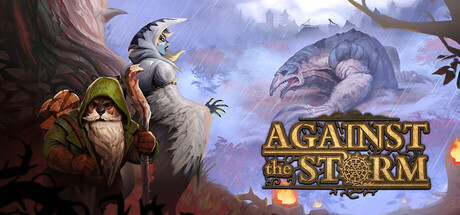

# 2023 in Video Games — October–December

[← All of 2023](../2023.md) · [Back to index](../../README.md)

286 titles.

### 100 Asian Cats

**Platforms:** Windows &nbsp;|&nbsp; **Developer:** 100 Hidden Animals &nbsp;|&nbsp; **Publisher:** 100 Cozy Games &nbsp;|&nbsp; **Genre:** Point-and-click, Puzzle, Indie &nbsp;|&nbsp; **Released:** December 17, 2023

> 100 Asian Cats - Join the cutest adventure in the Asia! Explore the charming hand-drawn artwork of Asian temples as you embark on a quest to find 100 adorable cats hidden throughout the game. Can you find them all?
>
> _Synopsis source: IGDB_

[IGDB](https://www.igdb.com/games/100-asian-cats)

---

### 1080° Snowboarding

**Platforms:** Nintendo Switch &nbsp;|&nbsp; **Genre:** Sports &nbsp;|&nbsp; **Released:** December 8

[Wikipedia](https://en.wikipedia.org/wiki/1080%C2%B0_Snowboarding)

---

### A Boy and His Blob: Retro Collection

**Platforms:** Nintendo Switch, PlayStation 4, PlayStation 5, Windows &nbsp;|&nbsp; **Developer:** Ziggurat Interactive &nbsp;|&nbsp; **Publisher:** Ziggurat Interactive, Limited Run Games &nbsp;|&nbsp; **Genre:** Platformer &nbsp;|&nbsp; **Released:** October 17

---

### A Date with Death

**Platforms:** Windows, macOS, Linux &nbsp;|&nbsp; **Developer:** Two and a Half Studios &nbsp;|&nbsp; **Publisher:** Two and a Half Studios &nbsp;|&nbsp; **Genre:** Visual novel, Dating sim &nbsp;|&nbsp; **Released:** December 7

> Fight against and romance the one hunting for your soul in A Date with Death, a chat simulator visual novel where you date the Grim Reaper himself. Create your own character, decorate your apartment, and chat away with the charming yet dangerous Grim Reaper through fully voiced video calls.
>
> _Synopsis source: IGDB_

[Wikipedia](https://en.wikipedia.org/wiki/A_Date_with_Death) · [IGDB](https://www.igdb.com/games/a-date-with-death)

---

### A Highland Song

**Platforms:** Windows, macOS, Nintendo Switch &nbsp;|&nbsp; **Developer:** Inkle &nbsp;|&nbsp; **Publisher:** Inkle &nbsp;|&nbsp; **Genre:** Adventure &nbsp;|&nbsp; **Released:** December 5

[Wikipedia](https://en.wikipedia.org/wiki/A_Highland_Song)

---

### Achilles: Legends Untold

**Platforms:** Windows, PlayStation 5, Xbox Series X/S &nbsp;|&nbsp; **Developer:** Dark Point Games &nbsp;|&nbsp; **Publisher:** Dark Point Games &nbsp;|&nbsp; **Genre:** Action RPG &nbsp;|&nbsp; **Released:** November 2

---

### Against the Storm

**Platforms:** Windows &nbsp;|&nbsp; **Developer:** Eremite Games &nbsp;|&nbsp; **Publisher:** Hooded Horse &nbsp;|&nbsp; **Genre:** City builder &nbsp;|&nbsp; **Released:** December 8, 2023

> A dark fantasy city builder where you must rebuild civilization in the face of apocalyptic rains. As the Queen’s Viceroy, lead humans, beavers, lizards, foxes, and harpies to reclaim the wilderness and secure a future for civilization's last survivors.
>
> _Synopsis source: Steam_

[Wikipedia](https://en.wikipedia.org/wiki/Against_the_Storm_(video_game)) · [Steam](https://store.steampowered.com/app/1336490) · [IGDB](https://www.igdb.com/games/against-the-storm)

---

### Agatha Christie: Murder on the Orient Express

**Platforms:** Windows, Nintendo Switch, PlayStation 4, PlayStation 5, Xbox One, Xbox Series X/S &nbsp;|&nbsp; **Developer:** Microids Studio Lyon &nbsp;|&nbsp; **Publisher:** Microids &nbsp;|&nbsp; **Genre:** Adventure &nbsp;|&nbsp; **Released:** October 19

---

### Air Twister

**Platforms:** Windows, Nintendo Switch, PlayStation 4, PlayStation 5, Xbox One, Xbox Series X/S &nbsp;|&nbsp; **Developer:** Cadabra Games &nbsp;|&nbsp; **Publisher:** QUByte Interactive &nbsp;|&nbsp; **Genre:** Shoot 'em up (rail) &nbsp;|&nbsp; **Released:** November 10

[Wikipedia](https://en.wikipedia.org/wiki/Air_Twister)

---

### AirportSim

**Platforms:** Windows &nbsp;|&nbsp; **Developer:** MS Games, MK Studios &nbsp;|&nbsp; **Publisher:** Iceberg Interactive &nbsp;|&nbsp; **Genre:** Simulation &nbsp;|&nbsp; **Released:** October 19

---

### Alan Wake II

**Platforms:** Windows, PlayStation 5, Xbox Series X/S &nbsp;|&nbsp; **Developer:** Remedy Entertainment &nbsp;|&nbsp; **Publisher:** Epic Games Publishing &nbsp;|&nbsp; **Genre:** Survival horror &nbsp;|&nbsp; **Released:** October 27

> Alan Wake 2 marks Remedy Entertainment’s first foray into the survival horror genre. Ritualistic murders in a small town. A writer trapped in a nightmare. An FBI agent looking for answers. Two realities. Two hero characters. One horror story that wants them dead.
>
> _Synopsis source: IGDB_

[Wikipedia](https://en.wikipedia.org/wiki/Alan_Wake_II) · [IGDB](https://www.igdb.com/games/alan-wake-ii)

---

### Alien Hominid HD

**Platforms:** Windows, Nintendo Switch, Xbox One, Xbox Series X/S &nbsp;|&nbsp; **Developer:** The Behemoth &nbsp;|&nbsp; **Publisher:** The Behemoth &nbsp;|&nbsp; **Genre:** Run and gun &nbsp;|&nbsp; **Released:** November 1

[Wikipedia](https://en.wikipedia.org/wiki/Alien_Hominid_HD)

---

### Alien Hominid Invasion

**Platforms:** Windows, Nintendo Switch, Xbox One, Xbox Series X/S &nbsp;|&nbsp; **Developer:** The Behemoth &nbsp;|&nbsp; **Publisher:** The Behemoth &nbsp;|&nbsp; **Genre:** Run and gun &nbsp;|&nbsp; **Released:** November 1

[Wikipedia](https://en.wikipedia.org/wiki/Alien_Hominid)

---

### American Arcadia

**Platforms:** Windows &nbsp;|&nbsp; **Developer:** Out of the Blue Games &nbsp;|&nbsp; **Publisher:** Raw Fury &nbsp;|&nbsp; **Genre:** Puzzle, Platformer &nbsp;|&nbsp; **Released:** November 15

> Escape from a televised utopia in Out of the Blue’s brand new puzzle-platformer game.  Welcome to Arcadia! A 70's retro-futuristic metropolis where all its citizens enjoy a life of luxury and comfort… unaware that they’re being broadcast live 24/7! Arcadia is not an ordinary city, but the most watched reality show on the planet - where a drop in popularity ratings comes at the highest cost: death.  Uncover the truth and escape with your life in American Arcadia!
>
> _Synopsis source: IGDB_

[Wikipedia](https://en.wikipedia.org/wiki/American_Arcadia) · [IGDB](https://www.igdb.com/games/american-arcadia)

---

### An Arcade Full of Cats

**Platforms:** Linux, Windows &nbsp;|&nbsp; **Developer:** Devcats &nbsp;|&nbsp; **Publisher:** Devcats &nbsp;|&nbsp; **Genre:** Puzzle, Indie &nbsp;|&nbsp; **Released:** November 16, 2023

> Journey through gaming history's time and space, while searching for adorable feline companions in 'An Arcade Full of Cats,' the ultimate pet'em up hidden object game.
>
> _Synopsis source: IGDB_

[IGDB](https://www.igdb.com/games/an-arcade-full-of-cats)

---

### Aquarium.

**Platforms:** Windows &nbsp;|&nbsp; **Developer:** Entergram &nbsp;|&nbsp; **Publisher:** Entergram &nbsp;|&nbsp; **Genre:** Visual novel &nbsp;|&nbsp; **Released:** October 26 (JP)

---

### Arashi: Castles of Sin – Final Cut

**Platforms:** Windows, PlayStation 5, Meta Quest &nbsp;|&nbsp; **Developer:** Endeavor One &nbsp;|&nbsp; **Publisher:** Skydance Interactive &nbsp;|&nbsp; **Genre:** Stealth, Action &nbsp;|&nbsp; **Released:** December 5

---

### Archetype Arcadia

**Platforms:** Windows, Nintendo Switch, PlayStation 4, PlayStation 5 &nbsp;|&nbsp; **Developer:** Water Phoenix &nbsp;|&nbsp; **Publisher:** PQube &nbsp;|&nbsp; **Genre:** Visual novel &nbsp;|&nbsp; **Released:** October 24

[Wikipedia](https://en.wikipedia.org/wiki/Archetype_Arcadia)

---

### Arizona Sunshine 2

**Platforms:** Windows, PlayStation 5, Meta Quest &nbsp;|&nbsp; **Developer:** Vertigo Games &nbsp;|&nbsp; **Publisher:** Vertigo Games &nbsp;|&nbsp; **Genre:** FPS &nbsp;|&nbsp; **Released:** December 7

[Wikipedia](https://en.wikipedia.org/wiki/Arizona_Sunshine_2)

---

### Ark: Survival Ascended

**Platforms:** Xbox Series X/S, PlayStation 5, Windows &nbsp;|&nbsp; **Developer:** Studio Wildcard &nbsp;|&nbsp; **Publisher:** Studio Wildcard &nbsp;|&nbsp; **Genre:** Shooter, Role-playing (RPG), Simulator, Adventure, Indie &nbsp;|&nbsp; **Released:** October 25, 2023

> Ark: Survival Ascended is a next-generation remaster of our beloved ARK: Survival Evolved, harnessing the power of Unreal Engine 5. The base game will include SOTF and all the Ark: Survival Evolved DLC maps (which will be added to ASA over time).
>
> _Synopsis source: IGDB_

[IGDB](https://www.igdb.com/games/ark-survival-ascended)

---

### ARMA Reforger

**Platforms:** Windows, Xbox Series X/S &nbsp;|&nbsp; **Developer:** Bohemia Interactive &nbsp;|&nbsp; **Publisher:** Bohemia Interactive &nbsp;|&nbsp; **Genre:** FPS &nbsp;|&nbsp; **Released:** November 16

[Wikipedia](https://en.wikipedia.org/wiki/ARMA_Reforger)

---

### Asgard's Wrath 2

**Platforms:** Meta Quest &nbsp;|&nbsp; **Developer:** Sanzaru Games &nbsp;|&nbsp; **Publisher:** Oculus Studios &nbsp;|&nbsp; **Genre:** Action RPG &nbsp;|&nbsp; **Released:** December 15

[Wikipedia](https://en.wikipedia.org/wiki/Asgard%27s_Wrath_2)

---

### Assassin's Creed Mirage

**Platforms:** Windows, PlayStation 4, PlayStation 5, Xbox One, Xbox Series X/S &nbsp;|&nbsp; **Developer:** Ubisoft Bordeaux &nbsp;|&nbsp; **Publisher:** Ubisoft &nbsp;|&nbsp; **Genre:** Action-adventure &nbsp;|&nbsp; **Released:** October 5

> Assassin’s Creed Mirage is a stealth-focused action-adventure game set in ninth-century Baghdad. It emphasizes parkour, infiltration, and targeted assassinations. The game follows a more compact structure than recent entries in the series. Players control Basim, a young thief drawn into a secretive order. The title blends historical settings with narrative elements tied to the franchise’s established lore.  The story unfolds in a thriving Baghdad at the height of its cultural and scientific influence, where Basim, a young orphan shaped by loss, struggles to survive through street theft. Haunted by disturbing visions and driven by a need for answers, he lashes out violently, forcing him to flee the city. Taken in by the Hidden Ones, he undergoes rigorous training and adopts their code, developing his skills and sense of purpose. As he uncovers the truth about himself and the world he has joined, Basim is pushed toward a destiny that transforms both his identity and his allegiance to the emerging Creed.
>
> _Synopsis source: IGDB_

[Wikipedia](https://en.wikipedia.org/wiki/Assassin%27s_Creed_Mirage) · [IGDB](https://www.igdb.com/games/assassins-creed-mirage)

---

### Assassin's Creed Nexus VR

**Platforms:** Meta Quest &nbsp;|&nbsp; **Developer:** Red Storm Entertainment &nbsp;|&nbsp; **Publisher:** Ubisoft &nbsp;|&nbsp; **Genre:** Action-adventure &nbsp;|&nbsp; **Released:** November 16

[Wikipedia](https://en.wikipedia.org/wiki/Assassin%27s_Creed_Nexus_VR)

---

### Astlibra Revision

**Platforms:** Nintendo Switch &nbsp;|&nbsp; **Developer:** KEIZO &nbsp;|&nbsp; **Publisher:** WhisperGames &nbsp;|&nbsp; **Genre:** Action RPG &nbsp;|&nbsp; **Released:** November 16

[Wikipedia](https://en.wikipedia.org/wiki/Astlibra_Revision)

---

### Astral Ascent

**Platforms:** Windows, Nintendo Switch, PlayStation 4, PlayStation 5 &nbsp;|&nbsp; **Developer:** Hibernian Workshop &nbsp;|&nbsp; **Publisher:** Maple Whispering &nbsp;|&nbsp; **Genre:** Platformer, Roguelike &nbsp;|&nbsp; **Released:** November 14

---

### Avatar: Frontiers of Pandora

**Platforms:** Windows, PlayStation 5, Xbox Series X/S &nbsp;|&nbsp; **Developer:** Massive Entertainment &nbsp;|&nbsp; **Publisher:** Ubisoft &nbsp;|&nbsp; **Genre:** Action-adventure &nbsp;|&nbsp; **Released:** December 7

> Avatar: Frontiers of Pandora is a first-person, action-adventure game set in the never-before-seen Western Frontier of Pandora. Abducted by the human militaristic corporation known as the RDA, you, a Na’vi, were trained and molded to serve their purpose. Fifteen years later, you are free, but find yourself a stranger in your birthplace. Reconnect with your lost heritage, discover what it truly means to be Na'vi, and join other clans to protect Pandora from the RDA.
>
> _Synopsis source: IGDB_

[IGDB](https://www.igdb.com/games/avatar-frontiers-of-pandora)

---

### Backpack Hero

**Platforms:** Windows, Nintendo Switch &nbsp;|&nbsp; **Developer:** Jaspel &nbsp;|&nbsp; **Publisher:** Jaspel, IndieArk, Different Tales &nbsp;|&nbsp; **Genre:** Roguelike &nbsp;|&nbsp; **Released:** November 14

> Backpack Hero is the inventory management roguelike! Collect rare items, organize your bag, and vanquish your foes!
>
> _Synopsis source: IGDB_

[Wikipedia](https://en.wikipedia.org/wiki/Backpack_Hero) · [IGDB](https://www.igdb.com/games/backpack-hero)

---

### Bahnsen Knights

**Platforms:** Windows, macOS &nbsp;|&nbsp; **Developer:** LCB Game Studio &nbsp;|&nbsp; **Publisher:** Chorus Worldwide &nbsp;|&nbsp; **Genre:** Adventure &nbsp;|&nbsp; **Released:** December 14

---

### Bakeru

**Platforms:** Nintendo Switch &nbsp;|&nbsp; **Developer:** Good-Feel &nbsp;|&nbsp; **Publisher:** Good-Feel &nbsp;|&nbsp; **Genre:** Action &nbsp;|&nbsp; **Released:** November 30 (JP)

[Wikipedia](https://en.wikipedia.org/wiki/Bakeru)

---

### Barton Lynch Pro Surfing

**Platforms:** Windows, PlayStation 5, Xbox Series X/S &nbsp;|&nbsp; **Developer:** Bungarra Software &nbsp;|&nbsp; **Publisher:** Bungarra Software &nbsp;|&nbsp; **Genre:** Sports &nbsp;|&nbsp; **Released:** November 17

---

### Batman: Arkham Trilogy

**Platforms:** Nintendo Switch &nbsp;|&nbsp; **Developer:** Rocksteady Studios &nbsp;|&nbsp; **Publisher:** Warner Bros. Games &nbsp;|&nbsp; **Genre:** Action-adventure &nbsp;|&nbsp; **Released:** December 1

---

### Bem Feito

**Platforms:** Windows, Nintendo Switch, PlayStation 4, PlayStation 5, Xbox One, Xbox Series X/S &nbsp;|&nbsp; **Developer:** oiCabie &nbsp;|&nbsp; **Publisher:** QUByte Interactive &nbsp;|&nbsp; **Genre:** Life sim &nbsp;|&nbsp; **Released:** November 9

---

### Berzerk: Recharged

**Platforms:** Windows, Nintendo Switch, PlayStation 4, PlayStation 5, Xbox One, Xbox Series X/S, Atari VCS &nbsp;|&nbsp; **Developer:** SneakyBox &nbsp;|&nbsp; **Publisher:** Atari &nbsp;|&nbsp; **Genre:** Shoot 'em up &nbsp;|&nbsp; **Released:** November 9

[Wikipedia](https://en.wikipedia.org/wiki/Berzerk_(video_game))

---

### Bilkins' Folly

**Platforms:** Windows, Nintendo Switch, PlayStation 4, PlayStation 5 &nbsp;|&nbsp; **Developer:** Webbysoft &nbsp;|&nbsp; **Publisher:** Armor Games Studios &nbsp;|&nbsp; **Genre:** Adventure &nbsp;|&nbsp; **Released:** October 2

---

### Black Clover M: Rise of the Wizard King

**Platforms:** iOS, Android &nbsp;|&nbsp; **Developer:** Vic Game Studios &nbsp;|&nbsp; **Publisher:** Garena &nbsp;|&nbsp; **Genre:** RPG &nbsp;|&nbsp; **Released:** November 30

[Wikipedia](https://en.wikipedia.org/wiki/Black_Clover)

---

### Black Lily’s Tale

**Platforms:** Windows &nbsp;|&nbsp; **Developer:** 1000-REKA &nbsp;|&nbsp; **Publisher:** 1000-REKA, mirai works &nbsp;|&nbsp; **Genre:** Dating sim, Visual novel &nbsp;|&nbsp; **Released:** October 24 (JP)

---

### Blood West

**Platforms:** Windows &nbsp;|&nbsp; **Developer:** Hyperstrange &nbsp;|&nbsp; **Publisher:** New Blood Interactive &nbsp;|&nbsp; **Genre:** Shooter, Role-playing (RPG) &nbsp;|&nbsp; **Released:** December 5, 2023

> Blood West is an immersive stealth shooter taking place in a nightmare version of a classic wild west setting. The player takes on the role of an outlawed gunslinger brought back to live by strange native spirits to find the root of a curse that has befallen the land. They will explore the dangerous frontier, gather supplies, expand their arsenal, and gain experience to unlock special traits, to best the many monsters and face off with challenging bosses.
>
> _Synopsis source: IGDB_

[IGDB](https://www.igdb.com/games/blood-west)

---

### Blossom Tales II: The Minotaur Prince

**Platforms:** Xbox One, Xbox Series X/S &nbsp;|&nbsp; **Developer:** Castle Pixel &nbsp;|&nbsp; **Publisher:** Playtonic Friends &nbsp;|&nbsp; **Genre:** Action-adventure &nbsp;|&nbsp; **Released:** October 4

---

### Bluey: The Videogame

**Platforms:** Windows, Nintendo Switch, PlayStation 4, PlayStation 5, Xbox One, Xbox Series X/S &nbsp;|&nbsp; **Developer:** Artax Games &nbsp;|&nbsp; **Publisher:** Outright Games &nbsp;|&nbsp; **Genre:** Adventure &nbsp;|&nbsp; **Released:** November 17

---

### Borderlands 3 Ultimate Edition

**Platforms:** Nintendo Switch &nbsp;|&nbsp; **Developer:** Gearbox Software &nbsp;|&nbsp; **Publisher:** 2K &nbsp;|&nbsp; **Genre:** FPS &nbsp;|&nbsp; **Released:** October 6

[Wikipedia](https://en.wikipedia.org/wiki/Borderlands_3)

---

### Born of Bread

**Platforms:** Windows, Nintendo Switch, PlayStation 5, Xbox Series X/S &nbsp;|&nbsp; **Developer:** Wild Arts &nbsp;|&nbsp; **Publisher:** Dear Villagers &nbsp;|&nbsp; **Genre:** Action RPG &nbsp;|&nbsp; **Released:** December 5

[Wikipedia](https://en.wikipedia.org/wiki/Born_of_Bread)

---

### Buckshot Roulette

**Platforms:** Windows, Linux &nbsp;|&nbsp; **Developer:** Mike Klubnika &nbsp;|&nbsp; **Publisher:** Mike Klubnika &nbsp;|&nbsp; **Genre:** Strategy, Horror &nbsp;|&nbsp; **Released:** December 28

> Buckshot Roulette is an indie tabletop horror game that reimagines Russian roulette using a pump-action shotgun instead of a revolver. The player faces off against a computer-controlled opponent called "The Dealer" across three rounds, with consumable items introduced in later rounds that add strategic depth. The game features a single-player campaign and a multiplayer mode for up to four players.
>
> _Synopsis source: IGDB_

[Wikipedia](https://en.wikipedia.org/wiki/Buckshot_Roulette) · [IGDB](https://www.igdb.com/games/buckshot-roulette)

---

### Bulletstorm VR

**Platforms:** Windows, PlayStation 5, Meta Quest &nbsp;|&nbsp; **Developer:** Incuvo &nbsp;|&nbsp; **Publisher:** People Can Fly &nbsp;|&nbsp; **Genre:** FPS &nbsp;|&nbsp; **Released:** December 14

[Wikipedia](https://en.wikipedia.org/wiki/Bulletstorm_VR)

---

### Calico

**Platforms:** PlayStation 4, PlayStation 5 &nbsp;|&nbsp; **Developer:** Peachy Keen Games &nbsp;|&nbsp; **Publisher:** Whitethorn Games &nbsp;|&nbsp; **Genre:** Simulation &nbsp;|&nbsp; **Released:** November 28

[Wikipedia](https://en.wikipedia.org/wiki/Calico_(video_game))

---

### Call of Duty: Modern Warfare III

**Platforms:** Windows, PlayStation 4, PlayStation 5, Xbox One, Xbox Series X/S &nbsp;|&nbsp; **Developer:** Sledgehammer Games &nbsp;|&nbsp; **Publisher:** Activision &nbsp;|&nbsp; **Genre:** FPS &nbsp;|&nbsp; **Released:** November 10

> The game brings "open combat, " offering players more choices in approaching the single-player missions. Makarov returns as the chief villain of the new campaign.  The newly introduced Carry Forward system will let players keep their progression and inventory from Modern Warfare II. Multiplayer fans can expect 16 maps at the launch and at least 12 coming later. Zombies mode will also return and should offer the largest zombie map to date.
>
> _Synopsis source: IGDB_

[IGDB](https://www.igdb.com/games/call-of-duty-modern-warfare-iii)

---

### Captain Tsubasa: Ace

**Platforms:** iOS, Android &nbsp;|&nbsp; **Developer:** Program Twenty Three &nbsp;|&nbsp; **Publisher:** DeNA &nbsp;|&nbsp; **Genre:** Sports &nbsp;|&nbsp; **Released:** December 5

---

### Castlevania Legends

**Platforms:** Nintendo Switch &nbsp;|&nbsp; **Genre:** Action, Platformer &nbsp;|&nbsp; **Released:** October 31

[Wikipedia](https://en.wikipedia.org/wiki/Castlevania_Legends)

---

### Cattails: Wildwood Story

**Platforms:** Nintendo Switch &nbsp;|&nbsp; **Developer:** Falcon Development &nbsp;|&nbsp; **Publisher:** Falcon Development &nbsp;|&nbsp; **Genre:** Farming, RPG &nbsp;|&nbsp; **Released:** November 30

---

### Cities: Skylines II

**Platforms:** Windows &nbsp;|&nbsp; **Developer:** Colossal Order &nbsp;|&nbsp; **Publisher:** Paradox Interactive &nbsp;|&nbsp; **Genre:** City builder &nbsp;|&nbsp; **Released:** October 24

> Create and manage your own city without restrictions. Offering a deep simulation and a living economy, Cities: Skylines II will challenge your decision-making skills and allow you to build the cities of your dreams. Get ready for a new epic scale in the most realistic city builder - ever.
>
> _Synopsis source: IGDB_

[IGDB](https://www.igdb.com/games/cities-skylines-ii)

---

### Company of Heroes Collection

**Platforms:** Nintendo Switch &nbsp;|&nbsp; **Developer:** Feral Interactive &nbsp;|&nbsp; **Publisher:** Feral Interactive &nbsp;|&nbsp; **Genre:** RTS &nbsp;|&nbsp; **Released:** October 12

[Wikipedia](https://en.wikipedia.org/wiki/Company_of_Heroes_(video_game))

---

### Cookie Run: Kingdom

**Platforms:** iOS, Android, Windows &nbsp;|&nbsp; **Developer:** Devsisters , Tencent Games &nbsp;|&nbsp; **Publisher:** Devsisters , Tencent Games &nbsp;|&nbsp; **Genre:** Action RPG &nbsp;|&nbsp; **Released:** December 28 (CN)

---

### Cookie Run: The Darkest Night

**Platforms:** Meta Quest &nbsp;|&nbsp; **Developer:** Devsisters &nbsp;|&nbsp; **Publisher:** Devsisters &nbsp;|&nbsp; **Genre:** Roguelike, Action-adventure &nbsp;|&nbsp; **Released:** November 30

---

### Coral Island

**Platforms:** Windows, PlayStation 5, Xbox Series X/S &nbsp;|&nbsp; **Developer:** Stairway Games &nbsp;|&nbsp; **Publisher:** Humble Games &nbsp;|&nbsp; **Genre:** Simulation &nbsp;|&nbsp; **Released:** November 14

> Coral Island is a re-imagined farm sim game inspired by classics. Grow crops, nurture animals, and befriend the islanders. Decide whether to revitalize not only the town but also the surrounding coral reefs.  Promising to keep intact what makes classic farm sim games fun, Coral Island aims to modernize and make the experience more inclusive. We feature a large cast of diverse characters and weave environmental awareness into the core game loop — all the while keeping it a wholesome good time.
>
> _Synopsis source: IGDB_

[Wikipedia](https://en.wikipedia.org/wiki/Coral_Island_(video_game)) · [IGDB](https://www.igdb.com/games/coral-island)

---

### Cricket 24

**Platforms:** Windows, PlayStation 4, PlayStation 5, Xbox One, Xbox Series X/S &nbsp;|&nbsp; **Developer:** Big Ant Studios &nbsp;|&nbsp; **Publisher:** Nacon &nbsp;|&nbsp; **Genre:** Sports &nbsp;|&nbsp; **Released:** October 5

[Wikipedia](https://en.wikipedia.org/wiki/Cricket_24)

---

### Cuisineer

**Platforms:** Windows &nbsp;|&nbsp; **Developer:** BattleBrew Productions &nbsp;|&nbsp; **Publisher:** Xseed Games, Marvelous Europe &nbsp;|&nbsp; **Genre:** Action, Roguelike &nbsp;|&nbsp; **Released:** November 9

---

### Cupid Parasite: Sweet & Spicy Darling

**Platforms:** Nintendo Switch &nbsp;|&nbsp; **Developer:** Idea Factory &nbsp;|&nbsp; **Publisher:** Idea Factory &nbsp;|&nbsp; **Genre:** Visual novel &nbsp;|&nbsp; **Released:** November 30 (JP)

---

### Custom Mech Wars

**Platforms:** Windows, PlayStation 5 &nbsp;|&nbsp; **Developer:** D3 Publisher &nbsp;|&nbsp; **Publisher:** D3 Publisher &nbsp;|&nbsp; **Genre:** TPS &nbsp;|&nbsp; **Released:** December 14

---

### Cut the Rope 3

**Platforms:** iOS &nbsp;|&nbsp; **Developer:** ZeptoLab &nbsp;|&nbsp; **Publisher:** Apple Arcade &nbsp;|&nbsp; **Genre:** Puzzle &nbsp;|&nbsp; **Released:** October 13

[Wikipedia](https://en.wikipedia.org/wiki/Cut_the_Rope_3)

---

### Dark Envoy

**Platforms:** Windows &nbsp;|&nbsp; **Developer:** Event Horizon &nbsp;|&nbsp; **Publisher:** Twin Sails Interactive &nbsp;|&nbsp; **Genre:** RPG &nbsp;|&nbsp; **Released:** October 24

---

### Death Must Die

**Platforms:** Windows, macOS &nbsp;|&nbsp; **Developer:** Realm Archive &nbsp;|&nbsp; **Publisher:** Realm Archive &nbsp;|&nbsp; **Genre:** Role-playing (RPG), Indie &nbsp;|&nbsp; **Released:** November 14, 2023

> Descend the nether in search of Death himself! Choose from God-given powers to slay his hordes of minions. Unlock new heroes, collect powerful items and create game-breaking synergies in this roguelite hack and slash survivors game.
>
> _Synopsis source: IGDB_

[IGDB](https://www.igdb.com/games/death-must-die)

---

### Dementium: The Ward

**Platforms:** Nintendo Switch &nbsp;|&nbsp; **Developer:** atooi &nbsp;|&nbsp; **Publisher:** atooi &nbsp;|&nbsp; **Genre:** Horror, FPS &nbsp;|&nbsp; **Released:** October 12

---

### Desolatium

**Platforms:** Windows, Nintendo Switch, PlayStation 4, PlayStation 5, Xbox One, Xbox Series X/S &nbsp;|&nbsp; **Developer:** Superlumen &nbsp;|&nbsp; **Publisher:** Soedesco &nbsp;|&nbsp; **Genre:** Adventure &nbsp;|&nbsp; **Released:** October 27

---

### Despera Drops

**Platforms:** Nintendo Switch &nbsp;|&nbsp; **Developer:** Red Entertainment &nbsp;|&nbsp; **Publisher:** Aksys Games &nbsp;|&nbsp; **Genre:** Visual novel &nbsp;|&nbsp; **Released:** November 30 (JP)

---

### Detective Pikachu Returns

**Platforms:** Nintendo Switch &nbsp;|&nbsp; **Developer:** Game Freak &nbsp;|&nbsp; **Publisher:** The Pokémon Company , Nintendo &nbsp;|&nbsp; **Genre:** Adventure &nbsp;|&nbsp; **Released:** October 6

[Wikipedia](https://en.wikipedia.org/wiki/Detective_Pikachu_Returns)

---

### Devil Engine: Complete Edition

**Platforms:** Nintendo Switch, PlayStation 4, PlayStation 5, Xbox One, Xbox Series X/S &nbsp;|&nbsp; **Developer:** Protoculture Games, Poppy Works &nbsp;|&nbsp; **Publisher:** Beep Japan, Poppy Works &nbsp;|&nbsp; **Genre:** Shoot 'em up &nbsp;|&nbsp; **Released:** November 9

---

### Devil World

**Platforms:** Nintendo Switch &nbsp;|&nbsp; **Genre:** Maze &nbsp;|&nbsp; **Released:** October 31

[Wikipedia](https://en.wikipedia.org/wiki/Devil_World)

---

### Disgaea 7: Vows of the Virtueless (OC)

**Platforms:** Windows, Nintendo Switch, PlayStation 4, PlayStation 5 &nbsp;|&nbsp; **Developer:** Nippon Ichi Software &nbsp;|&nbsp; **Publisher:** NIS America &nbsp;|&nbsp; **Genre:** RPG &nbsp;|&nbsp; **Released:** October 13

---

### Disney Dreamlight Valley

**Platforms:** Windows, macOS, Nintendo Switch, PlayStation 4, PlayStation 5, Xbox One, Xbox Series X/S &nbsp;|&nbsp; **Developer:** Gameloft Montreal &nbsp;|&nbsp; **Publisher:** Gameloft &nbsp;|&nbsp; **Genre:** Life sim, Action &nbsp;|&nbsp; **Released:** December 5

> Explore a world filled with the magic of Disney as you discover rich stories and build the perfect neighbourhood alongside Disney and Pixar Heroes and Villains in this new life-sim adventure game. Welcome to Disney Dreamlight Valley.
>
> _Synopsis source: IGDB_

[Wikipedia](https://en.wikipedia.org/wiki/Disney_Dreamlight_Valley) · [IGDB](https://www.igdb.com/games/disney-dreamlight-valley)

---

### DoDonPachi Blissful Death Re:Incarnation

**Platforms:** Nintendo Switch, PlayStation 4 &nbsp;|&nbsp; **Developer:** M2 , Cave &nbsp;|&nbsp; **Publisher:** M2 &nbsp;|&nbsp; **Genre:** Shoot 'em up &nbsp;|&nbsp; **Released:** December 7 (JP)

[Wikipedia](https://en.wikipedia.org/wiki/DoDonPachi_Blissful_Death)

---

### Double Dragon Advance

**Platforms:** Windows, Nintendo Switch, PlayStation 4, Xbox One &nbsp;|&nbsp; **Developer:** Arc System Works &nbsp;|&nbsp; **Publisher:** Arc System Works &nbsp;|&nbsp; **Genre:** Brawler &nbsp;|&nbsp; **Released:** November 9

[Wikipedia](https://en.wikipedia.org/wiki/Double_Dragon_Advance)

---

### Double Dragon Collection

**Platforms:** Nintendo Switch &nbsp;|&nbsp; **Developer:** Arc System Works &nbsp;|&nbsp; **Publisher:** Arc System Works &nbsp;|&nbsp; **Genre:** Brawler &nbsp;|&nbsp; **Released:** November 9

[Wikipedia](https://en.wikipedia.org/wiki/Double_Dragon_Collection)

---

### Dragon Quest Monsters: The Dark Prince

**Platforms:** Nintendo Switch &nbsp;|&nbsp; **Developer:** Tose &nbsp;|&nbsp; **Publisher:** Square Enix &nbsp;|&nbsp; **Genre:** RPG &nbsp;|&nbsp; **Released:** December 1

[Wikipedia](https://en.wikipedia.org/wiki/Dragon_Quest_Monsters)

---

### DreamWorks All-Star Kart Racing

**Platforms:** Windows, Nintendo Switch, PlayStation 4, PlayStation 5, Xbox One, Xbox Series X/S &nbsp;|&nbsp; **Developer:** Bamtang Games &nbsp;|&nbsp; **Publisher:** GameMill Entertainment &nbsp;|&nbsp; **Genre:** Racing (kart) &nbsp;|&nbsp; **Released:** November 3

---

### DreamWorks Trolls Remix Rescue

**Platforms:** Windows, Nintendo Switch, PlayStation 4, PlayStation 5, Xbox One, Xbox Series X/S &nbsp;|&nbsp; **Developer:** Petit Fabrik &nbsp;|&nbsp; **Publisher:** GameMill Entertainment &nbsp;|&nbsp; **Genre:** Platformer &nbsp;|&nbsp; **Released:** October 27

---

### Dungeons 4

**Platforms:** Windows, PlayStation 5, Xbox Series X/S &nbsp;|&nbsp; **Developer:** Realmforge Studios &nbsp;|&nbsp; **Publisher:** Kalypso Media &nbsp;|&nbsp; **Genre:** RTS &nbsp;|&nbsp; **Released:** November 9

[Wikipedia](https://en.wikipedia.org/wiki/Dungeons_3)

---

### Dusk

**Platforms:** PlayStation 4 &nbsp;|&nbsp; **Developer:** David Szymanski &nbsp;|&nbsp; **Publisher:** New Blood Interactive &nbsp;|&nbsp; **Genre:** FPS &nbsp;|&nbsp; **Released:** October 31

[Wikipedia](https://en.wikipedia.org/wiki/Dusk_(video_game))

---

### Dwerve

**Platforms:** Nintendo Switch &nbsp;|&nbsp; **Developer:** Half Human Games &nbsp;|&nbsp; **Publisher:** Half Human Games &nbsp;|&nbsp; **Genre:** Tower defense, Action RPG &nbsp;|&nbsp; **Released:** October 12

---

### EA Sports UFC 5

**Platforms:** PlayStation 5, Xbox Series X/S &nbsp;|&nbsp; **Developer:** EA Vancouver &nbsp;|&nbsp; **Publisher:** EA Sports &nbsp;|&nbsp; **Genre:** Sports &nbsp;|&nbsp; **Released:** October 27

[Wikipedia](https://en.wikipedia.org/wiki/EA_Sports_UFC_5)

---

### EA Sports WRC

**Platforms:** Windows, PlayStation 5, Xbox Series X/S &nbsp;|&nbsp; **Developer:** Codemasters &nbsp;|&nbsp; **Publisher:** EA Sports &nbsp;|&nbsp; **Genre:** Racing &nbsp;|&nbsp; **Released:** November 3

> EA Sports WRC boasts 10 current WRC, WRC2, and Junior WRC vehicles and 68 of the most iconic rally cars spanning 60 years of the sport.  Working together with official WRC teams and manufacturers, such as Ford, Toyota, and Hyundai, each vehicle is built to tackle every challenge they'll face throughout the season. The hybrid-powered 4WD Rally1 cars are some of the fastest in the sport's history, capable of incredible speeds while tackling gravity-defying jumps, deteriorating surfaces, and adverse weather.
>
> _Synopsis source: IGDB_

[Wikipedia](https://en.wikipedia.org/wiki/EA_Sports_WRC) · [IGDB](https://www.igdb.com/games/ea-sports-wrc)

---

### Ebenezer and the Invisible World

**Platforms:** Windows, Nintendo Switch, PlayStation 4, PlayStation 5, Xbox One, Xbox Series X/S &nbsp;|&nbsp; **Developer:** Orbit, Play On Worlds &nbsp;|&nbsp; **Publisher:** Play On Worlds &nbsp;|&nbsp; **Genre:** Metroidvania &nbsp;|&nbsp; **Released:** November 3

[Wikipedia](https://en.wikipedia.org/wiki/Ebenezer_and_the_Invisible_World)

---

### Endless Dungeon

**Platforms:** Windows, PlayStation 4, PlayStation 5, Xbox One, Xbox Series X/S &nbsp;|&nbsp; **Developer:** Amplitude Studios &nbsp;|&nbsp; **Publisher:** Sega &nbsp;|&nbsp; **Genre:** Tower defense, Roguelike &nbsp;|&nbsp; **Released:** October 19

[Wikipedia](https://en.wikipedia.org/wiki/Endless_Dungeon)

---

### Fashion Dreamer

**Platforms:** Nintendo Switch &nbsp;|&nbsp; **Developer:** syn Sophia &nbsp;|&nbsp; **Publisher:** Marvelous &nbsp;|&nbsp; **Genre:** Simulation &nbsp;|&nbsp; **Released:** November 2

[Wikipedia](https://en.wikipedia.org/wiki/Fashion_Dreamer)

---

### Fears to Fathom: Ironbark Lookout

**Platforms:** Windows &nbsp;|&nbsp; **Developer:** Rayll Studios &nbsp;|&nbsp; **Publisher:** Rayll Studios &nbsp;|&nbsp; **Genre:** Strategy, Adventure, Indie &nbsp;|&nbsp; **Released:** October 20, 2023

> Jack Nelson, a 24 year old fire lookout, transferred to a new outpost. As he settled into his new home, he couldn't shake the feeling that something was off, little did he know what was transpiring down in ironbark state park.
>
> _Synopsis source: IGDB_

[IGDB](https://www.igdb.com/games/fears-to-fathom-ironbark-lookout)

---

### Flashback 2

**Platforms:** Windows, Nintendo Switch, PlayStation 4, PlayStation 5, Xbox One, Xbox Series X/S &nbsp;|&nbsp; **Developer:** Paul Cuisset , Microids Studio Lyon &nbsp;|&nbsp; **Publisher:** Microids &nbsp;|&nbsp; **Genre:** Cinematic platformer &nbsp;|&nbsp; **Released:** November 16

[Wikipedia](https://en.wikipedia.org/wiki/Flashback_(1992_video_game))

---

### Football Manager 2024

**Platforms:** Windows, Nintendo Switch, PlayStation 4, PlayStation 5, Xbox One, Xbox Series X/S, iOS, Android &nbsp;|&nbsp; **Developer:** Sports Interactive &nbsp;|&nbsp; **Publisher:** Sega &nbsp;|&nbsp; **Genre:** Sports &nbsp;|&nbsp; **Released:** November 6

> Progress never stops when you're pursuing footballing greatness. Gameplay upgrades empower you to develop a blueprint for success on and off the pitch. Pre-order for 10% off and Early Access*.
>
> _Synopsis source: IGDB_

[Wikipedia](https://en.wikipedia.org/wiki/Football_Manager_2024) · [IGDB](https://www.igdb.com/games/football-manager-2024)

---

### For the King II

**Platforms:** Windows &nbsp;|&nbsp; **Developer:** IronOak Games &nbsp;|&nbsp; **Publisher:** Curve Games &nbsp;|&nbsp; **Genre:** Roguelike, RPG &nbsp;|&nbsp; **Released:** November 2

[Wikipedia](https://en.wikipedia.org/wiki/For_the_King_II)

---

### Forza Motorsport

**Platforms:** Windows, Xbox Series X/S &nbsp;|&nbsp; **Developer:** Turn 10 Studios &nbsp;|&nbsp; **Publisher:** Xbox Game Studios &nbsp;|&nbsp; **Genre:** Racing &nbsp;|&nbsp; **Released:** October 10

> Out-build the competition in the new career. Race your friends in adjudicated multiplayer events. Compete in over 500 cars on world-famous tracks with cutting-edge AI, advanced physics, tire and fuel strategy, and driver and safety ratings.
>
> _Synopsis source: IGDB_

[Wikipedia](https://en.wikipedia.org/wiki/Forza_Motorsport_(2023_video_game)) · [IGDB](https://www.igdb.com/games/forza-motorsport--1)

---

### Freddi Fish 4: The Case of the Hogfish Rustlers of Briny Gulch

**Platforms:** Nintendo Switch, PlayStation 4 &nbsp;|&nbsp; **Developer:** Humongous Entertainment &nbsp;|&nbsp; **Publisher:** UFO Interactive Games &nbsp;|&nbsp; **Genre:** Adventure &nbsp;|&nbsp; **Released:** December 21

---

### Frog Detective: The Entire Mystery

**Platforms:** Nintendo Switch, PlayStation 4, PlayStation 5, Xbox One, Xbox Series X/S &nbsp;|&nbsp; **Developer:** worm club &nbsp;|&nbsp; **Publisher:** worm club &nbsp;|&nbsp; **Genre:** Adventure &nbsp;|&nbsp; **Released:** October 26

---

### Front Mission 2: Remake

**Platforms:** Nintendo Switch &nbsp;|&nbsp; **Developer:** Storm Trident &nbsp;|&nbsp; **Publisher:** Forever Entertainment &nbsp;|&nbsp; **Genre:** Tactical RPG &nbsp;|&nbsp; **Released:** October 5

[Wikipedia](https://en.wikipedia.org/wiki/Front_Mission_2)

---

### Gangs of Sherwood

**Platforms:** Windows, PlayStation 5, Xbox Series X/S &nbsp;|&nbsp; **Developer:** Appeal Studios &nbsp;|&nbsp; **Publisher:** Nacon &nbsp;|&nbsp; **Genre:** Action &nbsp;|&nbsp; **Released:** October 19

---

### Gargoyles Remastered

**Platforms:** Windows, Nintendo Switch, PlayStation 4, Xbox One &nbsp;|&nbsp; **Developer:** Empty Clip Studios &nbsp;|&nbsp; **Publisher:** Disney Games &nbsp;|&nbsp; **Genre:** Platformer &nbsp;|&nbsp; **Released:** October 19

[Wikipedia](https://en.wikipedia.org/wiki/Gargoyles_(video_game))

---

### Ghostbusters: Rise of the Ghost Lord

**Platforms:** Windows, PlayStation 5, Meta Quest &nbsp;|&nbsp; **Developer:** NDreams &nbsp;|&nbsp; **Publisher:** NDreams &nbsp;|&nbsp; **Genre:** Action-adventure &nbsp;|&nbsp; **Released:** October 26

---

### Ghostrunner 2

**Platforms:** Windows, PlayStation 5, Xbox Series X/S &nbsp;|&nbsp; **Developer:** One More Level &nbsp;|&nbsp; **Publisher:** 505 Games &nbsp;|&nbsp; **Genre:** Hack and slash &nbsp;|&nbsp; **Released:** October 26

[Wikipedia](https://en.wikipedia.org/wiki/Ghostrunner_2)

---

### Ghostrunner II

**Platforms:** Xbox Series X/S, Windows, PlayStation 5 &nbsp;|&nbsp; **Developer:** One More Level &nbsp;|&nbsp; **Publisher:** 505 Games &nbsp;|&nbsp; **Genre:** Platform, Strategy, Hack and slash/Beat 'em up, Adventure &nbsp;|&nbsp; **Released:** October 26, 2023

> Ghostrunner II is a hardcore FPP slasher set in a post-apocalyptic, cyberpunk world. Featuring everything fans loved about Ghostrunner plus incredible boss fights, new interactive story, thrilling motorbike levels, improved skills, and more cyber ninja action.
>
> _Synopsis source: IGDB_

[IGDB](https://www.igdb.com/games/ghostrunner-ii)

---

### Ginka

**Platforms:** Windows &nbsp;|&nbsp; **Developer:** Frontwing &nbsp;|&nbsp; **Publisher:** Bushiroad Games &nbsp;|&nbsp; **Genre:** Visual novel &nbsp;|&nbsp; **Released:** October 26

---

### Gnosia

**Platforms:** PlayStation 4, PlayStation 5, Xbox One, Xbox Series X/S &nbsp;|&nbsp; **Developer:** Petit Depotto &nbsp;|&nbsp; **Publisher:** Playism &nbsp;|&nbsp; **Genre:** RPG &nbsp;|&nbsp; **Released:** December 14

[Wikipedia](https://en.wikipedia.org/wiki/Gnosia)

---

### Gothic II Complete Classic

**Platforms:** Nintendo Switch &nbsp;|&nbsp; **Developer:** Piranha Bytes &nbsp;|&nbsp; **Publisher:** THQ Nordic &nbsp;|&nbsp; **Genre:** Action RPG &nbsp;|&nbsp; **Released:** November 29

[Wikipedia](https://en.wikipedia.org/wiki/Gothic_II)

---

### Granblue Fantasy Versus: Rising

**Platforms:** Windows, PlayStation 4, PlayStation 5 &nbsp;|&nbsp; **Developer:** Arc System Works &nbsp;|&nbsp; **Publisher:** Cygames &nbsp;|&nbsp; **Genre:** Fighting &nbsp;|&nbsp; **Released:** December 14

---

### Grand Theft Auto: The Trilogy – The Definitive Edition

**Platforms:** iOS, Android &nbsp;|&nbsp; **Developer:** Grove Street Games &nbsp;|&nbsp; **Publisher:** Rockstar Games &nbsp;|&nbsp; **Genre:** Action-adventure &nbsp;|&nbsp; **Type:** Port &nbsp;|&nbsp; **Released:** December 14

---

### Gubbins

**Platforms:** iOS, Android &nbsp;|&nbsp; **Developer:** Studio Folly &nbsp;|&nbsp; **Publisher:** Studio Folly &nbsp;|&nbsp; **Genre:** Puzzle &nbsp;|&nbsp; **Released:** November 14

---

### Gungrave G.O.R.E – Ultimate Enhanced Edition

**Platforms:** Nintendo Switch &nbsp;|&nbsp; **Developer:** Studio IGGYMOB &nbsp;|&nbsp; **Publisher:** Beep Japan &nbsp;|&nbsp; **Genre:** TPS &nbsp;|&nbsp; **Released:** October 4 (EU/NA)

[Wikipedia](https://en.wikipedia.org/wiki/Gungrave_G.O.R.E)

---

### Gunhead

**Platforms:** Windows, PlayStation 5 &nbsp;|&nbsp; **Developer:** Alientrap &nbsp;|&nbsp; **Publisher:** Alientrap &nbsp;|&nbsp; **Genre:** Roguelike, FPS &nbsp;|&nbsp; **Released:** November 8

[Wikipedia](https://en.wikipedia.org/wiki/Cryptark)

---

### Harvest Moon 64

**Platforms:** Nintendo Switch &nbsp;|&nbsp; **Genre:** Farming &nbsp;|&nbsp; **Released:** December 8

[Wikipedia](https://en.wikipedia.org/wiki/Harvest_Moon_64)

---

### Haunted House

**Platforms:** Windows, Nintendo Switch, PlayStation 4, PlayStation 5, Xbox One, Xbox Series X/S, Atari VCS &nbsp;|&nbsp; **Developer:** Orbit Studio &nbsp;|&nbsp; **Publisher:** Atari &nbsp;|&nbsp; **Genre:** Roguelike, Horror, Adventure &nbsp;|&nbsp; **Released:** October 12

[Wikipedia](https://en.wikipedia.org/wiki/Haunted_House_(video_game)#Legacy)

---

### Headbangers: Rhythm Royale

**Platforms:** Windows, Nintendo Switch, PlayStation 5, Xbox Series X/S &nbsp;|&nbsp; **Developer:** Glee-Cheese Games &nbsp;|&nbsp; **Publisher:** Team17 &nbsp;|&nbsp; **Genre:** Party, Rhythm &nbsp;|&nbsp; **Released:** October 31

---

### Hellboy Web of Wyrd

**Platforms:** Windows, Nintendo Switch, PlayStation 4, PlayStation 5, Xbox One, Xbox Series X/S &nbsp;|&nbsp; **Developer:** Upstream Arcade &nbsp;|&nbsp; **Publisher:** Good Shepherd Entertainment &nbsp;|&nbsp; **Genre:** Brawler, Roguelike &nbsp;|&nbsp; **Released:** October 18

[Wikipedia](https://en.wikipedia.org/wiki/Hellboy_Web_of_Wyrd)

---

### Hello Kitty and Friends: Happiness Parade

**Platforms:** Nintendo Switch &nbsp;|&nbsp; **Developer:** Dabadu Games &nbsp;|&nbsp; **Publisher:** Rogue Games &nbsp;|&nbsp; **Genre:** Rhythm &nbsp;|&nbsp; **Released:** October 26

---

### Hira Hira Hihiru

**Platforms:** Windows &nbsp;|&nbsp; **Developer:** BA-KU &nbsp;|&nbsp; **Publisher:** ANIPLEX.EXE &nbsp;|&nbsp; **Genre:** Visual novel &nbsp;|&nbsp; **Released:** November 17

---

### Hollow Cocoon

**Platforms:** Windows &nbsp;|&nbsp; **Developer:** Nayuta Studio &nbsp;|&nbsp; **Publisher:** Nayuta Studio &nbsp;|&nbsp; **Genre:** Horror, Adventure &nbsp;|&nbsp; **Released:** December 7

---

### Hot Wheels Unleashed 2: Turbocharged

**Platforms:** Windows, Nintendo Switch, PlayStation 4, PlayStation 5, Xbox One, Xbox Series X/S &nbsp;|&nbsp; **Developer:** Milestone &nbsp;|&nbsp; **Publisher:** Milestone &nbsp;|&nbsp; **Genre:** Racing &nbsp;|&nbsp; **Released:** October 19

> The world’s raddest cars are back and taking the fun to the next level! Race over 130 vehicles with crazy new mechanics and even more vehicle types. Plus, build your tracks with stunning new environments and different game modes to have fun off and online!
>
> _Synopsis source: IGDB_

[IGDB](https://www.igdb.com/games/hot-wheels-unleashed-2-turbocharged)

---

### Hotline Miami

**Platforms:** PlayStation 5, Xbox Series X/S &nbsp;|&nbsp; **Developer:** Dennaton Games &nbsp;|&nbsp; **Publisher:** Devolver Digital &nbsp;|&nbsp; **Genre:** Shoot 'em up &nbsp;|&nbsp; **Released:** October 23

[Wikipedia](https://en.wikipedia.org/wiki/Hotline_Miami)

---

### Hotline Miami 2: Wrong Number

**Platforms:** PlayStation 5, Xbox Series X/S &nbsp;|&nbsp; **Developer:** Dennaton Games &nbsp;|&nbsp; **Publisher:** Devolver Digital &nbsp;|&nbsp; **Genre:** Shoot 'em up &nbsp;|&nbsp; **Released:** October 23

---

### House Flipper 2

**Platforms:** Windows &nbsp;|&nbsp; **Developer:** Frozen District &nbsp;|&nbsp; **Publisher:** PlayWay &nbsp;|&nbsp; **Genre:** Simulation &nbsp;|&nbsp; **Released:** December 14

> It's time to dust off your hammer - House Flipper is back in a brand-new fashion! Buy and renovate run-down houses! Or maybe you want to build new ones? Now you can! Start as a rookie Flipper and make a fortune by helping out the community of the charming town of Pinnacove.
>
> _Synopsis source: IGDB_

[Wikipedia](https://en.wikipedia.org/wiki/House_Flipper_2) · [IGDB](https://www.igdb.com/games/house-flipper-2)

---

### Howl

**Platforms:** Windows, Nintendo Switch &nbsp;|&nbsp; **Developer:** Mi'pu'mi Games &nbsp;|&nbsp; **Publisher:** Astragon Entertainment &nbsp;|&nbsp; **Genre:** TBS &nbsp;|&nbsp; **Released:** November 14

---

### Idol Mahjong Final Romance 4 Remaster

**Platforms:** Nintendo Switch &nbsp;|&nbsp; **Developer:** City Connection &nbsp;|&nbsp; **Publisher:** City Connection &nbsp;|&nbsp; **Genre:** Puzzle &nbsp;|&nbsp; **Released:** October 26 (JP)

---

### Ignistone

**Platforms:** Windows, iOS, Android &nbsp;|&nbsp; **Developer:** Mono Entertainment &nbsp;|&nbsp; **Publisher:** Kodansha &nbsp;|&nbsp; **Genre:** Action, Roguelike &nbsp;|&nbsp; **Released:** October 3

---

### Ikonei Island: An Earthlock Adventure

**Platforms:** Windows &nbsp;|&nbsp; **Developer:** Snowcastle Games &nbsp;|&nbsp; **Publisher:** Snowcastle Games &nbsp;|&nbsp; **Genre:** Adventure, Sandbox &nbsp;|&nbsp; **Released:** November 9

[Wikipedia](https://en.wikipedia.org/wiki/Earthlock)

---

### In His Time

**Platforms:** Windows &nbsp;|&nbsp; **Developer:** TearyHand Studio &nbsp;|&nbsp; **Publisher:** Kodansha &nbsp;|&nbsp; **Genre:** Puzzle, Adventure &nbsp;|&nbsp; **Released:** October 3

---

### In Stars and Time

**Platforms:** Windows, Nintendo Switch, PlayStation 4, PlayStation 5 &nbsp;|&nbsp; **Developer:** insertdisc5 &nbsp;|&nbsp; **Publisher:** Armor Games Studios &nbsp;|&nbsp; **Genre:** RPG &nbsp;|&nbsp; **Released:** November 20

> In Stars and Time is a time-looping RPG adventure. With each loop, Siffrin gains a new perspective on the world around them, opening up new solutions to puzzles and allowing them to make better choices in conversation. Equip memories as armor, pray to the Change God to improve your team’s capabilities each loop, and challenge deadly foes to Rock, Papers, Scissors as Siffrin seeks the truth.
>
> _Synopsis source: IGDB_

[Wikipedia](https://en.wikipedia.org/wiki/In_Stars_and_Time) · [IGDB](https://www.igdb.com/games/in-stars-and-time)

---

### Inescapable: No Rules, No Rescue

**Platforms:** Windows, Nintendo Switch, PlayStation 4, PlayStation 5, Xbox One, Xbox Series X/S &nbsp;|&nbsp; **Developer:** Dreamloop Games &nbsp;|&nbsp; **Publisher:** Aksys Games &nbsp;|&nbsp; **Genre:** Adventure, Visual novel &nbsp;|&nbsp; **Released:** October 19

---

### Invincible Presents: Atom Eve

**Platforms:** Windows &nbsp;|&nbsp; **Developer:** Terrible Posture Games &nbsp;|&nbsp; **Publisher:** Skybound Games &nbsp;|&nbsp; **Genre:** Visual novel &nbsp;|&nbsp; **Released:** November 14

---

### Ira

**Platforms:** Windows &nbsp;|&nbsp; **Developer:** ABShot &nbsp;|&nbsp; **Publisher:** Nicalis &nbsp;|&nbsp; **Genre:** Roguelike, Shoot 'em up &nbsp;|&nbsp; **Released:** October 3

---

### Jet Force Gemini

**Platforms:** Nintendo Switch &nbsp;|&nbsp; **Genre:** Platformer, TPS &nbsp;|&nbsp; **Released:** November 30 (JP/WW)

[Wikipedia](https://en.wikipedia.org/wiki/Jet_Force_Gemini)

---

### Journey to Foundation

**Platforms:** PlayStation 5, Meta Quest &nbsp;|&nbsp; **Developer:** Archiact &nbsp;|&nbsp; **Publisher:** Archiact &nbsp;|&nbsp; **Genre:** Adventure &nbsp;|&nbsp; **Released:** October 26

---

### Jujutsu Kaisen: Phantom Parade

**Platforms:** macOS, iOS, Android &nbsp;|&nbsp; **Developer:** Sumzap &nbsp;|&nbsp; **Publisher:** Sumzap &nbsp;|&nbsp; **Genre:** Action RPG &nbsp;|&nbsp; **Released:** November 21

---

### Jusant

**Platforms:** Windows, PlayStation 5, Xbox Series X/S &nbsp;|&nbsp; **Developer:** Don't Nod &nbsp;|&nbsp; **Publisher:** Don't Nod &nbsp;|&nbsp; **Genre:** Platformer &nbsp;|&nbsp; **Released:** October 31

> Enjoy meditative vibes in Jusant, an action-puzzle climbing game. Scale an immeasurably tall tower and ascend to new heights alongside your watery companion. Master your climbing tools, find your way up through diverse biomes, and piece together the tower's past.
>
> _Synopsis source: IGDB_

[Wikipedia](https://en.wikipedia.org/wiki/Jusant) · [IGDB](https://www.igdb.com/games/jusant)

---

### Just Dance 2024 Edition

**Platforms:** Nintendo Switch, PlayStation 5, Xbox Series X/S &nbsp;|&nbsp; **Developer:** Ubisoft Paris &nbsp;|&nbsp; **Publisher:** Ubisoft &nbsp;|&nbsp; **Genre:** Rhythm &nbsp;|&nbsp; **Released:** October 24

[Wikipedia](https://en.wikipedia.org/wiki/Just_Dance_2024_Edition)

---

### KarmaZoo

**Platforms:** Windows, Nintendo Switch, PlayStation 5, Xbox Series X/S &nbsp;|&nbsp; **Developer:** Pastagames &nbsp;|&nbsp; **Publisher:** Devolver Digital &nbsp;|&nbsp; **Genre:** Platformer &nbsp;|&nbsp; **Released:** November 14

---

### Kingpin: Reloaded

**Platforms:** Windows &nbsp;|&nbsp; **Developer:** Slipgate Ironworks &nbsp;|&nbsp; **Publisher:** 3D Realms , Interplay Entertainment &nbsp;|&nbsp; **Genre:** FPS &nbsp;|&nbsp; **Released:** December 5

---

### Knight vs Giant: The Broken Excalibur

**Platforms:** Windows, Nintendo Switch, PlayStation 5, Xbox Series X/S &nbsp;|&nbsp; **Developer:** Gambir Studio &nbsp;|&nbsp; **Publisher:** PQube &nbsp;|&nbsp; **Genre:** Roguelike, Action RPG &nbsp;|&nbsp; **Released:** October 5

---

### Koi-Koi: Love Blossoms

**Platforms:** PlayStation 5 &nbsp;|&nbsp; **Developer:** Apricot Heart &nbsp;|&nbsp; **Publisher:** Apricot Heart &nbsp;|&nbsp; **Genre:** Adventure &nbsp;|&nbsp; **Released:** November 15

---

### Kona II: Brume

**Platforms:** Windows, Nintendo Switch, PlayStation 4, PlayStation 5, Xbox One, Xbox Series X/S &nbsp;|&nbsp; **Developer:** Parabole &nbsp;|&nbsp; **Publisher:** Ravenscourt &nbsp;|&nbsp; **Genre:** Adventure &nbsp;|&nbsp; **Released:** October 18

[Wikipedia](https://en.wikipedia.org/wiki/Kona_(video_game))

---

### Koumajou Remilia II: Stranger's Requiem

**Platforms:** Windows, Nintendo Switch &nbsp;|&nbsp; **Developer:** Frontier Aja &nbsp;|&nbsp; **Publisher:** CFK &nbsp;|&nbsp; **Genre:** Action &nbsp;|&nbsp; **Released:** December 14

---

### Laika: Aged Through Blood

**Platforms:** Windows, PlayStation 4, PlayStation 5, Xbox One, Xbox Series X/S &nbsp;|&nbsp; **Developer:** Brainwash Gang &nbsp;|&nbsp; **Publisher:** Headup Publishing &nbsp;|&nbsp; **Genre:** Metroidvania, Action-adventure &nbsp;|&nbsp; **Released:** October 19

> Laika: Aged Through Blood is a western-inspired motorvania set in a post-apocalyptic desert. It is the story about a tribe oppressed by occupant forces, and the personal story of a mother coyote warrior who descends on an endless path of vengeance to take back what her people lost.
>
> _Synopsis source: IGDB_

[IGDB](https://www.igdb.com/games/laika-aged-through-blood)

---

### Last Train Home

**Platforms:** Windows &nbsp;|&nbsp; **Developer:** Ashborne Games &nbsp;|&nbsp; **Publisher:** THQ Nordic &nbsp;|&nbsp; **Genre:** RTS &nbsp;|&nbsp; **Released:** November 28

[Wikipedia](https://en.wikipedia.org/wiki/Last_Train_Home_(video_game))

---

### Lego Bricktales VR

**Platforms:** Meta Quest &nbsp;|&nbsp; **Developer:** ClockStone Studio &nbsp;|&nbsp; **Publisher:** Thunderful Publishing &nbsp;|&nbsp; **Genre:** Puzzle, Adventure &nbsp;|&nbsp; **Released:** December 7

[Wikipedia](https://en.wikipedia.org/wiki/Lego_Bricktales)

---

### Lethal Company

**Platforms:** Windows &nbsp;|&nbsp; **Developer:** Zeekerss &nbsp;|&nbsp; **Publisher:** Zeekerss &nbsp;|&nbsp; **Genre:** Survival horror &nbsp;|&nbsp; **Released:** October 23

> Lethal Company is a co-op horror roguelite game about scavenging at abandoned moons to sell scrap to the Company.
>
> _Synopsis source: IGDB_

[Wikipedia](https://en.wikipedia.org/wiki/Lethal_Company) · [IGDB](https://www.igdb.com/games/lethal-company)

---

### Like a Dragon Gaiden: The Man Who Erased His Name

**Platforms:** Windows, PlayStation 4, PlayStation 5, Xbox One, Xbox Series X/S &nbsp;|&nbsp; **Developer:** Ryu Ga Gotoku Studio &nbsp;|&nbsp; **Publisher:** Sega &nbsp;|&nbsp; **Genre:** Action-adventure &nbsp;|&nbsp; **Released:** November 9

> Like a Dragon Gaiden: The Man Who Erased His Name is a 2023 action-adventure video game developed by Ryu Ga Gotoku Studio and published by Sega. It is a spin-off of the Like a Dragon series. Taking place during the events of Yakuza: Like a Dragon (2020), Like a Dragon Gaiden focuses on the series' original protagonist, Kazuma Kiryu, as he embarks on a new adventure in Osaka under the guise of a secret agent.
>
> _Synopsis source: IGDB_

[IGDB](https://www.igdb.com/games/like-a-dragon-gaiden-the-man-who-erased-his-name)

---

### Lil Gator Game

**Platforms:** PlayStation 4, PlayStation 5, Xbox One, Xbox Series X/S &nbsp;|&nbsp; **Developer:** MegaWobble &nbsp;|&nbsp; **Publisher:** Playtonic Friends &nbsp;|&nbsp; **Genre:** Platformer &nbsp;|&nbsp; **Released:** October 10

[Wikipedia](https://en.wikipedia.org/wiki/Lil_Gator_Game)

---

### Little Goody Two Shoes

**Platforms:** Windows, Nintendo Switch, PlayStation 5, Xbox Series X/S &nbsp;|&nbsp; **Developer:** AstralShift &nbsp;|&nbsp; **Publisher:** Square Enix Collective &nbsp;|&nbsp; **Genre:** Horror, RPG &nbsp;|&nbsp; **Released:** October 31

[Wikipedia](https://en.wikipedia.org/wiki/Little_Goody_Two_Shoes_(video_game))

---

### Little Noah: Scion of Paradise

**Platforms:** Xbox One, Xbox Series X/S &nbsp;|&nbsp; **Developer:** Cygames , Grounding &nbsp;|&nbsp; **Publisher:** Cygames &nbsp;|&nbsp; **Genre:** Roguelike, Action &nbsp;|&nbsp; **Released:** November 1

---

### Loddlenaut

**Platforms:** Windows, macOS &nbsp;|&nbsp; **Developer:** Moon Lagoon &nbsp;|&nbsp; **Publisher:** Secret Mode &nbsp;|&nbsp; **Genre:** Cozy, adventure, simulation &nbsp;|&nbsp; **Released:** November 16

[Wikipedia](https://en.wikipedia.org/wiki/Loddlenaut)

---

### Long Gone Days

**Platforms:** Windows, Nintendo Switch, PlayStation 4, PlayStation 5, Xbox One, Xbox Series X/S &nbsp;|&nbsp; **Developer:** This I Dreamt &nbsp;|&nbsp; **Publisher:** Serenity Forge &nbsp;|&nbsp; **Genre:** RPG &nbsp;|&nbsp; **Released:** October 10

[Wikipedia](https://en.wikipedia.org/wiki/Long_Gone_Days)

---

### Lords of the Fallen

**Platforms:** Windows, PlayStation 5, Xbox Series X/S &nbsp;|&nbsp; **Developer:** Hexworks &nbsp;|&nbsp; **Publisher:** CI Games &nbsp;|&nbsp; **Genre:** Action RPG &nbsp;|&nbsp; **Released:** October 13

> Lords of the Fallen is an action role-playing game set in a dark fantasy world split between the living realm (Axiom) and the dead (Umbral). Players battle through brutal combat, uncover secrets, and shape the world’s fate with a lantern that bridges both realms. Inspired by Soulsborne games, it offers deep exploration, punishing difficulty, and a haunting atmosphere where choices matter.
>
> _Synopsis source: IGDB_

[Wikipedia](https://en.wikipedia.org/wiki/Lords_of_the_Fallen_(2023_video_game)) · [IGDB](https://www.igdb.com/games/lords-of-the-fallen--2)

---

### Lunacid

**Platforms:** Windows &nbsp;|&nbsp; **Developer:** KIRA &nbsp;|&nbsp; **Publisher:** KIRA, Critical Reflex &nbsp;|&nbsp; **Genre:** Role-playing (RPG), Indie &nbsp;|&nbsp; **Released:** October 30, 2023

> Lunacid is a first person dungeon crawler inspired by old FROMSOFT games like Shadow Tower and King’s Field.
>
> _Synopsis source: IGDB_

[IGDB](https://www.igdb.com/games/lunacid)

---

### Magicians Dead: Force of the Soul

**Platforms:** PlayStation 4 &nbsp;|&nbsp; **Developer:** Byking &nbsp;|&nbsp; **Publisher:** Oizumi Amuzio &nbsp;|&nbsp; **Genre:** Action &nbsp;|&nbsp; **Released:** December 28 (JP)

---

### Makoto Wakaido's Case Files Deluxe Trilogy

**Platforms:** Windows, Nintendo Switch &nbsp;|&nbsp; **Developer:** Hakaba Bunko &nbsp;|&nbsp; **Publisher:** room6 &nbsp;|&nbsp; **Genre:** Adventure &nbsp;|&nbsp; **Released:** October 19

---

### Mario Party 3

**Platforms:** Nintendo Switch &nbsp;|&nbsp; **Genre:** Party &nbsp;|&nbsp; **Released:** October 27

[Wikipedia](https://en.wikipedia.org/wiki/Mario_Party_3)

---

### Marvel's Spider-Man 2

**Platforms:** PlayStation 5 &nbsp;|&nbsp; **Developer:** Insomniac Games &nbsp;|&nbsp; **Publisher:** Sony Interactive Entertainment &nbsp;|&nbsp; **Genre:** Action-adventure &nbsp;|&nbsp; **Released:** October 20, 2023

> Marvel's Spider-Man 2 is an action-adventure game developed by Insomniac Games and published by Sony Interactive Entertainment. Released in October 2023 exclusively for the PlayStation 5, it is a direct sequel to Marvel's Spider-Man (2018) and Marvel's Spider-Man: Miles Morales (2020). The game continues the story of Peter Parker and Miles Morales as they face new challenges and threats in New York City.  In Marvel's Spider-Man 2, players can switch between Peter and Miles, each with unique abilities and combat styles. The game introduces new villains, including Kraven the Hunter and Venom, while expanding the open-world environment with more detailed and interactive elements.
>
> _Synopsis source: IGDB_

[Wikipedia](https://en.wikipedia.org/wiki/Marvel%27s_Spider-Man_2) · [IGDB](https://www.igdb.com/games/marvels-spider-man-2)

---

### Metal Gear Solid Master Collection Vol. 1

**Platforms:** Windows, Nintendo Switch, PlayStation 4, PlayStation 5, Xbox Series X/S &nbsp;|&nbsp; **Developer:** Konami &nbsp;|&nbsp; **Publisher:** Konami &nbsp;|&nbsp; **Genre:** Action-adventure, Stealth &nbsp;|&nbsp; **Released:** October 24

[Wikipedia](https://en.wikipedia.org/wiki/Metal_Gear_Solid_Master_Collection)

---

### MISTROGUE: Mist and the Living Dungeons

**Platforms:** Windows &nbsp;|&nbsp; **Developer:** Polyscape &nbsp;|&nbsp; **Publisher:** Polyscape &nbsp;|&nbsp; **Genre:** Roguelike &nbsp;|&nbsp; **Released:** October 27

---

### Mobile Suit Gundam U.C. Engage

**Platforms:** iOS, Android &nbsp;|&nbsp; **Developer:** Bandai Namco Studios &nbsp;|&nbsp; **Publisher:** Bandai Namco Entertainment &nbsp;|&nbsp; **Genre:** Strategy &nbsp;|&nbsp; **Released:** October 17

---

### Momotaro Dentetsu World: Chikyuu wa Kibou de Mawatteru!

**Platforms:** Nintendo Switch &nbsp;|&nbsp; **Developer:** Konami Digital Entertainment &nbsp;|&nbsp; **Publisher:** Konami Digital Entertainment &nbsp;|&nbsp; **Genre:** Digital tabletop &nbsp;|&nbsp; **Released:** November 16 (JP)

[Wikipedia](https://en.wikipedia.org/wiki/Momotaro_Dentetsu)

---

### Mortal Kombat: Onslaught

**Platforms:** iOS, Android &nbsp;|&nbsp; **Developer:** NetherRealm Studios &nbsp;|&nbsp; **Publisher:** Warner Bros. Games &nbsp;|&nbsp; **Genre:** RPG &nbsp;|&nbsp; **Released:** October 17

---

### Murder Mystery Paradox: Fifteen Years of Summer

**Platforms:** Windows &nbsp;|&nbsp; **Developer:** Fahrenheit 213 &nbsp;|&nbsp; **Publisher:** Aniplex &nbsp;|&nbsp; **Genre:** Visual novel &nbsp;|&nbsp; **Released:** December 2

---

### My Time at Sandrock

**Platforms:** Windows, Nintendo Switch, PlayStation 4, PlayStation 5, Xbox One, Xbox Series X/S &nbsp;|&nbsp; **Developer:** Pathea Games &nbsp;|&nbsp; **Publisher:** PM Studios &nbsp;|&nbsp; **Genre:** Action RPG, Simulation &nbsp;|&nbsp; **Released:** November 2

> You'll take the role of a fledgling Builder to Sandrock. It’s up to you and your trusty toolset to gather resources, construct machines, and fix up your workshop into a well-oiled production machine, and save the town from the jaws of economic ruin, as well as a few other unexpected complications.
>
> _Synopsis source: IGDB_

[Wikipedia](https://en.wikipedia.org/wiki/My_Time_at_Sandrock) · [IGDB](https://www.igdb.com/games/my-time-at-sandrock)

---

### Naheulbeuk's Dungeon Master

**Platforms:** Windows &nbsp;|&nbsp; **Developer:** Artefacts Studio &nbsp;|&nbsp; **Publisher:** Dear Villagers &nbsp;|&nbsp; **Genre:** Dungeon management &nbsp;|&nbsp; **Released:** November 15

[Wikipedia](https://en.wikipedia.org/wiki/Le_Donjon_de_Naheulbeuk#Video_games)

---

### Naruto x Boruto: Ultimate Ninja Storm Connections

**Platforms:** Windows, Nintendo Switch, PlayStation 4, PlayStation 5, Xbox One, Xbox Series X/S &nbsp;|&nbsp; **Developer:** CyberConnect2 &nbsp;|&nbsp; **Publisher:** Bandai Namco Entertainment &nbsp;|&nbsp; **Genre:** Fighting &nbsp;|&nbsp; **Released:** November 16 (JP)

---

### NHL 24

**Platforms:** PlayStation 4, PlayStation 5, Xbox One, Xbox Series X/S &nbsp;|&nbsp; **Developer:** EA Vancouver &nbsp;|&nbsp; **Publisher:** EA Sports &nbsp;|&nbsp; **Genre:** Sports &nbsp;|&nbsp; **Released:** October 6

[Wikipedia](https://en.wikipedia.org/wiki/NHL_24)

---

### Nickelodeon All-Star Brawl 2

**Platforms:** Windows, Nintendo Switch, PlayStation 4, PlayStation 5, Xbox One, Xbox Series X/S &nbsp;|&nbsp; **Developer:** Ludosity, Fair Play Labs &nbsp;|&nbsp; **Publisher:** GameMill Entertainment &nbsp;|&nbsp; **Genre:** Fighting &nbsp;|&nbsp; **Released:** November 7

[Wikipedia](https://en.wikipedia.org/wiki/Nickelodeon_All-Star_Brawl_2)

---

### Ninja Issen

**Platforms:** Windows &nbsp;|&nbsp; **Developer:** Asteroid-J &nbsp;|&nbsp; **Publisher:** CFK &nbsp;|&nbsp; **Genre:** Action &nbsp;|&nbsp; **Released:** November 23

---

### Noctuary

**Platforms:** Windows &nbsp;|&nbsp; **Developer:** Gratesca Studio &nbsp;|&nbsp; **Publisher:** Gratesca Studio &nbsp;|&nbsp; **Genre:** Action-adventure &nbsp;|&nbsp; **Released:** November 28

---

### One.

**Platforms:** Windows &nbsp;|&nbsp; **Developer:** Novamicus &nbsp;|&nbsp; **Publisher:** Nexton &nbsp;|&nbsp; **Genre:** Visual novel &nbsp;|&nbsp; **Released:** December 22

---

### Out Of Scale - A Kurzgesagt Adventure

**Platforms:** Meta Quest &nbsp;|&nbsp; **Developer:** Schell Games &nbsp;|&nbsp; **Publisher:** Meta Platforms &nbsp;|&nbsp; **Genre:** Educational &nbsp;|&nbsp; **Released:** October 26

[Wikipedia](https://en.wikipedia.org/wiki/Kurzgesagt)

---

### Pajama Sam 3: You Are What You Eat from Your Head to Your Feet

**Platforms:** Nintendo Switch, PlayStation 4 &nbsp;|&nbsp; **Developer:** Humongous Entertainment &nbsp;|&nbsp; **Publisher:** UFO Interactive Games &nbsp;|&nbsp; **Genre:** Adventure &nbsp;|&nbsp; **Released:** December 21

---

### Passpartout 2: The Lost Artist

**Platforms:** Nintendo Switch &nbsp;|&nbsp; **Developer:** Flamebait Games &nbsp;|&nbsp; **Publisher:** Happinet &nbsp;|&nbsp; **Genre:** Adventure &nbsp;|&nbsp; **Released:** October 19

---

### Persona 5 Tactica

**Platforms:** Windows, Nintendo Switch, PlayStation 4, PlayStation 5, Xbox One, Xbox Series X/S &nbsp;|&nbsp; **Developer:** P-Studio &nbsp;|&nbsp; **Publisher:** Atlus &nbsp;|&nbsp; **Genre:** Tactical RPG &nbsp;|&nbsp; **Released:** November 17

> After a strange incident, the Phantom Thieves wander into a bizarre realm where its citizens are living under tyrannical oppression. Surrounded by a military group named Legionnaires, they find themselves in grave danger until a mysterious revolutionary named Erina rescues them and offers an enticing deal in exchange for their help. What truth lies behind Erina and the deal she offers to the Phantom Thieves.
>
> _Synopsis source: IGDB_

[Wikipedia](https://en.wikipedia.org/wiki/Persona_5_Tactica) · [IGDB](https://www.igdb.com/games/persona-5-tactica)

---

### Phantom Blade: Executioners

**Platforms:** Windows, PlayStation 4, PlayStation 5, iOS, Android &nbsp;|&nbsp; **Developer:** S-GAME &nbsp;|&nbsp; **Publisher:** S-GAME &nbsp;|&nbsp; **Genre:** Action RPG &nbsp;|&nbsp; **Released:** November 2

---

### Pinball M

**Platforms:** Windows, PlayStation 4, PlayStation 5, Xbox One, Xbox Series X/S, Nintendo Switch &nbsp;|&nbsp; **Developer:** Zen Studios &nbsp;|&nbsp; **Publisher:** Pinball &nbsp;|&nbsp; **Genre:** Pinball &nbsp;|&nbsp; **Released:** November 30

[Wikipedia](https://en.wikipedia.org/wiki/Pinball_M)

---

### PlateUp!

**Platforms:** Nintendo Switch, PlayStation 4, PlayStation 5, Xbox One, Xbox Series X/S &nbsp;|&nbsp; **Developer:** It's Happening &nbsp;|&nbsp; **Publisher:** Yogscast Games &nbsp;|&nbsp; **Genre:** Roguelike, CMS &nbsp;|&nbsp; **Released:** November 2

> Hectic single-player and co-op restaurant management: cook and serve your dishes, upgrade and customise your restaurants, and expand your culinary kingdom with each procedurally-generated location. Work together to cook food, deal with customers, and serve drinks - or do it all yourself!
>
> _Synopsis source: IGDB_

[IGDB](https://www.igdb.com/games/plateup)

---

### Postal: Brain Damaged

**Platforms:** PlayStation 4, PlayStation 5 &nbsp;|&nbsp; **Developer:** CreativeForge Games, Hyperstrange &nbsp;|&nbsp; **Publisher:** Running with Scissors , Hyperstrange &nbsp;|&nbsp; **Genre:** FPS &nbsp;|&nbsp; **Released:** October 25

[Wikipedia](https://en.wikipedia.org/wiki/Postal_(franchise))

---

### Project Wingman: Frontline 59

**Platforms:** PlayStation 5 &nbsp;|&nbsp; **Developer:** Sector D2 &nbsp;|&nbsp; **Publisher:** Humble Games &nbsp;|&nbsp; **Genre:** Simulation &nbsp;|&nbsp; **Released:** October 3

[Wikipedia](https://en.wikipedia.org/wiki/Project_Wingman)

---

### Pui Pui Molcar Let's! Molcar Party!

**Platforms:** Nintendo Switch &nbsp;|&nbsp; **Developer:** Groove Box Japan &nbsp;|&nbsp; **Publisher:** Nighthawk Interactive &nbsp;|&nbsp; **Genre:** Party &nbsp;|&nbsp; **Released:** November 21

[Wikipedia](https://en.wikipedia.org/wiki/Pui_Pui_Molcar)

---

### Quantum Error

**Platforms:** PlayStation 5 &nbsp;|&nbsp; **Developer:** TeamKill Media &nbsp;|&nbsp; **Publisher:** TeamKill Media &nbsp;|&nbsp; **Genre:** Shooter, Horror &nbsp;|&nbsp; **Released:** November 3

[Wikipedia](https://en.wikipedia.org/wiki/Quantum_Error)

---

### Raccoo Venture

**Platforms:** Windows, Nintendo Switch, PlayStation 4, PlayStation 5, Xbox One, Xbox Series X/S &nbsp;|&nbsp; **Developer:** QUByte Interactive &nbsp;|&nbsp; **Publisher:** QUByte Interactive &nbsp;|&nbsp; **Genre:** Platformer &nbsp;|&nbsp; **Released:** December 14

---

### Radiant Silvergun

**Platforms:** Windows &nbsp;|&nbsp; **Developer:** Treasure &nbsp;|&nbsp; **Publisher:** Live Wire &nbsp;|&nbsp; **Genre:** Shoot 'em up &nbsp;|&nbsp; **Released:** November 3

[Wikipedia](https://en.wikipedia.org/wiki/Radiant_Silvergun)

---

### Rail Romanesque Origin

**Platforms:** Nintendo Switch, PlayStation 4 &nbsp;|&nbsp; **Developer:** RaRo &nbsp;|&nbsp; **Publisher:** RaRo &nbsp;|&nbsp; **Genre:** Visual novel &nbsp;|&nbsp; **Released:** December 21 (JP)

[Wikipedia](https://en.wikipedia.org/wiki/Maitetsu)

---

### Ready or Not

**Platforms:** Windows &nbsp;|&nbsp; **Developer:** VOID Interactive &nbsp;|&nbsp; **Publisher:** VOID Interactive &nbsp;|&nbsp; **Genre:** FPS, Tactical shooter &nbsp;|&nbsp; **Released:** December 13

> Ready or Not is a tactical first person shooter which places you in the boots of an elite SWAT team, tasked with diffusing hostile situations in intense, claustrophobic environments. It's set in a nondescript modern America, where an income disparity between the classes have become unsustainable and the country has been plunged into havoc. Bring order to chaos with up to 8 players in cooperative play, battle enemy squads in a close player-vs-player environment, or command AI in a striking single-player mode.
>
> _Synopsis source: IGDB_

[Wikipedia](https://en.wikipedia.org/wiki/Ready_or_Not_(video_game)) · [IGDB](https://www.igdb.com/games/ready-or-not)

---

### Rear Sekai

**Platforms:** Nintendo Switch &nbsp;|&nbsp; **Developer:** Hakama &nbsp;|&nbsp; **Publisher:** Bushiroad &nbsp;|&nbsp; **Genre:** Action RPG &nbsp;|&nbsp; **Released:** October 12 (JP)

---

### Refind Self: The Personality Test Game

**Platforms:** Windows, iOS, Android &nbsp;|&nbsp; **Developer:** Lizardry &nbsp;|&nbsp; **Publisher:** Playism &nbsp;|&nbsp; **Genre:** Adventure &nbsp;|&nbsp; **Released:** November 14

---

### Resident Evil Village

**Platforms:** iOS &nbsp;|&nbsp; **Developer:** Capcom &nbsp;|&nbsp; **Publisher:** Capcom &nbsp;|&nbsp; **Genre:** Survival horror &nbsp;|&nbsp; **Type:** Port &nbsp;|&nbsp; **Released:** October 30

[Wikipedia](https://en.wikipedia.org/wiki/Resident_Evil_Village)

---

### Reverse: 1999

**Platforms:** Windows, Android, iOS &nbsp;|&nbsp; **Developer:** Bluepoch &nbsp;|&nbsp; **Publisher:** Bluepoch &nbsp;|&nbsp; **Genre:** TBT, RPG &nbsp;|&nbsp; **Released:** October 26

> Reverse: 1999 sets in the retro style world in the west. The story is interesting: on the last day of 1999, humanity was brought into a new age – the 1920s, by a strange storm. In the new world, surprisingly, some talented people have a kind of ability called Arcanum, and some of them become Arcanists. You will explore and try to discover the secrets in the new world.  Now you must find out what to do and save some people along the way. It’s a fantastic card-based game in which you’ll learn a lot of new stuff that RPG fans will undoubtedly enjoy.
>
> _Synopsis source: IGDB_

[IGDB](https://www.igdb.com/games/reverse-1999)

---

### Risk of Rain Returns

**Platforms:** Windows, Nintendo Switch &nbsp;|&nbsp; **Developer:** Hopoo Games &nbsp;|&nbsp; **Publisher:** Gearbox Publishing &nbsp;|&nbsp; **Genre:** Action, Roguelike &nbsp;|&nbsp; **Released:** November 8

> Carefully designed, beautifully remastered, and loaded with new ways to play—Risk of Rain is back and better than ever! This remake of the classic Risk of Rain packs enhanced visuals, an updated codebase, and tons of new content.  No two runs in the iconic roguelike are the same, and that has never been truer. Risk of Rain Returns bring new and enhanced Survivors, customizable Survivor abilities, fresh items, monsters, and a brand-new game mode. The game’s difficulty increases the longer you play, so prepare to fight through hordes of enemies that threaten your continued existence, collect and combine items to enhance your abilities, and scale your power to godlike levels.  Many Survivors fled the mysterious attack on your ship. Forge new paths to explore with 15 unique Survivors, each with new abilities to master. Two entirely new Survivors are making their debut in Risk of Rain Returns.
>
> _Synopsis source: IGDB_

[Wikipedia](https://en.wikipedia.org/wiki/Risk_of_Rain#Development) · [IGDB](https://www.igdb.com/games/risk-of-rain-returns)

---

### River City: Rival Showdown

**Platforms:** Windows, Nintendo Switch, PlayStation 4 &nbsp;|&nbsp; **Developer:** A+ Games &nbsp;|&nbsp; **Publisher:** Arc System Works &nbsp;|&nbsp; **Genre:** Brawler &nbsp;|&nbsp; **Released:** October 12

[Wikipedia](https://en.wikipedia.org/wiki/Kunio-kun#List_of_games)

---

### River Tails: Stronger Together

**Platforms:** Windows &nbsp;|&nbsp; **Developer:** Kid Onion Studio &nbsp;|&nbsp; **Publisher:** Gravity Game Arise &nbsp;|&nbsp; **Genre:** Platformer &nbsp;|&nbsp; **Released:** December 14

---

### RoboCop: Rogue City

**Platforms:** Windows, PlayStation 5, Xbox Series X/S &nbsp;|&nbsp; **Developer:** Teyon &nbsp;|&nbsp; **Publisher:** Nacon &nbsp;|&nbsp; **Genre:** FPS &nbsp;|&nbsp; **Released:** November 2

> RoboCop: Rogue City is a first-person shooter set in the dystopian world of Old Detroit. Players step into the role of RoboCop, enforcing the law with a mix of brutal combat, investigation, and decision-making. Featuring a story set between RoboCop 2 and 3, the game combines cinematic action, cyberpunk atmosphere, and moral choices.
>
> _Synopsis source: IGDB_

[IGDB](https://www.igdb.com/games/robocop-rogue-city)

---

### Roboquest

**Platforms:** Windows, Xbox One, Xbox Series X/S &nbsp;|&nbsp; **Developer:** RyseUp Studios &nbsp;|&nbsp; **Publisher:** Starbreeze Studios &nbsp;|&nbsp; **Genre:** Roguelike, FPS &nbsp;|&nbsp; **Released:** November 7

> Roboquest is a fast FPS Roguelite in a scorched futureworld. You're a rebooted Guardian, ready to kick some metal ass! Fight with your buddy or by yourself and annihilate hordes of deadly bots in ever-changing environments.
>
> _Synopsis source: IGDB_

[Wikipedia](https://en.wikipedia.org/wiki/Roboquest) · [IGDB](https://www.igdb.com/games/roboquest)

---

### RollerCoaster Tycoon Adventures Deluxe

**Platforms:** Windows, Nintendo Switch, PlayStation 4, PlayStation 5, Xbox Series X/S &nbsp;|&nbsp; **Developer:** Graphite Lab, Nvizzio Creations &nbsp;|&nbsp; **Publisher:** Atari SA &nbsp;|&nbsp; **Genre:** Simulation &nbsp;|&nbsp; **Released:** November 1

[Wikipedia](https://en.wikipedia.org/wiki/RollerCoaster_Tycoon_Adventures)

---

### Rollerdrome

**Platforms:** Xbox Series X/S &nbsp;|&nbsp; **Developer:** Roll7 &nbsp;|&nbsp; **Publisher:** Private Division &nbsp;|&nbsp; **Genre:** TPS &nbsp;|&nbsp; **Released:** November 28

[Wikipedia](https://en.wikipedia.org/wiki/Rollerdrome)

---

### Salt and Sacrifice

**Platforms:** Nintendo Switch &nbsp;|&nbsp; **Developer:** Ska Studios, Devoured Studios &nbsp;|&nbsp; **Publisher:** Ska Studios &nbsp;|&nbsp; **Genre:** Action RPG &nbsp;|&nbsp; **Released:** November 7

[Wikipedia](https://en.wikipedia.org/wiki/Salt_and_Sacrifice)

---

### Saltsea Chronicles

**Platforms:** Windows, Nintendo Switch, PlayStation 5 &nbsp;|&nbsp; **Developer:** Die Gute Fabrik &nbsp;|&nbsp; **Publisher:** Die Gute Fabrik &nbsp;|&nbsp; **Genre:** Adventure &nbsp;|&nbsp; **Released:** October 12

[Wikipedia](https://en.wikipedia.org/wiki/Saltsea_Chronicles)

---

### Samba de Amigo: Virtual Party

**Platforms:** Meta Quest &nbsp;|&nbsp; **Developer:** Sega &nbsp;|&nbsp; **Publisher:** Sega &nbsp;|&nbsp; **Genre:** Rhythm &nbsp;|&nbsp; **Released:** October 12

---

### Sanabi

**Platforms:** Windows, Nintendo Switch &nbsp;|&nbsp; **Developer:** Wonder Potion &nbsp;|&nbsp; **Publisher:** Neowiz &nbsp;|&nbsp; **Genre:** Action, Platformer &nbsp;|&nbsp; **Released:** November 9

> Sanabi is an exhilarating stylish dystopian action-platformer. Play as a legendary retired veteran and use your signature prosthetic arm to jump over cliffs and skyscrapers, zip through bullets and traps and defeat powerful enemies.
>
> _Synopsis source: IGDB_

[IGDB](https://www.igdb.com/games/sanabi)

---

### Scorn

**Platforms:** PlayStation 5 &nbsp;|&nbsp; **Developer:** Ebb Software &nbsp;|&nbsp; **Publisher:** Kepler Interactive &nbsp;|&nbsp; **Genre:** Survival horror &nbsp;|&nbsp; **Released:** October 3

[Wikipedia](https://en.wikipedia.org/wiki/Scorn_(video_game))

---

### Silence Channel 2

**Platforms:** Windows &nbsp;|&nbsp; **Developer:** Lexip Games &nbsp;|&nbsp; **Publisher:** Lexip Games &nbsp;|&nbsp; **Genre:** Survival horror &nbsp;|&nbsp; **Released:** December 7

---

### Skull Island: Rise of Kong

**Platforms:** Windows, Nintendo Switch, PlayStation 4, PlayStation 5, Xbox One, Xbox Series X/S &nbsp;|&nbsp; **Developer:** IguanaBee &nbsp;|&nbsp; **Publisher:** GameMill Entertainment &nbsp;|&nbsp; **Genre:** Action-adventure &nbsp;|&nbsp; **Released:** October 17

---

### Slay the Princess

**Platforms:** Linux, macOS, Nintendo Switch, PlayStation 4, PlayStation 5, Xbox One, Xbox Series X/S, Windows &nbsp;|&nbsp; **Developer:** Black Tabby Games &nbsp;|&nbsp; **Publisher:** Black Tabby Games &nbsp;|&nbsp; **Genre:** Visual novel, Horror, Dating sim &nbsp;|&nbsp; **Released:** October 23, 2023

> You're here to slay the princess. Don't believe her lies.  Slay the Princess is a choice-driven psychological horror visual novel with dramatic branching, light RPG elements, and hand-penciled art.
>
> _Synopsis source: IGDB_

[Wikipedia](https://en.wikipedia.org/wiki/Slay_the_Princess) · [IGDB](https://www.igdb.com/games/slay-the-princess)

---

### Slender: The Arrival

**Platforms:** PlayStation 5, Xbox Series X/S &nbsp;|&nbsp; **Developer:** Blue Isle Studios &nbsp;|&nbsp; **Publisher:** Blue Isle Studios &nbsp;|&nbsp; **Genre:** Survival horror &nbsp;|&nbsp; **Released:** October 18

---

### Small Saga

**Platforms:** Windows, macOS &nbsp;|&nbsp; **Developer:** Jeremy Noghani &nbsp;|&nbsp; **Publisher:** Jeremy Noghani &nbsp;|&nbsp; **Genre:** RPG &nbsp;|&nbsp; **Released:** November 16

---

### Song of Nunu: A League of Legends Story

**Platforms:** Windows, Nintendo Switch, PlayStation 4, PlayStation 5, Xbox One, Xbox Series X/S &nbsp;|&nbsp; **Developer:** Tequila Works &nbsp;|&nbsp; **Publisher:** Riot Forge &nbsp;|&nbsp; **Genre:** Action-adventure &nbsp;|&nbsp; **Released:** November 1

[Wikipedia](https://en.wikipedia.org/wiki/League_of_Legends)

---

### Sonic Dream Team

**Platforms:** macOS, iOS &nbsp;|&nbsp; **Developer:** Hardlight &nbsp;|&nbsp; **Publisher:** Sega &nbsp;|&nbsp; **Genre:** Platformer &nbsp;|&nbsp; **Released:** December 5

[Wikipedia](https://en.wikipedia.org/wiki/Sonic_the_Hedgehog)

---

### Sonic Superstars

**Platforms:** Windows, Nintendo Switch, PlayStation 4, PlayStation 5, Xbox One, Xbox Series X/S &nbsp;|&nbsp; **Developer:** Sonic Team , Arzest &nbsp;|&nbsp; **Publisher:** Sega &nbsp;|&nbsp; **Genre:** Platformer &nbsp;|&nbsp; **Released:** October 17

> Adventure through the mystical Northstar Islands in this all-new take on classic 2D Sonic high-speed action platforming. Play as Sonic, Tails, Knuckles, and Amy Rose and harness all-new Emerald powers to move and attack in dynamic new ways. Navigate gorgeous, never-before-seen environments solo or with up to 3 other players and stop Dr. Eggman, Fang, and a mysterious new adversary from converting the islands' giant animals into Badniks before it's too late!
>
> _Synopsis source: IGDB_

[Wikipedia](https://en.wikipedia.org/wiki/Sonic_Superstars) · [IGDB](https://www.igdb.com/games/sonic-superstars)

---

### Spells & Secrets

**Platforms:** Windows, Nintendo Switch, PlayStation 5, Xbox Series X/S &nbsp;|&nbsp; **Developer:** rokaplay, Alchemist Interactive &nbsp;|&nbsp; **Publisher:** rokaplay, Merge Games &nbsp;|&nbsp; **Genre:** Action-adventure, Roguelike &nbsp;|&nbsp; **Released:** November 9

[Wikipedia](https://en.wikipedia.org/wiki/Spells_%26_Secrets)

---

### Spirit of the Island

**Platforms:** Nintendo Switch, PlayStation 4, PlayStation 5, Xbox One, Xbox Series X/S &nbsp;|&nbsp; **Developer:** 1 Million Bits Horde &nbsp;|&nbsp; **Publisher:** PID Games , Meta Publishing &nbsp;|&nbsp; **Genre:** Simulation, RPG &nbsp;|&nbsp; **Released:** October 19

---

### Spirittea

**Platforms:** Windows, Nintendo Switch, Xbox One, Xbox Series X/S &nbsp;|&nbsp; **Developer:** Cheesemaster Games &nbsp;|&nbsp; **Publisher:** No More Robots &nbsp;|&nbsp; **Genre:** Life sim &nbsp;|&nbsp; **Released:** November 13

---

### Spy × Anya: Operation Memories

**Platforms:** Nintendo Switch &nbsp;|&nbsp; **Developer:** Groove Box Japan &nbsp;|&nbsp; **Publisher:** Bandai Namco Entertainment &nbsp;|&nbsp; **Genre:** Adventure &nbsp;|&nbsp; **Released:** December 21 (JP)

[Wikipedia](https://en.wikipedia.org/wiki/Spy_%C3%97_Family)

---

### Star Ocean: The Second Story R

**Platforms:** Windows, Nintendo Switch, PlayStation 4, PlayStation 5 &nbsp;|&nbsp; **Developer:** Gemdrops &nbsp;|&nbsp; **Publisher:** Square Enix &nbsp;|&nbsp; **Genre:** Action RPG &nbsp;|&nbsp; **Released:** November 2

> Two worlds, one fateful encounter.  In an endless sea of stars, at the edge of the universe, two people who live in different worlds go on a journey to save planet Expel.  Choose your path and witness an awakened destiny.
>
> _Synopsis source: IGDB_

[IGDB](https://www.igdb.com/games/star-ocean-the-second-story-r)

---

### SteamWorld Build

**Platforms:** Windows, Nintendo Switch, PlayStation 4, PlayStation 5, Xbox One, Xbox Series X/S &nbsp;|&nbsp; **Developer:** The Station &nbsp;|&nbsp; **Publisher:** Thunderful Publishing &nbsp;|&nbsp; **Genre:** CMS &nbsp;|&nbsp; **Released:** December 1

> In SteamWorld Build, you must escape a dying planet by building a mining town to dig up vital long-lost technology. Meet the ever-growing needs of your citizens, trade resources and defend your mine from the creatures that lurk below.
>
> _Synopsis source: IGDB_

[Wikipedia](https://en.wikipedia.org/wiki/SteamWorld_Build) · [IGDB](https://www.igdb.com/games/steamworld-build)

---

### Stray Souls

**Platforms:** Windows, PlayStation 4, PlayStation 5, Xbox One, Xbox Series X/S &nbsp;|&nbsp; **Developer:** Jukai Studio &nbsp;|&nbsp; **Publisher:** Versus Evil &nbsp;|&nbsp; **Genre:** Horror (psych) &nbsp;|&nbsp; **Released:** October 25

---

### Stronghold: Definitive Edition

**Platforms:** Windows &nbsp;|&nbsp; **Developer:** Firefly Studios &nbsp;|&nbsp; **Publisher:** Firefly Studios &nbsp;|&nbsp; **Genre:** RTS &nbsp;|&nbsp; **Released:** November 7

---

### Suika Game

**Platforms:** Nintendo Switch &nbsp;|&nbsp; **Developer:** Aladdin X &nbsp;|&nbsp; **Publisher:** Aladdin X &nbsp;|&nbsp; **Genre:** Puzzle &nbsp;|&nbsp; **Released:** October 20

[Wikipedia](https://en.wikipedia.org/wiki/Suika_Game)

---

### Sunshine Manor

**Platforms:** Nintendo Switch, PlayStation 4, PlayStation 5, Xbox One, Xbox Series X/S &nbsp;|&nbsp; **Developer:** Fossil Games &nbsp;|&nbsp; **Publisher:** Hound Picked Games &nbsp;|&nbsp; **Genre:** RPG, Horror &nbsp;|&nbsp; **Released:** October 6

---

### Super Crazy Rhythm Castle

**Platforms:** Windows, Nintendo Switch, PlayStation 4, PlayStation 5, Xbox One, Xbox Series X/S &nbsp;|&nbsp; **Developer:** Second Impact Games &nbsp;|&nbsp; **Publisher:** Konami &nbsp;|&nbsp; **Genre:** Rhythm &nbsp;|&nbsp; **Released:** November 14

[Wikipedia](https://en.wikipedia.org/wiki/Super_Crazy_Rhythm_Castle)

---

### Super Double Dragon

**Platforms:** Windows, Nintendo Switch, PlayStation 4, Xbox One &nbsp;|&nbsp; **Developer:** Arc System Works &nbsp;|&nbsp; **Publisher:** Arc System Works &nbsp;|&nbsp; **Genre:** Brawler &nbsp;|&nbsp; **Released:** November 9

[Wikipedia](https://en.wikipedia.org/wiki/Super_Double_Dragon)

---

### Super Mario Bros. Wonder

**Platforms:** Nintendo Switch &nbsp;|&nbsp; **Developer:** Nintendo EPD &nbsp;|&nbsp; **Publisher:** Nintendo &nbsp;|&nbsp; **Genre:** Platformer &nbsp;|&nbsp; **Released:** October 20, 2023

> Super Mario Bros. Wonder is a side-scrolling platform game and the first 2D Super Mario entry since New Super Mario Bros. U (2012). Players choose from twelve characters and traverse levels across the Flower Kingdom, a new setting for the series. The game's central mechanic is the Wonder Flower, which dramatically alters levels in unpredictable ways when touched. New power-ups include an elephant transformation, a bubble flower, and a drill hat, while an equippable badge system allows players to customize their abilities. The game supports local multiplayer for up to four active players and includes an asynchronous online mode.
>
> _Synopsis source: IGDB_

[Wikipedia](https://en.wikipedia.org/wiki/Super_Mario_Bros._Wonder) · [IGDB](https://www.igdb.com/games/super-mario-bros-wonder)

---

### Super Mario RPG

**Platforms:** Nintendo Switch &nbsp;|&nbsp; **Developer:** ArtePiazza &nbsp;|&nbsp; **Publisher:** Nintendo &nbsp;|&nbsp; **Genre:** RPG &nbsp;|&nbsp; **Released:** November 17

> Mario, Bowser, and Peach partner up to repair the wish-granting Star Road in this approachable role-playing adventure.  Team up with an oddball group of heroes to save Star Road and stop the troublemaking Smithy Gang. This colorful RPG has updated graphics and cinematics that add even more charm to the unexpected alliance between Mario, Bowser, Peach, and original characters Mallow and Geno.  Enter (or revisit) this world of eccentric allies and offbeat enemies in an RPG for everyone.
>
> _Synopsis source: IGDB_

[Wikipedia](https://en.wikipedia.org/wiki/Super_Mario_RPG#Remake) · [IGDB](https://www.igdb.com/games/super-mario-rpg)

---

### Sushi Ben

**Platforms:** Meta Quest &nbsp;|&nbsp; **Developer:** Big Brane Studios &nbsp;|&nbsp; **Publisher:** Big Brane Studios &nbsp;|&nbsp; **Genre:** Adventure &nbsp;|&nbsp; **Released:** October 19

---

### Sword Art Online: Last Recollection

**Platforms:** Windows, PlayStation 4, PlayStation 5, Xbox One, Xbox Series X/S &nbsp;|&nbsp; **Developer:** Aquria &nbsp;|&nbsp; **Publisher:** Bandai Namco Entertainment &nbsp;|&nbsp; **Genre:** Action RPG &nbsp;|&nbsp; **Released:** October 5 (JP)

[Wikipedia](https://en.wikipedia.org/wiki/Sword_Art_Online)

---

### Taiko no Tatsujin RHYTHM CONNECT

**Platforms:** iOS, Android &nbsp;|&nbsp; **Developer:** Bandai Namco Studios &nbsp;|&nbsp; **Publisher:** Bandai Namco Entertainment &nbsp;|&nbsp; **Genre:** Rhythm &nbsp;|&nbsp; **Released:** November 1 (JP)

[Wikipedia](https://en.wikipedia.org/wiki/Taiko_no_Tatsujin)

---

### Teardown

**Platforms:** PlayStation 5, Xbox Series X/S &nbsp;|&nbsp; **Developer:** Tuxedo Labs &nbsp;|&nbsp; **Publisher:** Saber Interactive &nbsp;|&nbsp; **Genre:** Sandbox, Puzzle, Action &nbsp;|&nbsp; **Released:** November 15

[Wikipedia](https://en.wikipedia.org/wiki/Teardown_(video_game))

---

### Terminator: Resistance Complete Edition

**Platforms:** Xbox Series X/S &nbsp;|&nbsp; **Developer:** Teyon &nbsp;|&nbsp; **Publisher:** Reef Entertainment &nbsp;|&nbsp; **Genre:** FPS &nbsp;|&nbsp; **Released:** October 27

---

### Tevi

**Platforms:** Windows, Nintendo Switch &nbsp;|&nbsp; **Developer:** CreSpirit, GemaYue &nbsp;|&nbsp; **Publisher:** CreSpirit &nbsp;|&nbsp; **Genre:** Metroidvania &nbsp;|&nbsp; **Released:** November 30

---

### The 7th Guest VR

**Platforms:** Windows, PlayStation 5, Meta Quest &nbsp;|&nbsp; **Developer:** Vertigo Games &nbsp;|&nbsp; **Publisher:** Vertigo Games &nbsp;|&nbsp; **Genre:** Adventure &nbsp;|&nbsp; **Released:** October 19

[Wikipedia](https://en.wikipedia.org/wiki/The_7th_Guest_VR)

---

### The Caligula Effect 2

**Platforms:** PlayStation 5 &nbsp;|&nbsp; **Developer:** historia &nbsp;|&nbsp; **Publisher:** FuRyu &nbsp;|&nbsp; **Genre:** RPG &nbsp;|&nbsp; **Released:** October 12 (JP/NA/EU)

[Wikipedia](https://en.wikipedia.org/wiki/The_Caligula_Effect_2)

---

### The Dark Pictures Anthology: Little Hope

**Platforms:** Nintendo Switch &nbsp;|&nbsp; **Developer:** Supermassive Games &nbsp;|&nbsp; **Publisher:** Bandai Namco Entertainment &nbsp;|&nbsp; **Genre:** Interactive drama , Survival horror &nbsp;|&nbsp; **Type:** Port &nbsp;|&nbsp; **Released:** October 5

---

### The Day Before

**Platforms:** Xbox Series X/S, PlayStation 5, Windows &nbsp;|&nbsp; **Developer:** Fntastic &nbsp;|&nbsp; **Publisher:** MYTONA &nbsp;|&nbsp; **Genre:** Shooter, Adventure &nbsp;|&nbsp; **Released:** December 7, 2023

> The Day Before was a multiplayer survival horror extraction shooter video game developed by Fntastic and published by Mytona. Set in the future, players controlled a character who must traverse and survive in the fictional, post-apocalyptic "New Fortune City", which has been overrun by zombies. It was released in early access on 7 December 2023 for Microsoft Windows on Steam.  The game's lengthy development led to questions of its legitimacy, and it drew early criticism for its perceived status as a scam. The development was marred by legal disputes involving Fntastic, as well as accusations of plagiarism and soliciting unpaid labour. The Day Before was panned by critics for its technical issues and lack of creativity. Four days later, it was removed from sale—with its servers remaining open until the following month—and Fntastic was closed due to its poor sales performance.
>
> _Synopsis source: IGDB_

[IGDB](https://www.igdb.com/games/the-day-before)

---

### The Exit 8

**Platforms:** Windows &nbsp;|&nbsp; **Developer:** Kotake Create &nbsp;|&nbsp; **Publisher:** Kotake Create &nbsp;|&nbsp; **Genre:** Horror, Adventure &nbsp;|&nbsp; **Released:** November 29

> You are trapped in an endless underground passageway. Take a good look around and find a way to escape.
>
> _Synopsis source: IGDB_

[Wikipedia](https://en.wikipedia.org/wiki/The_Exit_8) · [IGDB](https://www.igdb.com/games/the-exit-8)

---

### The Finals

**Platforms:** Windows, PlayStation 5, Xbox Series X/S &nbsp;|&nbsp; **Developer:** Embark Studios &nbsp;|&nbsp; **Publisher:** Embark Studios &nbsp;|&nbsp; **Genre:** FPS &nbsp;|&nbsp; **Released:** December 7

> The Finals is the world’s first Dynamism Shooter, a free-to-play, fast-paced, physics-driven, first-person shooter set on the stage of the biggest Gameshow of the future! Fight for Fans and fortune in fully-destructible, virtual Arenas that guarantee no two rounds will ever play the same!
>
> _Synopsis source: IGDB_

[Wikipedia](https://en.wikipedia.org/wiki/The_Finals) · [IGDB](https://www.igdb.com/games/the-finals)

---

### The Foglands

**Platforms:** PlayStation 5, Meta Quest &nbsp;|&nbsp; **Developer:** Well Told Entertainment &nbsp;|&nbsp; **Publisher:** Well Told Entertainment &nbsp;|&nbsp; **Genre:** FPS, Roguelike &nbsp;|&nbsp; **Released:** October 31

---

### The Forest Quartet

**Platforms:** Nintendo Switch &nbsp;|&nbsp; **Developer:** Mads & Friends &nbsp;|&nbsp; **Publisher:** Bedtime Digital Games &nbsp;|&nbsp; **Genre:** Puzzle &nbsp;|&nbsp; **Released:** November 17

[Wikipedia](https://en.wikipedia.org/wiki/The_Forest_Quartet)

---

### The Fox Awaits Me HANA

**Platforms:** Nintendo Switch &nbsp;|&nbsp; **Developer:** TALESshop &nbsp;|&nbsp; **Publisher:** Cosen &nbsp;|&nbsp; **Genre:** Visual novel &nbsp;|&nbsp; **Released:** November 2

---

### The Gap

**Platforms:** Windows, PlayStation 4, PlayStation 5, Xbox One, Xbox Series X/S &nbsp;|&nbsp; **Developer:** Label This &nbsp;|&nbsp; **Publisher:** Crunching Koalas &nbsp;|&nbsp; **Genre:** Adventure &nbsp;|&nbsp; **Released:** October 19

---

### The Invincible

**Platforms:** Windows, PlayStation 5, Xbox Series X/S &nbsp;|&nbsp; **Developer:** Starward Industries &nbsp;|&nbsp; **Publisher:** 11 bit studios &nbsp;|&nbsp; **Genre:** Action-adventure &nbsp;|&nbsp; **Released:** November 6

> Rethink human’s dominion in The Invincible: a story-driven adventure set in a hard sci-fi world by Stanisław Lem. Discover planet Regis III as scientist Yasna, use atompunk tools looking for a missing crew and face unforeseen threats. Make choices in a philosophical story that’s driven by science.
>
> _Synopsis source: IGDB_

[Wikipedia](https://en.wikipedia.org/wiki/The_Invincible_(video_game)) · [IGDB](https://www.igdb.com/games/the-invincible)

---

### The Iron Oath

**Platforms:** Windows, macOS &nbsp;|&nbsp; **Developer:** Curious Panda Games &nbsp;|&nbsp; **Publisher:** Humble Games &nbsp;|&nbsp; **Genre:** Tactical RPG &nbsp;|&nbsp; **Released:** November 2

[Wikipedia](https://en.wikipedia.org/wiki/The_Iron_Oath)

---

### The Jackbox Party Pack 10

**Platforms:** Windows, Nintendo Switch, PlayStation 4, PlayStation 5, Xbox Series X/S &nbsp;|&nbsp; **Developer:** Jackbox Games &nbsp;|&nbsp; **Publisher:** Jackbox Games &nbsp;|&nbsp; **Genre:** Party &nbsp;|&nbsp; **Released:** October 19

[Wikipedia](https://en.wikipedia.org/wiki/The_Jackbox_Party_Pack_10)

---

### The Kindeman Remedy

**Platforms:** Windows &nbsp;|&nbsp; **Developer:** Troglobytes Games &nbsp;|&nbsp; **Publisher:** 3D Realms &nbsp;|&nbsp; **Genre:** CMS &nbsp;|&nbsp; **Released:** November 16

---

### The King of Fighters XIII: Global Match

**Platforms:** Nintendo Switch, PlayStation 4 &nbsp;|&nbsp; **Developer:** SNK &nbsp;|&nbsp; **Publisher:** SNK &nbsp;|&nbsp; **Genre:** Fighting &nbsp;|&nbsp; **Released:** November 16

[Wikipedia](https://en.wikipedia.org/wiki/The_King_of_Fighters_XIII)

---

### The Lamplighters League

**Platforms:** Windows, Xbox One, Xbox Series X/S &nbsp;|&nbsp; **Developer:** Harebrained Schemes &nbsp;|&nbsp; **Publisher:** Paradox Interactive &nbsp;|&nbsp; **Genre:** TBS &nbsp;|&nbsp; **Released:** October 3

[Wikipedia](https://en.wikipedia.org/wiki/The_Lamplighters_League)

---

### The Last Faith

**Platforms:** Windows, Nintendo Switch, PlayStation 4, PlayStation 5, Xbox One, Xbox Series X/S &nbsp;|&nbsp; **Developer:** Kumi Souls Games &nbsp;|&nbsp; **Publisher:** Playstack &nbsp;|&nbsp; **Genre:** Metroidvania &nbsp;|&nbsp; **Released:** November 15

> The Last Faith is an exploration-based Metroidvania, action side-scrolling platformer with dark and gothic horror themes at its core. An ancient religion is ruling for centuries the world left to its fate. The once majestic capital and full of a glorious past, is now decadent and haunted by a fatal disease. Eric will have to subvert the words of the hidden prophecy and discover the truth behind the now corrupted and ravaged world.
>
> _Synopsis source: IGDB_

[IGDB](https://www.igdb.com/games/the-last-faith)

---

### The Lord of the Rings: Return to Moria

**Platforms:** Windows, PlayStation 5 &nbsp;|&nbsp; **Developer:** Free Range Games &nbsp;|&nbsp; **Publisher:** North Beach Games &nbsp;|&nbsp; **Genre:** Survival &nbsp;|&nbsp; **Released:** October 24

> The only survival crafting game set in the Fourth Age of Middle-earth, the iconic fantasy world created by J.R.R. Tolkien.
>
> _Synopsis source: IGDB_

[IGDB](https://www.igdb.com/games/the-lord-of-the-rings-return-to-moria)

---

### The Mysterious Murasame Castle

**Platforms:** Nintendo Switch &nbsp;|&nbsp; **Genre:** Action-adventure &nbsp;|&nbsp; **Released:** October 31

[Wikipedia](https://en.wikipedia.org/wiki/The_Mysterious_Murasame_Castle)

---

### The Rumble Fish +

**Platforms:** Nintendo Switch, PlayStation 4, Xbox One, Windows &nbsp;|&nbsp; **Developer:** Dimps &nbsp;|&nbsp; **Publisher:** 3goo &nbsp;|&nbsp; **Genre:** Fighting &nbsp;|&nbsp; **Released:** December 20

[Wikipedia](https://en.wikipedia.org/wiki/The_Rumble_Fish)

---

### The Sisters 2: Road to Fame

**Platforms:** Windows, Nintendo Switch, PlayStation 4, PlayStation 5, Xbox One, Xbox Series X/S &nbsp;|&nbsp; **Developer:** Balio Studio &nbsp;|&nbsp; **Publisher:** Microids &nbsp;|&nbsp; **Genre:** Party &nbsp;|&nbsp; **Released:** October 5

---

### The Smurfs 2: The Prisoner of the Green Stone

**Platforms:** Windows, Nintendo Switch, PlayStation 4, PlayStation 5, Xbox One, Xbox Series X/S &nbsp;|&nbsp; **Developer:** OSome &nbsp;|&nbsp; **Publisher:** Microids &nbsp;|&nbsp; **Genre:** RTS &nbsp;|&nbsp; **Released:** November 2

---

### The Talos Principle 2

**Platforms:** Windows, PlayStation 5, Xbox Series X/S &nbsp;|&nbsp; **Developer:** Croteam &nbsp;|&nbsp; **Publisher:** Devolver Digital &nbsp;|&nbsp; **Genre:** Puzzle &nbsp;|&nbsp; **Released:** November 2

[Wikipedia](https://en.wikipedia.org/wiki/The_Talos_Principle_2)

---

### The Talos Principle II

**Platforms:** Windows, PlayStation 5, Xbox Series X/S &nbsp;|&nbsp; **Developer:** Croteam &nbsp;|&nbsp; **Publisher:** Devolver Digital &nbsp;|&nbsp; **Genre:** Puzzle, Adventure, Indie &nbsp;|&nbsp; **Released:** November 2, 2023

> The Talos Principle II is a thought-provoking first-person puzzle experience that greatly expands on the first game's philosophical themes and stunning environments with increasingly mind-bending challenges.
>
> _Synopsis source: IGDB_

[IGDB](https://www.igdb.com/games/the-talos-principle-ii)

---

### The Walking Dead: Destinies

**Platforms:** Windows, Nintendo Switch, PlayStation 4, PlayStation 5, Xbox One, Xbox Series X/S &nbsp;|&nbsp; **Developer:** Flux Games &nbsp;|&nbsp; **Publisher:** GameMill Entertainment &nbsp;|&nbsp; **Genre:** Action-adventure &nbsp;|&nbsp; **Released:** November 17

---

### Thirsty Suitors

**Platforms:** Windows, Nintendo Switch, PlayStation 4, PlayStation 5, Xbox One, Xbox Series X/S &nbsp;|&nbsp; **Developer:** Outerloop Games &nbsp;|&nbsp; **Publisher:** Annapurna Interactive &nbsp;|&nbsp; **Genre:** Action RPG &nbsp;|&nbsp; **Released:** November 2

[Wikipedia](https://en.wikipedia.org/wiki/Thirsty_Suitors)

---

### This Bed We Made

**Platforms:** Windows, PlayStation 5 &nbsp;|&nbsp; **Developer:** Lowbirth Games &nbsp;|&nbsp; **Publisher:** Lowbirth Games &nbsp;|&nbsp; **Genre:** Adventure &nbsp;|&nbsp; **Released:** November 1

---

### Throne and Liberty

**Platforms:** Windows &nbsp;|&nbsp; **Developer:** NCSoft &nbsp;|&nbsp; **Publisher:** NCSoft &nbsp;|&nbsp; **Genre:** MMO, RPG &nbsp;|&nbsp; **Released:** December 7 (KR)

> Throne and Liberty is a free-to-play MMORPG that takes place in the vast open world of Solisium. Explore a land full of depth and opportunity, scale expansive mountain ranges for new vantage points, scan the open skies, and traverse sprawling plains. Adapt your fight to survive and thrive through strategic decisions in PvP, PvE or both as you encounter evolving battlefields impacted by weather, time of day, and other players. There is no single path to victory as you seek to defeat Kazar and claim the throne while keeping rival guilds at bay.
>
> _Synopsis source: IGDB_

[Wikipedia](https://en.wikipedia.org/wiki/Throne_and_Liberty) · [IGDB](https://www.igdb.com/games/throne-and-liberty)

---

### Tiger Blade

**Platforms:** PlayStation 5 &nbsp;|&nbsp; **Developer:** Ikimasho &nbsp;|&nbsp; **Publisher:** Big Sugar &nbsp;|&nbsp; **Genre:** Action &nbsp;|&nbsp; **Released:** November 17

---

### Tintin Reporter – Cigars of the Pharaoh

**Platforms:** Windows, PlayStation 5, Xbox One, Xbox Series X/S, PlayStation 4 &nbsp;|&nbsp; **Developer:** Pendulo Studios &nbsp;|&nbsp; **Publisher:** Microids &nbsp;|&nbsp; **Genre:** Adventure &nbsp;|&nbsp; **Released:** November 7

[Wikipedia](https://en.wikipedia.org/wiki/Tintin_Reporter_%E2%80%93_Cigars_of_the_Pharaoh)

---

### Total War: Pharaoh

**Platforms:** Windows &nbsp;|&nbsp; **Developer:** Creative Assembly &nbsp;|&nbsp; **Publisher:** Sega &nbsp;|&nbsp; **Genre:** RTS &nbsp;|&nbsp; **Released:** October 11

---

### Transformers: EarthSpark – Expedition

**Platforms:** Windows, Nintendo Switch, PlayStation 4, PlayStation 5, Xbox One, Xbox Series X/S &nbsp;|&nbsp; **Developer:** Tessera Studios &nbsp;|&nbsp; **Publisher:** Outright Games &nbsp;|&nbsp; **Genre:** Action-adventure &nbsp;|&nbsp; **Released:** October 13

[Wikipedia](https://en.wikipedia.org/wiki/List_of_Transformers_video_games)

---

### TrinityS

**Platforms:** Windows, PlayStation 4, PlayStation 5 &nbsp;|&nbsp; **Developer:** Indie-Us Games &nbsp;|&nbsp; **Publisher:** Indie-Us Games, Phoenixx &nbsp;|&nbsp; **Genre:** Action &nbsp;|&nbsp; **Released:** October 20

---

### Trip World DX

**Platforms:** Nintendo Switch &nbsp;|&nbsp; **Developer:** Sunsoft &nbsp;|&nbsp; **Publisher:** Limited Run Games &nbsp;|&nbsp; **Genre:** Platformer &nbsp;|&nbsp; **Released:** November 30

[Wikipedia](https://en.wikipedia.org/wiki/Trip_World)

---

### Turok 3: Shadow of Oblivion

**Platforms:** Windows, Nintendo Switch, PlayStation 4, PlayStation 5, Xbox One, Xbox Series X/S &nbsp;|&nbsp; **Developer:** Nightdive Interactive &nbsp;|&nbsp; **Publisher:** Nightdive Interactive &nbsp;|&nbsp; **Genre:** FPS &nbsp;|&nbsp; **Released:** November 30

---

### UFO Robot Grendizer: The Feast of the Wolves

**Platforms:** Windows, PlayStation 4, PlayStation 5, Xbox One, Xbox Series X/S &nbsp;|&nbsp; **Developer:** Endroad &nbsp;|&nbsp; **Publisher:** Microids &nbsp;|&nbsp; **Genre:** Action-adventure, Brawler &nbsp;|&nbsp; **Released:** November 14

[Wikipedia](https://en.wikipedia.org/wiki/Grendizer#Video_games)

---

### Undertale Yellow

**Platforms:** Windows &nbsp;|&nbsp; **Developer:** Team Undertale Yellow &nbsp;|&nbsp; **Publisher:** Team Undertale Yellow &nbsp;|&nbsp; **Genre:** Role-playing (RPG), Turn-based strategy (TBS), Adventure, Indie &nbsp;|&nbsp; **Released:** December 9, 2023

> Welcome to Undertale Yellow. In this fan made prequel to the RPG Undertale, you control a human who falls underground into the world of monsters... but will you make it out alive?  Grab your cowboy hat and your gun and take the place of Undertale’s Yellow soul in their journey through the Underground on an original adventure.
>
> _Synopsis source: IGDB_

[IGDB](https://www.igdb.com/games/undertale-yellow)

---

### Undying

**Platforms:** Windows &nbsp;|&nbsp; **Developer:** Vanimals &nbsp;|&nbsp; **Publisher:** Skystone Games &nbsp;|&nbsp; **Genre:** Survival &nbsp;|&nbsp; **Released:** December 7

[Wikipedia](https://en.wikipedia.org/wiki/Undying_(video_game))

---

### Valfaris: Mecha Therion

**Platforms:** Windows &nbsp;|&nbsp; **Developer:** Steel Mantis &nbsp;|&nbsp; **Publisher:** Big Sugar &nbsp;|&nbsp; **Genre:** Shoot 'em up &nbsp;|&nbsp; **Released:** November 21

[Wikipedia](https://en.wikipedia.org/wiki/Valfaris)

---

### Vengeance of Mr. Peppermint

**Platforms:** Windows &nbsp;|&nbsp; **Developer:** Hack The Publisher &nbsp;|&nbsp; **Publisher:** Freedom Games &nbsp;|&nbsp; **Genre:** Brawler &nbsp;|&nbsp; **Released:** October 23

---

### Virche Evermore: -ErroR:salvation-

**Platforms:** Nintendo Switch &nbsp;|&nbsp; **Developer:** Hyde &nbsp;|&nbsp; **Publisher:** Aksys Games &nbsp;|&nbsp; **Genre:** Visual novel &nbsp;|&nbsp; **Released:** November 9

---

### Visco Collection

**Platforms:** Windows, Nintendo Switch, PlayStation 4, PlayStation 5, Xbox One, Xbox Series X/S &nbsp;|&nbsp; **Developer:** QUByte Interactive &nbsp;|&nbsp; **Publisher:** QUByte Interactive &nbsp;|&nbsp; **Genre:** — N/a &nbsp;|&nbsp; **Released:** October 26

[Wikipedia](https://en.wikipedia.org/wiki/Visco_Corporation)

---

### Wallace & Gromit in The Grand Getaway

**Platforms:** Meta Quest &nbsp;|&nbsp; **Developer:** Aardman &nbsp;|&nbsp; **Publisher:** Astrea &nbsp;|&nbsp; **Genre:** Adventure &nbsp;|&nbsp; **Released:** December 7

[Wikipedia](https://en.wikipedia.org/wiki/Wallace_%26_Gromit_in_The_Grand_Getaway)

---

### Warcraft Rumble

**Platforms:** iOS, Android &nbsp;|&nbsp; **Developer:** Blizzard Entertainment &nbsp;|&nbsp; **Publisher:** Blizzard Entertainment &nbsp;|&nbsp; **Genre:** Tower defense, RTS &nbsp;|&nbsp; **Released:** November 3

> Warcraft Rumble is a mobile action strategy game where collectible Warcraft Minis come to life to clash in epic melee battles. Whether you choose to play in the massive single player campaign or compete head-to-head in epic PvP battles, prepare to experience the true meaning of joyful chaos!
>
> _Synopsis source: IGDB_

[Wikipedia](https://en.wikipedia.org/wiki/Warcraft_Rumble) · [IGDB](https://www.igdb.com/games/warcraft-rumble)

---

### Wargroove 2

**Platforms:** Windows, Nintendo Switch &nbsp;|&nbsp; **Developer:** Robotality, Chucklefish &nbsp;|&nbsp; **Publisher:** Chucklefish &nbsp;|&nbsp; **Genre:** TBT &nbsp;|&nbsp; **Released:** October 5

[Wikipedia](https://en.wikipedia.org/wiki/Wargroove_2)

---

### Warhammer 40,000: Darktide

**Platforms:** Xbox Series X/S &nbsp;|&nbsp; **Developer:** Fatshark &nbsp;|&nbsp; **Publisher:** Fatshark &nbsp;|&nbsp; **Genre:** FPS &nbsp;|&nbsp; **Released:** October 4

---

### Warhammer 40,000: Rogue Trader

**Platforms:** Windows, macOS, PlayStation 5, Xbox Series X/S &nbsp;|&nbsp; **Developer:** Owlcat Games &nbsp;|&nbsp; **Publisher:** Owlcat Games &nbsp;|&nbsp; **Genre:** RPG &nbsp;|&nbsp; **Released:** December 7

> You will take on the role of a Rogue Trader, a scion of an ancient dynasty of daring privateers, that reign over their own merchant empire and explore the fringes of Imperial space with the blessing of the Emperor Himself. Thanks to their Warrant of Trade - the Rogue Trader is endowed with privileges and power beyond imagination as well as the task of expanding the borders of the Imperium. At their disposal is a gargantuan voidship of immense power and innumerable servants and personnel ready to do the bidding of their lord. Their adventures begin in the vast Koronus Expanse - a treacherous region of unexplored space at the edge of Humanity’s domain.
>
> _Synopsis source: IGDB_

[IGDB](https://www.igdb.com/games/warhammer-40000-rogue-trader)

---

### Warhammer: Age of Sigmar – Realms of Ruin

**Platforms:** Windows, PlayStation 5, Xbox Series X/S &nbsp;|&nbsp; **Developer:** Frontier Developments &nbsp;|&nbsp; **Publisher:** Frontier Developments &nbsp;|&nbsp; **Genre:** RTS &nbsp;|&nbsp; **Released:** November 17

---

### WarioWare: Move It!

**Platforms:** Nintendo Switch &nbsp;|&nbsp; **Developer:** Intelligent Systems &nbsp;|&nbsp; **Publisher:** Nintendo &nbsp;|&nbsp; **Genre:** Party, Action &nbsp;|&nbsp; **Released:** November 3

---

### Warm Snow

**Platforms:** Nintendo Switch, PlayStation 4, PlayStation 5, Xbox One, Xbox Series X/S &nbsp;|&nbsp; **Developer:** BadMudStudio &nbsp;|&nbsp; **Publisher:** Microids , Bilibili &nbsp;|&nbsp; **Genre:** Roguelike, Action &nbsp;|&nbsp; **Released:** October 20

---

### What the Duck

**Platforms:** Windows, Nintendo Switch &nbsp;|&nbsp; **Developer:** Seize Studios &nbsp;|&nbsp; **Publisher:** Untold Tales &nbsp;|&nbsp; **Genre:** Action-adventure, RPG &nbsp;|&nbsp; **Released:** November 9

---

### While the Iron's Hot

**Platforms:** Windows, Nintendo Switch, PlayStation 4, PlayStation 5, Xbox One, Xbox Series X/S &nbsp;|&nbsp; **Developer:** Bontemp Games &nbsp;|&nbsp; **Publisher:** Humble Games &nbsp;|&nbsp; **Genre:** Adventure &nbsp;|&nbsp; **Released:** November 9

---

### Wild Card Football

**Platforms:** Windows, Nintendo Switch, PlayStation 4, PlayStation 5, Xbox One, Xbox Series X/S &nbsp;|&nbsp; **Developer:** Saber Interactive &nbsp;|&nbsp; **Publisher:** Saber Interactive &nbsp;|&nbsp; **Genre:** Sports &nbsp;|&nbsp; **Released:** October 10

---

### Witch on the Holy Night

**Platforms:** Windows &nbsp;|&nbsp; **Developer:** Type-Moon &nbsp;|&nbsp; **Publisher:** Aniplex &nbsp;|&nbsp; **Genre:** Visual novel &nbsp;|&nbsp; **Released:** December 14

[Wikipedia](https://en.wikipedia.org/wiki/Witch_on_the_Holy_Night)

---

### Wizard with a Gun

**Platforms:** Windows, PlayStation 5, Xbox Series X/S &nbsp;|&nbsp; **Developer:** Galvanic Games &nbsp;|&nbsp; **Publisher:** Devolver Digital &nbsp;|&nbsp; **Genre:** Adventure, Roguelike, Sandbox, Shooter, Survival &nbsp;|&nbsp; **Released:** October 17

[Wikipedia](https://en.wikipedia.org/wiki/Wizard_with_a_Gun)

---

### World of Horror

**Platforms:** Windows, Nintendo Switch, PlayStation 4, PlayStation 5 &nbsp;|&nbsp; **Developer:** Panstasz &nbsp;|&nbsp; **Publisher:** Ysbyrd Games &nbsp;|&nbsp; **Genre:** Horror, RPG &nbsp;|&nbsp; **Released:** October 19

> Experience the quiet terror of this 1-bit love letter to Junji Ito and H.P. Lovecraft. Navigate a hellish roguelite reality with turn-based combat and unforgiving choices. Experiment with your deck of event cards to discover new forms of cosmic horror in every playthrough. The inevitable awaits...
>
> _Synopsis source: IGDB_

[Wikipedia](https://en.wikipedia.org/wiki/World_of_Horror) · [IGDB](https://www.igdb.com/games/world-of-horror)

---

### Worldless

**Platforms:** Windows, Nintendo Switch, PlayStation 4, PlayStation 5, Xbox One, Xbox Series X/S &nbsp;|&nbsp; **Developer:** Noname Studios &nbsp;|&nbsp; **Publisher:** Coatsink &nbsp;|&nbsp; **Genre:** Adventure, Platformer &nbsp;|&nbsp; **Released:** November 21

---

### Xaladia: Rise of the Space Pirates X2

**Platforms:** Windows, Nintendo Switch, PlayStation 5 &nbsp;|&nbsp; **Developer:** Acquire &nbsp;|&nbsp; **Publisher:** Acquire &nbsp;|&nbsp; **Genre:** Shoot 'em up (twin-stick) &nbsp;|&nbsp; **Released:** October 19

---

### Yohane the Parhelion: Blaze in the Deepblue

**Platforms:** Windows, Nintendo Switch, PlayStation 4, PlayStation 5, Xbox One, Xbox Series X/S &nbsp;|&nbsp; **Developer:** Inti Creates &nbsp;|&nbsp; **Publisher:** Inti Creates &nbsp;|&nbsp; **Genre:** Action &nbsp;|&nbsp; **Released:** November 16

---

### You Will Die Here Tonight

**Platforms:** Windows &nbsp;|&nbsp; **Developer:** Spiral Bound Interactive &nbsp;|&nbsp; **Publisher:** Spiral Bound Interactive &nbsp;|&nbsp; **Genre:** Horror &nbsp;|&nbsp; **Released:** October 31

[Wikipedia](https://en.wikipedia.org/wiki/You_Will_Die_Here_Tonight)

---

### Yumeiro Yuram

**Platforms:** Nintendo Switch, PlayStation 4 &nbsp;|&nbsp; **Developer:** Nippon Ichi Software &nbsp;|&nbsp; **Publisher:** Nippon Ichi Software &nbsp;|&nbsp; **Genre:** Puzzle &nbsp;|&nbsp; **Released:** October 26 (JP)

---

### Zero to Dance Hero

**Platforms:** Nintendo Switch &nbsp;|&nbsp; **Developer:** SmileBoom &nbsp;|&nbsp; **Publisher:** Imagineer &nbsp;|&nbsp; **Genre:** Fitness, Rhythm &nbsp;|&nbsp; **Released:** December 21 (JP)

---
