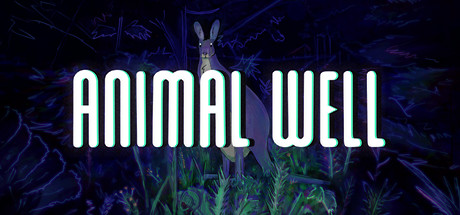

# 2024 in Video Games — April–June

[← All of 2024](../2024.md) · [Back to index](../../README.md)

257 titles.

### #BLUD

**Platforms:** Windows, Nintendo Switch, PlayStation 4, Xbox One &nbsp;|&nbsp; **Developer:** Exit 73 Studios &nbsp;|&nbsp; **Publisher:** Humble Games &nbsp;|&nbsp; **Genre:** Dungeon crawl &nbsp;|&nbsp; **Released:** June 18

[Wikipedia](https://en.wikipedia.org/wiki/HashtagBlud)

---

### 1000xRESIST

**Platforms:** Windows, Nintendo Switch &nbsp;|&nbsp; **Developer:** sunset visitor &nbsp;|&nbsp; **Publisher:** Fellow Traveller &nbsp;|&nbsp; **Genre:** Adventure &nbsp;|&nbsp; **Released:** May 9

> 1000xRESIST is a thrilling sci-fi adventure. The year is unknown, and a disease spread by an alien invasion keeps you underground. You are Watcher. You dutifully fulfil your purpose in serving the ALLMOTHER, until the day you discover a shocking secret that changes everything. The game blends visual novel, walking simulator, and third-person exploration as you navigate nonlinear memories and unravel the mystery of what really happened—and what’s still being kept from you.
>
> _Synopsis source: IGDB_

[Wikipedia](https://en.wikipedia.org/wiki/1000xRESIST) · [IGDB](https://www.igdb.com/games/1000xresist)

---

### Aeruta

**Platforms:** Windows &nbsp;|&nbsp; **Developer:** FromDawn Games &nbsp;|&nbsp; **Publisher:** Gravity Game Arise &nbsp;|&nbsp; **Genre:** Action RPG, Life sim &nbsp;|&nbsp; **Type:** Early access &nbsp;|&nbsp; **Released:** May 15

---

### Aimlabs

**Platforms:** Xbox Series X/S &nbsp;|&nbsp; **Developer:** State Space Labs &nbsp;|&nbsp; **Publisher:** State Space Labs &nbsp;|&nbsp; **Genre:** FPS, TPS &nbsp;|&nbsp; **Released:** June 28

[Wikipedia](https://en.wikipedia.org/wiki/Aimlabs)

---

### Alleyway

**Platforms:** Nintendo Switch &nbsp;|&nbsp; **Developer:** Intelligent Systems , Nintendo R&D1 &nbsp;|&nbsp; **Publisher:** Nintendo &nbsp;|&nbsp; **Genre:** Breakout clone &nbsp;|&nbsp; **Type:** Port &nbsp;|&nbsp; **Released:** May 15

[Wikipedia](https://en.wikipedia.org/wiki/Alleyway_(video_game))

---

### Amazing Hebereke

**Platforms:** Nintendo Switch &nbsp;|&nbsp; **Developer:** Sunsoft, OLM &nbsp;|&nbsp; **Publisher:** Sunsoft &nbsp;|&nbsp; **Genre:** Fighting &nbsp;|&nbsp; **Type:** Port &nbsp;|&nbsp; **Released:** April 12

[Wikipedia](https://en.wikipedia.org/wiki/Sugoi_Hebereke)

---

### AneeMate

**Platforms:** Windows &nbsp;|&nbsp; **Developer:** QORPO Game Studio &nbsp;|&nbsp; **Publisher:** QORPO Game Studio &nbsp;|&nbsp; **Genre:** Role-playing (RPG) &nbsp;|&nbsp; **Released:** June 30, 2024

> AneeMate is a PvPvE creature extraction shooter where survival means more than just staying alive—you must rescue, evolve, and fight for the future of the AneeMates. Built in Unreal Engine 5, this high-intensity adventure blends exploration, combat, and AI-driven strategy, creating a dynamic and unpredictable battleground.  Explore, Catch, Level Up—Decide the Fate of AneeMates
>
> _Synopsis source: IGDB_

[IGDB](https://www.igdb.com/games/aneemate)

---

### Animal Well

**Platforms:** PlayStation 5, Nintendo Switch, Windows, Xbox Series X/S &nbsp;|&nbsp; **Developer:** Shared Memory &nbsp;|&nbsp; **Publisher:** Bigmode &nbsp;|&nbsp; **Genre:** Metroidvania, Puzzle &nbsp;|&nbsp; **Released:** May 9, 2024

> Explore a dense, interconnected labyrinth, and unravel its many secrets. Collect items to manipulate your environment in surprising and meaningful ways. Encounter beautiful and unsettling creatures, as you attempt to survive what lurks in the dark. There is more than what you see.
>
> _Synopsis source: Steam_

[Wikipedia](https://en.wikipedia.org/wiki/Animal_Well) · [Steam](https://store.steampowered.com/app/813230) · [IGDB](https://www.igdb.com/games/animal-well)

---

### Anomaly Collapse

**Platforms:** Windows &nbsp;|&nbsp; **Developer:** RocketPunch Games &nbsp;|&nbsp; **Publisher:** Spiral Up Games &nbsp;|&nbsp; **Genre:** TBS, Roguelike &nbsp;|&nbsp; **Released:** April 12

[Wikipedia](https://en.wikipedia.org/wiki/Anomaly_Collapse)

---

### Another Crab's Treasure

**Platforms:** Windows, Nintendo Switch, PlayStation 5, Xbox Series X/S &nbsp;|&nbsp; **Developer:** Aggro Crab &nbsp;|&nbsp; **Publisher:** Aggro Crab &nbsp;|&nbsp; **Genre:** Action-adventure &nbsp;|&nbsp; **Released:** April 25

> Another Crab’s Treasure is a soulslike adventure set in a crumbling underwater world plagued by a mysterious curse. As Kril the hermit crab, you’ll need to wear the trash around you as shells to withstand attacks from enemies many times your size. Embark on an epic treasure hunt to buy back your repossessed shell, and discover the dark secrets behind the polluted ocean.
>
> _Synopsis source: IGDB_

[Wikipedia](https://en.wikipedia.org/wiki/Another_Crab%27s_Treasure) · [IGDB](https://www.igdb.com/games/another-crabs-treasure)

---

### Anthology of the Killer

**Platforms:** Windows, macOS, Linux &nbsp;|&nbsp; **Developer:** thecatamites &nbsp;|&nbsp; **Publisher:** thecatamites &nbsp;|&nbsp; **Genre:** Horror &nbsp;|&nbsp; **Released:** May 28

[Wikipedia](https://en.wikipedia.org/wiki/Anthology_of_the_Killer)

---

### Arcana Alchemia

**Platforms:** Nintendo Switch, PlayStation 4 &nbsp;|&nbsp; **Developer:** Lump of Sugar &nbsp;|&nbsp; **Publisher:** Entergram &nbsp;|&nbsp; **Genre:** Visual novel &nbsp;|&nbsp; **Released:** June 27 (JP)

---

### Arctic Eggs

**Platforms:** Windows, macOS, Linux &nbsp;|&nbsp; **Developer:** The Water Museum, cockydoody, abmarnie, Cameron Ginex &nbsp;|&nbsp; **Publisher:** The Water Museum &nbsp;|&nbsp; **Genre:** Cooking &nbsp;|&nbsp; **Released:** May 16

[Wikipedia](https://en.wikipedia.org/wiki/Arctic_Eggs)

---

### Assault Suit Leynos 2 Saturn Tribute

**Platforms:** Windows, Nintendo Switch, PlayStation 4, Xbox One &nbsp;|&nbsp; **Developer:** City Connection &nbsp;|&nbsp; **Publisher:** City Connection &nbsp;|&nbsp; **Genre:** Shoot 'em up &nbsp;|&nbsp; **Released:** April 25

[Wikipedia](https://en.wikipedia.org/wiki/Assault_Suit_Leynos_2)

---

### Astor: Blade of the Monolith

**Platforms:** Windows, Nintendo Switch, PlayStation 4, PlayStation 5, Xbox One, Xbox Series X/S &nbsp;|&nbsp; **Developer:** C2 Game Studio &nbsp;|&nbsp; **Publisher:** Versus Evil &nbsp;|&nbsp; **Genre:** Action RPG &nbsp;|&nbsp; **Released:** May 30

---

### Backpack Hero

**Platforms:** PlayStation 4, PlayStation 5, Xbox One, Xbox Series X/S &nbsp;|&nbsp; **Developer:** Jaspel &nbsp;|&nbsp; **Publisher:** IndieArk, Different Tales &nbsp;|&nbsp; **Genre:** Roguelike &nbsp;|&nbsp; **Released:** June 11

[Wikipedia](https://en.wikipedia.org/wiki/Backpack_Hero)

---

### Baladins

**Platforms:** Windows &nbsp;|&nbsp; **Developer:** Seed by Seed &nbsp;|&nbsp; **Publisher:** Armor Games Studios &nbsp;|&nbsp; **Genre:** Adventure &nbsp;|&nbsp; **Released:** May 15

---

### Banana

**Platforms:** Windows &nbsp;|&nbsp; **Genre:** Clicker game &nbsp;|&nbsp; **Released:** April 23, 2024

> Banana is a clicker Game, in which you click a Banana! In Banana you click the Banana to gain even more Bananas!!
>
> _Synopsis source: IGDB_

[Wikipedia](https://en.wikipedia.org/wiki/Banana_(2024_video_game)) · [IGDB](https://www.igdb.com/games/banana--3)

---

### Baseball (Game Boy)

**Platforms:** Nintendo Switch &nbsp;|&nbsp; **Developer:** Intelligent Systems , Nintendo R&D1 &nbsp;|&nbsp; **Publisher:** Nintendo &nbsp;|&nbsp; **Genre:** Sports &nbsp;|&nbsp; **Type:** Port &nbsp;|&nbsp; **Released:** May 15

[Wikipedia](https://en.wikipedia.org/wiki/Baseball_(1983_video_game))

---

### Baten Kaitos I & II HD Remaster

**Platforms:** Windows &nbsp;|&nbsp; **Developer:** Monolith Soft , logicalbeat &nbsp;|&nbsp; **Publisher:** Bandai Namco Entertainment &nbsp;|&nbsp; **Genre:** RPG &nbsp;|&nbsp; **Type:** Remaster, Compilation &nbsp;|&nbsp; **Released:** June 17

[Wikipedia](https://en.wikipedia.org/wiki/Baten_Kaitos_I_%26_II_HD_Remaster)

---

### Bendy: Secrets of the Machine

**Platforms:** Windows &nbsp;|&nbsp; **Developer:** Joey Drew Studios &nbsp;|&nbsp; **Publisher:** Joey Drew Studios &nbsp;|&nbsp; **Genre:** Survival horror &nbsp;|&nbsp; **Released:** April 14

[Wikipedia](https://en.wikipedia.org/wiki/Bendy_(franchise))

---

### Beyond Good & Evil: 20th Anniversary Edition

**Platforms:** Windows, Nintendo Switch, PlayStation 4, PlayStation 5, Xbox One, Xbox Series X/S &nbsp;|&nbsp; **Developer:** Ubisoft Montpellier &nbsp;|&nbsp; **Publisher:** Ubisoft &nbsp;|&nbsp; **Genre:** Action-adventure, Stealth &nbsp;|&nbsp; **Type:** Remaster &nbsp;|&nbsp; **Released:** June 25

---

### Biomorph

**Platforms:** Windows, PlayStation 5 &nbsp;|&nbsp; **Developer:** Lucid Dreams Studio &nbsp;|&nbsp; **Publisher:** Lucid Dreams Studio &nbsp;|&nbsp; **Genre:** Soulslike, Metroidvania &nbsp;|&nbsp; **Released:** April 5

[Wikipedia](https://en.wikipedia.org/wiki/Biomorph_(video_game))

---

### Biomutant

**Platforms:** Nintendo Switch &nbsp;|&nbsp; **Developer:** Experiment 101 &nbsp;|&nbsp; **Publisher:** THQ Nordic &nbsp;|&nbsp; **Genre:** Action RPG &nbsp;|&nbsp; **Type:** Port &nbsp;|&nbsp; **Released:** May 14

[Wikipedia](https://en.wikipedia.org/wiki/Biomutant)

---

### Blade & Sorcery

**Platforms:** Windows, Meta Quest, PICO 4 &nbsp;|&nbsp; **Developer:** WarpFrog &nbsp;|&nbsp; **Publisher:** WarpFrog &nbsp;|&nbsp; **Genre:** Fighting video game, sandbox game &nbsp;|&nbsp; **Released:** June 17, 2024

[Wikipedia](https://en.wikipedia.org/wiki/Blade_&_Sorcery)

---

### Bleach: Brave Souls

**Platforms:** Xbox One, Xbox Series X/S, Nintendo Switch &nbsp;|&nbsp; **Developer:** KLabGames &nbsp;|&nbsp; **Publisher:** KLabGames &nbsp;|&nbsp; **Genre:** Brawler &nbsp;|&nbsp; **Type:** Port &nbsp;|&nbsp; **Released:** June 27

---

### Blockbuster Inc.

**Platforms:** Windows &nbsp;|&nbsp; **Developer:** Super Sly Fox &nbsp;|&nbsp; **Publisher:** Ancient Forge &nbsp;|&nbsp; **Genre:** Simulation &nbsp;|&nbsp; **Released:** June 6

---

### Bodycam

**Platforms:** Windows &nbsp;|&nbsp; **Developer:** Reissad Studio &nbsp;|&nbsp; **Publisher:** Reissad Studio &nbsp;|&nbsp; **Genre:** Simulator, Strategy, Indie &nbsp;|&nbsp; **Released:** June 7, 2024

> Bodycam is an ultra-realistic multiplayer, first-person shooter game made using the latest technologies of the next-gen game engine Unreal Engine 5. Get ready to dive into fast-paced Bodycam actions, where every bullet counts and every choice can decide over the victory or loss of your team.
>
> _Synopsis source: IGDB_

[IGDB](https://www.igdb.com/games/bodycam)

---

### Botany Manor

**Platforms:** Windows, Nintendo Switch, Xbox One, Xbox Series X/S &nbsp;|&nbsp; **Developer:** Balloon Studios &nbsp;|&nbsp; **Publisher:** Whitethorn Games &nbsp;|&nbsp; **Genre:** Adventure, Puzzle &nbsp;|&nbsp; **Released:** April 9

> Welcome to Botany Manor, a stately home in 19th century England. You play as its inhabitant Arabella Greene, a retired botanist. Explore your house and gardens, filled with botanical research, to figure out the ideal habitat for a collection of forgotten flora. Grow each plant to discover the mysterious qualities they hold…
>
> _Synopsis source: IGDB_

[Wikipedia](https://en.wikipedia.org/wiki/Botany_Manor) · [IGDB](https://www.igdb.com/games/botany-manor)

---

### Braid Anniversary Edition

**Platforms:** Windows, Nintendo Switch, PlayStation 4, PlayStation 5, Xbox One, Xbox Series X/S, iOS, Android &nbsp;|&nbsp; **Developer:** Thekla &nbsp;|&nbsp; **Publisher:** Thekla &nbsp;|&nbsp; **Genre:** Puzzle &nbsp;|&nbsp; **Released:** May 14

> Solve puzzles by changing the flow of time in this remaster of the classic, award-winning game Braid. This remaster has new puzzles, hand-repainted graphics and fully reimagined sound, and a completely unreasonable amount of developer commentary.
>
> _Synopsis source: IGDB_

[Wikipedia](https://en.wikipedia.org/wiki/Braid_(video_game)) · [IGDB](https://www.igdb.com/games/braid-anniversary-edition)

---

### Broken Roads

**Platforms:** Windows, PlayStation 4, PlayStation 5, Xbox One, Xbox Series X/S &nbsp;|&nbsp; **Developer:** Drop Bear Bytes &nbsp;|&nbsp; **Publisher:** Versus Evil &nbsp;|&nbsp; **Genre:** RPG &nbsp;|&nbsp; **Released:** April 10

[Wikipedia](https://en.wikipedia.org/wiki/Broken_Roads_(video_game))

---

### Bunny Garden

**Platforms:** Windows, Nintendo Switch &nbsp;|&nbsp; **Developer:** qureate &nbsp;|&nbsp; **Publisher:** qureate &nbsp;|&nbsp; **Genre:** Dating sim &nbsp;|&nbsp; **Released:** April 18

[Wikipedia](https://en.wikipedia.org/wiki/Bunny_Garden)

---

### C.A.R.D.S. RPG: The Misty Battlefield

**Platforms:** Windows, Nintendo Switch, PlayStation 4, PlayStation 5 &nbsp;|&nbsp; **Developer:** Acquire &nbsp;|&nbsp; **Publisher:** Acquire &nbsp;|&nbsp; **Genre:** Tactical RPG &nbsp;|&nbsp; **Released:** May 23

---

### Capes

**Platforms:** Windows, Nintendo Switch, PlayStation 4, PlayStation 5, Xbox One, Xbox Series X/S &nbsp;|&nbsp; **Developer:** Spitfire Interactive &nbsp;|&nbsp; **Publisher:** Daedalic Entertainment &nbsp;|&nbsp; **Genre:** TBS &nbsp;|&nbsp; **Released:** May 29

---

### Chained Together

**Platforms:** Windows &nbsp;|&nbsp; **Developer:** Anegar Games &nbsp;|&nbsp; **Publisher:** Anegar Games &nbsp;|&nbsp; **Genre:** Platformer &nbsp;|&nbsp; **Released:** June 19

> From the depths of hell, climb chained to your friends through diverse worlds. Solo or co-op, try to reach the summit and discover what awaits you there...
>
> _Synopsis source: IGDB_

[Wikipedia](https://en.wikipedia.org/wiki/Chained_Together) · [IGDB](https://www.igdb.com/games/chained-together)

---

### Children of the Sun

**Platforms:** Windows &nbsp;|&nbsp; **Developer:** Rene Rother &nbsp;|&nbsp; **Publisher:** Devolver Digital &nbsp;|&nbsp; **Genre:** TPS, Puzzle &nbsp;|&nbsp; **Released:** April 9

> Burning with anger, The girl wages a one-woman war against the cult, taking them down cultist by cultist, bullet by bullet, until she reaches her true target: the leader. Along the way she will unravel the dark truth about this mysterious order and the atrocities committed by them in the name of their master. In this tactical third-person puzzle-shooter you assume control of one bullet, guiding it through increasingly complex and challenging levels to kill cultists, trigger traps, and reshape the environment. Every shot counts and ruthless precision is rewarded. Taking down the cult is deeply satisfying; doing it with style even more so.
>
> _Synopsis source: IGDB_

[Wikipedia](https://en.wikipedia.org/wiki/Children_of_the_Sun_(video_game)) · [IGDB](https://www.igdb.com/games/children-of-the-sun)

---

### Class of Heroes 2G : Remaster Edition

**Platforms:** Windows, Nintendo Switch, PlayStation 5 &nbsp;|&nbsp; **Developer:** Acquire &nbsp;|&nbsp; **Publisher:** Acquire , PQube &nbsp;|&nbsp; **Genre:** RPG, Dungeon crawl &nbsp;|&nbsp; **Type:** Remaster &nbsp;|&nbsp; **Released:** April 26

[Wikipedia](https://en.wikipedia.org/wiki/Class_of_Heroes_2G)

---

### Class of Heroes: Anniversary Edition

**Platforms:** Windows, Nintendo Switch, PlayStation 5 &nbsp;|&nbsp; **Developer:** Acquire &nbsp;|&nbsp; **Publisher:** Acquire , PQube &nbsp;|&nbsp; **Genre:** RPG, Dungeon crawl &nbsp;|&nbsp; **Type:** Remake &nbsp;|&nbsp; **Released:** April 26

---

### Content Warning

**Platforms:** Windows &nbsp;|&nbsp; **Developer:** Skog, Zorro, Wilnyl, Philip, thePetHen &nbsp;|&nbsp; **Publisher:** Landfall Publishing &nbsp;|&nbsp; **Genre:** Survival horror &nbsp;|&nbsp; **Released:** April 1

> Film your friends doing scary things to become SpöökTube famous!
>
> _Synopsis source: IGDB_

[Wikipedia](https://en.wikipedia.org/wiki/Content_Warning) · [IGDB](https://www.igdb.com/games/content-warning)

---

### CookieRun: Tower of Adventures

**Platforms:** iOS, Android &nbsp;|&nbsp; **Developer:** Devsisters &nbsp;|&nbsp; **Publisher:** Devsisters &nbsp;|&nbsp; **Genre:** Action RPG, Platformer &nbsp;|&nbsp; **Released:** June 25

---

### Cozy Grove : Camp Spirit

**Platforms:** iOS, Android &nbsp;|&nbsp; **Developer:** Spry Fox &nbsp;|&nbsp; **Publisher:** Spry Fox &nbsp;|&nbsp; **Genre:** Life sim &nbsp;|&nbsp; **Released:** June 25

[Wikipedia](https://en.wikipedia.org/wiki/Cozy_Grove)

---

### Crow Country

**Platforms:** Windows, PlayStation 5, Xbox Series X/S, Nintendo Switch, PlayStation 4 &nbsp;|&nbsp; **Developer:** SFB Games &nbsp;|&nbsp; **Publisher:** SFB Games &nbsp;|&nbsp; **Genre:** Survival horror &nbsp;|&nbsp; **Released:** May 9

> The year is 1990. Edward Crow has disappeared. The owner of 'Crow Country', he has not been seen since he unexpectedly shut down his park two years ago. The silence is broken when a mysterious young woman named Mara Forest ventures into the heart of the abandoned theme park in order to find him.
>
> _Synopsis source: IGDB_

[Wikipedia](https://en.wikipedia.org/wiki/Crow_Country) · [IGDB](https://www.igdb.com/games/crow-country)

---

### Crown Wars: The Black Prince

**Platforms:** Windows, PlayStation 5, Xbox Series X/S &nbsp;|&nbsp; **Developer:** Artefacts Studio &nbsp;|&nbsp; **Publisher:** Nacon &nbsp;|&nbsp; **Genre:** TBS &nbsp;|&nbsp; **Released:** May 23

---

### Cryptmaster

**Platforms:** Windows, PlayStation 4, PlayStation 5, Xbox One, Xbox Series X/S &nbsp;|&nbsp; **Developer:** Akupara Games &nbsp;|&nbsp; **Publisher:** Akupara Games &nbsp;|&nbsp; **Genre:** Dungeon crawl &nbsp;|&nbsp; **Released:** May 9

> Say anything in this bizarre dungeon adventure where words control everything. Fill in the blanks with text or voice to uncover lost abilities, solve strange quests, and play unexpected mini-games. Use your words to conquer the crypt and unleash a whole new kind of "spell casting!"
>
> _Synopsis source: IGDB_

[Wikipedia](https://en.wikipedia.org/wiki/Cryptmaster) · [IGDB](https://www.igdb.com/games/cryptmaster)

---

### Cupid Parasite: Sweet & Spicy Darling

**Platforms:** Nintendo Switch &nbsp;|&nbsp; **Developer:** Idea Factory &nbsp;|&nbsp; **Publisher:** Idea Factory International &nbsp;|&nbsp; **Genre:** Visual novel &nbsp;|&nbsp; **Released:** May 28

---

### Cyber Citizen Shockman 3: The Princess from Another World

**Platforms:** Nintendo Switch, PlayStation 4, PlayStation 5, Xbox One, Xbox Series X/S &nbsp;|&nbsp; **Developer:** Shinyuden &nbsp;|&nbsp; **Publisher:** Ratalaika Games &nbsp;|&nbsp; **Genre:** Action, Platformer &nbsp;|&nbsp; **Released:** May 3

---

### Dance Dance Revolution World

**Genre:** Music &nbsp;|&nbsp; **Released:** June 12, 2024

[Wikipedia](https://en.wikipedia.org/wiki/Dance_Dance_Revolution_World)

---

### Dave the Diver

**Platforms:** PlayStation 4, PlayStation 5 &nbsp;|&nbsp; **Developer:** Mintrocket &nbsp;|&nbsp; **Publisher:** Mintrocket &nbsp;|&nbsp; **Genre:** Fishing , Adventure &nbsp;|&nbsp; **Type:** Port &nbsp;|&nbsp; **Released:** April 16

[Wikipedia](https://en.wikipedia.org/wiki/Dave_the_Diver)

---

### Dementium: The Ward

**Platforms:** PlayStation 4, PlayStation 5 &nbsp;|&nbsp; **Developer:** atooi &nbsp;|&nbsp; **Publisher:** atooi &nbsp;|&nbsp; **Genre:** Horror, FPS &nbsp;|&nbsp; **Released:** April 19

---

### Demon Slayer: Kimetsu no Yaiba – Sweep the Board

**Platforms:** Nintendo Switch, Windows, PlayStation 4, PlayStation 5, Xbox One, Xbox Series X/S &nbsp;|&nbsp; **Developer:** CyberConnect2 &nbsp;|&nbsp; **Publisher:** Aniplex &nbsp;|&nbsp; **Genre:** Digital tabletop &nbsp;|&nbsp; **Released:** April 25 (JP/WW)

---

### Destiny 2: The Final Shape

**Platforms:** Windows, PlayStation 4, PlayStation 5, Xbox One, Xbox Series X/S &nbsp;|&nbsp; **Developer:** Bungie &nbsp;|&nbsp; **Publisher:** Bungie &nbsp;|&nbsp; **Genre:** FPS, Action RPG &nbsp;|&nbsp; **Released:** June 4

---

### Devil Blade Reboot

**Platforms:** Windows &nbsp;|&nbsp; **Developer:** Shigatake Games &nbsp;|&nbsp; **Publisher:** Shigatake Games &nbsp;|&nbsp; **Genre:** Scrolling shooter (vertical) &nbsp;|&nbsp; **Type:** Remake &nbsp;|&nbsp; **Released:** May 24

---

### Dragon Ball Xenoverse 2

**Platforms:** PlayStation 5, Xbox Series X/S &nbsp;|&nbsp; **Developer:** Dimps &nbsp;|&nbsp; **Publisher:** Bandai Namco Entertainment &nbsp;|&nbsp; **Genre:** Fighting, RPG &nbsp;|&nbsp; **Released:** May 24

[Wikipedia](https://en.wikipedia.org/wiki/Dragon_Ball_Xenoverse_2)

---

### Dread Delusion

**Platforms:** Windows &nbsp;|&nbsp; **Developer:** Lovely Hellplace &nbsp;|&nbsp; **Publisher:** DreadXP &nbsp;|&nbsp; **Genre:** RPG &nbsp;|&nbsp; **Released:** May 14

[Wikipedia](https://en.wikipedia.org/wiki/Dread_Delusion)

---

### Duck Detective: The Secret Salami

**Platforms:** Windows, macOS, Linux, Nintendo Switch &nbsp;|&nbsp; **Developer:** Happy Broccoli Games &nbsp;|&nbsp; **Publisher:** Happy Broccoli Games &nbsp;|&nbsp; **Genre:** Adventure &nbsp;|&nbsp; **Released:** May 23

> Solving crime is no walk in the pond. You are a down-on-his-luck detective who also happens to be a duck. Use your powers of de-duck-tion to inspect evidence, fill in the blanks, and bust the case wide open, in a narrative mystery adventure where nothing is quite as it seems.
>
> _Synopsis source: IGDB_

[IGDB](https://www.igdb.com/games/duck-detective-the-secret-salami)

---

### Dungeon Artifact

**Platforms:** Windows &nbsp;|&nbsp; **Developer:** itokon &nbsp;|&nbsp; **Publisher:** ExertionGame &nbsp;|&nbsp; **Genre:** Deck building, Roguelike &nbsp;|&nbsp; **Type:** Early access &nbsp;|&nbsp; **Released:** April 3

---

### Dystopika

**Developer:** Voids Within &nbsp;|&nbsp; **Publisher:** Voids Within, UNIKAT Label &nbsp;|&nbsp; **Genre:** urban sandbox, cozy game &nbsp;|&nbsp; **Released:** June 21, 2024

[Wikipedia](https://en.wikipedia.org/wiki/Dystopika)

---

### Earth Defense Force: World Brothers 2

**Platforms:** Nintendo Switch, PlayStation 4, PlayStation 5, Windows &nbsp;|&nbsp; **Developer:** Yuke's &nbsp;|&nbsp; **Publisher:** D3 Publisher &nbsp;|&nbsp; **Genre:** TPS &nbsp;|&nbsp; **Released:** May 23 (JP)

---

### Echo Generation: Midnight Edition

**Platforms:** Windows, Nintendo Switch &nbsp;|&nbsp; **Developer:** Cococucumber &nbsp;|&nbsp; **Publisher:** Cococucumber &nbsp;|&nbsp; **Genre:** Adventure &nbsp;|&nbsp; **Released:** June 19

---

### Eiyuden Chronicle: Hundred Heroes

**Platforms:** Windows, Nintendo Switch, PlayStation 4, PlayStation 5, Xbox One, Xbox Series X/S &nbsp;|&nbsp; **Developer:** Rabbit and Bear Studios &nbsp;|&nbsp; **Publisher:** 505 Games &nbsp;|&nbsp; **Genre:** RPG &nbsp;|&nbsp; **Released:** April 23

> Eiyuden Chronicles: Hundred Heroes is designed to bring players a modern take on a classic JRPG experience. Get ready to lead 100+ playable characters through a war-torn world only you can save.
>
> _Synopsis source: IGDB_

[IGDB](https://www.igdb.com/games/eiyuden-chronicle-hundred-heroes)

---

### El Shaddai: Ascension of the Metatron - HD Remaster

**Platforms:** Nintendo Switch &nbsp;|&nbsp; **Developer:** crim &nbsp;|&nbsp; **Publisher:** Rainy Frog &nbsp;|&nbsp; **Genre:** Action-adventure &nbsp;|&nbsp; **Type:** Remaster &nbsp;|&nbsp; **Released:** April 28

---

### Elden Ring Shadow of the Erdtree

**Platforms:** PlayStation 4, PlayStation 5, Windows, Xbox One, Xbox Series X/S &nbsp;|&nbsp; **Developer:** FromSoftware &nbsp;|&nbsp; **Publisher:** Bandai Namco Entertainment &nbsp;|&nbsp; **Genre:** Action RPG &nbsp;|&nbsp; **Type:** Expansion &nbsp;|&nbsp; **Released:** June 21, 2024

[Wikipedia](https://en.wikipedia.org/wiki/Elden_Ring_Shadow_of_the_Erdtree)

---

### Empires of the Undergrowth

**Platforms:** Windows &nbsp;|&nbsp; **Developer:** Slug Disco Studios &nbsp;|&nbsp; **Publisher:** Hooded Horse &nbsp;|&nbsp; **Genre:** RTS &nbsp;|&nbsp; **Released:** June 7

[Wikipedia](https://en.wikipedia.org/wiki/Empires_of_the_Undergrowth)

---

### Endless Ocean Luminous

**Platforms:** Nintendo Switch &nbsp;|&nbsp; **Developer:** Arika &nbsp;|&nbsp; **Publisher:** Nintendo &nbsp;|&nbsp; **Genre:** Adventure, Simulation &nbsp;|&nbsp; **Released:** May 2

[Wikipedia](https://en.wikipedia.org/wiki/Endless_Ocean_Luminous)

---

### Ereban: Shadow Legacy

**Platforms:** Windows &nbsp;|&nbsp; **Developer:** Baby Robot Games &nbsp;|&nbsp; **Publisher:** Baby Robot Games &nbsp;|&nbsp; **Genre:** Stealth, Action, Platformer &nbsp;|&nbsp; **Released:** April 10

---

### Eternal Threads

**Platforms:** Nintendo Switch, PlayStation 4, PlayStation 5, Xbox One, Xbox Series X/S &nbsp;|&nbsp; **Developer:** Cosmonaut Studios &nbsp;|&nbsp; **Publisher:** Secret Mode &nbsp;|&nbsp; **Genre:** Puzzle &nbsp;|&nbsp; **Released:** May 23

---

### Everafter Falls

**Platforms:** Windows, Nintendo Switch, PlayStation 4, PlayStation 5, Xbox One, Xbox Series X/S &nbsp;|&nbsp; **Developer:** SquareHusky &nbsp;|&nbsp; **Publisher:** Akupara Games &nbsp;|&nbsp; **Genre:** Farming &nbsp;|&nbsp; **Released:** June 20

---

### Exo One

**Platforms:** PlayStation 4, PlayStation 5 &nbsp;|&nbsp; **Developer:** Exbleative &nbsp;|&nbsp; **Publisher:** All in! Games &nbsp;|&nbsp; **Genre:** Adventure &nbsp;|&nbsp; **Released:** June 27

[Wikipedia](https://en.wikipedia.org/wiki/Exo_One)

---

### Extreme-G

**Platforms:** Nintendo Switch &nbsp;|&nbsp; **Developer:** Probe Entertainment &nbsp;|&nbsp; **Publisher:** Acclaim Entertainment &nbsp;|&nbsp; **Genre:** Racing &nbsp;|&nbsp; **Type:** Port &nbsp;|&nbsp; **Released:** April 24

[Wikipedia](https://en.wikipedia.org/wiki/Extreme-G)

---

### F1 24

**Platforms:** Windows, PlayStation 4, PlayStation 5, Xbox One, Xbox Series X/S &nbsp;|&nbsp; **Developer:** Codemasters &nbsp;|&nbsp; **Publisher:** EA Sports &nbsp;|&nbsp; **Genre:** Racing &nbsp;|&nbsp; **Released:** May 31

> Get ready to ignite your passion for racing and get closer to the grid like never before with EA SPORTS F1 24, the official videogame of the 2024 FIA Formula One World Championship
>
> _Synopsis source: IGDB_

[Wikipedia](https://en.wikipedia.org/wiki/F1_24) · [IGDB](https://www.igdb.com/games/f1-24)

---

### Fabledom

**Platforms:** Windows, Nintendo Switch, PlayStation 5, Xbox Series X/S &nbsp;|&nbsp; **Developer:** Grenaa Games &nbsp;|&nbsp; **Publisher:** Dear Villagers &nbsp;|&nbsp; **Genre:** Simulation &nbsp;|&nbsp; **Released:** May 13

> Once upon a Village.. Set in a wholesome fairytale world, Fabledom is the ideal laid back City builder. Enjoy the growth of your settlement, trade and use diplomacy to ally or challenge your neighbors, and most importantly, find yourself a prince or princess and live happily ever after!
>
> _Synopsis source: IGDB_

[Wikipedia](https://en.wikipedia.org/wiki/Fabledom) · [IGDB](https://www.igdb.com/games/fabledom)

---

### Five Nights at Freddy's: Help Wanted 2

**Platforms:** PlayStation 5, Nintendo Switch &nbsp;|&nbsp; **Developer:** Scott Cawthon , Steel Wool Studios &nbsp;|&nbsp; **Publisher:** Scott Cawthon , Steel Wool Studios &nbsp;|&nbsp; **Genre:** Survival horror &nbsp;|&nbsp; **Type:** Port &nbsp;|&nbsp; **Released:** June 20

---

### Foundry

**Platforms:** Windows &nbsp;|&nbsp; **Developer:** Channel 3 Entertainment &nbsp;|&nbsp; **Publisher:** Paradox Interactive &nbsp;|&nbsp; **Genre:** Factory simulation &nbsp;|&nbsp; **Released:** May 2, 2024

[Wikipedia](https://en.wikipedia.org/wiki/Foundry_(video_game))

---

### Freddi Fish 2: The Case of the Haunted Schoolhouse

**Platforms:** Nintendo Switch, PlayStation 4 &nbsp;|&nbsp; **Developer:** Humongous Entertainment &nbsp;|&nbsp; **Publisher:** UFO Interactive Games &nbsp;|&nbsp; **Genre:** Adventure &nbsp;|&nbsp; **Released:** May 2

---

### Freddi Fish 5: The Case of the Creature of Coral Cove

**Platforms:** Nintendo Switch, PlayStation 4 &nbsp;|&nbsp; **Developer:** Humongous Entertainment &nbsp;|&nbsp; **Publisher:** UFO Interactive Games &nbsp;|&nbsp; **Genre:** Adventure &nbsp;|&nbsp; **Released:** May 2

---

### Freedom Planet 2

**Platforms:** Nintendo Switch, PlayStation 4, PlayStation 5, Xbox One, Xbox Series X/S &nbsp;|&nbsp; **Developer:** GalaxyTrail &nbsp;|&nbsp; **Publisher:** Xseed Games &nbsp;|&nbsp; **Genre:** Platformer &nbsp;|&nbsp; **Type:** Port &nbsp;|&nbsp; **Released:** April 4

[Wikipedia](https://en.wikipedia.org/wiki/Freedom_Planet_2)

---

### Frogun Encore

**Platforms:** Windows, Linux, Nintendo Switch, PlayStation 4, PlayStation 5, Xbox One, Xbox Series X/S &nbsp;|&nbsp; **Developer:** Molegato &nbsp;|&nbsp; **Publisher:** Top Hat Studios &nbsp;|&nbsp; **Genre:** Platformer &nbsp;|&nbsp; **Released:** June 25

[Wikipedia](https://en.wikipedia.org/wiki/Frogun)

---

### Front Mission 2 : Remake

**Platforms:** Windows, PlayStation 4, PlayStation 5, Xbox One, Xbox Series X/S &nbsp;|&nbsp; **Developer:** Storm Trident &nbsp;|&nbsp; **Publisher:** Forever Entertainment &nbsp;|&nbsp; **Genre:** Tactical RPG &nbsp;|&nbsp; **Type:** Port &nbsp;|&nbsp; **Released:** April 30

[Wikipedia](https://en.wikipedia.org/wiki/Front_Mission_2)

---

### Gakuen Idolmaster

**Platforms:** iOS, Android &nbsp;|&nbsp; **Developer:** QualiArts &nbsp;|&nbsp; **Publisher:** Bandai Namco Entertainment &nbsp;|&nbsp; **Genre:** Raising sim &nbsp;|&nbsp; **Released:** May 16 (JP)

> An idol raising simulation mobile game in The Idolmaster series featuring a completely new branch of idols. Enroll in Hatsuboshi Gakuen to learn the ropes of being a producer by partnering up with various idol students to help them raise to the top!
>
> _Synopsis source: IGDB_

[Wikipedia](https://en.wikipedia.org/wiki/Gakuen_Idolmaster) · [IGDB](https://www.igdb.com/games/gakuen-idolmaster)

---

### Galacticare

**Platforms:** Windows, PlayStation 5, Xbox Series X/S &nbsp;|&nbsp; **Developer:** Brightrock Games &nbsp;|&nbsp; **Publisher:** CULT Games &nbsp;|&nbsp; **Genre:** Business sim &nbsp;|&nbsp; **Released:** May 23

[Wikipedia](https://en.wikipedia.org/wiki/Galacticare)

---

### Garage: Bad Dream Adventure

**Platforms:** Nintendo Switch &nbsp;|&nbsp; **Developer:** Sakuba Metal Works, SmokymonkeyS &nbsp;|&nbsp; **Publisher:** Sakuba Metal Works &nbsp;|&nbsp; **Genre:** PCA &nbsp;|&nbsp; **Released:** June 6

---

### Ghost of Tsushima Director's Cut

**Platforms:** Windows &nbsp;|&nbsp; **Developer:** Sucker Punch Productions , Nixxes Software &nbsp;|&nbsp; **Publisher:** Sony Interactive Entertainment &nbsp;|&nbsp; **Genre:** Action-adventure &nbsp;|&nbsp; **Type:** Port &nbsp;|&nbsp; **Released:** May 16

[Wikipedia](https://en.wikipedia.org/wiki/Ghost_of_Tsushima)

---

### Gift

**Platforms:** Windows, Nintendo Switch, PlayStation 5, Xbox Series X/S &nbsp;|&nbsp; **Developer:** Toydium, Million Edge &nbsp;|&nbsp; **Publisher:** Bushiroad Games &nbsp;|&nbsp; **Genre:** Action-adventure &nbsp;|&nbsp; **Released:** May 9

---

### Gigantic: Rampage Edition

**Platforms:** Windows, PlayStation 4, PlayStation 5, Xbox One, Xbox Series X/S &nbsp;|&nbsp; **Developer:** Abstraction Games &nbsp;|&nbsp; **Publisher:** Arc Games &nbsp;|&nbsp; **Genre:** MOBA &nbsp;|&nbsp; **Type:** Rerelease &nbsp;|&nbsp; **Released:** April 9

[Wikipedia](https://en.wikipedia.org/wiki/Gigantic_(video_game))

---

### Gray Zone Warfare

**Platforms:** Windows &nbsp;|&nbsp; **Developer:** MADFINGER Games &nbsp;|&nbsp; **Publisher:** MADFINGER Games &nbsp;|&nbsp; **Genre:** Shooter, Simulator, Adventure &nbsp;|&nbsp; **Released:** April 30, 2024

> Enter a high-stakes PvE-first open-world tactical shooter set on a quarantined Southeast Asian island torn apart by faction warfare. Deploy as an elite operator, fight solo or with your squad to carry out missions, earn reputation, and explore the truth behind the Event igniting the conflict.
>
> _Synopsis source: IGDB_

[IGDB](https://www.igdb.com/games/gray-zone-warfare)

---

### Grounded

**Platforms:** Nintendo Switch, PlayStation 4, PlayStation 5 &nbsp;|&nbsp; **Developer:** Obsidian Entertainment &nbsp;|&nbsp; **Publisher:** Xbox Game Studios &nbsp;|&nbsp; **Genre:** Survival &nbsp;|&nbsp; **Type:** Port &nbsp;|&nbsp; **Released:** April 16

[Wikipedia](https://en.wikipedia.org/wiki/Grounded_(video_game))

---

### Hammerwatch 2

**Platforms:** PlayStation 4, Xbox Series X/S &nbsp;|&nbsp; **Developer:** Crackshell &nbsp;|&nbsp; **Publisher:** Modus Games &nbsp;|&nbsp; **Genre:** Hack and slash, Action RPG &nbsp;|&nbsp; **Released:** April 23

[Wikipedia](https://en.wikipedia.org/wiki/Hammerwatch_2)

---

### Harold Halibut

**Platforms:** Windows, PlayStation 5, Xbox Series X/S &nbsp;|&nbsp; **Developer:** Slow Bros. &nbsp;|&nbsp; **Publisher:** Slow Bros. &nbsp;|&nbsp; **Genre:** Adventure &nbsp;|&nbsp; **Released:** April 16

> Dive into this nautic adventure as curiosity will guide you through a space ship wreck on an unknown planet made up of water. When one of the lead scientists still on board tries to unriddle the possibility of a relaunch young Janitor Harold is around to assist her. Join Harold in his clumsy undertakings to stir up the ark-like ship’s stale day-to-day life and find the secrets that lie behind its doors.  Underwater atmosphere, self-reflective humor and contemporary adventure mechanics make up the foundation of this game created entirely out of craft supplies.
>
> _Synopsis source: IGDB_

[Wikipedia](https://en.wikipedia.org/wiki/Harold_Halibut) · [IGDB](https://www.igdb.com/games/harold-halibut)

---

### Hauntii

**Platforms:** Windows, Nintendo Switch, PlayStation 4, PlayStation 5, Xbox One, Xbox Series X/S &nbsp;|&nbsp; **Developer:** Moonloop Games &nbsp;|&nbsp; **Publisher:** Firestoke &nbsp;|&nbsp; **Genre:** Adventure &nbsp;|&nbsp; **Released:** May 23

---

### Headquarters: World War II

**Platforms:** Windows &nbsp;|&nbsp; **Developer:** Starni Games &nbsp;|&nbsp; **Publisher:** Slitherine Software &nbsp;|&nbsp; **Genre:** TBS, TBT &nbsp;|&nbsp; **Released:** April 11

---

### Heaven Seeker: The Savior of This Cruel World

**Platforms:** Windows, Nintendo Switch, PlayStation 4, PlayStation 5, iOS, Android &nbsp;|&nbsp; **Developer:** Success &nbsp;|&nbsp; **Publisher:** Success &nbsp;|&nbsp; **Genre:** Roguelike, Shoot 'em up (twin-stick) &nbsp;|&nbsp; **Released:** June 21

---

### Hellblade II: Senua's Saga

**Platforms:** Windows, Xbox Series X/S &nbsp;|&nbsp; **Developer:** Ninja Theory &nbsp;|&nbsp; **Publisher:** Xbox Game Studios &nbsp;|&nbsp; **Genre:** Adventure &nbsp;|&nbsp; **Released:** May 21, 2024

> The sequel to the award winning Hellblade: Senua’s Sacrifice, Senua returns in a brutal journey of survival through the myth and torment of Viking Iceland. Intent on saving those who have fallen victim to the horrors of tyranny, Senua faces a battle of overcoming the darkness within and without.
>
> _Synopsis source: IGDB_

[IGDB](https://www.igdb.com/games/hellblade-ii-senuas-saga)

---

### Homeworld 3

**Platforms:** Windows &nbsp;|&nbsp; **Developer:** Blackbird Interactive &nbsp;|&nbsp; **Publisher:** Gearbox Publishing &nbsp;|&nbsp; **Genre:** RTS &nbsp;|&nbsp; **Released:** May 13

[Wikipedia](https://en.wikipedia.org/wiki/Homeworld_3)

---

### Homeworld: Vast Reaches

**Platforms:** Meta Quest &nbsp;|&nbsp; **Developer:** FarBridge &nbsp;|&nbsp; **Publisher:** Gearbox Software &nbsp;|&nbsp; **Genre:** Real-time strategy &nbsp;|&nbsp; **Released:** May 2, 2024

[Wikipedia](https://en.wikipedia.org/wiki/Homeworld:_Vast_Reaches)

---

### Horizon Chase 2

**Platforms:** PlayStation 4, PlayStation 5, Xbox One, Xbox Series X/S &nbsp;|&nbsp; **Developer:** Aquiris &nbsp;|&nbsp; **Publisher:** Epic Games &nbsp;|&nbsp; **Genre:** Racing &nbsp;|&nbsp; **Released:** May 30

[Wikipedia](https://en.wikipedia.org/wiki/Horizon_Chase_2)

---

### Humanity

**Platforms:** Xbox One, Xbox Series X/S &nbsp;|&nbsp; **Developer:** THA &nbsp;|&nbsp; **Publisher:** Enhance &nbsp;|&nbsp; **Genre:** Puzzle &nbsp;|&nbsp; **Released:** May 30

[Wikipedia](https://en.wikipedia.org/wiki/Humanity_(video_game))

---

### Hypercharge: Unboxed

**Platforms:** Xbox One, Xbox Series X/S &nbsp;|&nbsp; **Developer:** Digital Cybercherries &nbsp;|&nbsp; **Publisher:** Digital Cybercherries &nbsp;|&nbsp; **Genre:** FPS, TPS, Tower defense &nbsp;|&nbsp; **Released:** May 31

---

### Hyperdimension Neptunia Re;Birth1

**Platforms:** Nintendo Switch &nbsp;|&nbsp; **Developer:** Compile Heart &nbsp;|&nbsp; **Publisher:** Compile Heart &nbsp;|&nbsp; **Genre:** RPG &nbsp;|&nbsp; **Released:** May 23 (JP)

[Wikipedia](https://en.wikipedia.org/wiki/Hyperdimension_Neptunia_(video_game))

---

### Hyperdimension Neptunia Re;Birth2: Sisters Generation

**Platforms:** Nintendo Switch, PlayStation 4 &nbsp;|&nbsp; **Developer:** Compile Heart &nbsp;|&nbsp; **Publisher:** Compile Heart &nbsp;|&nbsp; **Genre:** RPG &nbsp;|&nbsp; **Released:** May 23 (JP)

---

### Hyperdimension Neptunia Re;Birth3: V Generation

**Platforms:** Nintendo Switch, PlayStation 4 &nbsp;|&nbsp; **Developer:** Compile Heart &nbsp;|&nbsp; **Publisher:** Compile Heart &nbsp;|&nbsp; **Genre:** RPG &nbsp;|&nbsp; **Released:** May 23 (JP)

[Wikipedia](https://en.wikipedia.org/wiki/Hyperdimension_Neptunia_Victory)

---

### Iggy's Reckin' Balls

**Platforms:** Nintendo Switch &nbsp;|&nbsp; **Developer:** Iguana Entertainment &nbsp;|&nbsp; **Publisher:** Acclaim Entertainment &nbsp;|&nbsp; **Genre:** Platformer, Racing &nbsp;|&nbsp; **Type:** Port &nbsp;|&nbsp; **Released:** April 24

[Wikipedia](https://en.wikipedia.org/wiki/Iggy%27s_Reckin%27_Balls)

---

### Ikki Unite

**Platforms:** Nintendo Switch &nbsp;|&nbsp; **Developer:** Sunsoft &nbsp;|&nbsp; **Publisher:** Sunsoft &nbsp;|&nbsp; **Genre:** Action, Roguelike &nbsp;|&nbsp; **Released:** April 18

[Wikipedia](https://en.wikipedia.org/wiki/Ikki_Unite)

---

### Indigo Park: Chapter 1

**Platforms:** Windows &nbsp;|&nbsp; **Developer:** UniqueGeese &nbsp;|&nbsp; **Publisher:** UniqueGeese &nbsp;|&nbsp; **Genre:** Horror &nbsp;|&nbsp; **Released:** May 18

---

### Indika

**Platforms:** Windows, PlayStation 5, Xbox Series X/S &nbsp;|&nbsp; **Developer:** Odd Meter &nbsp;|&nbsp; **Publisher:** 11 Bit Studios &nbsp;|&nbsp; **Genre:** Narrative adventure &nbsp;|&nbsp; **Released:** May 8

> Play a third-person, story-driven game set in alternative Russia of the late XIX century where religious visions clash with harsh reality. INDIKA tells the story of a young nun who sets off on a journey of self-discovery with the most unusual companion by her side, the devil himself.
>
> _Synopsis source: IGDB_

[Wikipedia](https://en.wikipedia.org/wiki/Indika_(video_game)) · [IGDB](https://www.igdb.com/games/indika)

---

### Infection Free Zone

**Platforms:** Windows &nbsp;|&nbsp; **Developer:** Jutsu Games &nbsp;|&nbsp; **Publisher:** Games Operators &nbsp;|&nbsp; **Genre:** City-building game, survival &nbsp;|&nbsp; **Released:** April 11, 2024

[Wikipedia](https://en.wikipedia.org/wiki/Infection_Free_Zone)

---

### Inkbound

**Platforms:** Windows &nbsp;|&nbsp; **Developer:** Shiny Shoe &nbsp;|&nbsp; **Publisher:** Shiny Shoe &nbsp;|&nbsp; **Genre:** Roguelike, RPG &nbsp;|&nbsp; **Released:** April 9

[Wikipedia](https://en.wikipedia.org/wiki/Inkbound)

---

### Instruments of Destruction

**Platforms:** Windows &nbsp;|&nbsp; **Developer:** Radiangames &nbsp;|&nbsp; **Publisher:** Radiangames &nbsp;|&nbsp; **Genre:** Simulation &nbsp;|&nbsp; **Released:** May 10

[Wikipedia](https://en.wikipedia.org/wiki/Instruments_of_Destruction)

---

### Insurmountable

**Platforms:** Nintendo Switch, PlayStation 4, PlayStation 5, Xbox One, Xbox Series X/S &nbsp;|&nbsp; **Developer:** ByteRockers' Games &nbsp;|&nbsp; **Publisher:** Daedalic Entertainment &nbsp;|&nbsp; **Genre:** Roguelike, Adventure &nbsp;|&nbsp; **Released:** April 24

---

### Isles of Sea and Sky

**Platforms:** Windows &nbsp;|&nbsp; **Developer:** Cicada Games &nbsp;|&nbsp; **Publisher:** Cicada Games, Gamera Games &nbsp;|&nbsp; **Genre:** Puzzle &nbsp;|&nbsp; **Released:** May 22

[Wikipedia](https://en.wikipedia.org/wiki/Isles_of_Sea_and_Sky)

---

### Iwakura Aria

**Platforms:** Nintendo Switch &nbsp;|&nbsp; **Developer:** Mages &nbsp;|&nbsp; **Publisher:** Mages &nbsp;|&nbsp; **Genre:** Visual novel &nbsp;|&nbsp; **Released:** June 27 (JP)

---

### Kaeru no Tame ni Kane wa Naru

**Platforms:** Nintendo Switch &nbsp;|&nbsp; **Developer:** Intelligent Systems , Nintendo R&D1 &nbsp;|&nbsp; **Publisher:** Nintendo &nbsp;|&nbsp; **Genre:** Action RPG &nbsp;|&nbsp; **Type:** Port &nbsp;|&nbsp; **Released:** May 15 (JP)

[Wikipedia](https://en.wikipedia.org/wiki/Kaeru_no_Tame_ni_Kane_wa_Naru)

---

### Killer Klowns from Outer Space: The Game

**Platforms:** Windows, PlayStation 5, Xbox Series X/S &nbsp;|&nbsp; **Developer:** IllFonic , Teravision Games &nbsp;|&nbsp; **Publisher:** IllFonic &nbsp;|&nbsp; **Genre:** Survival horror &nbsp;|&nbsp; **Released:** June 4

---

### Leap Year

**Platforms:** Windows &nbsp;|&nbsp; **Publisher:** Sokpop Collective &nbsp;|&nbsp; **Genre:** Puzzle &nbsp;|&nbsp; **Released:** June 14, 2024

[Wikipedia](https://en.wikipedia.org/wiki/Leap_Year_(video_game))

---

### Legend of Mortal

**Platforms:** Windows &nbsp;|&nbsp; **Developer:** Obb Studio &nbsp;|&nbsp; **Publisher:** Obb Studio, Paras Games &nbsp;|&nbsp; **Genre:** Visual novel &nbsp;|&nbsp; **Released:** June 14

---

### Life Eater

**Platforms:** Windows &nbsp;|&nbsp; **Developer:** Strange Scaffold &nbsp;|&nbsp; **Publisher:** Strange Scaffold, Frosty Pop &nbsp;|&nbsp; **Genre:** Puzzle &nbsp;|&nbsp; **Released:** April 16

[Wikipedia](https://en.wikipedia.org/wiki/Life_Eater)

---

### Little Kitty, Big City

**Platforms:** Windows, Nintendo Switch, Xbox One, Xbox Series X/S &nbsp;|&nbsp; **Developer:** Double Dagger Studio &nbsp;|&nbsp; **Publisher:** Double Dagger Studio &nbsp;|&nbsp; **Genre:** Adventure &nbsp;|&nbsp; **Released:** May 9

> You're a curious little kitty with a big personality, on an adventure to find your way back home. Explore the city, make new friends, wear delightful hats, and leave more than a little chaos in your wake. After all, isn't that what cats do best?
>
> _Synopsis source: IGDB_

[Wikipedia](https://en.wikipedia.org/wiki/Little_Kitty,_Big_City) · [IGDB](https://www.igdb.com/games/little-kitty-big-city)

---

### Lorelei and the Laser Eyes

**Platforms:** Windows, Nintendo Switch, PlayStation 4, PlayStation 5 &nbsp;|&nbsp; **Developer:** Simogo &nbsp;|&nbsp; **Publisher:** Annapurna Interactive &nbsp;|&nbsp; **Genre:** Puzzle &nbsp;|&nbsp; **Released:** May 16

> A woman, summoned by an eccentric man to participate in a project in an old hotel somewhere in central Europe, becomes embroiled in a game of illusions, increasingly dangerous and surreal.  Now you are invited to fall into the same rabbit hole, in a non-linear mystery with an immense amount of handcrafted puzzles, constantly presenting you with new riddles to solve, each leading you closer to deciphering the enigma of Lorelei and the Laser Eyes.
>
> _Synopsis source: IGDB_

[Wikipedia](https://en.wikipedia.org/wiki/Lorelei_and_the_Laser_Eyes) · [IGDB](https://www.igdb.com/games/lorelei-and-the-laser-eyes)

---

### Luigi's Mansion 2 HD

**Platforms:** Nintendo Switch &nbsp;|&nbsp; **Developer:** Tantalus Media &nbsp;|&nbsp; **Publisher:** Nintendo &nbsp;|&nbsp; **Genre:** Action-adventure &nbsp;|&nbsp; **Type:** Remaster &nbsp;|&nbsp; **Released:** June 27

> A remaster of the 3DS game for Nintendo Switch.  Luigi's Mansion: Dark Moon gives players multiple mansions to explore, a variety of puzzles to solve and new ghosts to capture. Armed with the Poltergust 5000, a ghost-sucking, vacuum-like invention, Luigi must complete a number of missions assigned to him by Professor E. Gadd.  Shining a light on the ghosts is no longer enough to stun them into immobility. Players need to activate a new strobe function to stun the ghosts before sucking them up with the Poltergust 5000.  Every mansion is filled with unique puzzle elements and ghosts. Players must figure out how to defeat each one of them and find hidden clues and keys to unlock new areas.
>
> _Synopsis source: IGDB_

[Wikipedia](https://en.wikipedia.org/wiki/Luigi%27s_Mansion_2_HD) · [IGDB](https://www.igdb.com/games/luigis-mansion-2-hd)

---

### Lunar Lander Beyond

**Platforms:** Windows, Nintendo Switch, PlayStation 5, Xbox Series X/S &nbsp;|&nbsp; **Developer:** Atari &nbsp;|&nbsp; **Publisher:** Dreams Uncorporated &nbsp;|&nbsp; **Genre:** Vehicle sim (spaceship) &nbsp;|&nbsp; **Released:** April 23

[Wikipedia](https://en.wikipedia.org/wiki/Lunar_Lander_(1979_video_game))

---

### Magical Drop VI

**Platforms:** PlayStation 4, PlayStation 5, Xbox One, Xbox Series X/S &nbsp;|&nbsp; **Developer:** Highball Games, Storm Trident &nbsp;|&nbsp; **Publisher:** Forever Entertainment &nbsp;|&nbsp; **Genre:** Puzzle &nbsp;|&nbsp; **Released:** June 14

[Wikipedia](https://en.wikipedia.org/wiki/Magical_Drop)

---

### Manor Lords

**Platforms:** Windows &nbsp;|&nbsp; **Developer:** Slavic Magic &nbsp;|&nbsp; **Publisher:** Hooded Horse &nbsp;|&nbsp; **Genre:** City-builder, real-time tactics &nbsp;|&nbsp; **Released:** April 26, 2024

> Manor Lords is a strategy game that allows you to experience the life of a medieval lord. Grow your starting village into a bustling city, manage resources and production chains, and expand your lands through conquest.  Inspired by the art and architecture of late 14th century Franconia, Manor Lords prioritizes historical accuracy wherever possible, using it to inform gameplay mechanics and visuals alike. Common medieval tropes are avoided in favor of historical accuracy, in order to make the world feel more authentic, colorful, and believable.
>
> _Synopsis source: IGDB_

[Wikipedia](https://en.wikipedia.org/wiki/Manor_Lords) · [IGDB](https://www.igdb.com/games/manor-lords)

---

### Marvelous: Mōhitotsu no Takarajima

**Platforms:** Nintendo Switch &nbsp;|&nbsp; **Developer:** Nintendo R&D2 &nbsp;|&nbsp; **Publisher:** Nintendo &nbsp;|&nbsp; **Genre:** Adventure, RPG &nbsp;|&nbsp; **Type:** Port &nbsp;|&nbsp; **Released:** April 12 (JP)

---

### Mega Dreoilín

**Developer:** Han Hogan, Donal Fullam &nbsp;|&nbsp; **Released:** May 2024

[Wikipedia](https://en.wikipedia.org/wiki/Mega_Dreoil%C3%ADn)

---

### Mega Man II

**Platforms:** Nintendo Switch &nbsp;|&nbsp; **Developer:** Thinking Rabbit &nbsp;|&nbsp; **Publisher:** NA / JP : Capcom, Nintendo &nbsp;|&nbsp; **Genre:** Platformer &nbsp;|&nbsp; **Type:** Port &nbsp;|&nbsp; **Released:** June 7

[Wikipedia](https://en.wikipedia.org/wiki/Mega_Man_II_(1991_video_game))

---

### Mega Man III

**Platforms:** Nintendo Switch &nbsp;|&nbsp; **Developer:** Minakuchi Engineering &nbsp;|&nbsp; **Publisher:** NA / JP : Capcom, Nintendo &nbsp;|&nbsp; **Genre:** Platformer &nbsp;|&nbsp; **Type:** Port &nbsp;|&nbsp; **Released:** June 7

[Wikipedia](https://en.wikipedia.org/wiki/Mega_Man_III_(1992_video_game))

---

### Mega Man IV

**Platforms:** Nintendo Switch &nbsp;|&nbsp; **Developer:** Minakuchi Engineering &nbsp;|&nbsp; **Publisher:** Capcom &nbsp;|&nbsp; **Genre:** Platformer &nbsp;|&nbsp; **Type:** Port &nbsp;|&nbsp; **Released:** June 7

[Wikipedia](https://en.wikipedia.org/wiki/Mega_Man_IV_(1993_video_game))

---

### Mega Man V

**Platforms:** Nintendo Switch &nbsp;|&nbsp; **Developer:** Minakuchi Engineering &nbsp;|&nbsp; **Publisher:** Capcom &nbsp;|&nbsp; **Genre:** Platformer &nbsp;|&nbsp; **Type:** Port &nbsp;|&nbsp; **Released:** June 7

[Wikipedia](https://en.wikipedia.org/wiki/Mega_Man_V_(1994_video_game))

---

### Mega Man: Dr. Wily's Revenge

**Platforms:** Nintendo Switch &nbsp;|&nbsp; **Developer:** Minakuchi Engineering &nbsp;|&nbsp; **Publisher:** NA / JP : Capcom, Nintendo &nbsp;|&nbsp; **Genre:** Platformer &nbsp;|&nbsp; **Type:** Port &nbsp;|&nbsp; **Released:** June 7

---

### Megaton Musashi : Wired

**Platforms:** Windows, Nintendo Switch, PlayStation 4, PlayStation 5 &nbsp;|&nbsp; **Developer:** Level-5 &nbsp;|&nbsp; **Publisher:** Level-5 &nbsp;|&nbsp; **Genre:** Action &nbsp;|&nbsp; **Released:** April 25

[Wikipedia](https://en.wikipedia.org/wiki/Megaton_Musashi)

---

### Men of War II

**Platforms:** Windows &nbsp;|&nbsp; **Developer:** Best Way &nbsp;|&nbsp; **Publisher:** Fulqrum Publishing &nbsp;|&nbsp; **Genre:** Real-time tactics &nbsp;|&nbsp; **Released:** May 15, 2024

[Wikipedia](https://en.wikipedia.org/wiki/Men_of_War_II)

---

### Metal Slug Attack Reloaded

**Platforms:** Windows, Nintendo Switch, PlayStation 4, PlayStation 5, Xbox One, Xbox Series X/S &nbsp;|&nbsp; **Developer:** SNK &nbsp;|&nbsp; **Publisher:** SNK &nbsp;|&nbsp; **Genre:** Tower defense &nbsp;|&nbsp; **Type:** Rerelease &nbsp;|&nbsp; **Released:** June 18

[Wikipedia](https://en.wikipedia.org/wiki/Metal_Slug_Attack)

---

### Metroid: Zero Mission

**Platforms:** Nintendo Switch &nbsp;|&nbsp; **Developer:** Nintendo R&D1 &nbsp;|&nbsp; **Publisher:** Nintendo &nbsp;|&nbsp; **Genre:** Action-adventure &nbsp;|&nbsp; **Type:** Port &nbsp;|&nbsp; **Released:** June 18

---

### Minishoot' Adventures

**Platforms:** Windows &nbsp;|&nbsp; **Developer:** SoulGame Studio &nbsp;|&nbsp; **Publisher:** SoulGame Studio, IndieArk &nbsp;|&nbsp; **Genre:** Adventure &nbsp;|&nbsp; **Released:** April 2

> Minishoot' is a cute and unique adventure game that mixes up open exploration with crispy twin-stick shooter action. Fight your way from the shiny overworld to the deepest caves, improve your ship and overcome the dungeons' bosses to rescue your friends!
>
> _Synopsis source: IGDB_

[Wikipedia](https://en.wikipedia.org/wiki/Minishoot%27_Adventures) · [IGDB](https://www.igdb.com/games/minishoot-adventures)

---

### Monster Hunter Stories

**Platforms:** Windows, Nintendo Switch, PlayStation 4 &nbsp;|&nbsp; **Developer:** Capcom , Marvelous &nbsp;|&nbsp; **Publisher:** Capcom &nbsp;|&nbsp; **Genre:** RPG &nbsp;|&nbsp; **Type:** Port &nbsp;|&nbsp; **Released:** June 14

[Wikipedia](https://en.wikipedia.org/wiki/Monster_Hunter_Stories)

---

### Monster Hunter Stories 2: Wings of Ruin

**Platforms:** PlayStation 4 &nbsp;|&nbsp; **Developer:** Capcom , Marvelous &nbsp;|&nbsp; **Publisher:** Capcom &nbsp;|&nbsp; **Genre:** RPG &nbsp;|&nbsp; **Type:** Port &nbsp;|&nbsp; **Released:** June 14

---

### Moonstone Island

**Platforms:** Nintendo Switch &nbsp;|&nbsp; **Developer:** Studio Supersoft &nbsp;|&nbsp; **Publisher:** Raw Fury &nbsp;|&nbsp; **Genre:** Life sim, Deck building &nbsp;|&nbsp; **Released:** June 19

[Wikipedia](https://en.wikipedia.org/wiki/Moonstone_Island)

---

### MotoGP 24

**Platforms:** Windows, Nintendo Switch, PlayStation 4, PlayStation 5, Xbox One, Xbox Series X/S &nbsp;|&nbsp; **Developer:** Milestone &nbsp;|&nbsp; **Publisher:** Milestone &nbsp;|&nbsp; **Genre:** Racing &nbsp;|&nbsp; **Released:** May 2

[Wikipedia](https://en.wikipedia.org/wiki/MotoGP_20)

---

### Mullet MadJack

**Platforms:** Windows &nbsp;|&nbsp; **Developer:** Hammer95 &nbsp;|&nbsp; **Publisher:** Hammer95 &nbsp;|&nbsp; **Genre:** Roguelike, FPS &nbsp;|&nbsp; **Released:** May 15

> Mullet Madjack is a single-player fast-paced FPS that brings you directly inside a classic anime. Power up your character and reach the last floor; Beat your best time or try again. Haste makes waste… of your enemies!
>
> _Synopsis source: IGDB_

[Wikipedia](https://en.wikipedia.org/wiki/Mullet_MadJack) · [IGDB](https://www.igdb.com/games/mullet-madjack)

---

### MultiVersus

**Platforms:** Windows, PlayStation 4, PlayStation 5, Xbox One, Xbox Series X/S &nbsp;|&nbsp; **Developer:** Player First Games &nbsp;|&nbsp; **Publisher:** Warner Bros. Games &nbsp;|&nbsp; **Genre:** Fighting &nbsp;|&nbsp; **Released:** May 28

> MultiVersus is a free-to-play platform fighter that brings the depth of iconic WB stars to life across the nearly endless possibilities of play.  MultiVersus was taken offline permanently and delisted from storefronts on May 30, 2025, while remaining playable through its offline modes.
>
> _Synopsis source: IGDB_

[Wikipedia](https://en.wikipedia.org/wiki/MultiVersus) · [IGDB](https://www.igdb.com/games/multiversus)

---

### Mushoku Tensei : Jobless Reincarnation – Quest of Memories

**Platforms:** Windows, Nintendo Switch, PlayStation 4, PlayStation 5 &nbsp;|&nbsp; **Developer:** Lancarse &nbsp;|&nbsp; **Publisher:** Bushiroad Games &nbsp;|&nbsp; **Genre:** RPG &nbsp;|&nbsp; **Released:** June 20

[Wikipedia](https://en.wikipedia.org/wiki/Mushoku_Tensei)

---

### Nancy Drew: Mystery of the Seven Keys

**Platforms:** Windows, macOS &nbsp;|&nbsp; **Developer:** HeR Interactive, Room 8 Group &nbsp;|&nbsp; **Publisher:** HeR Interactive &nbsp;|&nbsp; **Genre:** Adventure &nbsp;|&nbsp; **Released:** May 7, 2024

[Wikipedia](https://en.wikipedia.org/wiki/Nancy_Drew:_Mystery_of_the_Seven_Keys)

---

### Natsu-Mon! 20th Century Summer Vacation

**Platforms:** Windows &nbsp;|&nbsp; **Developer:** Millennium Kitchen , Toybox &nbsp;|&nbsp; **Publisher:** Spike Chunsoft &nbsp;|&nbsp; **Genre:** Adventure &nbsp;|&nbsp; **Released:** June 27 (JP)

[Wikipedia](https://en.wikipedia.org/wiki/Natsu-Mon!_20th_Century_Summer_Vacation)

---

### NeoSprint

**Platforms:** Windows, Nintendo Switch, PlayStation 4, PlayStation 5, Xbox One, Xbox Series X/S, Atari VCS &nbsp;|&nbsp; **Developer:** Headless Chicken &nbsp;|&nbsp; **Publisher:** Atari &nbsp;|&nbsp; **Genre:** Racing &nbsp;|&nbsp; **Released:** June 27

[Wikipedia](https://en.wikipedia.org/wiki/Sprint_2)

---

### Neptunia Game Maker R:Evolution

**Platforms:** Nintendo Switch, PlayStation 4, PlayStation 5, Xbox Series X/S &nbsp;|&nbsp; **Developer:** Compile Heart &nbsp;|&nbsp; **Publisher:** Idea Factory International &nbsp;|&nbsp; **Genre:** RPG &nbsp;|&nbsp; **Type:** Port &nbsp;|&nbsp; **Released:** May 14

---

### Neptunia VS Titan Dogoo

**Platforms:** Nintendo Switch, PlayStation 4, PlayStation 5 &nbsp;|&nbsp; **Developer:** Compile Heart &nbsp;|&nbsp; **Publisher:** Compile Heart &nbsp;|&nbsp; **Genre:** Action &nbsp;|&nbsp; **Released:** June 27 (JP)

[Wikipedia](https://en.wikipedia.org/wiki/Hyperdimension_Neptunia#Neptunia_Riders_VS_Dogoos_(2024))

---

### Nightmare Kart

**Platforms:** Windows &nbsp;|&nbsp; **Developer:** LWMedia &nbsp;|&nbsp; **Publisher:** LWMedia &nbsp;|&nbsp; **Genre:** Racing &nbsp;|&nbsp; **Released:** May 31

[Wikipedia](https://en.wikipedia.org/wiki/Nightmare_Kart)

---

### Nine Sols

**Platforms:** Windows, macOS, Nintendo Switch, PlayStation 4, PlayStation 5, Xbox One, Xbox Series X/S &nbsp;|&nbsp; **Developer:** Red Candle Games &nbsp;|&nbsp; **Publisher:** Red Candle Games &nbsp;|&nbsp; **Genre:** Action, Platformer &nbsp;|&nbsp; **Released:** May 29

> Nine Sols is a hand-drawn 2D action-platformer set in a science fiction world influenced by Asian fantasy and Taoist imagery. The game follows a vengeful protagonist on a quest to defeat the nine Sols, the rulers of a ruined realm once inhabited by an ancient alien civilization. Gameplay focuses on exploration, story progression, and combat built around timed deflection mechanics.
>
> _Synopsis source: IGDB_

[Wikipedia](https://en.wikipedia.org/wiki/Nine_Sols) · [IGDB](https://www.igdb.com/games/nine-sols)

---

### Ninja Kamui: Shinobi Origins

**Platforms:** Nintendo Switch, PlayStation 4, Windows &nbsp;|&nbsp; **Developer:** G.rev &nbsp;|&nbsp; **Publisher:** Rainmaker Productions &nbsp;|&nbsp; **Genre:** Action &nbsp;|&nbsp; **Released:** May 30

---

### No Rest for the Wicked

**Platforms:** Windows &nbsp;|&nbsp; **Developer:** Moon Studios &nbsp;|&nbsp; **Publisher:** Moon Studios &nbsp;|&nbsp; **Genre:** Role-playing (RPG), Adventure &nbsp;|&nbsp; **Released:** April 18, 2024

> From Moon Studios, the award-winning developers of Ori and the Blind Forest and Ori and the Will of the Wisps comes No Rest for the Wicked, a visceral, precision Action RPG set to reinvent the genre.
>
> _Synopsis source: IGDB_

[IGDB](https://www.igdb.com/games/no-rest-for-the-wicked--1)

---

### Octopath Traveler

**Platforms:** PlayStation 4, PlayStation 5 &nbsp;|&nbsp; **Developer:** Square Enix , Acquire &nbsp;|&nbsp; **Publisher:** Square Enix &nbsp;|&nbsp; **Genre:** RPG &nbsp;|&nbsp; **Type:** Port &nbsp;|&nbsp; **Released:** June 5

[Wikipedia](https://en.wikipedia.org/wiki/Octopath_Traveler)

---

### Octopath Traveler II

**Platforms:** Xbox One, Xbox Series X/S &nbsp;|&nbsp; **Developer:** Square Enix , Acquire &nbsp;|&nbsp; **Publisher:** Square Enix &nbsp;|&nbsp; **Genre:** RPG &nbsp;|&nbsp; **Type:** Port &nbsp;|&nbsp; **Released:** June 5

[Wikipedia](https://en.wikipedia.org/wiki/Octopath_Traveler_II)

---

### Olympics Go! Paris 2024

**Platforms:** iOS &nbsp;|&nbsp; **Developer:** nWay &nbsp;|&nbsp; **Publisher:** nWay &nbsp;|&nbsp; **Genre:** Sports, City builder &nbsp;|&nbsp; **Released:** June 11

[Wikipedia](https://en.wikipedia.org/wiki/Olympics_Go!_Paris_2024)

---

### One Million Checkboxes

**Platforms:** Browser &nbsp;|&nbsp; **Developer:** Nolen Royalty &nbsp;|&nbsp; **Genre:** Incremental game &nbsp;|&nbsp; **Released:** June 26, 2024

[Wikipedia](https://en.wikipedia.org/wiki/One_Million_Checkboxes)

---

### One-inch Tactics

**Platforms:** Windows &nbsp;|&nbsp; **Developer:** Kogado Studio &nbsp;|&nbsp; **Publisher:** Komodo &nbsp;|&nbsp; **Genre:** TBS &nbsp;|&nbsp; **Released:** May 20

---

### Pac-Man Mega Tunnel Battle : Chomp Champs

**Platforms:** Windows, Nintendo Switch, PlayStation 4, PlayStation 5, Xbox One, Xbox Series X/S &nbsp;|&nbsp; **Developer:** Amber Studio &nbsp;|&nbsp; **Publisher:** Bandai Namco Entertainment &nbsp;|&nbsp; **Genre:** Maze , Battle royale &nbsp;|&nbsp; **Released:** May 9

[Wikipedia](https://en.wikipedia.org/wiki/Pac-Man_Mega_Tunnel_Battle)

---

### Pand Land

**Platforms:** iOS, Android &nbsp;|&nbsp; **Developer:** Game Freak , WonderPlanet &nbsp;|&nbsp; **Publisher:** WonderPlanet &nbsp;|&nbsp; **Genre:** RPG &nbsp;|&nbsp; **Released:** June 24 (JP)

---

### Paper Mario: The Thousand-Year Door

**Platforms:** Nintendo Switch &nbsp;|&nbsp; **Developer:** Intelligent Systems &nbsp;|&nbsp; **Publisher:** Nintendo &nbsp;|&nbsp; **Genre:** RPG &nbsp;|&nbsp; **Type:** Remake &nbsp;|&nbsp; **Released:** May 23

> A remake of the second game in the Paper Mario series, originally released for the Nintendo GameCube.  Turn the page and join Mario and friends in an RPG adventure to discover the legendary treasure behind the ancient Thousand-Year Door. Will Mario complete his papery quest, or will he crumple under the pressure?
>
> _Synopsis source: IGDB_

[IGDB](https://www.igdb.com/games/paper-mario-the-thousand-year-door--1)

---

### Paper Trail

**Platforms:** Windows, Nintendo Switch, PlayStation 4, PlayStation 5, Xbox One, Xbox Series X/S, iOS, Android &nbsp;|&nbsp; **Developer:** Newfangled Games &nbsp;|&nbsp; **Publisher:** Newfangled Games &nbsp;|&nbsp; **Genre:** Adventure, Puzzle &nbsp;|&nbsp; **Released:** May 21

[Wikipedia](https://en.wikipedia.org/wiki/Paper_Trail_(video_game))

---

### Perfect Dark

**Platforms:** Nintendo Switch &nbsp;|&nbsp; **Developer:** Rare &nbsp;|&nbsp; **Publisher:** Rare &nbsp;|&nbsp; **Genre:** FPS, Stealth &nbsp;|&nbsp; **Type:** Port &nbsp;|&nbsp; **Released:** June 18

[Wikipedia](https://en.wikipedia.org/wiki/Perfect_Dark)

---

### Perish

**Platforms:** PlayStation 4, PlayStation 5, Xbox One, Xbox Series X/S &nbsp;|&nbsp; **Developer:** Item42 &nbsp;|&nbsp; **Publisher:** HandyGames &nbsp;|&nbsp; **Genre:** Roguelike, FPS &nbsp;|&nbsp; **Released:** April 15

---

### Phantom Fury

**Platforms:** Windows &nbsp;|&nbsp; **Developer:** Slipgate Ironworks &nbsp;|&nbsp; **Publisher:** 3D Realms &nbsp;|&nbsp; **Genre:** FPS &nbsp;|&nbsp; **Released:** April 23

[Wikipedia](https://en.wikipedia.org/wiki/Phantom_Fury_(video_game))

---

### Picross S Namco Legendary edition

**Platforms:** Nintendo Switch &nbsp;|&nbsp; **Developer:** Jupiter Corporation &nbsp;|&nbsp; **Publisher:** Jupiter Corporation &nbsp;|&nbsp; **Genre:** Puzzle &nbsp;|&nbsp; **Type:** Compilation &nbsp;|&nbsp; **Released:** May 30

[Wikipedia](https://en.wikipedia.org/wiki/Picross_S)

---

### Planet Crafter

**Platforms:** Windows &nbsp;|&nbsp; **Developer:** Miju Games &nbsp;|&nbsp; **Publisher:** Miju Games &nbsp;|&nbsp; **Genre:** Simulator, Adventure &nbsp;|&nbsp; **Released:** April 10, 2024

> You are sent on an hostile planet with one mission: Make it habitable for Humans. You'll have to survive, collect ressources, build your base and machines in order to heat the planet, create an atmosphere with oxygen and eventually geo-engineer an entire planet.
>
> _Synopsis source: IGDB_

[IGDB](https://www.igdb.com/games/planet-crafter)

---

### Planet of Lana

**Platforms:** Nintendo Switch, PlayStation 4, PlayStation 5 &nbsp;|&nbsp; **Developer:** Wishfully Studios &nbsp;|&nbsp; **Publisher:** Thunderful Publishing &nbsp;|&nbsp; **Genre:** Puzzle-platformer &nbsp;|&nbsp; **Released:** April 16

[Wikipedia](https://en.wikipedia.org/wiki/Planet_of_Lana)

---

### Platform 8

**Platforms:** Windows, Nintendo Switch, PlayStation 4, PlayStation 5 &nbsp;|&nbsp; **Developer:** Kotake Create &nbsp;|&nbsp; **Publisher:** Kotake Create &nbsp;|&nbsp; **Genre:** Horror, Adventure &nbsp;|&nbsp; **Released:** May 31

> You are trapped on a train that runs forever. Keep an eye out for anomalies and find a way out.
>
> _Synopsis source: IGDB_

[Wikipedia](https://en.wikipedia.org/wiki/Platform_8) · [IGDB](https://www.igdb.com/games/platform-8)

---

### Please Fix the Road

**Platforms:** Nintendo Switch &nbsp;|&nbsp; **Developer:** Arielek &nbsp;|&nbsp; **Publisher:** Silesia Games &nbsp;|&nbsp; **Genre:** Puzzle &nbsp;|&nbsp; **Released:** May 16

[Wikipedia](https://en.wikipedia.org/wiki/Please_Fix_the_Road)

---

### PO'ed: Definitive Edition

**Platforms:** Windows, Nintendo Switch, PlayStation 4, PlayStation 5, Xbox One, Xbox Series X/S &nbsp;|&nbsp; **Developer:** Nightdive Studios &nbsp;|&nbsp; **Publisher:** Nightdive Studios &nbsp;|&nbsp; **Genre:** FPS &nbsp;|&nbsp; **Type:** Remaster &nbsp;|&nbsp; **Released:** May 16

---

### Pools

**Platforms:** Windows &nbsp;|&nbsp; **Developer:** Tensori &nbsp;|&nbsp; **Publisher:** UNIKAT label &nbsp;|&nbsp; **Genre:** Walking sim, Horror &nbsp;|&nbsp; **Released:** April 26

> Liminal space game with focus on eerie exploration and immersion instead of typical horror. Navigate through endless alike rooms. Explore, orient, get out.
>
> _Synopsis source: IGDB_

[Wikipedia](https://en.wikipedia.org/wiki/Pools_(2024_video_game)) · [IGDB](https://www.igdb.com/games/pools)

---

### PuzzMiX

**Platforms:** Nintendo Switch, Windows, PlayStation 4, PlayStation 5, Xbox One, Xbox Series X/S &nbsp;|&nbsp; **Developer:** Inti Creates &nbsp;|&nbsp; **Publisher:** Inti Creates &nbsp;|&nbsp; **Genre:** Puzzle &nbsp;|&nbsp; **Released:** April 5

---

### Rabbit and Steel

**Platforms:** Windows &nbsp;|&nbsp; **Developer:** mino_dev &nbsp;|&nbsp; **Publisher:** mino_dev &nbsp;|&nbsp; **Genre:** Action, Roguelike &nbsp;|&nbsp; **Released:** May 9

[Wikipedia](https://en.wikipedia.org/wiki/Rabbit_and_Steel)

---

### Rainbow Cotton

**Platforms:** Windows, Nintendo Switch, PlayStation 4, PlayStation 5, Xbox One &nbsp;|&nbsp; **Developer:** Success &nbsp;|&nbsp; **Publisher:** ININ Games &nbsp;|&nbsp; **Genre:** Shoot 'em up &nbsp;|&nbsp; **Released:** May 9

[Wikipedia](https://en.wikipedia.org/wiki/Rainbow_Cotton)

---

### Raven 2

**Platforms:** Android, iOS, Windows &nbsp;|&nbsp; **Developer:** Netmarble Monster &nbsp;|&nbsp; **Publisher:** Netmarble &nbsp;|&nbsp; **Genre:** MMORPG &nbsp;|&nbsp; **Released:** May 29, 2024

[Wikipedia](https://en.wikipedia.org/wiki/Raven_2)

---

### Read Only Memories: Neurodiver

**Platforms:** Linux, macOS, Nintendo Switch, PlayStation 4, PlayStation 5, Windows, Xbox One, Xbox Series X/S &nbsp;|&nbsp; **Developer:** MidBoss &nbsp;|&nbsp; **Publisher:** Chorus Worldwide &nbsp;|&nbsp; **Genre:** Adventure, visual novel &nbsp;|&nbsp; **Released:** May 16, 2024

[Wikipedia](https://en.wikipedia.org/wiki/Read_Only_Memories:_Neurodiver)

---

### Richman 11

**Platforms:** PlayStation 4, PlayStation 5, Xbox One, Xbox Series X/S &nbsp;|&nbsp; **Developer:** Softstar &nbsp;|&nbsp; **Publisher:** eastasiasoft &nbsp;|&nbsp; **Genre:** Digital tabletop &nbsp;|&nbsp; **Released:** April 19

[Wikipedia](https://en.wikipedia.org/wiki/Richman_(series))

---

### Rider's Spirits

**Platforms:** Nintendo Switch, PlayStation 4, PlayStation 5, Xbox One, Xbox Series X/S &nbsp;|&nbsp; **Developer:** Masaya Games, Shinyuden &nbsp;|&nbsp; **Publisher:** Ratalaika Games &nbsp;|&nbsp; **Genre:** Racing &nbsp;|&nbsp; **Released:** June 7

[Wikipedia](https://en.wikipedia.org/wiki/Bike_Daisuki!_Hashiriya_Kon_%E2%80%93_Rider%27s_Spirits)

---

### Riven

**Platforms:** Windows, macOS &nbsp;|&nbsp; **Developer:** Cyan Worlds &nbsp;|&nbsp; **Publisher:** Cyan Worlds &nbsp;|&nbsp; **Genre:** Adventure, Puzzle &nbsp;|&nbsp; **Released:** June 25

> The 1997 Riven: The Sequel to Myst remade from the ground up. The remake features a fully traversable 3D space in both Standard First-Person or in VR.
>
> _Synopsis source: IGDB_

[Wikipedia](https://en.wikipedia.org/wiki/Riven#Remake) · [IGDB](https://www.igdb.com/games/riven)

---

### RKGK / Rakugaki

**Platforms:** Windows &nbsp;|&nbsp; **Developer:** Wabisabi Games &nbsp;|&nbsp; **Publisher:** Gearbox Publishing &nbsp;|&nbsp; **Genre:** Action-adventure &nbsp;|&nbsp; **Released:** May 22

---

### ROBOBEAT

**Platforms:** Windows &nbsp;|&nbsp; **Developer:** Inzanity &nbsp;|&nbsp; **Publisher:** Kwalee &nbsp;|&nbsp; **Genre:** Roguelike, Rhythm, FPS &nbsp;|&nbsp; **Released:** May 16

---

### Rocket Knight Adventures: Re-Sparked!

**Platforms:** Windows, Nintendo Switch, PlayStation 4, PlayStation 5 &nbsp;|&nbsp; **Developer:** Konami Digital Entertainment , Limited Run Games &nbsp;|&nbsp; **Publisher:** Konami Digital Entertainment &nbsp;|&nbsp; **Genre:** Platformer &nbsp;|&nbsp; **Type:** Compilation &nbsp;|&nbsp; **Released:** June 11

[Wikipedia](https://en.wikipedia.org/wiki/Rocket_Knight_Adventures)

---

### Rusted Moss

**Platforms:** Nintendo Switch, PlayStation 5, Xbox Series X/S &nbsp;|&nbsp; **Developer:** faxdoc, happysquared, sunnydaze &nbsp;|&nbsp; **Publisher:** Playism &nbsp;|&nbsp; **Genre:** Metroidvania &nbsp;|&nbsp; **Released:** June 20

[Wikipedia](https://en.wikipedia.org/wiki/Rusted_Moss)

---

### Rusty's Retirement

**Platforms:** Windows, macOS &nbsp;|&nbsp; **Developer:** Mister Morris Games &nbsp;|&nbsp; **Genre:** Idle &nbsp;|&nbsp; **Released:** April 26, 2024

[Wikipedia](https://en.wikipedia.org/wiki/Rusty's_Retirement)

---

### SaGa: Emerald Beyond

**Platforms:** Windows, Nintendo Switch, PlayStation 4, PlayStation 5, iOS, Android &nbsp;|&nbsp; **Developer:** Square Enix &nbsp;|&nbsp; **Publisher:** Square Enix &nbsp;|&nbsp; **Genre:** RPG &nbsp;|&nbsp; **Released:** April 25

---

### Samurai Warriors 4 DX

**Platforms:** Windows &nbsp;|&nbsp; **Developer:** Omega Force &nbsp;|&nbsp; **Publisher:** Koei Tecmo &nbsp;|&nbsp; **Genre:** Hack and slash &nbsp;|&nbsp; **Released:** May 13

[Wikipedia](https://en.wikipedia.org/wiki/Samurai_Warriors_4_DX)

---

### Sand Land

**Platforms:** Windows, PlayStation 4, PlayStation 5, Xbox Series X/S &nbsp;|&nbsp; **Developer:** ILCA &nbsp;|&nbsp; **Publisher:** Bandai Namco Entertainment &nbsp;|&nbsp; **Genre:** Action RPG &nbsp;|&nbsp; **Released:** April 26

[Wikipedia](https://en.wikipedia.org/wiki/Sand_Land_(video_game))

---

### Save Me Mr Tako: Definitive Edition

**Platforms:** PlayStation 4 &nbsp;|&nbsp; **Developer:** Deneos Games &nbsp;|&nbsp; **Publisher:** Limited Run Games &nbsp;|&nbsp; **Genre:** Platformer, Action RPG &nbsp;|&nbsp; **Type:** Port &nbsp;|&nbsp; **Released:** May 3

---

### Scars of Mars

**Platforms:** Windows, Nintendo Switch &nbsp;|&nbsp; **Developer:** Acquire &nbsp;|&nbsp; **Publisher:** Acquire &nbsp;|&nbsp; **Genre:** RPG &nbsp;|&nbsp; **Released:** June 20

---

### Sclash

**Platforms:** Nintendo Switch, PlayStation 4, PlayStation 5, Xbox One, Xbox Series X/S &nbsp;|&nbsp; **Developer:** Bevel Bakery &nbsp;|&nbsp; **Publisher:** Maximum Entertainment , Abiding Bridge &nbsp;|&nbsp; **Genre:** Fighting &nbsp;|&nbsp; **Released:** May 2

---

### Sea of Thieves

**Platforms:** PlayStation 5 &nbsp;|&nbsp; **Developer:** Rare &nbsp;|&nbsp; **Publisher:** Xbox Game Studios &nbsp;|&nbsp; **Genre:** Action-adventure &nbsp;|&nbsp; **Type:** Port &nbsp;|&nbsp; **Released:** April 30

[Wikipedia](https://en.wikipedia.org/wiki/Sea_of_Thieves)

---

### Senua's Saga: Hellblade II

**Platforms:** Windows, Xbox Series X/S &nbsp;|&nbsp; **Developer:** Ninja Theory &nbsp;|&nbsp; **Publisher:** Xbox Game Studios &nbsp;|&nbsp; **Genre:** Action-adventure &nbsp;|&nbsp; **Released:** May 21

---

### Shin Megami Tensei V: Vengeance

**Platforms:** Windows, Nintendo Switch, PlayStation 4, PlayStation 5, Xbox One, Xbox Series X/S &nbsp;|&nbsp; **Developer:** Atlus &nbsp;|&nbsp; **Publisher:** Atlus &nbsp;|&nbsp; **Genre:** RPG &nbsp;|&nbsp; **Type:** Rerelease &nbsp;|&nbsp; **Released:** June 14

> Embark on this definitive version of the critically acclaimed Shin Megami Tensei V, massively expanded with a brand-new storyline featuring new locations, demons, and choices to make that will dictate the fate of all existence.
>
> _Synopsis source: IGDB_

[IGDB](https://www.igdb.com/games/shin-megami-tensei-v-vengeance)

---

### Shinjuku Soumei

**Platforms:** Windows, Nintendo Switch &nbsp;|&nbsp; **Developer:** G-Mode , Plus81 &nbsp;|&nbsp; **Publisher:** G-Mode &nbsp;|&nbsp; **Genre:** Visual novel &nbsp;|&nbsp; **Released:** May 24

---

### Skald: Against the Black Priory

**Platforms:** Windows, macOS &nbsp;|&nbsp; **Developer:** High North Studios &nbsp;|&nbsp; **Publisher:** Raw Fury Games &nbsp;|&nbsp; **Genre:** RPG &nbsp;|&nbsp; **Released:** May 30

---

### Slapshot: Rebound

**Platforms:** Windows &nbsp;|&nbsp; **Developer:** Oddshot Games &nbsp;|&nbsp; **Publisher:** Oddshot Games &nbsp;|&nbsp; **Genre:** Sport, Indie &nbsp;|&nbsp; **Released:** April 11, 2024

> Slapshot Rebound is a physics-based multiplayer game where you play an arcade style match of hockey. No shoot button, no puck glue, no RNG.  It’s up to you and your team to take control of the puck, rotate your stick to pass, shoot, outplay your opponents. Score the most goals before time runs out to win.
>
> _Synopsis source: IGDB_

[IGDB](https://www.igdb.com/games/slapshot-rebound)

---

### Slayers X: Terminal Aftermath: Vengance of the Slayer

**Platforms:** Nintendo Switch, PlayStation 4, PlayStation 5 &nbsp;|&nbsp; **Developer:** Big Z Studios &nbsp;|&nbsp; **Publisher:** No More Robots &nbsp;|&nbsp; **Genre:** FPS &nbsp;|&nbsp; **Released:** May 14

---

### Smuta

**Platforms:** Windows &nbsp;|&nbsp; **Developer:** Cyberia Nova &nbsp;|&nbsp; **Publisher:** Cyberia Nova &nbsp;|&nbsp; **Genre:** Action-adventure &nbsp;|&nbsp; **Released:** April 4, 2024

> Smuta is a third-person action/RPG computer game developed by the Russian game studio Cyberia Nova.
>
> _Synopsis source: IGDB_

[Wikipedia](https://en.wikipedia.org/wiki/Smuta_(video_game)) · [IGDB](https://www.igdb.com/games/smuta)

---

### Solo Leveling: Arise

**Platforms:** iOS, Android &nbsp;|&nbsp; **Developer:** Netmarble Neo &nbsp;|&nbsp; **Publisher:** Netmarble &nbsp;|&nbsp; **Genre:** Action RPG &nbsp;|&nbsp; **Released:** May 8

> Solo Leveling: Arise is an action RPG based on the South Korean web novel of the same name.
>
> _Synopsis source: IGDB_

[IGDB](https://www.igdb.com/games/solo-leveling-arise)

---

### Songs of Conquest

**Platforms:** Windows, macOS, PlayStation 5, Xbox Series X/S &nbsp;|&nbsp; **Developer:** Lavapotion &nbsp;|&nbsp; **Publisher:** Coffee Stain Publishing &nbsp;|&nbsp; **Genre:** TBS &nbsp;|&nbsp; **Released:** May 20

> Songs of Conquest is a turn based game where you build a kingdom, raise armies and control powerful magicians called wielders. You’ll quest around for loot, fight monsters, optimize build orders and strategies to pick off the enemy teams. We call it Classic Adventure Strategy, for short.
>
> _Synopsis source: IGDB_

[Wikipedia](https://en.wikipedia.org/wiki/Songs_of_Conquest) · [IGDB](https://www.igdb.com/games/songs-of-conquest--1)

---

### Sonic Mania Plus

**Platforms:** iOS, Android &nbsp;|&nbsp; **Developer:** Christian Whitehead , Headcannon, PagodaWest Games, Sonic Team &nbsp;|&nbsp; **Publisher:** Sega &nbsp;|&nbsp; **Genre:** Platformer, Action &nbsp;|&nbsp; **Type:** Port &nbsp;|&nbsp; **Released:** May 7

[Wikipedia](https://en.wikipedia.org/wiki/Sonic_Mania_Plus)

---

### Soul Covenant

**Platforms:** Windows, PlayStation 5 &nbsp;|&nbsp; **Developer:** Thirdverse &nbsp;|&nbsp; **Publisher:** Thirdverse &nbsp;|&nbsp; **Genre:** Action RPG &nbsp;|&nbsp; **Released:** April 18

---

### Spy × Anya: Operation Memories

**Platforms:** PlayStation 4, PlayStation 5, Windows, Nintendo Switch &nbsp;|&nbsp; **Developer:** Groove Box Japan &nbsp;|&nbsp; **Publisher:** Bandai Namco Entertainment &nbsp;|&nbsp; **Genre:** Adventure &nbsp;|&nbsp; **Released:** June 27 (JP)

---

### Squad Busters

**Platforms:** iOS, Android &nbsp;|&nbsp; **Developer:** Supercell &nbsp;|&nbsp; **Publisher:** Supercell &nbsp;|&nbsp; **Genre:** MOBA &nbsp;|&nbsp; **Released:** May 29

[Wikipedia](https://en.wikipedia.org/wiki/Squad_Busters)

---

### Star Wars: Hunters

**Platforms:** Nintendo Switch, iOS, Android &nbsp;|&nbsp; **Developer:** NaturalMotion , BossAlien &nbsp;|&nbsp; **Publisher:** Zynga &nbsp;|&nbsp; **Genre:** TPS &nbsp;|&nbsp; **Released:** June 4

---

### Stellar Blade

**Platforms:** PlayStation 5 &nbsp;|&nbsp; **Developer:** Shift Up &nbsp;|&nbsp; **Publisher:** Sony Interactive Entertainment &nbsp;|&nbsp; **Genre:** Action-adventure &nbsp;|&nbsp; **Released:** April 26

> Stellar Blade is a third-person action-adventure game set on a post-apocalyptic Earth. Players control Eve, an elite soldier deployed from an orbital colony to reclaim the planet from hostile creatures called Naytibas. The combat system emphasizes timing-based parrying and evasion, with skill gauges that unlock powerful attacks and buffs. The game features exploration across ruined environments, side quests from NPC survivors in the last human city of Xion, and a narrative with multiple endings based on player choices.
>
> _Synopsis source: IGDB_

[Wikipedia](https://en.wikipedia.org/wiki/Stellar_Blade) · [IGDB](https://www.igdb.com/games/stellar-blade)

---

### Still Wakes the Deep

**Platforms:** Windows, PlayStation 5, Xbox Series X/S &nbsp;|&nbsp; **Developer:** The Chinese Room &nbsp;|&nbsp; **Publisher:** Secret Mode &nbsp;|&nbsp; **Genre:** Survival horror &nbsp;|&nbsp; **Released:** June 18

> 1975. Disaster strikes the Beira D oil rig off the coast of Scotland. Navigate the collapsing rig to save your crew from an otherworldly horror on the edge of all logic and reality.
>
> _Synopsis source: IGDB_

[Wikipedia](https://en.wikipedia.org/wiki/Still_Wakes_the_Deep) · [IGDB](https://www.igdb.com/games/still-wakes-the-deep)

---

### Sucker for Love: Date to Die For

**Platforms:** Windows &nbsp;|&nbsp; **Developer:** Akabaka &nbsp;|&nbsp; **Publisher:** DreadXP &nbsp;|&nbsp; **Genre:** Dating sim, Visual novel &nbsp;|&nbsp; **Released:** April 23

---

### SunnySide

**Platforms:** Windows, PlayStation 5, Xbox Series X/S &nbsp;|&nbsp; **Developer:** RainyGames &nbsp;|&nbsp; **Publisher:** Merge Games &nbsp;|&nbsp; **Genre:** Farming, RPG &nbsp;|&nbsp; **Released:** June 14

---

### SUNSOFT is Back! Retro Game Selection

**Platforms:** Windows, Nintendo Switch, PlayStation 5, Xbox Series X/S &nbsp;|&nbsp; **Developer:** Sunsoft &nbsp;|&nbsp; **Publisher:** Sunsoft &nbsp;|&nbsp; **Genre:** — N/a &nbsp;|&nbsp; **Type:** Compilation &nbsp;|&nbsp; **Released:** April 18 (JP)

[Wikipedia](https://en.wikipedia.org/wiki/List_of_Sunsoft_video_games)

---

### Super Mario Land

**Platforms:** Nintendo Switch &nbsp;|&nbsp; **Developer:** Nintendo R&D1 &nbsp;|&nbsp; **Publisher:** Nintendo &nbsp;|&nbsp; **Genre:** Platformer &nbsp;|&nbsp; **Type:** Port &nbsp;|&nbsp; **Released:** May 15

[Wikipedia](https://en.wikipedia.org/wiki/Super_Mario_Land)

---

### Super Monkey Ball Banana Rumble

**Platforms:** Nintendo Switch &nbsp;|&nbsp; **Developer:** Ryu Ga Gotoku Studio &nbsp;|&nbsp; **Publisher:** Sega &nbsp;|&nbsp; **Genre:** Action, Platformer &nbsp;|&nbsp; **Released:** June 25

[Wikipedia](https://en.wikipedia.org/wiki/Super_Monkey_Ball_Banana_Rumble)

---

### Super R-Type

**Platforms:** Nintendo Switch &nbsp;|&nbsp; **Developer:** Irem &nbsp;|&nbsp; **Publisher:** JP / NA : Irem, Nintendo &nbsp;|&nbsp; **Genre:** Scrolling shooter &nbsp;|&nbsp; **Type:** Port &nbsp;|&nbsp; **Released:** April 12

[Wikipedia](https://en.wikipedia.org/wiki/Super_R-Type)

---

### System Shock

**Platforms:** PlayStation 4, PlayStation 5, Xbox One, Xbox Series X/S &nbsp;|&nbsp; **Developer:** Nightdive Studios &nbsp;|&nbsp; **Publisher:** Prime Matter &nbsp;|&nbsp; **Genre:** Action-adventure &nbsp;|&nbsp; **Type:** Port &nbsp;|&nbsp; **Released:** May 21

[Wikipedia](https://en.wikipedia.org/wiki/System_Shock_(2023_video_game))

---

### Tales of Kenzera: Zau

**Platforms:** Windows, Nintendo Switch, PlayStation 5, Xbox Series X/S &nbsp;|&nbsp; **Developer:** Surgent Studios &nbsp;|&nbsp; **Publisher:** Electronic Arts &nbsp;|&nbsp; **Genre:** Metroidvania &nbsp;|&nbsp; **Released:** April 23

> Tales of Kenzera: Zau is a 2.5D metroidvania developed by Surgent Studios and published under the EA Originals label. The game follows Zau, a young shaman who bargains with Kalunga, the God of Death, to revive his father. Players explore the mythological lands of Kenzera, using Zau's athletic abilities—such as double jumping, wall jumping, and air dashing—to traverse the environment. Equipped with the sun mask for melee attacks and the moon mask for ranged combat, Zau can upgrade both weapons along distinct paths. As players gain new skills, they unlock previously inaccessible areas, progressing through a world filled with ancestral spirits and powerful monsters.
>
> _Synopsis source: IGDB_

[IGDB](https://www.igdb.com/games/tales-of-kenzera-zau)

---

### Tarisland

**Platforms:** Windows, iOS, Android &nbsp;|&nbsp; **Developer:** Level Infinite, Locojoy &nbsp;|&nbsp; **Publisher:** Tencent &nbsp;|&nbsp; **Genre:** Role-playing (RPG), Adventure &nbsp;|&nbsp; **Released:** June 21, 2024

> Tarisland is a non-P2W MMORPG on PC and mobile that features raids, diverse classes and builds, and a vast world for exploration. Here, myths are real, ghosts exist, and magic is unquestioned. In this immense, open-world playground, choose from various races, each with unique skills and abilities, and embark on an epic adventure full of mystery and dangers to overcome.
>
> _Synopsis source: IGDB_

[Wikipedia](https://en.wikipedia.org/wiki/Tarisland) · [IGDB](https://www.igdb.com/games/tarisland--1)

---

### Tavern Talk

**Platforms:** Nintendo Switch, macOS, Windows &nbsp;|&nbsp; **Developer:** Gentle Troll Entertainment &nbsp;|&nbsp; **Publisher:** Gentle Troll Entertainment &nbsp;|&nbsp; **Genre:** Visual novel &nbsp;|&nbsp; **Released:** June 20, 2024

[Wikipedia](https://en.wikipedia.org/wiki/Tavern_Talk)

---

### Teenage Mutant Ninja Turtles Arcade: Wrath of the Mutants

**Platforms:** Windows, Nintendo Switch, PlayStation 4, PlayStation 5, Xbox One, Xbox Series X/S &nbsp;|&nbsp; **Developer:** Raw Thrills , Cradle Games &nbsp;|&nbsp; **Publisher:** GameMill Entertainment &nbsp;|&nbsp; **Genre:** Brawler &nbsp;|&nbsp; **Type:** Port &nbsp;|&nbsp; **Released:** April 23

---

### Tevi

**Platforms:** PlayStation 4, PlayStation 5, Xbox One, Xbox Series X/S &nbsp;|&nbsp; **Developer:** CreSpirit, GemaYue &nbsp;|&nbsp; **Publisher:** CreSpirit &nbsp;|&nbsp; **Genre:** Metroidvania &nbsp;|&nbsp; **Released:** May 28

---

### The Bridge Curse 2: The Extrication

**Platforms:** Windows, Nintendo Switch, PlayStation 4, PlayStation 5, Xbox One, Xbox Series X/S &nbsp;|&nbsp; **Developer:** Softstar &nbsp;|&nbsp; **Publisher:** Softstar &nbsp;|&nbsp; **Genre:** Horror &nbsp;|&nbsp; **Released:** May 9

[Wikipedia](https://en.wikipedia.org/wiki/The_Bridge_Curse)

---

### The Elder Scrolls Online : Gold Road

**Platforms:** Windows, macOS, PlayStation 4, PlayStation 5, Xbox One, Xbox Series X/S &nbsp;|&nbsp; **Developer:** ZeniMax Online Studios &nbsp;|&nbsp; **Publisher:** Bethesda Softworks &nbsp;|&nbsp; **Genre:** MMO, RPG &nbsp;|&nbsp; **Type:** Expansion &nbsp;|&nbsp; **Released:** June 3

[Wikipedia](https://en.wikipedia.org/wiki/The_Elder_Scrolls_Online)

---

### The Exit 8

**Platforms:** Nintendo Switch, PlayStation 4, PlayStation 5 &nbsp;|&nbsp; **Developer:** Kotake Create &nbsp;|&nbsp; **Publisher:** Playism &nbsp;|&nbsp; **Genre:** Walking sim, Horror &nbsp;|&nbsp; **Released:** April 17

[Wikipedia](https://en.wikipedia.org/wiki/The_Exit_8)

---

### The Gap

**Platforms:** Nintendo Switch &nbsp;|&nbsp; **Developer:** Label This &nbsp;|&nbsp; **Publisher:** Crunching Koalas &nbsp;|&nbsp; **Genre:** Walking sim, Narrative adventure &nbsp;|&nbsp; **Released:** April 4

---

### The Hungry Lamb

**Platforms:** Windows &nbsp;|&nbsp; **Developer:** ZerocreationGame &nbsp;|&nbsp; **Publisher:** ZerocreationGame, 2P Games &nbsp;|&nbsp; **Released:** April 23, 2024

[Wikipedia](https://en.wikipedia.org/wiki/The_Hungry_Lamb)

---

### The Legend of Zelda: A Link to the Past and Four Swords

**Platforms:** Nintendo Switch &nbsp;|&nbsp; **Developer:** Flagship , Nintendo R&D2 &nbsp;|&nbsp; **Publisher:** Nintendo &nbsp;|&nbsp; **Genre:** Action-adventure &nbsp;|&nbsp; **Type:** Port &nbsp;|&nbsp; **Released:** June 18

---

### The Planet Crafter

**Platforms:** Windows &nbsp;|&nbsp; **Developer:** Miju Games &nbsp;|&nbsp; **Publisher:** Miju Games &nbsp;|&nbsp; **Genre:** Survival &nbsp;|&nbsp; **Released:** April 10

[Wikipedia](https://en.wikipedia.org/wiki/The_Planet_Crafter)

---

### The Political Machine 2024

**Platforms:** Windows &nbsp;|&nbsp; **Developer:** Stardock &nbsp;|&nbsp; **Publisher:** Stardock &nbsp;|&nbsp; **Genre:** Government sim &nbsp;|&nbsp; **Released:** May 2

[Wikipedia](https://en.wikipedia.org/wiki/The_Political_Machine_(series))

---

### The Quintessential Quintuplets: Five Memories Spent With You

**Platforms:** Nintendo Switch, PlayStation 4 &nbsp;|&nbsp; **Developer:** Mages &nbsp;|&nbsp; **Publisher:** Spike Chunsoft &nbsp;|&nbsp; **Genre:** Visual novel &nbsp;|&nbsp; **Released:** May 23

---

### The Quintessential Quintuplets: Memories of a Quintessential Summer

**Platforms:** Nintendo Switch, PlayStation 4 &nbsp;|&nbsp; **Developer:** Mages &nbsp;|&nbsp; **Publisher:** Spike Chunsoft &nbsp;|&nbsp; **Genre:** Visual novel &nbsp;|&nbsp; **Released:** May 23

---

### The Smurfs: Village Party

**Platforms:** Windows, Nintendo Switch, PlayStation 4, PlayStation 5, Xbox One, Xbox Series X/S &nbsp;|&nbsp; **Developer:** Balio Studio &nbsp;|&nbsp; **Publisher:** Microids &nbsp;|&nbsp; **Genre:** Party &nbsp;|&nbsp; **Released:** June 6

[Wikipedia](https://en.wikipedia.org/wiki/List_of_The_Smurfs_video_games)

---

### The WereCleaner

**Platforms:** Android, iOS, Windows &nbsp;|&nbsp; **Developer:** Howlin' Hugs &nbsp;|&nbsp; **Publisher:** USC Games &nbsp;|&nbsp; **Genre:** Stealth &nbsp;|&nbsp; **Released:** May 7, 2024

[Wikipedia](https://en.wikipedia.org/wiki/The_WereCleaner)

---

### Times & Galaxy

**Platforms:** Windows, Nintendo Switch, PlayStation 5, Xbox One, Xbox Series X/S &nbsp;|&nbsp; **Developer:** Copychaser Games &nbsp;|&nbsp; **Publisher:** Fellow Traveller &nbsp;|&nbsp; **Genre:** PCA &nbsp;|&nbsp; **Released:** June 21

---

### Tokyo Psychodemic

**Platforms:** Windows, Nintendo Switch, PlayStation 4, PlayStation 5 &nbsp;|&nbsp; **Developer:** Gravity Game Arise &nbsp;|&nbsp; **Publisher:** Gravity Game Arise &nbsp;|&nbsp; **Genre:** Adventure &nbsp;|&nbsp; **Released:** May 30 (JP)

---

### TopSpin 2K25

**Platforms:** Windows, PlayStation 4, PlayStation 5, Xbox One, Xbox Series X/S &nbsp;|&nbsp; **Developer:** Hangar 13 &nbsp;|&nbsp; **Publisher:** 2K &nbsp;|&nbsp; **Genre:** Sports &nbsp;|&nbsp; **Released:** April 26

[Wikipedia](https://en.wikipedia.org/wiki/TopSpin_2K25)

---

### Touhou Hero of Ice Fairy

**Platforms:** Windows &nbsp;|&nbsp; **Developer:** GAMEPULSE &nbsp;|&nbsp; **Publisher:** GAMEPULSE, Phoenixx &nbsp;|&nbsp; **Genre:** Bullet hell &nbsp;|&nbsp; **Released:** April 3

[Wikipedia](https://en.wikipedia.org/wiki/List_of_Touhou_Project_fangames)

---

### Touhou Mystia's Izakaya

**Platforms:** Nintendo Switch &nbsp;|&nbsp; **Developer:** Dichroic Purpilion &nbsp;|&nbsp; **Publisher:** Phoenixx &nbsp;|&nbsp; **Genre:** Life sim &nbsp;|&nbsp; **Released:** May 2

[Wikipedia](https://en.wikipedia.org/wiki/List_of_Touhou_Project_fangames)

---

### Touhou Spell Carnival

**Platforms:** Nintendo Switch, PlayStation 4, PlayStation 5 &nbsp;|&nbsp; **Developer:** Sting Entertainment &nbsp;|&nbsp; **Publisher:** Compile Heart &nbsp;|&nbsp; **Genre:** Tactical RPG &nbsp;|&nbsp; **Released:** June 6 (JP)

[Wikipedia](https://en.wikipedia.org/wiki/List_of_Touhou_Project_fangames)

---

### Triggerheart Exelica

**Platforms:** Windows, Nintendo Switch &nbsp;|&nbsp; **Developer:** Cosmo Machia &nbsp;|&nbsp; **Publisher:** Cosmo Machia &nbsp;|&nbsp; **Genre:** Shoot 'em up &nbsp;|&nbsp; **Released:** April 26

[Wikipedia](https://en.wikipedia.org/wiki/Triggerheart_Exelica)

---

### Tsukihime: A Piece of Blue Glass Moon

**Platforms:** PlayStation 4, Nintendo Switch &nbsp;|&nbsp; **Developer:** Type-Moon / HuneX &nbsp;|&nbsp; **Publisher:** Aniplex &nbsp;|&nbsp; **Genre:** Visual novel &nbsp;|&nbsp; **Released:** June 27, 2024

---

### Turbo Golf Racing

**Platforms:** Windows, PlayStation 5, Xbox One, Xbox Series X/S &nbsp;|&nbsp; **Developer:** Hugecalf Studios &nbsp;|&nbsp; **Publisher:** Secret Mode &nbsp;|&nbsp; **Genre:** Sports, Racing &nbsp;|&nbsp; **Released:** April 4

[Wikipedia](https://en.wikipedia.org/wiki/Turbo_Golf_Racing)

---

### Turbo Kid

**Platforms:** Windows &nbsp;|&nbsp; **Developer:** Outerminds &nbsp;|&nbsp; **Publisher:** Outerminds &nbsp;|&nbsp; **Genre:** Metroidvania, Action-adventure &nbsp;|&nbsp; **Released:** April 10

[Wikipedia](https://en.wikipedia.org/wiki/Turbo_Kid_(video_game))

---

### Turok: Dinosaur Hunter

**Platforms:** Nintendo Switch &nbsp;|&nbsp; **Developer:** Iguana Entertainment &nbsp;|&nbsp; **Publisher:** Acclaim Entertainment &nbsp;|&nbsp; **Genre:** FPS &nbsp;|&nbsp; **Type:** Port &nbsp;|&nbsp; **Released:** June 18

---

### Umbraclaw

**Platforms:** Windows, Nintendo Switch, PlayStation 4, PlayStation 5, Xbox One, Xbox Series X/S &nbsp;|&nbsp; **Developer:** Inti Creates &nbsp;|&nbsp; **Publisher:** Inti Creates &nbsp;|&nbsp; **Genre:** Adventure, Action &nbsp;|&nbsp; **Released:** May 30

---

### Umurangi Generation

**Platforms:** PlayStation 4, PlayStation 5 &nbsp;|&nbsp; **Developer:** Origame Digital &nbsp;|&nbsp; **Publisher:** Playism &nbsp;|&nbsp; **Genre:** Photography &nbsp;|&nbsp; **Released:** April 18

[Wikipedia](https://en.wikipedia.org/wiki/Umurangi_Generation)

---

### Until Then

**Platforms:** Windows, PlayStation 5 &nbsp;|&nbsp; **Developer:** Polychroma &nbsp;|&nbsp; **Publisher:** Modus Games &nbsp;|&nbsp; **Genre:** Narrative adventure &nbsp;|&nbsp; **Released:** June 25

> Mark, an average irresponsible high school student, tries to get by and find purpose in a humdrum life of scrolling, cramming, and traffic. He meets friends, both old and new, and embarks upon a seemingly never-ending trouble, until nothing is ever the same again.  Until Then is a contemporary adventure game inspired by the Philippines, its lifestyle, and culture. Featuring a smartphone where mechanics of modern living come into play, chat with your classmates and explore the depths of social networks, where your replies and interactions may pose consequences.
>
> _Synopsis source: IGDB_

[Wikipedia](https://en.wikipedia.org/wiki/Until_Then) · [IGDB](https://www.igdb.com/games/until-then)

---

### Utakata no Uchronia

**Platforms:** Nintendo Switch &nbsp;|&nbsp; **Developer:** LicoBiTs &nbsp;|&nbsp; **Publisher:** Broccoli &nbsp;|&nbsp; **Genre:** Visual novel &nbsp;|&nbsp; **Released:** April 11 (JP)

---

### V Rising

**Platforms:** Windows, PlayStation 5 &nbsp;|&nbsp; **Developer:** Stunlock Studios &nbsp;|&nbsp; **Publisher:** Level Infinite &nbsp;|&nbsp; **Genre:** Survival &nbsp;|&nbsp; **Released:** May 8

> Awaken as a vampire. Hunt for blood in nearby settlements to regain your strength and evade the scorching sun to survive. Raise your castle and thrive in an ever-changing open world full of mystery. Gain allies online and conquer the land of the living.
>
> _Synopsis source: IGDB_

[Wikipedia](https://en.wikipedia.org/wiki/V_Rising) · [IGDB](https://www.igdb.com/games/v-rising)

---

### Venture to the Vile

**Platforms:** Windows, PlayStation 4, PlayStation 5 &nbsp;|&nbsp; **Developer:** Cut to Bits &nbsp;|&nbsp; **Publisher:** Aniplex &nbsp;|&nbsp; **Genre:** Metroidvania &nbsp;|&nbsp; **Released:** May 22

---

### Whisker Waters

**Platforms:** Windows, Nintendo Switch, PlayStation 5 &nbsp;|&nbsp; **Developer:** Underbite Games &nbsp;|&nbsp; **Publisher:** Merge Games &nbsp;|&nbsp; **Genre:** RPG &nbsp;|&nbsp; **Released:** April 25

---

### Wildfrost

**Platforms:** iOS, Android &nbsp;|&nbsp; **Developer:** Deadpan Games, Gaziter &nbsp;|&nbsp; **Publisher:** Chucklefish &nbsp;|&nbsp; **Genre:** Deck building, Roguelike &nbsp;|&nbsp; **Released:** April 11

[Wikipedia](https://en.wikipedia.org/wiki/Wildfrost)

---

### Wizardry: Proving Grounds of the Mad Overlord

**Platforms:** Windows, Nintendo Switch, PlayStation 4, PlayStation 5, Xbox One, Xbox Series X/S &nbsp;|&nbsp; **Developer:** Digital Eclipse &nbsp;|&nbsp; **Publisher:** Digital Eclipse &nbsp;|&nbsp; **Genre:** Dungeon crawl, RPG &nbsp;|&nbsp; **Released:** May 23

---

### WiZmans World Re:Try

**Platforms:** Nintendo Switch, PlayStation 4, PlayStation 5 &nbsp;|&nbsp; **Developer:** Lancarse , City Connection &nbsp;|&nbsp; **Publisher:** City Connection &nbsp;|&nbsp; **Genre:** RPG &nbsp;|&nbsp; **Released:** May 30 (JP)

---

### Workers & Resources: Soviet Republic

**Platforms:** Windows &nbsp;|&nbsp; **Developer:** 3Division &nbsp;|&nbsp; **Publisher:** Hooded Horse &nbsp;|&nbsp; **Genre:** Simulator, Strategy, Indie &nbsp;|&nbsp; **Released:** June 20, 2024

> Workers & Resources: Soviet Republic is the ultimate real-time soviet-themed city builder tycoon game. Construct your own republic and transform a poor country into a rich industrial superpower!
>
> _Synopsis source: IGDB_

[Wikipedia](https://en.wikipedia.org/wiki/Workers_&_Resources:_Soviet_Republic) · [IGDB](https://www.igdb.com/games/workers-and-resources-soviet-republic)

---

### World of Warcraft: Cataclysm Classic

**Platforms:** Windows, macOS &nbsp;|&nbsp; **Developer:** Blizzard Entertainment &nbsp;|&nbsp; **Publisher:** Blizzard Entertainment &nbsp;|&nbsp; **Genre:** MMO, RPG &nbsp;|&nbsp; **Type:** Rerelease &nbsp;|&nbsp; **Released:** May 20

[Wikipedia](https://en.wikipedia.org/wiki/World_of_Warcraft_Classic)

---

### Wrecking Crew '98

**Platforms:** Nintendo Switch &nbsp;|&nbsp; **Developer:** Nintendo R&D1 , Pax Softnica &nbsp;|&nbsp; **Publisher:** Nintendo &nbsp;|&nbsp; **Genre:** Action, Puzzle &nbsp;|&nbsp; **Type:** Port &nbsp;|&nbsp; **Released:** April 12

[Wikipedia](https://en.wikipedia.org/wiki/Wrecking_Crew_(video_game)#Sequel)

---

### Wuthering Waves

**Platforms:** Windows, iOS, Android &nbsp;|&nbsp; **Developer:** Kuro Games &nbsp;|&nbsp; **Publisher:** Kuro Games &nbsp;|&nbsp; **Genre:** Action RPG &nbsp;|&nbsp; **Released:** May 22

> Wuthering Waves is a story-rich open-world action RPG. You wake from your slumber as Rover, joined by a vibrant cast of Resonators on a journey to reclaim your lost memories and surmount the Lament.  The game features fast-paced combat with a variety of mechanics such as Extreme Evasion and Dodge Counter. You can also absorb the remaining of the monsters you've defeated and use their power in battles.
>
> _Synopsis source: IGDB_

[Wikipedia](https://en.wikipedia.org/wiki/Wuthering_Waves) · [IGDB](https://www.igdb.com/games/wuthering-waves)

---

### XDefiant

**Platforms:** Windows, PlayStation 5, Xbox Series X/S &nbsp;|&nbsp; **Developer:** Ubisoft San Francisco &nbsp;|&nbsp; **Publisher:** Ubisoft &nbsp;|&nbsp; **Genre:** FPS &nbsp;|&nbsp; **Released:** May 21

> Ubisoft's worlds collide in a free-to-play, first-person arena shooter where you compete to be the best in fast-paced online matches!
>
> _Synopsis source: IGDB_

[Wikipedia](https://en.wikipedia.org/wiki/XDefiant) · [IGDB](https://www.igdb.com/games/xdefiant)

---

### Xuan-Yuan Sword VII

**Platforms:** Nintendo Switch &nbsp;|&nbsp; **Developer:** Softstar , DOMO Studio &nbsp;|&nbsp; **Publisher:** eastasiasoft &nbsp;|&nbsp; **Genre:** Action RPG &nbsp;|&nbsp; **Released:** May 30

[Wikipedia](https://en.wikipedia.org/wiki/Xuan-Yuan_Sword)

---

### Yellow Taxi Goes Vroom

**Platforms:** Windows &nbsp;|&nbsp; **Developer:** Panik Arcade &nbsp;|&nbsp; **Publisher:** Those Awesome Guys &nbsp;|&nbsp; **Genre:** Platformer &nbsp;|&nbsp; **Released:** April 9

[Wikipedia](https://en.wikipedia.org/wiki/Yellow_Taxi_Goes_Vroom)

---

### Ys Memoire: The Oath in Felghana

**Platforms:** PlayStation 4, PlayStation 5 &nbsp;|&nbsp; **Developer:** Nihon Falcom &nbsp;|&nbsp; **Publisher:** Nihon Falcom &nbsp;|&nbsp; **Genre:** Action RPG &nbsp;|&nbsp; **Released:** May 23 (JP)

---
